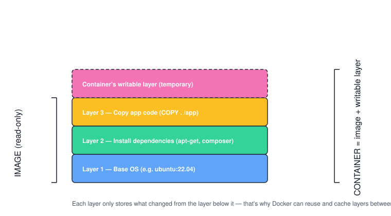

# Chapter 3 — Images vs Containers (Hands-On)

> **Course:** Docker (Zero to Hero) · **Chapter:** 3 of 8
> Read on the website: [learn.bazardev.com/docker/03-images-vs-containers](https://learn.bazardev.com/docker/03-images-vs-containers)
>
> 🇧🇩 **Prefer Bangla?** [Read this chapter in Bangla →](https://learn.bazardev.com/docker/03-images-vs-containers?lang=bn)

In Chapter 1 you learned the idea: image = recipe, container = the food made from it. Now let's get hands-on with the commands, and look a little closer at *how* an image is actually built inside, so nothing feels like magic.

## 1. A picture is worth a thousand words

Here's what an image and a container actually look like underneath:



Think of an image like a **stack of transparent sheets**, one on top of another:

- The bottom sheet is the base operating system (e.g. Ubuntu).
- The next sheet only has the *changes* needed to install your dependencies.
- The next sheet only has the *changes* needed to add your app's code.

Each sheet is called a **layer**. A layer never stores the whole filesystem again — it only stores what's *different* from the layer below it. Stack them all up, and you get the full image.

When you **run** that image, Docker adds one more sheet on top — the only one that can be written to. That's your **container**. Everything below it (the image) stays frozen/read-only; only this top sheet changes while the container runs. Delete the container, and that top sheet disappears — the image underneath is untouched.

**Why this matters in practice:** if two images both start from `ubuntu:22.04`, Docker only downloads that base layer *once* and reuses it for both. That's why pulling a second image that shares a base with one you already have is often much faster.

If you'd like to see this demonstrated step by step, this video covers exactly this part of Docker (images, layers, and the commands below) in detail:

<iframe width="560" height="315" src="https://www.youtube.com/embed/3c-iBn73dDE" title="Docker Tutorial for Beginners - TechWorld with Nana" frameborder="0" allowfullscreen></iframe>

*(GitHub doesn't play embedded videos in a README — if you're reading this on GitHub, [watch it here instead](https://www.youtube.com/watch?v=3c-iBn73dDE).)*

## 2. Commands for working with images

```bash
docker images
```
Lists every image stored locally.

```bash
docker pull nginx:1.27
```
Downloads a specific version (**tag**) of an image. If you don't specify a tag, Docker uses `latest` — but `latest` is just a label someone chose, not necessarily the newest version, so it's safer to pin a specific tag in real projects.

```bash
docker history nginx:1.27
```
Shows every layer that makes up that image, in the order they were built — this is the command version of the diagram above.

```bash
docker inspect nginx:1.27
```
Dumps detailed metadata about the image as JSON — its layers, environment variables, exposed ports, and more.

```bash
docker rmi nginx:1.27
```
Removes an image (only works if no container is using it — stop/remove those containers first).

```bash
docker image prune
```
Cleans up **dangling images** — layers left behind from old builds that nothing points to anymore. Good habit to run occasionally so disk space doesn't fill up.

## 3. Commands for working with containers

You already know `docker run`, `docker ps`, `docker stop`, and `docker rm` from Chapter 2. A few more that matter:

```bash
docker exec -it my-nginx bash
```
Opens an interactive shell **inside** a running container — as if you SSH'd into it. Extremely useful for poking around or debugging. (`-it` means interactive + attach a terminal; without it the command would run and immediately return, not give you a shell.)

```bash
docker cp my-nginx:/etc/nginx/nginx.conf ./nginx.conf
```
Copies a file **out of** a running container onto your machine (or the reverse, machine-to-container).

```bash
docker restart my-nginx
```
Stops and starts the container again — useful after changing a mounted config file.

```bash
docker pause my-nginx
docker unpause my-nginx
```
Freezes all processes inside the container without stopping it — rarely needed day to day, but good to know it exists.

## 4. Try it yourself

```bash
docker run -d -p 8080:80 --name my-nginx nginx
docker exec -it my-nginx bash
# you're now inside the container
cat /etc/os-release
exit
# back on your own machine
docker history nginx
docker rm -f my-nginx
```

Running `cat /etc/os-release` inside the container shows you the base OS layer nginx's image was built on — you've just looked directly at Layer 1 from the diagram above.

## 5. Key takeaways

- An image is a stack of read-only **layers**; each layer only stores what changed from the one below it.
- A container adds one writable layer on top of an image — delete the container, and only that top layer disappears.
- Shared base layers between images are downloaded once and reused — this is why Docker pulls are often faster than expected.
- `docker exec -it <container> bash` gives you a shell inside a running container — your go-to debugging tool.
- `docker image prune` clears out unused, dangling image layers.

## 6. Test yourself (exam prep)

<details>
<summary><strong>Q1. Why does Docker only download a base layer once, even if two images use it?</strong></summary>

Because layers are content-addressed and shared on disk. If an image needs a layer Docker already has (e.g. the same `ubuntu:22.04` base), it reuses the existing copy instead of downloading it again.
</details>

<details>
<summary><strong>Q2. What happens to a container's writable layer when the container is removed?</strong></summary>

It's deleted along with the container. The image underneath (its read-only layers) is untouched and can be used to start a brand-new container at any time.
</details>

<details>
<summary><strong>Q3. What does `docker exec -it my-nginx bash` actually do?</strong></summary>

It starts an interactive (`-i`) session with a terminal attached (`-t`) running `bash` inside the already-running `my-nginx` container — effectively giving you a shell inside that container, similar to SSH-ing into it.
</details>

<details>
<summary><strong>Q4. Why is pinning a specific tag (e.g. `nginx:1.27`) safer than using `nginx:latest`?</strong></summary>

`latest` is just a label — whoever built the image decides what it points to, and it can change over time. Pinning an exact version tag guarantees you always get the same image, which avoids surprise breakage when `latest` is updated.
</details>

## 7. Free resources

- Official docs: [Understanding image layers](https://docs.docker.com/guides/docker-concepts/building-images/understanding-image-layers/)
- Official docs: [`docker exec` reference](https://docs.docker.com/reference/cli/docker/container/exec/)
- Video: **"Docker Tutorial for Beginners [FULL COURSE in 3 Hours]"** — *TechWorld with Nana* (embedded above)

---

**Next:** [Chapter 4 — Dockerfile: Write Your Own Image →](../01-docker/04-dockerfile.md) *(coming soon)*
