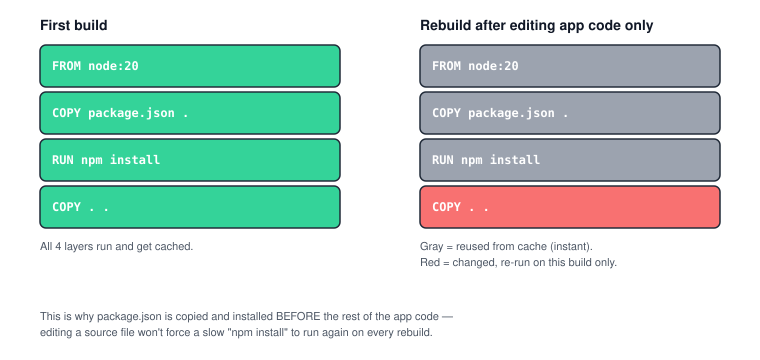

# Chapter 4 — Dockerfile: Write Your Own Image

> **Course:** Docker (Zero to Hero) · **Chapter:** 4 of 8
> Read on the website: [learn.bazardev.com/docker/04-dockerfile](https://learn.bazardev.com/docker/04-dockerfile)
>
> 🇧🇩 **Prefer Bangla?** [Read this chapter in Bangla →](https://learn.bazardev.com/docker/04-dockerfile?lang=bn)

So far you've only used images other people built (`nginx`, `hello-world`). Today you write your own. A **Dockerfile** is nothing more than a text file with step-by-step instructions for building an image — literally the recipe from Chapter 1, written down.

## 1. The instructions you'll actually use

| Instruction | What it does |
|---|---|
| `FROM` | The base image to start from (your bottom layer) |
| `WORKDIR` | Sets the "current folder" inside the image for the instructions that follow |
| `COPY` | Copies files from your machine into the image |
| `RUN` | Runs a command *while building* the image (e.g. installing packages) |
| `ENV` | Sets an environment variable inside the image |
| `EXPOSE` | Documents which port the container listens on (doesn't actually publish it — that's still `-p` at `docker run` time) |
| `CMD` | The default command that runs *when a container starts* |

## 2. A real, minimal Dockerfile

Create a folder with two files.

`app.js`:
```js
const http = require('http');
http.createServer((req, res) => res.end('Hello from inside a container!')).listen(3000);
console.log('Listening on port 3000');
```

`Dockerfile` (no file extension, exactly this name):
```dockerfile
FROM node:20-alpine
WORKDIR /app
COPY app.js .
EXPOSE 3000
CMD ["node", "app.js"]
```

Build it:
```bash
docker build -t my-first-app .
```

- `-t my-first-app` — **tags** (names) the image so you can refer to it later.
- `.` — the **build context**: the folder Docker looks in for the files your `COPY` instructions reference. (This is also why you should never run `docker build` from a folder with huge unrelated files in it — Docker has to read the whole folder first.)

Run it:
```bash
docker run -d -p 3000:3000 my-first-app
curl http://localhost:3000
```

You should see `Hello from inside a container!` — code you wrote, running inside an image you built, from a Dockerfile you wrote. That's the whole loop.

## 3. Instruction order matters — build caching

Docker caches each instruction in a Dockerfile as its own layer (this is the same layering you saw in Chapter 3). On a rebuild, if an instruction and everything above it haven't changed, Docker reuses the cached result instead of running it again — instant, instead of slow.



This is why real-world Dockerfiles separate **dependency installation** from **copying app code**:

```dockerfile
FROM node:20-alpine
WORKDIR /app
COPY package.json .
RUN npm install
COPY . .
CMD ["node", "app.js"]
```

`package.json` rarely changes, so `npm install` almost never needs to re-run. Only `COPY . .` (and anything after it) re-runs when you edit your actual source code — which makes rebuilds dramatically faster. If you instead wrote `COPY . .` *before* `npm install`, editing even a single line of code would force a full dependency reinstall every time.

## 4. `CMD` vs `ENTRYPOINT` (the common confusion)

Both specify what runs when the container starts. The practical difference:

- `CMD` is a **default** — easy to override. `docker run my-first-app node other-script.js` ignores the Dockerfile's `CMD` entirely and runs `other-script.js` instead.
- `ENTRYPOINT` is **fixed** — anything you add after the image name at `docker run` gets *appended* to it, not used to replace it.

For most simple images, `CMD` alone is all you need. `ENTRYPOINT` is for when you want the container to always behave like a specific command-line tool, no matter what arguments someone passes.

## 5. `.dockerignore`

Just like `.gitignore`, a `.dockerignore` file tells Docker which files to skip when building — keep `node_modules`, `.git`, and `vendor` out of your build context so builds stay fast and images stay small:

```
node_modules
.git
vendor
*.log
```

## 6. Key takeaways

- A Dockerfile is a text file of build instructions — `FROM`, `WORKDIR`, `COPY`, `RUN`, `EXPOSE`, `CMD`.
- `docker build -t <name> .` builds an image from the Dockerfile in the current folder.
- Order your instructions from **least** to **most** frequently changing, so caching actually saves you time.
- `CMD` is a default that can be overridden; `ENTRYPOINT` is fixed and only gets arguments appended to it.
- `.dockerignore` keeps unnecessary files out of your build context.

## 7. Test yourself (exam prep)

<details>
<summary><strong>Q1. Why does `docker build -t my-first-app .` need that trailing `.`?</strong></summary>

That `.` is the build context — the folder Docker sends to the daemon, and the folder your Dockerfile's `COPY` instructions are relative to. Without it, `docker build` doesn't know which files it's allowed to copy into the image.
</details>

<details>
<summary><strong>Q2. Why copy `package.json` and run `npm install` before copying the rest of the app code?</strong></summary>

Because Docker caches each instruction as a layer. If `package.json` hasn't changed, `npm install` can reuse its cached result instead of re-running — so editing only your source code doesn't force a slow reinstall every time you rebuild.
</details>

<details>
<summary><strong>Q3. If a Dockerfile has `CMD ["node", "app.js"]`, what happens when you run `docker run my-first-app node other.js`?</strong></summary>

The command you pass at `docker run` **replaces** `CMD` entirely, so `other.js` runs instead of `app.js`. This would behave differently with `ENTRYPOINT`, where `other.js` would be appended as an argument instead.
</details>

<details>
<summary><strong>Q4. What does `EXPOSE 3000` actually do?</strong></summary>

It's documentation — it tells anyone reading the Dockerfile (and some tooling) which port the app listens on inside the container. It does **not** publish that port to your host machine; you still need `-p 3000:3000` at `docker run` time for that.
</details>

## 8. Free resources

- Official docs: [Dockerfile reference](https://docs.docker.com/reference/dockerfile/)
- Official docs: [Best practices for writing Dockerfiles](https://docs.docker.com/build/building/best-practices/)
- Video: **"Docker Tutorial for Beginners [FULL COURSE in 3 Hours]"** — *TechWorld with Nana* (includes a full Dockerfile walkthrough)

---

**Next:** [Chapter 5 — Volumes & Networking →](../01-docker/05-volumes-and-networking.md) *(coming soon)*
