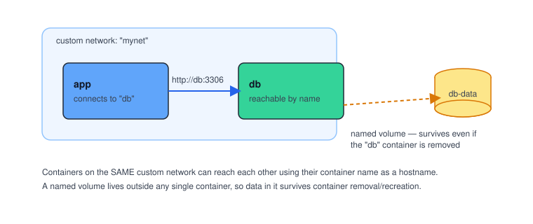

# Chapter 5 — Volumes & Networking

> **Course:** Docker (Zero to Hero) · **Chapter:** 5 of 8
> Read on the website: [learn.bazardev.com/docker/05-volumes-and-networking](https://learn.bazardev.com/docker/05-volumes-and-networking)
>
> 🇧🇩 **Prefer Bangla?** [Read this chapter in Bangla →](https://learn.bazardev.com/docker/05-volumes-and-networking?lang=bn)

Two things trip up almost everyone learning Docker: **where does my data actually live**, and **how do my containers talk to each other**. Both get much simpler once you see them drawn out.



If you want this shown step by step with real commands, this video covers both topics well:

<iframe width="560" height="315" src="https://www.youtube.com/embed/5grbXvV_DSk" title="Docker Networking Tutorial - Christian Lempa" frameborder="0" allowfullscreen></iframe>

*(GitHub doesn't play embedded videos in a README — if you're reading this on GitHub, [watch it here instead](https://www.youtube.com/watch?v=5grbXvV_DSk).)*

## 1. The problem: containers are disposable

Remember from Chapter 3: a container's writable layer disappears the moment you remove the container. That's great for apps (clean, disposable, restart from scratch) — but terrible for a **database**. If you `docker rm` your MySQL container, you do not want to lose every row of data you ever saved.

**Volumes** solve this: they live *outside* any single container, so you can remove and recreate the container as many times as you like, and the data in the volume stays put.

```bash
docker volume create db-data
docker run -d --name my-db -v db-data:/var/lib/mysql -e MYSQL_ROOT_PASSWORD=secret mysql:8
```

- `docker volume create db-data` — makes a named volume, managed entirely by Docker.
- `-v db-data:/var/lib/mysql` — mounts that volume at `/var/lib/mysql` *inside* the container, which is exactly where MySQL stores its data files.

Now try this:

```bash
docker rm -f my-db
docker run -d --name my-db -v db-data:/var/lib/mysql -e MYSQL_ROOT_PASSWORD=secret mysql:8
```

Even though you deleted the container and started a brand-new one, all your previous data is still there — because it never lived inside the container to begin with. It lived in `db-data`.

```bash
docker volume ls
docker volume inspect db-data
docker volume rm db-data
```

### Named volumes vs. bind mounts

There's a second, related flag worth knowing — a **bind mount**, which maps an actual folder from your machine directly into the container:

```bash
docker run -d -p 3000:3000 -v $(pwd)/src:/app/src my-first-app
```

| | Named volume (`-v db-data:/path`) | Bind mount (`-v $(pwd)/src:/path`) |
|---|---|---|
| Managed by | Docker itself | You — it's a real folder on your machine |
| Best for | Databases, anything you want Docker to manage and back up | Live-editing code during local development |
| Where it lives | Docker's internal storage area | Wherever you point it, on your machine |

## 2. The problem: containers can't see each other by default

Start two containers separately, and by default they're isolated from each other — `app` has no idea `db` exists. For a real application (an app server talking to a database), they need to communicate.

```bash
docker network create mynet
docker run -d --name db --network mynet -e MYSQL_ROOT_PASSWORD=secret mysql:8
docker run -d --name app --network mynet my-first-app
```

Here's the part that feels like magic the first time you see it: because both containers are on the same custom network (`mynet`), the `app` container can reach the `db` container simply by using its **name** — `db` — as if it were a hostname:

```bash
docker exec -it app ping db
```

Docker runs a built-in DNS server on every custom network, so container names resolve to the right internal IP addresses automatically. You never have to hardcode an IP address that might change.

```bash
docker network ls
docker network inspect mynet
```

**Important nuance:** this automatic name-based lookup only works on a **custom** network you created (`docker network create ...`). Containers started on Docker's default network (if you don't specify `--network` at all) can't reliably reach each other by name — which is exactly why real projects always create a dedicated network, and why Chapter 6 (Docker Compose) does this for you automatically.

## 3. Key takeaways

- A container's own storage disappears when the container is removed — **volumes** exist outside the container so data survives.
- `-v <volume-name>:/path` mounts a Docker-managed named volume; `-v /host/path:/path` bind-mounts a real folder from your machine.
- Containers on a **custom network** can reach each other by container name — Docker provides DNS resolution automatically.
- Containers on Docker's default network cannot reliably reach each other by name — always create a custom network for multi-container setups.

## 4. Test yourself (exam prep)

<details>
<summary><strong>Q1. If you remove a database container without a volume attached, what happens to its data?</strong></summary>

It's lost. The data lived only in the container's writable layer, which is deleted along with the container. This is exactly why a named volume should always back a database container's data directory.
</details>

<details>
<summary><strong>Q2. What's the difference between a named volume and a bind mount?</strong></summary>

A named volume is created and managed entirely by Docker, in Docker's own storage area — ideal for databases. A bind mount points directly at a real folder on your machine, which is ideal for live-editing source code during development, since changes on your machine show up inside the container instantly.
</details>

<details>
<summary><strong>Q3. Why can the `app` container reach `db` just by using "db" as a hostname?</strong></summary>

Because both containers were started on the same custom Docker network, and Docker runs a built-in DNS server on that network that automatically resolves container names to their internal IP addresses.
</details>

<details>
<summary><strong>Q4. Why doesn't this name-based lookup work if you don't create a custom network first?</strong></summary>

Docker's automatic DNS resolution between containers is a feature of custom (user-defined) networks. Containers left on Docker's default network don't get the same reliable name resolution, which is why real-world multi-container setups always create a dedicated network.
</details>

## 5. Free resources

- Official docs: [Manage data in Docker](https://docs.docker.com/storage/)
- Official docs: [Docker networking overview](https://docs.docker.com/engine/network/)
- Video: **"Docker Networking Tutorial // ALL Network Types explained!"** — *Christian Lempa* (embedded above)

---

**Next:** [Chapter 6 — Docker Compose: Multi-Container Apps →](../01-docker/06-docker-compose.md) *(coming soon)*
