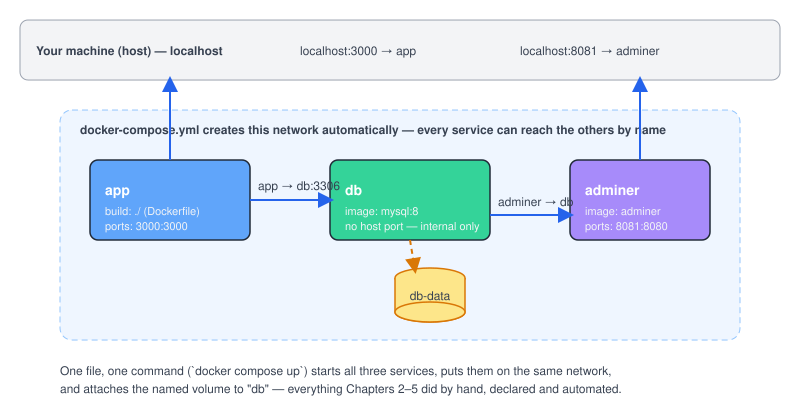

# Chapter 6 — Docker Compose: Multi-Container Apps

> **Course:** Docker (Zero to Hero) · **Chapter:** 6 of 8
> Read on the website: [learn.bazardev.com/docker/06-docker-compose](https://learn.bazardev.com/docker/06-docker-compose)
>
> 🇧🇩 **Prefer Bangla?** [Read this chapter in Bangla →](https://learn.bazardev.com/docker/06-docker-compose?lang=bn)

Take your time with this one — it's the chapter where everything you've learned so far (images, containers, volumes, networks) stops being separate ideas and becomes one practical skill. Read it slowly, type out the example yourself, and it will click.

## 1. The problem, stated plainly

In Chapter 5, to run an app and a database together, you had to type four separate commands, in a specific order, and remember all of them:

```bash
docker network create mynet
docker volume create db-data
docker run -d --name db --network mynet -v db-data:/var/lib/mysql -e MYSQL_ROOT_PASSWORD=secret mysql:8
docker run -d --name app --network mynet -p 3000:3000 my-first-app
```

That's already a lot to remember for just **two** containers. Real applications often have three, four, or more (app, database, cache, admin tool...). Typing this every time — and getting the order right every time — doesn't scale, and it's impossible to share with a teammate except by copy-pasting a list of commands into a chat message.

**Docker Compose** fixes this: you describe your entire multi-container setup — every service, how they connect, what data they persist — in **one file**. Then one command brings the whole thing up, exactly the same way, every single time, on any machine.

## 2. Checking you have it

Modern Docker already includes Compose, built into the CLI (notice the **space**, not a hyphen):

```bash
docker compose version
```

(You may see tutorials referencing `docker-compose` with a hyphen — that was the older, separate tool. `docker compose` with a space is the current, built-in version. Both do roughly the same job, but use the space version going forward.)

## 3. The big picture, before the file

Here's what we're about to build — three services, one shared network Compose creates automatically, one persistent volume:



Keep this picture in mind while reading the file below — every line in it maps directly to something you see here.

## 4. Reading a Compose file, slowly, piece by piece

Here is a complete, real `docker-compose.yml` — the same app + database from Chapter 5, plus one more service for free. Don't rush past this; read every line and connect it back to a command you already know.

```yaml
services:
  app:
    build: .
    ports:
      - "3000:3000"
    environment:
      - DB_HOST=db
    depends_on:
      - db

  db:
    image: mysql:8
    environment:
      - MYSQL_ROOT_PASSWORD=secret
      - MYSQL_DATABASE=myapp
    volumes:
      - db-data:/var/lib/mysql

  adminer:
    image: adminer
    ports:
      - "8081:8080"
    depends_on:
      - db

volumes:
  db-data:
```

Walking through it:

- **`services:`** — each block underneath is one container, called a "service" in Compose terms. We have three: `app`, `db`, `adminer`.
- **`app: build: .`** — instead of `image:`, this tells Compose to **build an image from the Dockerfile in the current folder** (the one you wrote in Chapter 4), rather than pulling a ready-made one.
- **`ports: - "3000:3000"`** — exactly the same meaning as `-p 3000:3000` from Chapter 2.
- **`environment:`** — the same idea as `-e` flags. Here's a crucial detail: `DB_HOST=db` tells your app code to connect to a database host named `db` — not `localhost`, not an IP address, just the **service name**. This works because of exactly what you learned in Chapter 5: Compose automatically creates a network, and every service can reach every other service by name on it. You never typed `docker network create` anywhere in this file — Compose does it for you, silently, every time.
- **`depends_on: - db`** — tells Compose to start `db` before `app`. (An important nuance below — don't skip it.)
- **`db: image: mysql:8`** plus **`volumes: - db-data:/var/lib/mysql`** — exactly the named-volume pattern from Chapter 5, just written declaratively instead of typed as a `-v` flag.
- **`adminer`** — a free, tiny web-based database admin tool. It needs zero configuration to find your database, because (again) it can simply reach it at the hostname `db`.
- **`volumes: db-data:`** (top level, outside `services:`) — this declares that `db-data` is a real named volume Compose should manage, the same as `docker volume create db-data`.

## 5. Running it

```bash
docker compose up -d
```

That's the entire command. Compose will:
1. Build the `app` image from your Dockerfile (only if it hasn't built it before, or if the Dockerfile changed — caching from Chapter 4 still applies).
2. Pull `mysql:8` and `adminer` if you don't have them.
3. Create the shared network.
4. Create the `db-data` volume if it doesn't exist.
5. Start all three containers, connected, in the right order.

Now check it worked:

```bash
docker compose ps
curl http://localhost:3000
```

And open `http://localhost:8081` (or `http://<your-server-ip>:8081`) in a browser — that's Adminer. Log in with server `db`, username `root`, password `secret` (from the compose file), and you're looking at the actual MySQL database running inside the `db` container, through a web UI, with zero setup.

## 6. The everyday commands

```bash
docker compose logs -f app       # follow one service's logs live
docker compose ps                # see all services and their status
docker compose exec app bash     # shell into the "app" service (same idea as docker exec)
docker compose restart app       # restart just one service
docker compose stop              # stop everything, keep containers and volumes
docker compose down              # stop AND remove the containers (volumes survive)
docker compose down -v           # stop, remove containers, AND delete volumes — this deletes your data, use carefully
docker compose build             # rebuild images without starting containers
```

**The one command to be careful with:** `docker compose down -v`. The `-v` also removes volumes — which means your database data goes with it. `docker compose down` on its own is safe; your `db-data` volume survives, exactly like Chapter 5 taught you.

## 7. An important `depends_on` nuance

`depends_on` only waits for the `db` **container to start** — not for MySQL *inside* it to actually finish booting up and be ready to accept connections. Those are two different moments in time; MySQL can take a few extra seconds after its container starts before it's truly ready.

In practice, this means your `app` container might try to connect to the database a moment too early and fail on its very first attempt. The common, practical fixes are:
- Have your app retry the database connection a few times on startup instead of giving up immediately (most frameworks, including Laravel, already do this if configured).
- Add a `healthcheck` to the `db` service and a `condition: service_healthy` to `depends_on` (a more advanced pattern — good to know exists, you'll meet it again if you go deeper into Compose later).

For now, just remember: **`depends_on` controls start order, not readiness.** This single fact saves hours of confused debugging later.

## 8. Key takeaways

- Docker Compose describes a whole multi-container application in one YAML file instead of a list of manual commands.
- `build: .` builds from your own Dockerfile; `image:` pulls a ready-made one — a single file can mix both.
- Compose automatically creates a shared network for all services in the file — every service reaches every other one by its **service name**, with zero manual `docker network create`.
- Top-level `volumes:` declares named volumes, exactly like `docker volume create`, just written declaratively.
- `docker compose up -d` starts everything; `docker compose down` stops and removes containers but keeps volumes; `docker compose down -v` deletes volumes too — be careful with that one.
- `depends_on` only guarantees **start order**, not that the dependency is actually ready to accept connections yet.

## 9. Test yourself (exam prep)

<details>
<summary><strong>Q1. In the compose file above, why does the app's environment variable say `DB_HOST=db` and not `DB_HOST=localhost`?</strong></summary>

Because the database isn't running on the app's own "localhost" — it's a separate container. Compose puts every service in the file on the same auto-created network, where each service is reachable by its service name. `db` is simply the hostname the app container should use to reach the database container.
</details>

<details>
<summary><strong>Q2. What's the practical difference between `docker compose down` and `docker compose down -v`?</strong></summary>

Both stop and remove the containers. `-v` additionally deletes the named volumes used by those services — meaning any data stored in them (like your database's data) is permanently deleted. Without `-v`, volumes survive and your data is intact the next time you run `docker compose up`.
</details>

<details>
<summary><strong>Q3. Does `depends_on: - db` guarantee that MySQL is ready to accept connections before the `app` service starts?</strong></summary>

No — it only guarantees the `db` container has started. MySQL itself may still be initializing inside that container for a few more seconds. An app that assumes the database is immediately ready can fail its very first connection attempt; it should retry, or the compose file should use a proper healthcheck.
</details>

<details>
<summary><strong>Q4. In the example, why does `app` use `build: .` while `db` and `adminer` use `image: ...`?</strong></summary>

`app` is your own code, so Compose needs to build an image from your Dockerfile in the current folder. `db` and `adminer` are standard, ready-made tools you didn't write, so there's no need to build them — Compose just pulls their published images from Docker Hub.
</details>

<details>
<summary><strong>Q5. If you add a fourth service called `redis` to this file, do you need to run `docker network create` for it to talk to `app`?</strong></summary>

No. Every service declared in the same `docker-compose.yml` is automatically placed on the same Compose-managed network and can reach every other service by name — that's the whole point of Compose handling networking for you.
</details>

## 10. Free resources

- Official docs: [Docker Compose overview](https://docs.docker.com/compose/)
- Official docs: [Compose file reference](https://docs.docker.com/reference/compose-file/)
- Video: **"Docker Tutorial for Beginners [FULL COURSE in 3 Hours]"** — *TechWorld with Nana* (its later sections cover Compose in depth)

---

**Next:** [Chapter 7 — Best Practices + Debugging →](../01-docker/07-best-practices-debugging.md) *(coming soon)*
