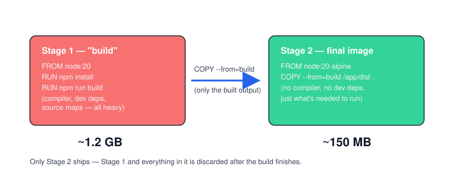

# Chapter 7 — Best Practices + Debugging

> **Course:** Docker (Zero to Hero) · **Chapter:** 7 of 8
> Read on the website: [learn.bazardev.com/docker/07-best-practices-debugging](https://learn.bazardev.com/docker/07-best-practices-debugging)
>
> 🇧🇩 **Prefer Bangla?** [Read this chapter in Bangla →](https://learn.bazardev.com/docker/07-best-practices-debugging?lang=bn)

Everything so far has focused on making things *work*. This chapter is about making them work **well** — smaller images, safer containers — and what to do when something breaks, because something always eventually breaks.

## 1. Multi-stage builds — the single biggest size win

Your Chapter 4 Dockerfile installs build tools, dev dependencies, and your source code all into one final image. Most of that is only needed *while building*, not while *running*. A **multi-stage build** keeps the heavy stuff in one throwaway stage, and copies only the finished result into a small final image.



```dockerfile
# Stage 1: build (this image is big, and that's fine — it never gets shipped)
FROM node:20 AS build
WORKDIR /app
COPY package.json .
RUN npm install
COPY . .
RUN npm run build

# Stage 2: final (small, this is what actually ships)
FROM node:20-alpine
WORKDIR /app
COPY --from=build /app/dist ./dist
COPY --from=build /app/node_modules ./node_modules
CMD ["node", "dist/main.js"]
```

`AS build` names the first stage. `COPY --from=build` in the second stage reaches *back* into that first stage and copies only the specific files you ask for. Everything else from Stage 1 — the compiler, the dev dependencies, the full `node_modules` before pruning — is simply thrown away. Your final image only contains what Stage 2 explicitly copied in.

The result in the real world: images routinely shrink from well over a gigabyte down to under 200MB. Smaller images pull faster, start faster, and have a smaller attack surface.

## 2. Don't run as root inside the container

By default, a container runs as the `root` user *inside the container*. If an attacker ever breaks out of your app through a vulnerability, running as root makes their job much easier. Fix it in your Dockerfile:

```dockerfile
FROM node:20-alpine
WORKDIR /app
COPY . .
RUN addgroup -S appgroup && adduser -S appuser -G appgroup
USER appuser
CMD ["node", "app.js"]
```

`USER appuser` switches every instruction after it — and the running container itself — to that non-root user. Many official images (like recent `node` and `postgres` images) already include a ready-made non-root user for you; check an image's documentation on Docker Hub before building your own.

## 3. Never bake secrets into an image

```dockerfile
# DON'T do this:
ENV DB_PASSWORD=supersecret123
COPY .env .
```

Anything baked into an image with `ENV` or `COPY` is visible to anyone who can run `docker history` or `docker inspect` on it — even after you "remove" it in a later layer, it's often still sitting in an earlier one (remember Chapter 3: layers are a stack, not a single merged file). Instead:

- Pass secrets at **runtime**, not build time: `docker run -e DB_PASSWORD=secret ...`, or an `environment:` block in Compose fed from a `.env` file that is never committed to git.
- For anything more sensitive in production, use [Docker secrets](https://docs.docker.com/engine/swarm/secrets/) or your hosting platform's secret manager, not plain environment variables.

## 4. A quick checklist of smaller habits

- **Pin exact versions** (`node:20.11-alpine`, not `node:latest`) — Chapter 3 covered why.
- **Order instructions least-to-most-frequently-changing** — Chapter 4 covered the caching reason.
- **Use `.dockerignore`** to keep `node_modules`, `.git`, and `vendor` out of your build context.
- **Prefer `COPY` over `ADD`** unless you specifically need `ADD`'s extra behavior (auto-extracting tar files, fetching remote URLs) — `COPY` is simpler and more predictable, and that's usually all you need.
- **Add a `HEALTHCHECK`** so Docker (and Compose) can actually tell whether your app is working, not just "running":
  ```dockerfile
  HEALTHCHECK --interval=30s --timeout=3s CMD curl -f http://localhost:3000/ || exit 1
  ```
  This is exactly what Chapter 6's `depends_on` nuance was pointing toward — a healthcheck gives Compose a real signal to wait for, instead of just "the container started."

## 5. Debugging: your toolkit when something breaks

```bash
docker logs my-container          # see everything the container has printed
docker logs -f my-container       # follow logs live, like `tail -f`
docker logs --tail 50 my-container  # just the last 50 lines
```

```bash
docker exec -it my-container sh   # get a shell inside it and look around
docker inspect my-container       # full JSON dump: env vars, mounts, network, exit code, everything
```

```bash
docker ps -a                      # see every container, including stopped/crashed ones
docker inspect --format='{{.State.ExitCode}}' my-container   # just the exit code
```

### Reading exit codes

| Exit code | Usually means |
|---|---|
| `0` | Exited cleanly — the process finished its job on purpose |
| `1` | A general application error — check `docker logs` |
| `137` | Killed — very often **OOMKilled** (it ran out of memory) |
| `139` | Segmentation fault inside the process |
| `143` | Received a graceful stop signal (e.g. `docker stop`) |

If you see `137`, your first move should be `docker inspect my-container` and look for `"OOMKilled": true` — the fix is usually giving the container more memory, or finding a memory leak in the app itself.

### Common error messages and what they actually mean

| Error | What's really happening |
|---|---|
| `port is already allocated` | Something else on your machine is already using that host port — change the `-p` mapping or stop the other process |
| `Cannot connect to the Docker daemon` | The Docker service isn't running, or your user isn't in the `docker` group (Chapter 2) |
| `no such file or directory` during build | A `COPY` instruction references a file that isn't in your build context — check `.dockerignore` and your folder structure |
| `exec format error` | The image was built for a different CPU architecture than the one you're running it on (common when pulling an `amd64` image on an Apple Silicon Mac, or vice versa) |

### Keeping your machine clean

Images, containers, and volumes you don't need anymore quietly eat disk space. Check and clean them up occasionally:

```bash
docker system df       # see how much space images/containers/volumes are using
docker system prune    # remove stopped containers, unused networks, and dangling images
docker stats           # live view of CPU/memory usage per running container
```

## 6. Key takeaways

- Multi-stage builds keep heavy build tools out of your final image — often cutting image size by 80% or more.
- Run containers as a non-root user; never bake secrets into an image with `ENV` or `COPY`.
- Pin versions, order instructions for caching, use `.dockerignore`, prefer `COPY` over `ADD`, and add a `HEALTHCHECK`.
- `docker logs`, `docker exec`, and `docker inspect` are your three go-to debugging tools.
- Exit code `137` almost always means the container was killed for using too much memory (OOMKilled).
- `docker system prune` and `docker system df` keep your disk from quietly filling up with unused images and containers.

## 7. Test yourself (exam prep)

<details>
<summary><strong>Q1. Why does a multi-stage build produce a smaller final image than a single-stage one?</strong></summary>

Because only the final stage actually ships. Earlier stages (which can include compilers, build tools, and full dev dependencies) are used only to produce build output, and everything about them besides what you explicitly `COPY --from=` is discarded.
</details>

<details>
<summary><strong>Q2. Why is `COPY .env .` in a Dockerfile considered a security mistake?</strong></summary>

Because that `.env` file's contents get baked into an image layer, visible to anyone who can run `docker history` or inspect the image — even if a later instruction deletes the file, the layer containing it is often still there underneath. Secrets should be passed at runtime instead (e.g. `docker run -e`), not baked in at build time.
</details>

<details>
<summary><strong>Q3. A container exits with code 137 — what should you check first?</strong></summary>

Run `docker inspect` on it and look for `"OOMKilled": true`. Exit code 137 almost always means the container was killed because it used more memory than it was allowed — the fix is usually raising its memory limit or fixing a memory leak in the app.
</details>

<details>
<summary><strong>Q4. What's the practical difference between `docker logs` and `docker exec -it ... sh`?</strong></summary>

`docker logs` shows you what the container has already printed — useful for seeing what happened. `docker exec -it ... sh` gives you an active shell inside the running container right now — useful for poking around, checking files, or testing something live.
</details>

## 8. Free resources

- Official docs: [Dockerfile best practices](https://docs.docker.com/build/building/best-practices/)
- Official docs: [Multi-stage builds](https://docs.docker.com/build/building/multi-stage/)
- Official docs: [`docker system prune` reference](https://docs.docker.com/reference/cli/docker/system/prune/)

---

**Next:** [Chapter 8 — Real Project: Dockerize a Laravel App →](../01-docker/08-real-project-laravel-dockerize.md) *(coming soon)*
