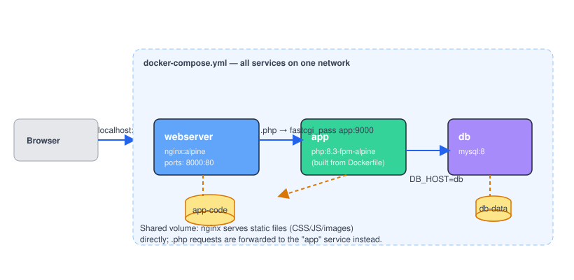

# Chapter 8 — Real Project: Dockerize a Laravel App

> **Course:** Docker (Zero to Hero) · **Chapter:** 8 of 8 (final chapter!)
> Read on the website: [learn.bazardev.com/docker/08-real-project-laravel-dockerize](https://learn.bazardev.com/docker/08-real-project-laravel-dockerize)
>
> 🇧🇩 **Prefer Bangla?** [Read this chapter in Bangla →](https://learn.bazardev.com/docker/08-real-project-laravel-dockerize?lang=bn)

This is where every chapter comes together. Multi-stage Dockerfiles (Ch7), Compose (Ch6), volumes and networking (Ch5), caching and layers (Ch3-4), non-root users and healthchecks (Ch7) — all of it, applied to one real, working Laravel application.

## 1. The shape of a real Laravel deployment

A Laravel app in production is never just "one container." It's normally **three separate pieces working together**:

- **`app`** — PHP-FPM, which actually executes your Laravel code.
- **`webserver`** — nginx, which accepts incoming HTTP requests, serves static files (CSS, JS, images) directly, and forwards anything ending in `.php` to `app`.
- **`db`** — MySQL, storing your application's data.

(Why not just one container running `php artisan serve`? Because that built-in server is explicitly documented as a development convenience, not something designed to handle real production traffic. nginx + PHP-FPM is the standard, battle-tested combination.)



## 2. The Dockerfile — multi-stage, non-root, production-minded

```dockerfile
# Stage 1: install PHP dependencies with Composer (this stage is never shipped)
FROM composer:2 AS vendor
WORKDIR /app
COPY composer.json composer.lock ./
RUN composer install --no-dev --no-scripts --no-interaction --prefer-dist

# Stage 2: the actual PHP-FPM runtime that ships
FROM php:8.3-fpm-alpine
RUN docker-php-ext-install pdo pdo_mysql

WORKDIR /var/www/html
COPY --from=vendor /app/vendor ./vendor
COPY . .

# Laravel needs to WRITE to these two folders at runtime (logs, compiled views, cache)
RUN addgroup -S laravel && adduser -S laravel -G laravel \
    && chown -R laravel:laravel storage bootstrap/cache

# Bake in the production performance caches (Chapter 7's "best practices" in action)
RUN php artisan config:cache && php artisan route:cache && php artisan view:cache

USER laravel
EXPOSE 9000
HEALTHCHECK --interval=30s --timeout=3s CMD php artisan --version || exit 1
CMD ["php-fpm"]
```

Every line here is something you've already learned:
- **Stage 1 / Stage 2** — the exact multi-stage pattern from Chapter 7: Composer and its cache never make it into the final image.
- **`chown -R laravel:laravel storage bootstrap/cache`** — this is the single most common real-world Laravel-in-Docker bug: Laravel needs to *write* to `storage/` and `bootstrap/cache/` while running, and if those folders still belong to `root` after you `USER laravel`, every request fails with a permission error. Fixing ownership **before** switching users is exactly why this line exists.
- **`config:cache`, `route:cache`, `view:cache`** — baking these in at build time means your app never re-parses config/route files on every request in production — a real performance win, done the "best practices" way: at build time, not as a manual step someone forgets to run.
- **`HEALTHCHECK`** — straight from Chapter 7, so Compose (and any orchestrator) can tell if the app is actually alive, not just "started."

## 3. nginx configuration (`docker/nginx.conf`)

```nginx
server {
    listen 80;
    index index.php index.html;
    root /var/www/html/public;

    location / {
        try_files $uri $uri/ /index.php?$query_string;
    }

    location ~ \.php$ {
        fastcgi_pass app:9000;
        fastcgi_index index.php;
        fastcgi_param SCRIPT_FILENAME $document_root$fastcgi_script_name;
        include fastcgi_params;
    }

    location ~ /\.(?!well-known).* {
        deny all;
    }
}
```

The one line to really notice: **`fastcgi_pass app:9000`**. Not an IP address, not `localhost` — just `app`, the service name. This is Chapter 5 and Chapter 6's lesson, used for real: nginx and PHP-FPM are two separate containers, and they find each other purely by the name Compose gives them on its shared network.

## 4. `docker-compose.yml`

```yaml
services:
  app:
    build: .
    volumes:
      - app-code:/var/www/html
    env_file: .env
    environment:
      - DB_HOST=db
    depends_on:
      - db

  webserver:
    image: nginx:alpine
    ports:
      - "8000:80"
    volumes:
      - app-code:/var/www/html
      - ./docker/nginx.conf:/etc/nginx/conf.d/default.conf:ro
    depends_on:
      - app

  db:
    image: mysql:8
    environment:
      - MYSQL_DATABASE=laravel
      - MYSQL_ROOT_PASSWORD=secret
    volumes:
      - db-data:/var/lib/mysql

volumes:
  app-code:
  db-data:
```

A detail worth slowing down for: **why do `app` and `webserver` both mount the same `app-code` volume?** nginx needs direct access to the `public/` folder to serve static files (CSS, JS, images) efficiently by itself, without bothering PHP at all — only requests ending in `.php` get forwarded to `app`. For nginx to serve those files, it needs the same codebase on disk that `app` has.

Here's the genuinely useful Docker behavior this relies on: when a **named volume** is empty and gets mounted into a container at a path that already has files from the image (here, `/var/www/html`, populated by `COPY . .` in the Dockerfile), Docker automatically copies that initial content into the volume the first time. That's how `webserver` — which never ran any `COPY` of its own — ends up with your app's code available to serve. This is the same `volumes:` mechanism from Chapter 5, just relied on in a new, very practical way.

## 5. Running it

```bash
cp .env.example .env
docker compose up -d --build
docker compose exec app php artisan key:generate
docker compose exec app php artisan migrate
```

Visit `http://localhost:8000` — nginx serving your Laravel app's static assets directly, PHP requests handled by the `app` container, data stored in MySQL inside `db`, with a persistent volume so a `docker compose down` (without `-v`!) never loses your data.

A few commands you'll use constantly from here on:

```bash
docker compose logs -f app         # watch Laravel's logs live
docker compose exec app bash       # shell into the app container
docker compose exec app php artisan tinker   # Laravel's REPL, inside the container
docker compose down                # stop everything, keep your data
```

## 6. Where to go from here

You could extend this setup the exact same way, using nothing but what you already know:
- **Add Redis** for cache/queues: another service block, `image: redis:alpine`, and `CACHE_DRIVER=redis` in your `.env` — it joins the same network automatically, exactly like `db` did.
- **Add a queue worker**: a second service using the *same* `app` image, but with `command: php artisan queue:work` overriding the default `CMD`.
- **Push images to a registry** and deploy this same `docker-compose.yml` (or its production equivalent) on a real server — the whole point of everything in this course is that it behaves identically wherever it runs.

## 7. Key takeaways

- A real Laravel deployment is normally three containers: nginx (`webserver`), PHP-FPM (`app`), and a database (`db`) — not one container running `php artisan serve`.
- `chown` the `storage/` and `bootstrap/cache/` folders to your non-root user *before* switching to it with `USER` — this is the single most common real-world Docker+Laravel bug.
- Baking `config:cache`, `route:cache`, and `view:cache` into the image at build time is a genuine production performance practice, not just busywork.
- `fastcgi_pass app:9000` in nginx's config is the same service-name networking you learned in Chapters 5 and 6, just used for real.
- A named volume shared between two services, pre-filled from the image's own files, is how `webserver` gets access to the same codebase as `app` without duplicating anything.

## 8. Test yourself (exam prep)

<details>
<summary><strong>Q1. Why does a real Laravel deployment typically use three containers instead of one?</strong></summary>

Because `php artisan serve` is a development convenience, not meant for production traffic. The standard production setup separates the web server (nginx, serving static files and routing requests) from the PHP runtime (PHP-FPM, executing your app code) from the database — each with a distinct, well-tested job.
</details>

<details>
<summary><strong>Q2. What real bug does `chown -R laravel:laravel storage bootstrap/cache` prevent?</strong></summary>

Laravel needs write access to `storage/` (logs, cached views, uploaded files) and `bootstrap/cache/` (compiled config/route caches) while running. If those folders are still owned by `root` when the container switches to a non-root user via `USER`, every request that tries to write to them fails with a permission error.
</details>

<details>
<summary><strong>Q3. In the nginx config, what does `fastcgi_pass app:9000` actually rely on?</strong></summary>

Docker Compose's automatic service-name networking (Chapters 5 and 6): nginx and the PHP-FPM container are separate containers on the same Compose-created network, so nginx can reach PHP-FPM simply by using its service name, `app`, as a hostname.
</details>

<details>
<summary><strong>Q4. Why do both `app` and `webserver` mount the same `app-code` volume?</strong></summary>

So nginx (`webserver`) can serve static files like CSS and JS directly from the codebase without needing PHP involved at all, while still forwarding `.php` requests to `app`. Since a fresh named volume gets pre-filled from the image's own files the first time it's mounted, `webserver` ends up with the same codebase as `app` without ever running its own `COPY`.
</details>

## 9. Free resources

- Official docs: [Dockerizing a PHP application](https://docs.docker.com/guides/php/)
- Official image docs: [`php` on Docker Hub](https://hub.docker.com/_/php) (the `-fpm-alpine` variants used here)
- Official image docs: [`nginx` on Docker Hub](https://hub.docker.com/_/nginx)

---

**That's the full course.** Image → container → volume → network → Dockerfile → Compose → best practices → a real deployment — you've gone from zero to a working, production-shaped setup. 🎉

Next up on [learn.bazardev.com](https://learn.bazardev.com): **Linux & Shell Basics** — coming soon.
