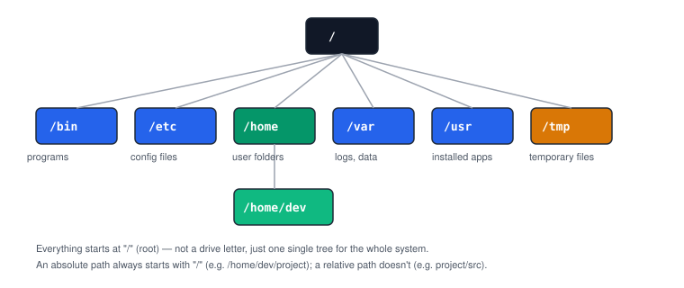

# Chapter 1 — Why Linux, and Finding Your Way Around

> **Course:** Linux & Shell Basics · **Chapter:** 1 of 8
> Read on the website: [learn.bazardev.com/linux-shell/01-finding-your-way-around](https://learn.bazardev.com/linux-shell/01-finding-your-way-around)
>
> 🇧🇩 **Prefer Bangla?** [Read this chapter in Bangla →](https://learn.bazardev.com/linux-shell/01-finding-your-way-around?lang=bn)

Every chapter in the Docker course assumed you could already open a terminal and move around a server comfortably. This course goes back and builds that skill properly — because it's the one skill every other DevOps topic quietly depends on.

## 1. Why servers run Linux

Almost every server you'll ever touch as a developer — the one hosting this very course, the ones running Docker containers from the last course, cloud VMs, Raspberry Pis — runs Linux. Not because Windows or macOS are bad, but because Linux is free, extremely stable for long-running unattended machines, and lets you automate absolutely everything through text commands instead of clicking through menus.

That last part is the real reason it matters to you: **everything in Linux can be done, scripted, and repeated with text commands.** That's exactly what makes servers automatable — and automating repetitive work is most of what "DevOps" actually means.

## 2. The shell: typing instead of clicking

The **shell** (also called the terminal, or command line) is a program that takes the commands you type, runs them, and shows you the result as text. There's no desktop, no icons — just you, a blinking cursor, and whatever you type.

This feels slower at first than clicking through a file manager. It becomes faster than any GUI once you know the handful of commands in this chapter, because you never have to context-switch or hunt through menus — you just type exactly what you want.

## 3. The filesystem: one tree, not drive letters

If you're coming from Windows, forget `C:\`, `D:\`, and separate drive letters. Linux has exactly **one** tree of files and folders, starting from a single root: `/`.



A few folders you'll run into constantly:

| Folder | What lives there |
|---|---|
| `/home/<username>` | Your personal files — this is "your corner" of the system |
| `/etc` | Configuration files for almost everything on the system |
| `/var` | Logs, databases, and other data that changes while the system runs |
| `/usr` | Installed programs and their supporting files |
| `/tmp` | Temporary files — anything here can be wiped on reboot, so never store anything important here |

### Absolute vs relative paths

An **absolute path** always starts from `/` and describes the exact same location no matter where you currently are:
```
/home/dev/projects/shop.bazardev.com
```

A **relative path** describes a location *relative to where you currently are*:
```
projects/shop.bazardev.com
```

If you're not already inside `/home/dev`, that relative path points somewhere completely different (or nowhere at all). When in doubt — especially in scripts — use absolute paths.

## 4. The core three: `pwd`, `ls`, `cd`

```bash
pwd
```
**P**rint **W**orking **D**irectory — tells you exactly where you currently are in the filesystem. This is the very first command to run when you feel lost.

```bash
ls
```
**L**i**s**t — shows what's inside your current folder. Two flags you'll use constantly:
```bash
ls -l     # long format: permissions, owner, size, modified date — one entry per line
ls -a     # "all" — also shows hidden files (anything starting with a dot, like .env or .gitignore)
ls -la    # both together, the combination you'll type the most
```

```bash
cd some-folder
```
**C**hange **D**irectory — moves you into `some-folder`. A few shortcuts worth memorizing:

| Command | Goes to |
|---|---|
| `cd ..` | One folder **up** |
| `cd ~` | Your home folder, from anywhere |
| `cd -` | The **previous** folder you were in (a quick way to jump back and forth between two places) |
| `cd /` | All the way to the root |

## 5. Try it yourself

```bash
pwd                      # where am I?
cd /                      # go to the root
ls -la                    # see everything here, including hidden files
cd home                   # go into /home
ls                        # see which users have a home folder
cd ~                      # jump straight back to your own home folder
pwd                       # confirm you're back
```

Do this slowly, actually typing each command, and check what changes after every single one. This small loop — `pwd`, `ls`, `cd`, repeat — is 80% of how you'll navigate any server for the rest of this course.

## 6. Key takeaways

- Linux has one filesystem tree starting at `/`, not separate drive letters.
- An absolute path starts with `/` and always means the same place; a relative path depends on where you currently are.
- `pwd` tells you where you are, `ls` shows what's there, `cd` moves you somewhere else.
- `ls -la` is the version of `ls` you'll actually use most — long format, including hidden files.
- `cd ~`, `cd ..`, and `cd -` are the three shortcuts worth memorizing immediately.

## 7. Test yourself (exam prep)

<details>
<summary><strong>Q1. What's the difference between an absolute path and a relative path?</strong></summary>

An absolute path starts with `/` and always points to the exact same location, no matter where you currently are. A relative path doesn't start with `/` and is interpreted relative to your current folder — the same relative path can point to different places depending on where you run it from.
</details>

<details>
<summary><strong>Q2. If you're lost and don't know where you are in the filesystem, what's the first command to run?</strong></summary>

`pwd` (print working directory) — it immediately tells you your exact current location as an absolute path.
</details>

<details>
<summary><strong>Q3. What does `ls -la` show that plain `ls` doesn't?</strong></summary>

The `-l` flag switches to a detailed, one-entry-per-line format showing permissions, owner, size, and modified date. The `-a` flag additionally shows hidden files — anything whose name starts with a dot, like `.env` or `.gitignore` — which plain `ls` hides by default.
</details>

<details>
<summary><strong>Q4. What does `cd -` do, and when is it useful?</strong></summary>

It takes you back to whichever folder you were in immediately before your current one — a quick way to toggle between two locations without typing their full paths each time.
</details>

## 8. Free resources

- Official reference: [The Linux Filesystem Hierarchy Standard](https://refspecs.linuxfoundation.org/FHS_3.0/fhs/index.html)
- YouTube: **"The 50 Most Popular Linux & Terminal Commands - Full Course for Beginners"** — channel: *freeCodeCamp.org*

---

**Next:** Chapter 2 — Working with Files and Directories *(coming soon)*
