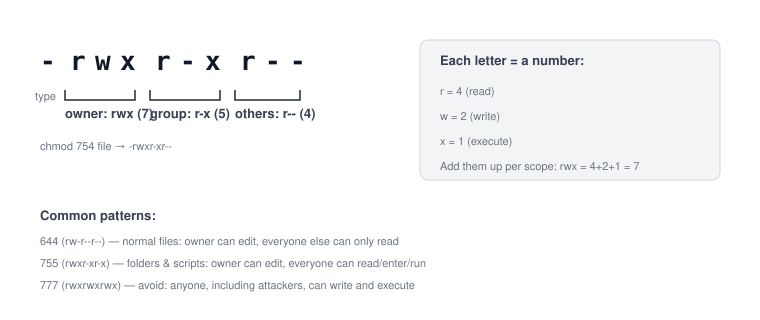

# Chapter 3 — Permissions and Ownership

> **Course:** Linux & Shell Basics · **Chapter:** 3 of 8
> Read on the website: [learn.bazardev.com/linux-shell/03-permissions-and-ownership](https://learn.bazardev.com/linux-shell/03-permissions-and-ownership)
>
> 🇧🇩 **Prefer Bangla?** [Read this chapter in Bangla →](https://learn.bazardev.com/linux-shell/03-permissions-and-ownership?lang=bn)

If you did the Docker course's final chapter, you already hit this exact topic: Laravel's `storage/` folder needing the right ownership before PHP-FPM could write to it. This chapter explains *why* that works the way it does — once you understand it here, "permission denied" stops being scary and starts being a two-second fix.

## 1. Why Linux cares who you are

Linux was built from the start to be a **multi-user** system — many people (or many processes, like a web server) sharing one machine safely. For that to work, every single file needs an answer to three questions: who owns it, what group can touch it, and what can everyone else do with it.

## 2. Reading `ls -l` — the permission string, decoded

```bash
ls -l
```
```
-rwxr-xr-- 1 dev www-data 1024 Nov 10 10:00 deploy.sh
```



Breaking down `-rwxr-xr--`:

- **First character** — the type: `-` for a regular file, `d` for a directory, `l` for a symbolic link.
- **Next three** (`rwx`) — what the **owner** (`dev`) can do: read, write, execute.
- **Next three** (`r-x`) — what the **group** (`www-data`) can do: read and execute, but not write.
- **Last three** (`r--`) — what **everyone else** can do: read only.

**r**ead, **w**rite, and e**x**ecute mean slightly different things for files vs. folders:

| | On a file | On a folder |
|---|---|---|
| `r` | Can view its contents | Can list what's inside (`ls`) |
| `w` | Can modify or delete it | Can create/delete/rename things inside |
| `x` | Can run it as a program/script | Can `cd` into it |

That last row surprises people the first time: **execute permission on a folder is what lets you enter it**, not "run" it.

## 3. `chmod` — changing what's allowed

### The octal way (the one you'll use most)

Each permission is a number: `r = 4`, `w = 2`, `x = 1`. Add them up per scope, and you get a 3-digit code:

```bash
chmod 644 notes.txt     # rw-r--r--  — owner edits, everyone else just reads
chmod 755 deploy.sh     # rwxr-xr-x  — owner edits, everyone can read/run
chmod 600 secrets.env   # rw-------  — only the owner can even read it
```

- **644** is the standard default for ordinary files.
- **755** is the standard default for folders and scripts (the `x` lets others enter the folder or run the script).
- **600** or **400** is what you want for anything sensitive, like a private SSH key.

**Never use `777`** (`rwxrwxrwx`) as a casual fix for a permission error. It means *anyone* on the system — including an attacker who found a way in — can read, modify, and execute that file. If `chmod 644` or `755` doesn't fix your actual problem, the real fix is almost always a **chown** (next section), not a wider-open `chmod`.

### The symbolic way (more readable for small tweaks)

```bash
chmod u+x deploy.sh     # add execute for the owner (u = user/owner)
chmod g-w notes.txt      # remove write for the group
chmod o=r notes.txt       # set others to exactly read-only
```

`u`, `g`, `o` for owner/group/others; `+`, `-`, `=` to add, remove, or set exactly.

## 4. `chown` and `chgrp` — changing who owns it

```bash
sudo chown dev notes.txt           # change the owner to "dev"
sudo chgrp www-data notes.txt      # change the group to "www-data"
sudo chown dev:www-data notes.txt  # change both at once (owner:group)
```

This is the exact pattern from the Docker course's Laravel chapter: a web server process runs as its own user (often `www-data`), and for it to be allowed to write into your `storage/` folder, that folder's **group** needs to be `www-data`, with group-write permission (`chmod 775`). That combination — `chown ... :www-data` plus `chmod 775` — is one of the single most common real-world fixes you'll ever type on a server.

## 5. Try it yourself

```bash
mkdir test-permissions && cd test-permissions
touch file.txt
ls -l file.txt              # see the default permissions
chmod 600 file.txt
ls -l file.txt               # now only you can read/write it
chmod 644 file.txt
ls -l file.txt               # back to the normal default
```

## 6. Key takeaways

- Every file has three permission scopes: owner, group, and others — each can read, write, and/or execute.
- `chmod 644` is the normal default for files; `755` for folders and scripts; never reach for `777`.
- Execute permission on a **folder** means "can enter it," not "can run it."
- `chown user:group` changes who owns a file and which group it belongs to — the real fix for most "permission denied" problems that `chmod` alone can't solve.
- The web-server-needs-group-write pattern (`chown :www-data` + `chmod 775`) is one of the most common fixes you'll make on any real server.

## 7. Test yourself (exam prep)

<details>
<summary><strong>Q1. What does `chmod 755` actually set, and why is it common for folders?</strong></summary>

It sets `rwx` (7) for the owner, and `r-x` (5) for both the group and others. On a folder, the `x` bit is what allows others to `cd` into it and list its contents — which is exactly the access most folders need to grant without letting anyone outside the owner modify what's inside.
</details>

<details>
<summary><strong>Q2. Why is `chmod 777` considered dangerous?</strong></summary>

It grants read, write, and execute to literally everyone on the system — owner, group, and others alike. If an attacker gets any kind of access to the machine, a `777` file or folder is one they can freely modify or run code from. Legitimate permission problems almost always have a narrower, correct fix (often a `chown`), not a wide-open `chmod`.
</details>

<details>
<summary><strong>Q3. A web server can't write to your app's `storage/` folder. What's the likely two-step fix?</strong></summary>

Change the folder's group to the web server's user/group (e.g. `sudo chgrp www-data storage`), then give the group write permission (`chmod 775 storage` or similar). This lets the web server process write as a group member, without making the folder world-writable.
</details>

<details>
<summary><strong>Q4. On a folder, what does the execute (`x`) permission actually control?</strong></summary>

Whether you're allowed to `cd` into that folder (or otherwise access things inside it by name) at all — it does not mean "run the folder." Without execute permission on a folder, even having read permission on it won't let you actually enter or use what's inside.
</details>

## 8. Free resources

- Official reference: [GNU Coreutils — `chmod` manual](https://www.gnu.org/software/coreutils/manual/html_node/chmod-invocation.html)
- Official reference: [GNU Coreutils — `chown` manual](https://www.gnu.org/software/coreutils/manual/html_node/chown-invocation.html)

---

**Next:** Chapter 4 — Users, Groups, and sudo *(coming soon)*
