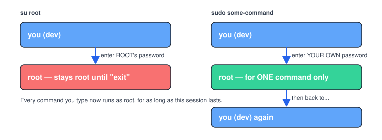

# Chapter 4 — Users, Groups, and sudo

> **Course:** Linux & Shell Basics · **Chapter:** 4 of 8
> Read on the website: [learn.bazardev.com/linux-shell/04-users-groups-and-sudo](https://learn.bazardev.com/linux-shell/04-users-groups-and-sudo)
>
> 🇧🇩 **Prefer Bangla?** [Read this chapter in Bangla →](https://learn.bazardev.com/linux-shell/04-users-groups-and-sudo?lang=bn)

Chapter 3 showed you *what* owners and groups control. This chapter shows you where users and groups actually come from, and exactly what `sudo` is doing every time you type it — including a detail that explains a "fix" from the Docker course you may not have fully understood at the time.

## 1. Who am I, really?

```bash
whoami
```
Just your username.

```bash
id
```
Much more useful — shows your user ID, your primary group, and **every** group you belong to:
```
uid=1002(dev) gid=1002(dev) groups=1002(dev),27(sudo),100(users)
```
That `groups=` list matters a lot: it's not just your main account, it's every "team" you're a member of — and group membership is exactly what Chapter 3's `chown :www-data` trick depends on.

```bash
groups
```
A shorter version — just the group names you belong to.

## 2. Where user accounts actually live

```bash
cat /etc/passwd
```
Every line is one user account, colon-separated:
```
dev:x:1002:1002:,,,:/home/dev:/bin/bash
```
`username : password-placeholder : user-id : group-id : full-name : home-folder : default-shell`

You'll never edit this file by hand — the commands below do it safely for you — but knowing it exists demystifies a lot of "where does Linux even keep this information" confusion.

## 3. Creating users and managing groups

```bash
sudo adduser newperson        # Ubuntu's friendly, interactive version
sudo useradd -m newperson     # the lower-level version (needs more flags to behave the same way)
```

```bash
sudo usermod -aG docker dev
```
Adds the existing user `dev` to the `docker` group, **without removing them from any group they're already in** (`-a` = append — forgetting it is a classic mistake that wipes someone's other group memberships).

If that command looks familiar, it should — it's the exact line from the Docker course's Chapter 2, and it's exactly the technique this chapter is now explaining properly.

```bash
sudo passwd newperson
```
Sets or changes that user's password.

### Why you had to log out and back in

Remember Chapter 2 of the Docker course saying "log out and log back in" after that `usermod` command? Here's why: **your current session already loaded your group list when you logged in.** Adding yourself to a new group updates `/etc/group` immediately, but your *already-running* terminal session doesn't automatically re-read it. Logging out and back in (or starting a fresh session) is what makes the shell pick up the new group membership. This trips up almost everyone the first time.

## 4. `sudo` vs `su` — the difference that actually matters

Both let you act as another user (usually `root`), but they work completely differently:



```bash
su root
```
Asks for **root's** password, then switches you entirely into a root session until you type `exit`. Every single thing you type after that runs as root — easy to forget you're still root, and easy to do real damage by accident.

```bash
sudo apt update
```
Asks for **your own** password, runs *just that one command* as root, and immediately returns you to being yourself. Nothing lingers.

This is exactly why `sudo` is the standard on modern systems (including this one) instead of `su`: it's scoped to one command at a time, and — importantly — it logs exactly who ran what, which matters a lot on a shared or production server.

### Who's even allowed to use `sudo`?

Only users listed in `/etc/sudoers` (or, more commonly on Ubuntu, members of the `sudo` group) can use it at all. If you ran `id` above and saw `27(sudo)` in your groups, that's exactly why `sudo` works for you.

## 5. Try it yourself (read-only, perfectly safe)

```bash
whoami
id
groups
cat /etc/passwd | head -5
sudo whoami   # should print "root" — you just ran one command as root, nothing more
```

## 6. Key takeaways

- `id` shows your full group membership — not just your main account, every group you belong to.
- `/etc/passwd` lists every user account as one colon-separated line each; you read it to understand the system, but manage accounts through commands like `adduser` and `usermod`.
- `usermod -aG <group> <user>` adds a user to a group — always with `-a`, or you'll wipe their other memberships.
- After joining a new group, you must start a new session (log out/in) before it takes effect — your current shell already loaded the old group list.
- `sudo` runs one command as root using *your* password and logs it; `su` fully switches you into a root session using *root's* password until you exit. Prefer `sudo`.

## 7. Test yourself (exam prep)

<details>
<summary><strong>Q1. You ran `usermod -aG docker dev` but the "docker" group still doesn't work in your current terminal. Why?</strong></summary>

Your current session loaded your group membership when you logged in, and it doesn't automatically refresh. You need to log out and log back in (or start a fresh session) for the shell to pick up the new group.
</details>

<details>
<summary><strong>Q2. What's the real risk of forgetting the `-a` flag in `usermod -G docker dev`?</strong></summary>

Without `-a`, `-G` *replaces* the user's group memberships with only the groups listed, instead of adding to them — potentially removing that user from every other group they were in.
</details>

<details>
<summary><strong>Q3. What's the practical difference between `su root` and `sudo some-command`?</strong></summary>

`su root` asks for root's own password and switches you into a full root session until you explicitly exit — everything you type afterward runs as root. `sudo some-command` asks for your own password and runs only that one command as root, immediately returning you to your normal user afterward, with the action logged.
</details>

<details>
<summary><strong>Q4. If `id` shows `groups=1002(dev),27(sudo)`, what does the `27(sudo)` part tell you?</strong></summary>

That your user is a member of the `sudo` group, which on Ubuntu-based systems is exactly what grants permission to use the `sudo` command at all. Without membership in that group (or a matching entry in `/etc/sudoers`), `sudo` would refuse to run anything for you.
</details>

## 8. Free resources

- Official reference: [Ubuntu Server Guide — User Management](https://ubuntu.com/server/docs/user-management)
- Official reference: [`sudo` manual](https://www.sudo.ws/docs/man/sudo.man/)

---

**Next:** Chapter 5 — Processes and Services (systemd) *(coming soon)*
