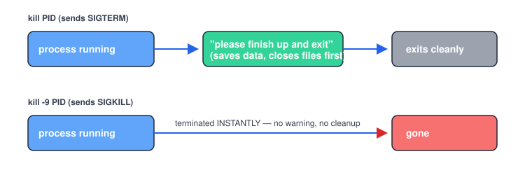

# Chapter 5 — Processes and Services (systemd)

> **Course:** Linux & Shell Basics · **Chapter:** 5 of 8
> Read on the website: [learn.bazardev.com/linux-shell/05-processes-and-services](https://learn.bazardev.com/linux-shell/05-processes-and-services)
>
> 🇧🇩 **Prefer Bangla?** [Read this chapter in Bangla →](https://learn.bazardev.com/linux-shell/05-processes-and-services?lang=bn)

Every program you run — a script, a web server, a database — becomes a **process** the moment it starts. This chapter is about seeing what's actually running on a machine, stopping it safely (or not so safely), and understanding `systemd`, the thing quietly keeping real servers (including the one hosting this course) alive.

## 1. What a process actually is

A process is one running instance of a program, and every single one gets a unique number the moment it starts: its **PID** (Process ID). A program can even be running as multiple separate processes at once (open two terminal tabs running the same script, and you have two different PIDs).

```bash
ps aux
```
Lists every process currently running on the machine. The columns worth knowing:

| Column | Means |
|---|---|
| `PID` | The process's unique ID |
| `%CPU` / `%MEM` | How much CPU/memory it's currently using |
| `STAT` | Its state (`S` sleeping, `R` running, `Z` a "zombie" — finished but not yet cleaned up) |
| `COMMAND` | The actual command that started it |

```bash
top
```
or, if installed:
```bash
htop
```
A live, auto-refreshing version of `ps aux` — the single fastest way to answer "what is eating all my CPU/memory right now."

## 2. Stopping a process — and the difference that actually matters

```bash
kill 12345
```
Sends a **SIGTERM** — a *polite request* to shut down. A well-written program catches this signal, finishes what it's doing (saving data, closing files, disconnecting cleanly), and exits on its own.

```bash
kill -9 12345
```
Sends a **SIGKILL** — not a request, an instant termination. The process gets no chance to clean up anything at all.



If this feels familiar, it should: this is exactly `docker stop` (SIGTERM, graceful) vs. `docker kill`/forced removal from the Docker course, just at the operating-system level instead of the container level. **Always try a plain `kill` first.** Reach for `kill -9` only when a process is genuinely stuck and ignoring the polite request — it should be your last resort, not your first move, because data can be lost if a process is killed mid-write.

```bash
killall nginx
```
Kills every process matching that name at once — useful, but be certain that's really what you want before running it.

## 3. Foreground, background, and jobs

```bash
long-running-script.sh        # runs in the foreground — your terminal is stuck until it finishes
long-running-script.sh &      # the & sends it to the background immediately — you get your prompt back
```

If something's already running in the foreground and you want your terminal back without killing it:
- Press `Ctrl+Z` — pauses it and hands control back to you.
- `bg` — resumes it, but in the background.
- `fg` — brings a backgrounded process back to the foreground.
- `jobs` — lists what's currently running/paused in your session.

```bash
nohup long-running-script.sh &
```
`nohup` ("no hang up") keeps the process running even after you close the terminal entirely — without it, closing your terminal session can kill anything you started in it.

## 4. `systemd` — how real services actually stay running

Scripts you start by hand die when your terminal closes (unless you `nohup` them). Real services — the web server, the database, the thing serving this very page — need to start automatically on boot, restart themselves if they crash, and be manageable with a consistent set of commands. That's exactly what **`systemd`** and its command, **`systemctl`**, are for.

```bash
systemctl status caddy
```
Shows whether a service is running, since when, and its most recent log lines — your first move whenever something "isn't working."

```bash
sudo systemctl start caddy      # start it now
sudo systemctl stop caddy       # stop it now
sudo systemctl restart caddy    # stop, then start again — the classic "did you turn it off and on again"
sudo systemctl reload caddy     # re-read its config WITHOUT dropping current connections (when supported)
```

```bash
sudo systemctl enable caddy     # make it start automatically on every boot
sudo systemctl disable caddy    # stop it from auto-starting on boot
```

**`start` vs `enable` is a genuinely common point of confusion:** `start` runs it right now, this one time. `enable` makes it start automatically every time the machine boots. You typically want both — `enable` it once, and `start` it (or just reboot) to actually have it running now.

```bash
journalctl -u caddy -f
```
Follows that service's logs live — the `systemd` equivalent of `docker logs -f` and `tail -f` from earlier chapters. Same idea, three different tools, one pattern you now recognize everywhere.

## 5. Try it yourself (read-only, safe on any machine)

```bash
ps aux | head -10
systemctl status ssh          # or any service you know is installed
journalctl -u ssh -n 20       # last 20 log lines for that service
```

## 6. Key takeaways

- Every running program is a process with a unique PID; `ps aux` lists them, `top`/`htop` shows them live.
- `kill` sends SIGTERM (a polite shutdown request); `kill -9` sends SIGKILL (instant, no cleanup) — always try plain `kill` first.
- `&`, `bg`, `fg`, and `jobs` manage foreground/background processes in your current session; `nohup` keeps one alive after you close the terminal.
- `systemctl status/start/stop/restart` manages a service right now; `enable`/`disable` controls whether it starts automatically on boot — these are two different questions.
- `journalctl -u <service> -f` follows a service's logs live, the same idea as `docker logs -f`.

## 7. Test yourself (exam prep)

<details>
<summary><strong>Q1. What's the real difference between `kill` and `kill -9`?</strong></summary>

Plain `kill` sends SIGTERM, a request the program can catch and respond to — cleaning up, saving data, and exiting on its own terms. `kill -9` sends SIGKILL, which terminates the process immediately with no chance to clean up anything, risking lost or corrupted data if it was mid-task.
</details>

<details>
<summary><strong>Q2. If you run `systemctl start nginx` but don't run `enable`, what happens after the server reboots?</strong></summary>

nginx will not start automatically — `start` only affects the service right now, in the current boot session. Only `enable` configures it to launch automatically on future boots.
</details>

<details>
<summary><strong>Q3. You closed the terminal where you ran `long-script.sh &`, and the process died anyway. Why, and what would have prevented it?</strong></summary>

Backgrounding a process with `&` doesn't protect it from the terminal session closing — it typically still gets terminated when the session ends, unless you also used `nohup` (or a proper service manager), which detaches it from the terminal entirely.
</details>

<details>
<summary><strong>Q4. What does `journalctl -u caddy -f` do, and what two commands from earlier courses does it resemble?</strong></summary>

It follows the `caddy` service's logs live, printing new lines as they appear. It's the same idea as `tail -f` on a log file (Linux course, Chapter 2) and `docker logs -f` on a container (Docker course) — three tools, one very common pattern: watching output happen in real time.
</details>

## 8. Free resources

- Official reference: [systemd — `systemctl` manual](https://www.freedesktop.org/software/systemd/man/systemctl.html)
- Official reference: [`journalctl` manual](https://www.freedesktop.org/software/systemd/man/journalctl.html)

---

**Next:** Chapter 6 — Package Management (apt) *(coming soon)*
