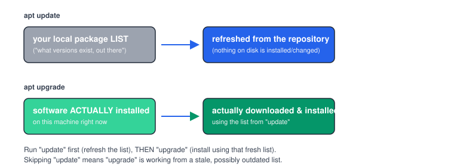

# Chapter 6 — Package Management (apt)

> **Course:** Linux & Shell Basics · **Chapter:** 6 of 8
> Read on the website: [learn.bazardev.com/linux-shell/06-package-management](https://learn.bazardev.com/linux-shell/06-package-management)
>
> 🇧🇩 **Prefer Bangla?** [Read this chapter in Bangla →](https://learn.bazardev.com/linux-shell/06-package-management?lang=bn)

Every time you install software on Ubuntu or Debian (the two most common Linux distributions for servers), you're almost certainly using `apt`. This chapter clears up the single most confusing pair of commands in it, and shows you the rest you'll actually use.

## 1. Why a package manager, instead of just downloading software

Without one, installing software means manually finding a download, checking it's compatible with your system, installing anything *it* depends on first, and tracking updates yourself — for every single piece of software, forever. A **package manager** does all of that for you: it knows what depends on what, fetches the right version for your system, and lets you update everything with one command.

`apt` (**A**dvanced **P**ackage **T**ool) is Ubuntu/Debian's package manager. If you're on a different distribution, the idea is identical but the tool has a different name (`yum`/`dnf` on Fedora/RHEL, `pacman` on Arch) — learn one well, and the others feel familiar.

## 2. `apt update` vs `apt upgrade` — the single most confused pair of commands in Linux

```bash
sudo apt update
```
This does **not** install or upgrade a single piece of software. It only refreshes your local list of what packages (and which versions) are *available* from your configured repositories — think of it as refreshing a catalog, not buying anything from it.

```bash
sudo apt upgrade
```
This actually installs newer versions of packages you already have — but using whatever list it currently has. If you haven't run `update` recently, `upgrade` is working from a stale catalog and might miss something that was just released.



**The habit to build:** always run them together, `update` first:
```bash
sudo apt update && sudo apt upgrade
```

## 3. Installing and removing software

```bash
sudo apt install nginx
```
Installs a package — and anything it depends on, automatically.

```bash
sudo apt remove nginx
```
Uninstalls it, but leaves its configuration files behind (useful if you plan to reinstall it later and want your settings kept).

```bash
sudo apt purge nginx
```
Uninstalls it **and** deletes its configuration files too — a complete, clean removal.

```bash
sudo apt autoremove
```
Cleans up packages that were installed only as a dependency of something else, and are no longer needed by anything currently installed — good hygiene to run occasionally.

## 4. Finding out what's available or installed

```bash
apt search redis          # search for packages matching "redis"
apt list --installed      # everything currently installed on this machine
apt show nginx             # details about a specific package — version, size, description
```

## 5. Where packages actually come from

Your system has a list of **repositories** it trusts — servers hosting packages — in `/etc/apt/sources.list` (and files inside `/etc/apt/sources.list.d/`). `apt update` is specifically re-reading *these* locations to refresh its catalog. Adding a new, trusted source (a PPA, "Personal Package Archive," on Ubuntu) is how you install newer or extra software not in the default repositories:

```bash
sudo add-apt-repository ppa:some/repository
sudo apt update
```

## 6. apt vs. a `curl | sh` install script

Back in the Docker course, Chapter 2 had you run:
```bash
curl -fsSL https://get.docker.com -o get-docker.sh
sudo sh get-docker.sh
```
That is **not** `apt` — it's a convenience script from Docker themselves that sets up their own repository and then uses `apt` underneath (on Ubuntu/Debian systems) to actually install things. When a piece of software is available through your distribution's official repositories, prefer plain `apt install` — it's easier to audit, update, and remove cleanly. Scripts piped straight into `sh` skip that safety net, so only run one from a source you genuinely trust.

## 7. Key takeaways

- `apt update` refreshes the catalog of available package versions; it installs nothing by itself.
- `apt upgrade` installs newer versions of what you already have, using whatever catalog is currently loaded — always `update` first.
- `apt remove` uninstalls software but keeps its config; `apt purge` removes the config too; `apt autoremove` cleans up now-unneeded dependencies.
- Repositories are configured in `/etc/apt/sources.list` (and `sources.list.d/`) — that's exactly what `update` is refreshing from.
- Prefer `apt install` over a `curl | sh` script whenever the software is available in your distribution's repositories — it's safer to audit and easier to manage.

## 8. Test yourself (exam prep)

<details>
<summary><strong>Q1. If you run `apt upgrade` without ever running `apt update`, what's the risk?</strong></summary>

`upgrade` installs newer versions based on whatever package catalog is currently cached locally. If that catalog is stale, `upgrade` may miss packages that were released since the last `update`, or work from outdated version information.
</details>

<details>
<summary><strong>Q2. What's the difference between `apt remove` and `apt purge`?</strong></summary>

`apt remove` uninstalls the package's program files but leaves its configuration files on disk, in case you reinstall it later and want those settings back. `apt purge` removes both the program and its configuration files — a complete removal.
</details>

<details>
<summary><strong>Q3. Why might `curl -fsSL https://some-site.com/install.sh | sh` be riskier than `apt install`?</strong></summary>

`apt install` pulls from a repository your system is already configured to trust, and its contents can be inspected and are tracked by your package manager (so you can cleanly update or remove it later). Piping a downloaded script straight into `sh` runs whatever that script contains immediately, with no review step, from whatever source provided it.
</details>

<details>
<summary><strong>Q4. What does `apt autoremove` actually clean up?</strong></summary>

Packages that were installed automatically as a dependency of something else, but are no longer required by anything currently installed on the system — leftover dependencies nothing else needs anymore.
</details>

## 9. Free resources

- Official reference: [Ubuntu — apt command basics](https://ubuntu.com/server/docs/package-management)
- Official reference: [Debian Wiki — Apt](https://wiki.debian.org/Apt)

---

**Next:** Chapter 7 — Pipes, Redirection, and Text Tools *(coming soon)*
