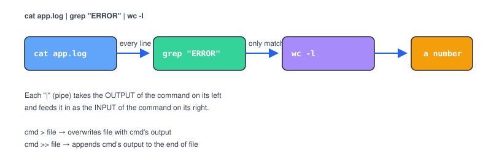

# Chapter 7 — Pipes, Redirection, and Text Tools

> **Course:** Linux & Shell Basics · **Chapter:** 7 of 8
> Read on the website: [learn.bazardev.com/linux-shell/07-pipes-redirection-text-tools](https://learn.bazardev.com/linux-shell/07-pipes-redirection-text-tools)
>
> 🇧🇩 **Prefer Bangla?** [Read this chapter in Bangla →](https://learn.bazardev.com/linux-shell/07-pipes-redirection-text-tools?lang=bn)

This chapter is where the shell stops feeling like "typing one command at a time" and starts feeling like real power: chaining small, simple tools together to answer questions a single command can't.

## 1. The pipe (`|`) — the single most useful character in the shell

```bash
cat app.log | grep "ERROR" | wc -l
```



Read that command exactly left to right: "show me the file, **then** keep only lines containing ERROR, **then** count how many lines are left." Each `|` takes the *output* of the command on its left and feeds it in as the *input* of the command on its right. None of these three tools knows or cares about the others — `grep` has no idea its input came from `cat`. That's the whole philosophy behind Linux's command-line tools: small, focused programs, combined in whatever order solves your actual problem.

## 2. Redirection — sending output somewhere other than your screen

```bash
ls -la > filelist.txt
```
`>` sends a command's output into a file, **overwriting** whatever was there before.

```bash
echo "new entry" >> filelist.txt
```
`>>` **appends** to the end of a file instead of overwriting it — the one to remember if you don't want to destroy what's already there.

```bash
some-command 2> errors.txt
```
`2>` redirects only the **error** output (not the normal output) into a file — useful when you want to see normal results on screen but keep a record of errors separately.

```bash
some-command > output.txt 2>&1
```
Sends both normal output and errors into the same file.

## 3. `grep` — finding lines that match

```bash
grep "ERROR" app.log          # lines containing "ERROR"
grep -i "error" app.log        # -i: case-insensitive, matches "Error", "ERROR", "error"
grep -n "ERROR" app.log        # -n: show the line number too
grep -v "DEBUG" app.log         # -v: invert — show lines that DON'T match
grep -r "TODO" .                # -r: search recursively through every file in every subfolder
```

`grep` is almost always the first tool you reach for when searching text, and often the only one you need.

## 4. `sed` — find and replace, without opening an editor

```bash
sed 's/old-text/new-text/g' file.txt
```
Replaces every occurrence (`g` = global) of `old-text` with `new-text`, and prints the result (it doesn't change the file unless you add `-i` to edit it in place):
```bash
sed -i 's/old-text/new-text/g' file.txt
```
There's a lot more `sed` can do, but "find and replace across a file" is 90% of why you'll reach for it.

## 5. `awk` — pulling out specific columns

```bash
awk '{print $1}' access.log
```
Prints just the first "column" (whitespace-separated field) of every line — extremely handy for log files where, say, the first word of every line is an IP address or timestamp. `$1`, `$2`, `$3`... refer to the 1st, 2nd, 3rd field.

## 6. `sort` and `uniq` — a pipeline classic

```bash
cat visitors.txt | sort | uniq -c | sort -rn
```
Read left to right again: sort the lines alphabetically (`uniq` requires sorted input to work correctly), collapse duplicate lines into one with a count (`uniq -c`), then sort by that count, highest first (`sort -rn`). This exact pipeline — sort, count duplicates, sort by count — is one of the most common patterns for answering "what's the most frequent X in this file."

## 7. Environment variables

```bash
echo $HOME          # print the value of a variable
export API_KEY=abc123    # set one for this session (and anything it starts)
```

Variables you `export` in your terminal disappear when you close it. To make one permanent, add the `export` line to `~/.bashrc` (it runs automatically every time you open a new terminal).

One environment variable to know by name: `$PATH`. It's a list of folders the shell searches, in order, whenever you type a command name — it's exactly how typing `docker` or `php` finds the right program without you typing its full location.

## 8. Putting it together

```bash
cat access.log | awk '{print $1}' | sort | uniq -c | sort -rn | head -5
```

In one line: pull out the IP address (first column) from every line of a web server's access log, then find the 5 most frequent visitors. Each piece is simple on its own; chained together with `|`, they answer a genuinely useful question that no single command could.

## 9. Key takeaways

- `|` feeds one command's output directly into the next command's input — the core idea behind chaining simple tools into something powerful.
- `>` overwrites a file with a command's output; `>>` appends to it instead.
- `grep` finds matching lines (`-i` case-insensitive, `-v` invert, `-r` recursive); `sed 's/old/new/g'` finds and replaces text; `awk '{print $N}'` pulls out a specific column.
- `sort | uniq -c | sort -rn` is the classic pipeline for "what's the most common value in this file."
- `export VAR=value` sets an environment variable for your session; add it to `~/.bashrc` to make it permanent; `$PATH` is the list of folders the shell searches for commands.

## 10. Test yourself (exam prep)

<details>
<summary><strong>Q1. In `cat app.log | grep "ERROR" | wc -l`, what exactly flows through each pipe?</strong></summary>

`cat app.log` outputs every line of the file. That full output becomes `grep`'s input, which filters it down to only lines containing "ERROR." That filtered output becomes `wc -l`'s input, which counts how many lines it received — the final number printed is the count of matching lines.
</details>

<details>
<summary><strong>Q2. What's the real difference between `>` and `>>`?</strong></summary>

`>` overwrites the target file entirely with the command's output — anything previously in the file is gone. `>>` appends the output to the end of the file instead, keeping whatever was already there.
</details>

<details>
<summary><strong>Q3. Why does `uniq -c` need its input to already be sorted?</strong></summary>

`uniq` only collapses *consecutive* duplicate lines — it doesn't scan the whole input for matches anywhere. If identical lines aren't next to each other (which `sort` guarantees by grouping them together), `uniq` won't recognize them as duplicates.
</details>

<details>
<summary><strong>Q4. What does the `$PATH` environment variable actually do?</strong></summary>

It's a list of folders, in order, that the shell searches through to find the program behind a command name you type. It's why typing `docker` runs the actual Docker program without you needing to type its full file path every time.
</details>

## 11. Free resources

- Official reference: [GNU Grep manual](https://www.gnu.org/software/grep/manual/grep.html)
- Official reference: [GNU Sed manual](https://www.gnu.org/software/sed/manual/sed.html)
- Official reference: [GNU Awk User's Guide](https://www.gnu.org/software/gawk/manual/gawk.html)

---

**Next:** Chapter 8 — SSH and Remote Access *(coming soon)*
