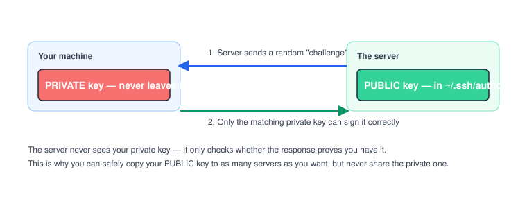

# Chapter 8 — SSH and Remote Access

> **Course:** Linux & Shell Basics · **Chapter:** 8 of 8 (final chapter!)
> Read on the website: [learn.bazardev.com/linux-shell/08-ssh-and-remote-access](https://learn.bazardev.com/linux-shell/08-ssh-and-remote-access)
>
> 🇧🇩 **Prefer Bangla?** [Read this chapter in Bangla →](https://learn.bazardev.com/linux-shell/08-ssh-and-remote-access?lang=bn)

Every chapter so far assumed you were already "on" a server. This chapter is about how you actually get there — securely — from your own laptop.

## 1. What SSH actually is

**SSH** (Secure Shell) is how you open a terminal session on a machine that isn't the one in front of you — encrypted, so nothing you type (including passwords) can be read by anyone intercepting the connection.

```bash
ssh dev@167.86.127.108
```
Connects as the user `dev` to that server. If it's using a non-default port:
```bash
ssh -p 2222 dev@167.86.127.108
```

## 2. Why SSH keys beat passwords

A password can be guessed, brute-forced, or leaked. An SSH **key pair** is dramatically harder to attack, and it's how real servers are secured in practice.



The idea: you generate two mathematically linked files — a **private key** (stays on your machine, forever, never shared) and a **public key** (safe to put on any server you want to access). When you connect, the server sends a challenge only your matching private key can answer correctly — it never actually sees or transmits your private key itself.

```bash
ssh-keygen -t ed25519 -C "your_email@example.com"
```
Generates a new key pair (`ed25519` is the modern, recommended key type). This creates two files: `~/.ssh/id_ed25519` (private — guard this) and `~/.ssh/id_ed25519.pub` (public — safe to share/copy).

```bash
ssh-copy-id dev@167.86.127.108
```
Copies your **public** key onto the server automatically, adding it to that account's `~/.ssh/authorized_keys` file. After this, `ssh dev@167.86.127.108` logs you in with no password prompt at all.

If `ssh-copy-id` isn't available, the manual equivalent is appending your public key's contents to `~/.ssh/authorized_keys` on the server yourself.

## 3. Copying files over SSH

```bash
scp localfile.txt dev@167.86.127.108:/home/dev/
```
Copies `localfile.txt` from your machine to that path on the server — same underlying connection and authentication as `ssh`, just moving a file instead of opening a terminal.

```bash
scp dev@167.86.127.108:/home/dev/remote-file.txt ./
```
The reverse — pulling a file *from* the server down to your machine.

## 4. A config file so you never type the full command again

Create (or edit) `~/.ssh/config` on **your own machine**:
```
Host myserver
    HostName 167.86.127.108
    User dev
    Port 22
    IdentityFile ~/.ssh/id_ed25519
```

Now, instead of remembering the full command every time:
```bash
ssh myserver
```
That's it. This is a small file most developers set up once and never think about again — worth doing the moment you're regularly connecting to the same server.

## 5. When it doesn't work: common SSH errors

| Error | Likely cause |
|---|---|
| `Permission denied (publickey)` | Your public key isn't in the server's `authorized_keys`, or your private key file has the wrong permissions |
| `WARNING: UNPROTECTED PRIVATE KEY FILE!` | Your private key's file permissions are too open — SSH refuses to use a key anyone else on your machine could read |
| `Host key verification failed` | The server's identity fingerprint changed since you last connected (expected after a server rebuild; alarming if unexpected — it can also mean someone is intercepting the connection) |

That second one connects directly back to Chapter 3: SSH private keys need to be locked down to `600` (owner can read/write, nobody else can even read):
```bash
chmod 600 ~/.ssh/id_ed25519
```

## 6. One sentence on firewalls

A server normally only needs a small, specific set of ports open to the internet — SSH (22), and whatever your app actually serves (80/443 for web traffic). Tools like `ufw` (Uncomplicated Firewall) on Ubuntu let you allow exactly those and nothing else:
```bash
sudo ufw allow OpenSSH
sudo ufw allow 80,443/tcp
sudo ufw enable
```
This is a deep topic on its own — the one habit worth taking from this course is simply: never expose a port you don't have a specific reason to expose.

## 7. Key takeaways

- `ssh user@host` opens an encrypted remote terminal session; `scp` copies files over that same secure connection.
- SSH key pairs beat passwords: your private key never leaves your machine, and the server only verifies you have it, without ever seeing it.
- `ssh-copy-id` installs your public key on a server so you can log in without a password prompt.
- `~/.ssh/config` lets you turn a long `ssh -p PORT user@host` command into a short alias like `ssh myserver`.
- `Permission denied (publickey)` is very often a file permissions problem (Chapter 3 again) — your private key should be `chmod 600`.

## 8. Test yourself (exam prep)

<details>
<summary><strong>Q1. Why is an SSH key pair generally considered more secure than a password?</strong></summary>

A password can be guessed or brute-forced over many attempts. With a key pair, the server never even receives your private key — it only checks whether you can correctly respond to a challenge using it, which is dramatically harder to fake or steal than guessing a password.
</details>

<details>
<summary><strong>Q2. What exactly does `ssh-copy-id` do?</strong></summary>

It copies your **public** key (never the private one) to the target server and appends it to that account's `~/.ssh/authorized_keys` file, so future logins with your matching private key succeed without a password prompt.
</details>

<details>
<summary><strong>Q3. You get "Permission denied (publickey)" when connecting. Besides the key not being on the server, what else should you check, based on Chapter 3?</strong></summary>

The permissions on your private key file. SSH will refuse to use a private key that's readable by anyone other than its owner — it should be `chmod 600`.
</details>

<details>
<summary><strong>Q4. What does a `~/.ssh/config` entry actually save you from doing?</strong></summary>

Retyping the full connection details — hostname, username, port, and key file — every single time. Once defined under a `Host` alias, `ssh myserver` alone carries all of that information automatically.
</details>

## 9. Free resources

- Official reference: [OpenSSH — `ssh_config` manual](https://man.openbsd.org/ssh_config)
- Official reference: [Ubuntu Server Guide — OpenSSH](https://ubuntu.com/server/docs/openssh-server)

---

**That's the full Linux & Shell Basics course.** Navigation, files, permissions, users, processes, packages, pipes, and now remote access — you can comfortably live inside a Linux server from here on.

🎉 Two courses down. Next up on [learn.bazardev.com](https://learn.bazardev.com): **Git & GitHub (Advanced)** — coming soon.
