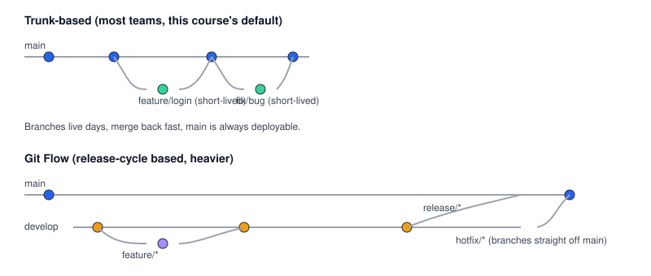

# Chapter 1 — Branching Strategies for Teams

> **Course:** Git & GitHub (Advanced) · **Chapter:** 1 of 8
> Read on the website: [learn.bazardev.com/git-github/01-branching-strategies](https://learn.bazardev.com/git-github/01-branching-strategies)
>
> 🇧🇩 **Prefer Bangla?** [Read this chapter in Bangla →](https://learn.bazardev.com/git-github/01-branching-strategies?lang=bn)

This course assumes you already know the basics — `git init`, `add`, `commit`, `push`, `pull`. What it covers is everything that actually matters once more than one person is touching the same codebase: branching models, merge conflicts, rebasing, pull requests, and undoing mistakes without panic.

## 1. Why branch at all

A branch is a separate line of work that doesn't affect `main` until you explicitly bring it in. Without branches, every change goes straight onto the one shared history — meaning an unfinished feature, a risky experiment, and a critical bugfix would all be tangled together, with no way to ship one without the others.

Quick command refresher (you already know these, this is just the vocabulary this course will keep using):

```bash
git branch                    # list branches
git switch -c feature/login   # create AND switch to a new branch
git switch main                # switch back
git branch -d feature/login    # delete a branch once it's merged in
```

## 2. The two models you'll actually run into



### Trunk-based development (the modern default — what most teams, including small ones, actually use)

- One long-lived branch: `main`.
- Every change is a **short-lived** feature branch — ideally merged back within a day or two.
- `main` is always in a deployable state.
- Simpler mental model, fewer long-lived branches to keep in sync, fewer painful merges.

### Git Flow (heavier, built for scheduled releases)

- Two long-lived branches: `main` (production) and `develop` (the next release, being assembled).
- `feature/*` branches merge into `develop`.
- A `release/*` branch gets cut from `develop` when it's time to stabilize for a release.
- `hotfix/*` branches come straight off `main` for urgent production fixes, then get merged back into both `main` and `develop`.

| | Trunk-based | Git Flow |
|---|---|---|
| Best for | Continuous deployment, small-to-medium teams | Scheduled releases (e.g. versioned software shipped on a cadence) |
| Branch lifespan | Days | Weeks, sometimes longer |
| Complexity | Low | Higher — more branch types to track |
| Deploys from | `main`, constantly | A `release/*` branch, at scheduled intervals |

If you're not sure which to use: **default to trunk-based.** It's simpler, it's what most modern teams and tools (including GitHub's own workflow features) are designed around, and you can always add more structure later if an actual scheduled-release need shows up.

## 3. Naming your branches so they're self-explanatory

A consistent prefix tells anyone glancing at the branch list what kind of change it is, before they even open it:

```
feature/user-authentication
fix/checkout-crash-on-ios
chore/upgrade-laravel-to-11
docs/update-readme
```

## 4. Protecting `main`

On GitHub, you can require that nothing gets pushed directly to `main` — every change must go through a pull request (covered properly in Chapter 6), optionally requiring a passing CI check or an approving review first. This is a setting, not a Git command, and it's one of the single highest-value five-minute changes you can make to a shared repository: it makes "someone accidentally pushed something broken straight to main" structurally impossible.

## 5. Key takeaways

- A branch isolates work until you're ready to bring it into `main` — nothing on a branch affects anyone else until it's merged.
- Trunk-based development (one `main`, short-lived feature branches) is the simpler, modern default for most teams.
- Git Flow (`main` + `develop` + `feature`/`release`/`hotfix` branches) exists for teams shipping scheduled, versioned releases — more structure, more overhead.
- Prefixing branch names (`feature/`, `fix/`, `chore/`) makes a branch list self-explanatory at a glance.
- GitHub's branch protection rules can block direct pushes to `main`, forcing all changes through review — a cheap, high-value safeguard.

## 6. Test yourself (exam prep)

<details>
<summary><strong>Q1. What's the core difference between trunk-based development and Git Flow?</strong></summary>

Trunk-based development has one long-lived branch (`main`) with short-lived feature branches merged back quickly. Git Flow adds a second long-lived branch (`develop`) plus dedicated `release/*` and `hotfix/*` branch types, built around scheduled, versioned releases rather than continuous deployment.
</details>

<details>
<summary><strong>Q2. Why would a team with scheduled, versioned releases prefer Git Flow over trunk-based development?</strong></summary>

Git Flow gives them a `release/*` branch to stabilize a specific set of features for a release without blocking ongoing work on `develop`, and a `hotfix/*` path to patch production urgently without waiting for the next full release cycle. Trunk-based development doesn't have this separation built in, since it assumes `main` is always ready to deploy as-is.
</details>

<details>
<summary><strong>Q3. What does branch protection on `main` actually prevent?</strong></summary>

It blocks direct pushes to `main`, requiring every change to go through a pull request instead — optionally also requiring a passing CI check or an approving review before it can be merged. This removes the possibility of someone accidentally pushing untested or broken code straight to the branch everyone deploys from.
</details>

## 7. Free resources

- Official guide: [GitHub Flow](https://docs.github.com/en/get-started/using-github/github-flow)
- Reference: [A successful Git branching model (the original Git Flow post, by Vincent Driessen)](https://nvie.com/posts/a-successful-git-branching-model/)

---

**Next:** Chapter 2 — Merge vs Rebase *(coming soon)*
