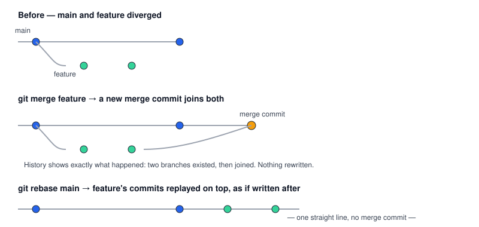

# Chapter 2 — Merge vs Rebase

> **Course:** Git & GitHub (Advanced) · **Chapter:** 2 of 8
> Read on the website: [learn.bazardev.com/git-github/02-merge-vs-rebase](https://learn.bazardev.com/git-github/02-merge-vs-rebase)
>
> 🇧🇩 **Prefer Bangla?** [Read this chapter in Bangla →](https://learn.bazardev.com/git-github/02-merge-vs-rebase?lang=bn)

If you've ever asked "should I merge or rebase?" and gotten three different confident answers from three different developers, this chapter is for you. Both combine two branches' work — they just leave completely different history behind.

## 1. What `git merge` actually does

```bash
git switch main
git merge feature
```

Git creates a brand new commit — a **merge commit** — that has *two* parents: the tip of `main` and the tip of `feature`. Nothing about either branch's existing history changes. The result honestly shows what happened: two lines of work existed in parallel, and then they joined.

## 2. What `git rebase` actually does

```bash
git switch feature
git rebase main
```

Git takes every commit that's unique to `feature`, and **replays** them one by one, as if you'd written them starting from the current tip of `main` — not from wherever `main` was when you originally branched off. The result is a straight, linear history with no merge commit at all — but every one of those replayed commits is technically a *new* commit, with a new hash, even though the actual code changes are the same.



## 3. The single most important rule in this chapter

**Never rebase a branch that other people have already pulled or are also working on.**

Because rebase creates brand-new commits with new hashes, anyone who already has the old commits now has history that's permanently diverged from yours — Git has no way to know "these are the same changes, just rewritten." Their next `git pull` turns into a confusing mess of duplicate-looking commits or conflicts that shouldn't exist.

The practical version of this rule:
- Rebase freely on a branch **only you** are working on, especially before you've pushed it anywhere.
- Once a branch is pushed and others might have based work on it, switch to merging (or, if you must rewrite shared history, everyone involved needs to know and coordinate — treat this as rare and deliberate, not routine).

## 4. So which one should you actually use?

| Situation | Use |
|---|---|
| Bringing your finished feature branch into `main` | **Merge** (via a pull request — Chapter 6) — preserves true history, safe on a shared branch |
| Cleaning up your own feature branch before opening a PR — pulling in the latest `main`, removing messy "fix typo" commits | **Rebase** — you own this branch, nobody's pulled it yet, a clean linear history is genuinely nicer to review |
| A branch other teammates have already pulled or pushed commits onto | **Merge, not rebase** — see the rule above |

This is exactly the trunk-based workflow from Chapter 1 in practice: keep your feature branch rebased onto the latest `main` while you work on it solo, then merge it in (through a reviewed pull request) once it's ready.

## 5. A note on fast-forward merges

If `main` hasn't moved at all since you branched off, `git merge feature` doesn't even need a merge commit — it can just slide `main`'s pointer forward to match `feature` exactly. This is called a **fast-forward merge**. Some teams prefer to disable this (`git merge --no-ff feature`) specifically to always keep a visible merge commit marking where a feature was integrated, even when a fast-forward was technically possible.

## 6. Key takeaways

- `merge` creates a new commit joining two histories together; nothing existing is rewritten.
- `rebase` replays your branch's commits on top of another branch, creating new commits with new hashes and a linear history — no merge commit.
- Never rebase a branch others have already pulled or pushed work onto — it diverges their history from yours in a way Git can't reconcile cleanly.
- Rebase your own, not-yet-shared feature branch to keep it clean and up to date with `main`; merge (via pull request) to actually bring finished work into `main`.
- A fast-forward merge just moves a branch pointer forward with no new commit; `--no-ff` forces a merge commit even when that would otherwise be possible.

## 7. Test yourself (exam prep)

<details>
<summary><strong>Q1. What's the fundamental difference in what `merge` and `rebase` do to history?</strong></summary>

`merge` adds a new commit with two parents, joining two histories without changing either branch's existing commits. `rebase` replays one branch's commits on top of another, creating entirely new commits (with new hashes) and producing a linear history with no merge commit.
</details>

<details>
<summary><strong>Q2. Why is it dangerous to rebase a branch that a teammate has already pulled?</strong></summary>

Rebase rewrites commits into new ones with different hashes. Your teammate's copy still has the old commits, so their history and yours have permanently diverged — Git can't automatically tell that the rewritten commits represent "the same" changes, leading to confusing duplicate-looking commits or conflicts on their next pull.
</details>

<details>
<summary><strong>Q3. In the trunk-based workflow from Chapter 1, when is it safe to rebase your feature branch onto main, and when should you switch to merging instead?</strong></summary>

It's safe to rebase while the branch is still yours alone — before pushing it, or before anyone else has pulled or built on top of it. Once it's shared and others may have pulled it or pushed their own commits onto it, you should merge instead of rebasing it further.
</details>

<details>
<summary><strong>Q4. What does `--no-ff` force Git to do that it otherwise might skip?</strong></summary>

It forces Git to create an explicit merge commit even in situations where a fast-forward (simply moving the branch pointer forward with no new commit) would otherwise be possible — keeping a visible marker in history of exactly where a feature was integrated.
</details>

## 8. Free resources

- Official docs: [Git Branching — Rebasing](https://git-scm.com/book/en/v2/Git-Branching-Rebasing)
- Official docs: [`git merge` reference](https://git-scm.com/docs/git-merge)

---

**Next:** Chapter 3 — Resolving Merge Conflicts *(coming soon)*
