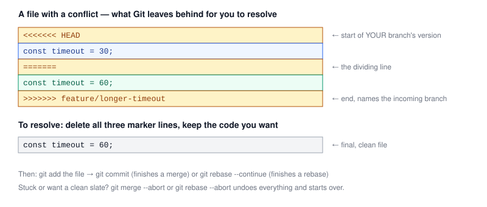

# Chapter 3 — Resolving Merge Conflicts

> **Course:** Git & GitHub (Advanced) · **Chapter:** 3 of 8
> Read on the website: [learn.bazardev.com/git-github/03-resolving-merge-conflicts](https://learn.bazardev.com/git-github/03-resolving-merge-conflicts)
>
> 🇧🇩 **Prefer Bangla?** [Read this chapter in Bangla →](https://learn.bazardev.com/git-github/03-resolving-merge-conflicts?lang=bn)

Conflicts feel scary the first few times. They aren't a sign you broke something — they're Git honestly telling you it found two changes to the *same lines* and refuses to guess which one you want. Once you've resolved a handful by hand, it becomes a completely mechanical five-minute task.

## 1. Why a conflict happens at all

Most merges need no human input — if your branch changed line 10 of a file and `main` changed line 80, Git merges both changes automatically, no conflict. A conflict only happens when **both branches changed the same lines (or very nearby lines) of the same file**, and Git has no way to know which version — or what combination — you actually want.

```bash
git switch main
git merge feature/longer-timeout
# Auto-merging config.js
# CONFLICT (content): Merge conflict in config.js
# Automatic merge failed; fix conflicts and then commit the result.
```

Git does not stop *all* progress — it successfully merges every file it can, and only pauses on the files it genuinely can't decide. Run `git status` right after a conflict to see exactly which files need your attention; everything else is already done.

## 2. Reading the conflict markers

Open the conflicted file. Git has inserted markers directly into it, showing you both versions side by side:



- `<<<<<<< HEAD` — everything below this, down to the `=======`, is **your current branch's** version.
- `=======` — the dividing line between the two versions.
- `>>>>>>> feature/longer-timeout` — everything above this, up from the `=======`, is the **incoming branch's** version. The name after `>>>>>>>` tells you exactly which branch it came from.

These markers are just plain text Git wrote into your file — they are not special syntax the file understands. If you ran your code right now without cleaning them up, it would almost certainly throw a syntax error.

## 3. Actually resolving it

Resolution is a three-step loop, repeated for every conflicted file:

1. **Open the file and decide what the final code should be.** Sometimes that's purely "keep mine," sometimes "keep theirs," and sometimes it's neither — you genuinely need both changes combined (e.g., one branch added a new function, the other renamed a variable that function uses).
2. **Delete all three marker lines** (`<<<<<<<`, `=======`, `>>>>>>>`) along with whichever version you're discarding, leaving only the code you've decided on.
3. **Tell Git it's resolved:**
   ```bash
   git add config.js
   ```
   `git add` here doesn't mean "stage a new change" — it specifically tells Git "I've resolved this file's conflict."

Once every conflicted file has been `git add`-ed, finish the operation:

```bash
# if this conflict came from a merge:
git commit

# if this conflict came from a rebase instead:
git rebase --continue
```

A merge conflict needs one `git commit` to finish. A rebase conflict can happen **once per replayed commit** — after resolving one, `git rebase --continue` moves on and may immediately hit another conflict on the *next* commit being replayed. That's normal; just repeat the loop until the rebase finishes.

## 4. Changed your mind? Abort and start clean

If a conflict resolution is going badly, or you just want to think about it with a clear working tree, you're never stuck:

```bash
git merge --abort      # cancels the in-progress merge, restores things exactly as before
git rebase --abort     # cancels the in-progress rebase, restores things exactly as before
```

Both are completely safe — they throw away nothing except the half-finished merge/rebase attempt itself. Your original commits are untouched.

## 5. Tools that make this easier

- **Your editor's merge view.** VS Code (and most modern editors) detects conflict markers automatically and shows "Accept Current Change / Accept Incoming Change / Accept Both Changes" buttons directly above each conflict — no need to hand-edit the markers in most cases.
- **`git mergetool`** launches whatever diff/merge tool is configured on your system for a more visual three-way comparison.
- **`git diff`** (while a conflict is unresolved) shows you a combined diff format marking exactly which side each change came from.
- **`git log --merge`** shows only the commits relevant to the files currently in conflict, if you need more context on *why* each side changed what it did.

## 6. A tip that prevents most conflicts before they happen

Most painful conflicts come from a feature branch that's lived for a long time without touching `main`. The fix connects straight back to [Chapter 1](/git-github/01-branching-strategies) and [Chapter 2](/git-github/02-merge-vs-rebase): keep feature branches **short-lived**, and regularly bring `main` into your branch (via merge or rebase, per Chapter 2's rule) while you work — resolving a handful of small conflicts early and often is far easier than resolving one giant conflict after weeks of divergence.

## 7. Key takeaways

- A conflict only happens when both branches changed the same lines of the same file — everything else merges automatically.
- `git status` tells you exactly which files still need manual resolution.
- Conflict markers (`<<<<<<<`, `=======`, `>>>>>>>`) are plain text Git inserts — remove all of them, keeping only the final code you want.
- `git add <file>` marks a file's conflict as resolved; `git commit` finishes a merge, `git rebase --continue` finishes a rebase (and may repeat per commit).
- `git merge --abort` / `git rebase --abort` safely cancel the whole operation and restore your prior state — use them without fear.
- Short-lived branches, regularly synced with `main`, are the real fix — small frequent conflicts beat one huge one.

## 8. Test yourself (exam prep)

<details>
<summary><strong>Q1. Why does Git produce a conflict for some merges but not others?</strong></summary>

Git can merge automatically whenever the two branches changed different parts of a file (or different files entirely). It only produces a conflict when both branches changed the same lines (or very nearby lines) of the same file, because it has no safe way to decide which version — or what combination of both — is correct.
</details>

<details>
<summary><strong>Q2. In a conflict marker block, what does the text immediately after `>>>>>>>` tell you?</strong></summary>

It names the branch that the content above it (between `=======` and `>>>>>>>`) is coming from — the "incoming" side of the conflict, as opposed to `HEAD`, which is your current branch's version.
</details>

<details>
<summary><strong>Q3. After resolving a conflict that came from `git rebase`, why might you hit another conflict immediately after running `git rebase --continue`?</strong></summary>

A rebase replays commits one at a time on top of the new base. Resolving a conflict only fixes the commit currently being replayed — the next commit in the sequence might touch the same lines again and trigger its own conflict, so `--continue` can pause again and the resolve loop may need to repeat per commit.
</details>

<details>
<summary><strong>Q4. What does `git merge --abort` actually undo, and what does it leave untouched?</strong></summary>

It cancels the in-progress merge attempt and restores your working directory and branch exactly as they were before you ran `git merge` — it does not touch or lose any of your actual commit history, only the unfinished merge attempt itself.
</details>

## 9. Free resources

- Official docs: [Resolving a merge conflict using the command line (GitHub)](https://docs.github.com/en/pull-requests/collaborating-with-pull-requests/addressing-merge-conflicts/resolving-a-merge-conflict-using-the-command-line)
- Official docs: [Git Basics — git merge conflicts](https://git-scm.com/book/en/v2/Git-Branching-Basic-Branching-and-Merging)

---

**Next:** Chapter 4 — Interactive Rebase: Cleaning Up History *(coming soon)*
