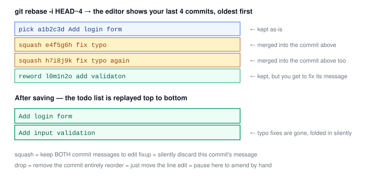

# Chapter 4 — Interactive Rebase: Cleaning Up History

> **Course:** Git & GitHub (Advanced) · **Chapter:** 4 of 8
> Read on the website: [learn.bazardev.com/git-github/04-interactive-rebase](https://learn.bazardev.com/git-github/04-interactive-rebase)
>
> 🇧🇩 **Prefer Bangla?** [Read this chapter in Bangla →](https://learn.bazardev.com/git-github/04-interactive-rebase?lang=bn)

Chapter 2 covered plain `git rebase` — replaying your branch on top of another one. Interactive rebase (`git rebase -i`) is the same replay mechanism, except *you* get to edit the list of commits before Git replays them: reorder them, combine several into one, reword messages, or delete commits entirely. It's the tool that turns a messy "work in progress" commit trail into a clean, readable story before you open a pull request.

## 1. Starting one

```bash
git rebase -i HEAD~4
```

This opens your editor with the last 4 commits of your current branch, **oldest first**, each on its own line:

```
pick a1b2c3d Add login form
pick e4f5g6h fix typo
pick h7i8j9k fix typo again
pick l0m1n2o add validaton
```

This isn't a log you're just viewing — it's a literal **to-do list** Git is about to execute. Change the word at the start of a line, reorder the lines, or delete a line, save the file, and Git carries out exactly what you wrote.

## 2. The commands you can use on each line

| Command | What it does |
|---|---|
| `pick` | Keep this commit as-is (the default for every line) |
| `reword` | Keep the commit's changes, but pause so you can edit its message |
| `edit` | Pause right after this commit is applied, so you can amend its content by hand |
| `squash` | Combine this commit into the one above it, and let you edit the combined message |
| `fixup` | Combine this commit into the one above it, **silently discarding** this one's message |
| `drop` | Remove this commit entirely (or just delete the line — same effect) |
| Reordering | Simply move a line up or down — commits replay in whatever order the lines end up in |



## 3. A real example: cleaning up "fix typo" commits

Given the to-do list above, changing it to:

```
pick a1b2c3d Add login form
squash e4f5g6h fix typo
squash h7i8j9k fix typo again
reword l0m1n2o add validaton
```

...and saving, Git will: fold the two typo-fix commits into "Add login form" (prompting you to write a combined message, or just keep the first one), then pause on the last commit so you can fix its message to "Add input validation". The messy four-commit trail becomes two clean commits that actually describe what changed — the two typo fixes vanish from history entirely, because their changes are now just part of the commit they were fixing.

`squash` vs `fixup` is purely about the message: use `squash` when you want to review/edit the combined message, use `fixup` when the commit being folded in has a throwaway message you don't need to see again (like "wip" or "fix typo").

## 4. The same golden rule from Chapter 2 applies here, louder

Interactive rebase rewrites commits — every commit it touches gets a new hash, exactly like plain rebase. **Never run `git rebase -i` on a branch other people have already pulled or pushed commits onto.** This is even more important here than in Chapter 2, because interactive rebase often rewrites *every* commit in the range, not just replays them unchanged.

The right time to clean up history with interactive rebase is **before** you push a branch for the first time, or while you're still the only person working on it — not after it's been shared, reviewed, or merged.

## 5. If you already pushed, and need to rebase anyway

If you rebased a branch you'd already pushed (and nobody else has pulled it), your local branch and the remote one now have diverged histories — a plain `git push` will be rejected. You need to force-push:

```bash
git push --force-with-lease
```

Use `--force-with-lease`, not plain `--force`. `--force-with-lease` refuses to overwrite the remote branch if someone else pushed new commits to it since you last fetched — protecting you from accidentally destroying a teammate's work you didn't know about. Plain `--force` has no such check.

## 6. Key takeaways

- `git rebase -i HEAD~N` opens an editable to-do list of your last N commits (oldest first) that Git will literally execute.
- `pick` keeps a commit, `reword` lets you edit its message, `edit` pauses to amend it, `squash`/`fixup` merge it into the commit above, `drop` removes it, and reordering lines changes replay order.
- `squash` keeps both messages for you to combine; `fixup` silently discards the folded-in commit's message.
- Only run interactive rebase on commits nobody else has pulled or built on — it rewrites history just like plain rebase, usually more of it.
- If you must force-push a rebased branch, use `git push --force-with-lease`, never plain `--force`.

## 7. Test yourself (exam prep)

<details>
<summary><strong>Q1. In the interactive rebase to-do list, which commit appears first — the oldest or the newest?</strong></summary>

The oldest commit in the range appears first (at the top), and the newest appears last. The list is replayed top to bottom, so this is the order Git will apply them in.
</details>

<details>
<summary><strong>Q2. What's the practical difference between `squash` and `fixup`?</strong></summary>

Both combine a commit into the one above it. `squash` pauses and lets you edit the combined commit message (keeping both original messages to work from), while `fixup` folds the commit in silently, discarding its message entirely and keeping only the message of the commit above it.
</details>

<details>
<summary><strong>Q3. Why is the "never rebase a shared branch" rule from Chapter 2 even more important for interactive rebase specifically?</strong></summary>

Interactive rebase doesn't just replay commits unchanged — it very often rewrites, reorders, combines, or deletes several of them. Every touched commit gets a new hash, so if anyone else has already pulled the old commits, significantly more of the history diverges than with a plain rebase, making reconciliation much messier.
</details>

<details>
<summary><strong>Q4. Why should you use `git push --force-with-lease` instead of `git push --force` after an interactive rebase?</strong></summary>

`--force-with-lease` checks that the remote branch hasn't changed since you last fetched it before overwriting it — if a teammate pushed new commits you don't know about, it refuses and fails safely. Plain `--force` overwrites the remote unconditionally, which can silently destroy commits someone else just pushed.
</details>

## 8. Free resources

- Official docs: [Git Tools — Rewriting History (interactive rebase)](https://git-scm.com/book/en/v2/Git-Tools-Rewriting-History)
- Official docs: [`git rebase` reference](https://git-scm.com/docs/git-rebase)

---

**Next:** Chapter 5 — Stash, Cherry-pick, and Reflog *(coming soon)*
