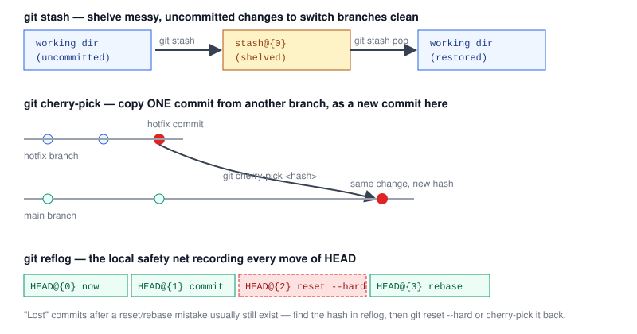

# Chapter 5 — Stash, Cherry-pick, and Reflog

> **Course:** Git & GitHub (Advanced) · **Chapter:** 5 of 8
> Read on the website: [learn.bazardev.com/git-github/05-stash-cherry-pick-reflog](https://learn.bazardev.com/git-github/05-stash-cherry-pick-reflog)
>
> 🇧🇩 **Prefer Bangla?** [Read this chapter in Bangla →](https://learn.bazardev.com/git-github/05-stash-cherry-pick-reflog?lang=bn)

Three independent tools in this chapter, each solving a different everyday problem: pausing unfinished work, copying a single commit somewhere else, and recovering from a mistake you thought was unrecoverable.



## 1. `git stash` — shelve unfinished work to switch branches cleanly

You're mid-change, nothing is ready to commit, and you suddenly need to switch branches — to review a teammate's PR, fix an urgent bug, whatever. Git won't let you switch branches cleanly if it would overwrite uncommitted changes that conflict with the other branch. `git stash` solves this by temporarily shelving your uncommitted changes, giving you back a clean working directory:

```bash
git stash              # shelve all uncommitted changes
git switch main         # now safe to switch — working dir is clean
# ...do the urgent thing...
git switch feature/login
git stash pop           # bring the shelved changes back, remove them from the stash
```

A few extra commands worth knowing:

```bash
git stash list                      # see everything currently stashed
git stash push -m "wip: login form" # stash with a descriptive name instead of the default
git stash show -p stash@{0}         # preview what's inside a stash without applying it
git stash apply                     # like pop, but keeps the stash around afterward (useful if you want to apply it to more than one branch)
git stash drop stash@{0}            # delete a stash you no longer need
```

A stash is **local only** — it's never pushed, and it lives in your repository until you pop/apply or drop it, or until you delete the repository.

## 2. `git cherry-pick` — copy one specific commit elsewhere

Sometimes you need exactly one commit's changes on a different branch, without merging or rebasing the whole branch. Classic case: someone commits a critical fix directly on a `hotfix` branch, and you need that exact fix on `main` too, without pulling in anything else from `hotfix`.

```bash
git switch main
git cherry-pick a1b2c3d
```

Git takes the changes introduced by commit `a1b2c3d` and applies them as a **brand new commit** on your current branch — same changes, same message by default, but a completely new commit hash (just like a rebase replay). If the target branch has changed the same lines, cherry-pick can conflict exactly like a merge or rebase — resolve it the same way you learned in [Chapter 3](/git-github/03-resolving-merge-conflicts): fix the markers, `git add`, then `git cherry-pick --continue` (or `--abort` to cancel).

Common real-world uses:
- Backporting a bugfix from `main` into an older `release/1.2` branch that's still being maintained.
- Pulling one genuinely useful commit out of a messy experimental branch you're about to throw away.
- Moving a commit that accidentally landed on the wrong branch onto the right one.

## 3. `git reflog` — the safety net for "I think I just destroyed my work"

Every time `HEAD` moves in your local repository — a commit, a checkout, a rebase, a reset, a merge — Git silently records it in the **reflog**. This is separate from your commit history; it's a log of everywhere your `HEAD` has *pointed*, kept locally, regardless of whether those commits are still reachable any other way.

```bash
git reflog
```

```
a1b2c3d (HEAD -> main) HEAD@{0}: commit: Add input validation
e4f5g6h HEAD@{1}: rebase (finish): returning to refs/heads/main
h7i8j9k HEAD@{2}: reset: moving to HEAD~3
l0m1n2o HEAD@{3}: commit: Add login form
```

This matters because of a very common panic moment: you ran `git reset --hard` one step too far, or a rebase went wrong, and commits you swore you had are just... gone from `git log`. They are almost never actually gone — Git doesn't delete commit objects immediately, it just stops pointing at them. The reflog still remembers exactly where `HEAD` was before the mistake:

```bash
git reflog                       # find the entry from right before the mistake, e.g. HEAD@{2}
git reset --hard HEAD@{2}        # move HEAD (and your branch) back to that exact point
# or, to grab just one specific commit instead of resetting everything:
git cherry-pick h7i8j9k
```

The reflog is **local only** (never pushed, never shared with teammates) and entries eventually expire — by default Git keeps unreachable commits reachable via reflog for about 90 days before it becomes eligible for garbage collection. For anything recent, though, this is genuinely one of the most reassuring tools in Git: very few mistakes here are actually permanent.

## 4. Key takeaways

- `git stash` shelves uncommitted changes so you can switch branches with a clean working directory; `git stash pop` brings them back. Stashes are local only.
- `git cherry-pick <hash>` copies one specific commit's changes onto your current branch as a brand-new commit — useful for backports and moving a commit to the right branch. It can conflict just like a merge, resolved the same way.
- `git reflog` is a local record of every place `HEAD` has pointed — commits, resets, rebases, checkouts — independent of your visible commit history.
- Most "I accidentally destroyed my commits" panics are solvable: find the commit in `git reflog`, then `git reset --hard` to it or `git cherry-pick` the specific commit back.
- None of these three (stash entries, reflog entries) are ever pushed to a remote — they exist only in your local repository.

## 5. Test yourself (exam prep)

<details>
<summary><strong>Q1. Why would you use `git stash` instead of just committing your unfinished work before switching branches?</strong></summary>

Stashing lets you get a clean working directory instantly without creating a half-finished commit in your history. It's meant for short-term shelving of work you're not ready to commit yet, whereas committing unfinished work would leave a messy "wip" commit you'd later need to clean up (e.g. via the interactive rebase from Chapter 4).
</details>

<details>
<summary><strong>Q2. What's the key difference between `git cherry-pick` and `git merge` when bringing one commit's changes onto another branch?</strong></summary>

`git cherry-pick` applies only the changes from one specific commit, creating a single new commit on the current branch — nothing else from the source branch comes along. `git merge` brings in the entire history of the other branch (every commit unique to it), not just one.
</details>

<details>
<summary><strong>Q3. After an accidental `git reset --hard` that seems to have deleted recent commits, what's the first command you'd run, and why?</strong></summary>

`git reflog` — it shows every position `HEAD` has recently pointed to, including the commit that existed right before the reset. Since Git doesn't immediately delete commit objects when a branch stops pointing at them, the "lost" commit's hash is almost always still visible there and can be recovered.
</details>

<details>
<summary><strong>Q4. If a teammate asks you to share a specific stash or reflog entry with them, what would you tell them?</strong></summary>

You can't — both stashes and the reflog are purely local to your own repository and are never pushed or shared with anyone else. If they need the actual change, you'd need to turn it into a real commit (e.g. apply the stash and commit it, or cherry-pick the commit) and push that instead.
</details>

## 6. Free resources

- Official docs: [Git Tools — Stashing and Cleaning](https://git-scm.com/book/en/v2/Git-Tools-Stashing-and-Cleaning)
- Official docs: [`git cherry-pick` reference](https://git-scm.com/docs/git-cherry-pick)
- Official docs: [Git Internals — Maintenance and Data Recovery (reflog)](https://git-scm.com/book/en/v2/Git-Internals-Maintenance-and-Data-Recovery)

---

**Next:** Chapter 6 — Pull Requests and Code Review on GitHub *(coming soon)*
