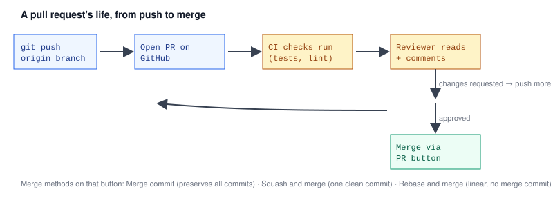

# Chapter 6 — Pull Requests and Code Review on GitHub

> **Course:** Git & GitHub (Advanced) · **Chapter:** 6 of 8
> Read on the website: [learn.bazardev.com/git-github/06-pull-requests-and-code-review](https://learn.bazardev.com/git-github/06-pull-requests-and-code-review)
>
> 🇧🇩 **Prefer Bangla?** [Read this chapter in Bangla →](https://learn.bazardev.com/git-github/06-pull-requests-and-code-review?lang=bn)

Everything so far has been pure Git — it works the same whether you host your code on GitHub, GitLab, or nowhere at all. A **pull request (PR)** is not a Git concept; it's a GitHub feature built on top of Git, and it's how most real teams actually get code from a feature branch into `main`.



## 1. What a pull request actually is

A PR is a **proposal**: "here's my branch, here's how it differs from `main`, please review it and merge it when it's ready." Opening one doesn't change any code by itself — it just creates a page on GitHub showing the diff, where discussion, automated checks, and the eventual merge all happen.

```bash
git push origin feature/login
```

Push your branch, then on GitHub: "Compare & pull request" → pick the base branch (usually `main`) and the branch you just pushed → write a description → "Create pull request."

## 2. Writing a PR that's easy to review

A good PR description answers two questions a reviewer always has: **what changed, and why.** The diff already shows *what* line by line — your description should carry the *why*, plus anything non-obvious a reviewer needs to know (a tricky edge case, a deliberate tradeoff, what you tested).

Linking an issue in the description (`Closes #42`) automatically closes that issue the moment the PR merges — a small habit that keeps a project's issue tracker honest without extra manual work.

Not ready for review yet, but want visibility or early CI feedback? Open it as a **draft PR** — same page, same checks, but it signals "not ready to merge" and most teams won't review it until you mark it ready.

## 3. The review itself

Reviewers can leave three kinds of feedback:
- **Comment** — a question or note, no judgment on mergeability either way.
- **Approve** — "this is good to merge," optionally with minor comments.
- **Request changes** — blocks merging (if branch protection requires it) until the author addresses the feedback and the reviewer re-approves.

Reviewers comment directly on specific lines of the diff, and can even propose an exact replacement via GitHub's "suggestion" feature, which the author can accept with one click. When the author pushes more commits in response, they appear directly in the same PR — there's no need to close and reopen anything.

## 4. Checks: the automated reviewer

Most real projects run automated checks on every PR — a test suite, a linter, a type-checker — via CI (the full subject of a later course in this series). These show up right on the PR page as pass/fail status checks. [Chapter 1](/git-github/01-branching-strategies) mentioned branch protection rules; this is where they connect: a protected `main` branch can require these checks to pass, and require an approving review, before the merge button even becomes clickable.

## 5. Merging: three different methods, same destination

GitHub's merge button actually offers three distinct ways to bring a PR's commits into the base branch — this is exactly [Chapter 2](/git-github/02-merge-vs-rebase)'s merge-vs-rebase decision, just exposed as a UI choice:

| Method | What it does | When it's the right pick |
|---|---|---|
| **Merge commit** | Standard `git merge` — keeps every commit from the branch, adds one merge commit | You want the full, honest history of how the feature was built |
| **Squash and merge** | Combines every commit on the branch into a single new commit on the base branch | The branch has messy "wip"/"fix typo" commits ([Chapter 4](/git-github/04-interactive-rebase) territory) and you want `main`'s history to show one clean entry per feature |
| **Rebase and merge** | Replays the branch's commits individually onto the base branch, no merge commit | You want a fully linear history and the branch's individual commits are already clean and meaningful |

Many teams standardize on **squash and merge** for feature branches specifically because it makes `main`'s history trivially easy to read — one commit per PR — without requiring every contributor to practice perfect commit hygiene.

## 6. Key takeaways

- A pull request is a GitHub feature, not a Git concept — it's a review-and-merge proposal built around a pushed branch.
- A good description explains *why*, not just *what*; link issues with `Closes #N` to auto-close them on merge.
- Reviews are comment, approve, or request changes — the last one can block merging if branch protection requires it.
- Status checks (CI) run automatically on a PR and can also be required before merging, alongside required reviews.
- The three merge methods (merge commit, squash, rebase) are the UI version of Chapter 2's decision — squash is the common default for keeping `main`'s history clean.

## 7. Test yourself (exam prep)

<details>
<summary><strong>Q1. Is a pull request a Git feature or a GitHub feature? What does opening one actually do to your code?</strong></summary>

It's a GitHub feature (other platforms have their own equivalents, like GitLab's merge requests) — Git itself has no concept of a "pull request." Opening one doesn't change any code; it creates a review page showing the diff between your pushed branch and the base branch, where discussion, checks, and the eventual merge happen.
</details>

<details>
<summary><strong>Q2. What's the effect of writing "Closes #42" in a PR description?</strong></summary>

GitHub automatically closes issue #42 the moment that PR is merged, keeping the issue tracker in sync with actual code changes without requiring anyone to manually close the issue afterward.
</details>

<details>
<summary><strong>Q3. If a repository's branch protection requires an approving review and passing status checks, what happens if a reviewer clicks "Request changes"?</strong></summary>

The merge button becomes blocked — the PR cannot be merged until the author addresses the feedback (typically by pushing more commits) and the reviewer either approves or their "request changes" is dismissed, even if all automated status checks are passing.
</details>

<details>
<summary><strong>Q4. A feature branch has ten commits, several of them "wip" or "fix typo." Which merge method keeps `main`'s history cleanest, and what does it do to those ten commits?</strong></summary>

Squash and merge — it combines all ten commits into a single new commit on the base branch, so `main` ends up with one clean entry representing the whole feature, regardless of how messy the individual commits on the branch were.
</details>

## 8. Free resources

- Official guide: [About pull requests (GitHub Docs)](https://docs.github.com/en/pull-requests/collaborating-with-pull-requests/proposing-changes-to-your-work-with-pull-requests/about-pull-requests)
- Official guide: [About pull request merges](https://docs.github.com/en/pull-requests/collaborating-with-pull-requests/incorporating-changes-from-a-pull-request/about-pull-request-merges)

---

**Next:** Chapter 7 — Undoing Mistakes: reset vs revert *(coming soon)*
