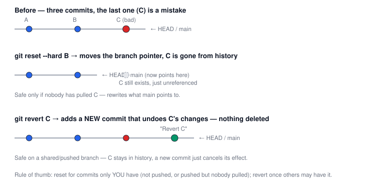

# Chapter 7 — Undoing Mistakes: reset vs revert

> **Course:** Git & GitHub (Advanced) · **Chapter:** 7 of 8
> Read on the website: [learn.bazardev.com/git-github/07-reset-vs-revert](https://learn.bazardev.com/git-github/07-reset-vs-revert)
>
> 🇧🇩 **Prefer Bangla?** [Read this chapter in Bangla →](https://learn.bazardev.com/git-github/07-reset-vs-revert?lang=bn)

You've already met `git reflog` ([Chapter 5](/git-github/05-stash-cherry-pick-reflog)) as the safety net for when something goes wrong by accident. This chapter is about the two tools you reach for **deliberately** when a commit you made on purpose turns out to be wrong: `git reset` and `git revert`. They solve the same problem in opposite ways, and picking the wrong one on a shared branch causes exactly the kind of mess [Chapter 2](/git-github/02-merge-vs-rebase) warned about.



## 1. `git reset` — move the branch pointer, rewrite history

`git reset` moves your current branch to point at a different (usually earlier) commit. The commit(s) you reset past aren't "merged away" or recorded anywhere in the new history — they simply stop being part of it (though, as Chapter 5 covered, they're still recoverable via reflog for a while).

```bash
git reset --soft HEAD~1    # undo the last commit, keep its changes staged
git reset --mixed HEAD~1   # undo the last commit, keep its changes unstaged (this is the default mode)
git reset --hard HEAD~1    # undo the last commit AND discard its changes completely
```

The three modes only differ in what happens to your **working directory and staging area** — all three move the branch pointer the same way:

| Mode | Branch pointer | Staged changes | Working directory files |
|---|---|---|---|
| `--soft` | Moves back | Keeps the undone commit's changes staged | Unchanged |
| `--mixed` (default) | Moves back | Unstages the undone commit's changes | Unchanged — changes are still there, just unstaged |
| `--hard` | Moves back | Cleared | **Discarded** — matches the target commit exactly |

`--hard` is destructive to anything uncommitted — always `git status` first, and remember reflog is your way back if you reset too far.

## 2. `git revert` — add a new commit that undoes an old one

`git revert` never rewrites or removes anything. It inspects what a target commit changed, and creates a **brand-new commit** that applies the exact opposite change — net effect: the bad change is cancelled, but the original (bad) commit, and the new undo commit, both stay permanently visible in history.

```bash
git revert a1b2c3d
```

This can conflict exactly like a merge, if later commits touched the same lines the revert needs to undo — resolve it the same way as [Chapter 3](/git-github/03-resolving-merge-conflicts): fix the markers, `git add`, then `git revert --continue` (or `--abort`).

## 3. So which one, when?

This is a direct application of the golden rule from Chapter 2 — it comes down to whether anyone else might already have the commit you're undoing:

| Situation | Use | Why |
|---|---|---|
| A commit that exists only on your machine, never pushed | **`reset`** | Nobody else has it; rewriting your own unpushed history is always safe |
| You pushed a commit, but you're certain nobody has pulled it yet (just you, just now) | **`reset`** (then a normal push, or force-push if needed) | Still effectively private |
| A commit that's already on a shared branch (`main`, or any branch others have pulled) | **`revert`** | Rewriting shared history diverges everyone else's copy, exactly as Chapter 2 warned; revert fixes the problem without touching history anyone else relies on |
| You need the mistake gone from history entirely, even on a shared branch | Neither, carefully — this needs team coordination (history rewrite + everyone re-syncing), same "rare and deliberate" territory Chapter 2 described | Routine `reset --hard` + force-push on a shared branch breaks everyone else's clone |

## 4. Key takeaways

- `git reset` moves your branch pointer to a different commit and rewrites history — `--soft` keeps changes staged, `--mixed` (default) unstages them, `--hard` discards them entirely.
- `git revert` never rewrites anything — it adds a new commit that cancels out an old one, leaving both visible in history.
- Reset is for commits only you have; revert is for commits that might already be on a shared branch — the same reasoning as Chapter 2's merge-vs-rebase rule.
- `git revert` can conflict just like a merge, resolved the same way as Chapter 3.
- `reset --hard` discards uncommitted changes permanently from your working directory — check `git status` first, and remember `git reflog` can still recover a commit you reset past.

## 5. Test yourself (exam prep)

<details>
<summary><strong>Q1. What's the one thing all three `git reset` modes (`--soft`, `--mixed`, `--hard`) have in common, and what differs between them?</strong></summary>

All three move the branch pointer back to the target commit in exactly the same way. They differ only in what happens to the undone commit's changes: `--soft` keeps them staged, `--mixed` (the default) unstages them but keeps them in the working directory, and `--hard` discards them completely.
</details>

<details>
<summary><strong>Q2. After `git revert a1b2c3d`, does commit `a1b2c3d` still exist in the repository's history?</strong></summary>

Yes — `git revert` never removes or rewrites anything. It adds a brand-new commit that applies the opposite of `a1b2c3d`'s changes; both the original commit and the new revert commit remain permanently visible in history.
</details>

<details>
<summary><strong>Q3. A bad commit was merged into `main` yesterday and several teammates have already pulled it. Which tool should you use to undo it, and why?</strong></summary>

`git revert` — since teammates have already pulled the commit, rewriting history with `git reset` (plus a force-push) would diverge their local copies from the remote, the same problem Chapter 2 warned about with rebasing shared branches. Revert fixes the issue by adding a new commit, without touching the history anyone has already based work on.
</details>

<details>
<summary><strong>Q4. You ran `git reset --hard HEAD~1` and immediately realize you needed that commit. Is it recoverable, and how?</strong></summary>

Usually yes. Git doesn't delete the commit object immediately — it's still sitting there unreferenced. Running `git reflog` will show the commit's hash from right before the reset, and `git reset --hard <that hash>` (or `git cherry-pick <that hash>`) brings it back, exactly as covered in Chapter 5.
</details>

## 6. Free resources

- Official docs: [`git reset` reference](https://git-scm.com/docs/git-reset)
- Official docs: [`git revert` reference](https://git-scm.com/docs/git-revert)
- Official guide: [Git Tools — Reset Demystified](https://git-scm.com/book/en/v2/Git-Tools-Reset-Demystified)

---

**Next:** Chapter 8 — GitHub Power Features *(coming soon)*
