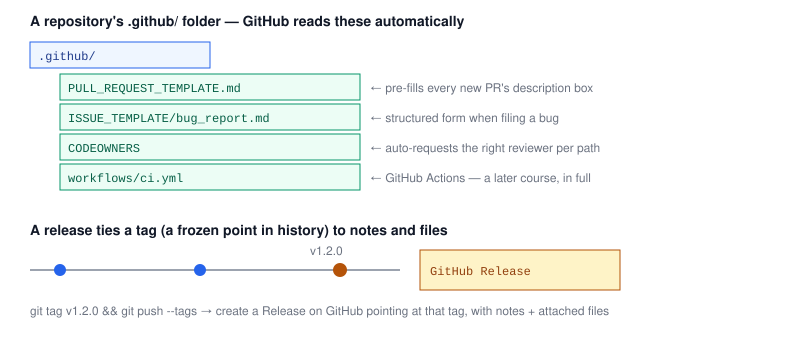

# Chapter 8 — GitHub Power Features

> **Course:** Git & GitHub (Advanced) · **Chapter:** 8 of 8 (final chapter)
> Read on the website: [learn.bazardev.com/git-github/08-github-power-features](https://learn.bazardev.com/git-github/08-github-power-features)
>
> 🇧🇩 **Prefer Bangla?** [Read this chapter in Bangla →](https://learn.bazardev.com/git-github/08-github-power-features?lang=bn)

This last chapter is a tour of GitHub features beyond Git itself and beyond the pull request flow from Chapter 6 — the kind of things that quietly make a well-run repository feel organized, instead of a pile of code with no process around it.



## 1. Issues, labels, and milestones

An **issue** is a tracked unit of work — a bug report, a feature request, a task — with its own discussion thread, independent of any specific commit or branch. **Labels** (`bug`, `good first issue`, `priority:high`) make a long issue list filterable at a glance. A **milestone** groups issues and PRs toward a specific target (like "v2.0 release"), with GitHub showing you a simple progress bar of how many are done.

Reference an issue from a commit message or PR description with `#42`, and GitHub automatically turns it into a clickable link — and as Chapter 6 covered, `Closes #42` in a PR auto-closes that issue on merge.

## 2. `.github/` — files GitHub reads automatically

A few specially-named files, if present in a `.github/` folder at the repo root, change GitHub's behavior without any configuration elsewhere:

- **`PULL_REQUEST_TEMPLATE.md`** — pre-fills the description box every time someone opens a new PR, so you can enforce "what changed / why / how was it tested" as a habit instead of hoping people remember.
- **`ISSUE_TEMPLATE/`** — a folder of templates (or a newer YAML-based structured form) that gives bug reports and feature requests a consistent shape, instead of a blank box.
- **`CODEOWNERS`** — maps file paths to GitHub usernames/teams, so a PR touching `/backend/**` automatically requests a review from whoever owns that path. Combined with the branch protection from Chapter 1, you can require that owner's approval specifically, not just any approval.

## 3. The GitHub CLI (`gh`)

Everything on github.com's web UI has a command-line equivalent through `gh`, which is genuinely faster once it's muscle memory — no browser tab-switching to open a PR or check CI status:

```bash
gh pr create --fill              # open a PR using your branch's commits for the title/body
gh pr status                     # see the state of your open PRs
gh pr checkout 42                # fetch and switch to the branch behind PR #42, to review it locally
gh issue create --title "Bug: login fails on Safari"
gh repo clone Nirjhor3029/devops-for-developers
```

## 4. Releases and tags

A **tag** is a permanent, named pointer to one specific commit — unlike a branch, it doesn't move forward as new commits are added. Tags are how projects mark version numbers:

```bash
git tag v1.2.0
git push --tags
```

A GitHub **Release** builds on top of a tag: a dedicated page with release notes, a changelog, and optionally attached files (compiled binaries, a zip of the source at that exact point). GitHub can even auto-generate the notes from merged PRs since the last release.

## 5. A few more worth knowing

- **Gists** — a single file (or a few) shared via a quick, shareable link, with its own lightweight version history — useful for a code snippet or config example that doesn't deserve a whole repository.
- **Code search** (`github.com/search`, or press `/` on any page) — searches code across all of GitHub (or scoped to one repo/org), including matching on symbols and regex, far beyond what a browser's find-on-page can do.
- **Saved replies** — canned responses you can insert into any issue/PR comment box, handy for a repository's common "please fill out the template" or "please rebase onto main" response.
- **GitHub Actions** — automatically running tests, builds, or deployments on events like a push or a PR — is powerful enough to deserve its own full course later in this series (CI/CD), so this chapter only flags that it exists and connects directly to the `workflows/ci.yml` status checks from Chapter 6.

## 6. Key takeaways

- Issues, labels, and milestones organize work and discussion independent of any specific branch or commit; `Closes #N` in a PR connects the two.
- `.github/PULL_REQUEST_TEMPLATE.md`, `ISSUE_TEMPLATE/`, and `CODEOWNERS` are files GitHub reads automatically to standardize PRs, issues, and review assignment.
- The `gh` CLI mirrors nearly everything on github.com's web UI, letting you create/review PRs and issues without leaving the terminal.
- A tag is a permanent pointer to one commit (used for version numbers); a GitHub Release builds a notes-and-files page on top of a tag.
- GitHub Actions (CI/CD automation) connects directly to the status checks from Chapter 6, and gets its own dedicated course later in this series.

## 7. Test yourself (exam prep)

<details>
<summary><strong>Q1. What does writing "Closes #42" in a PR description do, and which earlier chapter covered this?</strong></summary>

It links the PR to issue #42 and automatically closes that issue the moment the PR is merged — this was first covered in Chapter 6 (Pull Requests and Code Review).
</details>

<details>
<summary><strong>Q2. If a repository has a `CODEOWNERS` file mapping `/backend/**` to a specific team, and branch protection requires owner approval, what happens when someone opens a PR that only touches `/frontend/**` files?</strong></summary>

That specific CODEOWNERS rule wouldn't apply, since the PR doesn't touch any `/backend/**` paths — it would only trigger a required review from whichever owner (if any) is mapped to the `/frontend/**` paths actually changed, or no automatic owner review at all if nothing in CODEOWNERS matches those paths.
</details>

<details>
<summary><strong>Q3. What's the key difference between a Git tag and a Git branch?</strong></summary>

A branch is a pointer that moves forward automatically as new commits are added to it. A tag is a permanent pointer to one specific commit — it doesn't move, which is exactly why tags are used to mark fixed version numbers like `v1.2.0`.
</details>

<details>
<summary><strong>Q4. Why does this chapter only briefly mention GitHub Actions instead of covering it in depth?</strong></summary>

GitHub Actions (automated CI/CD — running tests, builds, and deployments on events like pushes or PRs) is substantial enough to warrant its own full course later in this series, so this chapter only connects it to the status checks concept from Chapter 6 rather than teaching it in depth here.
</details>

## 8. Free resources

- Official guide: [About issues](https://docs.github.com/en/issues/tracking-your-work-with-issues/about-issues)
- Official guide: [About code owners](https://docs.github.com/en/repositories/managing-your-repositorys-settings-and-features/customizing-your-repository/about-code-owners)
- Official guide: [GitHub CLI manual](https://cli.github.com/manual/)
- Official guide: [About releases](https://docs.github.com/en/repositories/releasing-projects-on-github/about-releases)

---

## Course complete

That's all 8 chapters of **Git & GitHub (Advanced)** — from choosing a branching strategy, through merge vs rebase, resolving conflicts, cleaning up history, the local recovery toolkit, pull requests, undoing mistakes safely, and the GitHub features that tie a whole team's workflow together.

Head back to the [course homepage](https://learn.bazardev.com) to continue with another course from the roadmap.
