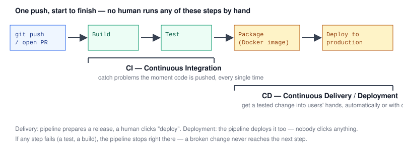

# Chapter 1 — What is CI/CD, and why does it matter?

> **Course:** CI/CD (GitHub Actions) · **Chapter:** 1 of 8
> Read on the website: [learn.bazardev.com/cicd/01-what-is-cicd](https://learn.bazardev.com/cicd/01-what-is-cicd)
>
> 🇧🇩 **Prefer Bangla?** [Read this chapter in Bangla →](https://learn.bazardev.com/cicd/01-what-is-cicd?lang=bn)

If you've finished the [Git & GitHub course](/git-github), you already know how to get code reviewed and merged through a pull request. CI/CD is the layer that sits on top of that: instead of a human manually running tests, building the app, and deploying it every single time, a machine does all three — automatically, consistently, every time someone pushes code.

## 1. The problem this solves

Before CI/CD, a typical workflow looked like this: a developer finishes a feature, manually runs the test suite on their own machine (if they remember to), manually SSHs into a server, pulls the latest code, and restarts the app. Every one of those manual steps is a place where something can go wrong — a forgotten test run, a typo during a manual deploy, a "works on my machine" bug nobody catches because the reviewer never actually ran the code.

A **pipeline** replaces all of that with a fixed, automated sequence of steps that runs identically every single time, triggered by something happening in your repository (a push, a PR, a merge).

## 2. CI — Continuous Integration

**Continuous Integration** means every change gets automatically built and tested the moment it's pushed — not once a week, not "whenever someone remembers," but on every single push or pull request. This directly connects to [Git & GitHub Chapter 6](/git-github/06-pull-requests-and-code-review): the "status checks" on a PR that branch protection can require are exactly CI running automatically.

The core idea is to catch problems **as early and as cheaply as possible**. A bug caught the moment it's pushed costs a few minutes to fix. The same bug discovered after it's merged into `main`, or worse, after it reaches production, costs far more — now someone has to track down what broke, when, and why, often under pressure.

## 3. CD — Continuous Delivery vs. Continuous Deployment

CD is often said as one thing, but it actually refers to two related but distinct practices:

| | Continuous **Delivery** | Continuous **Deployment** |
|---|---|---|
| What happens automatically | Every change that passes CI is automatically packaged and made ready to release | Every change that passes CI is automatically released to production |
| Human involvement | Someone still clicks a button to actually deploy | Nobody clicks anything — it ships itself |
| Why a team might choose this | Want a manual gate before anything reaches real users (e.g. a scheduled release window) | Confident enough in the test suite and pipeline to ship every passing change immediately |

Both are "automated past where CI leaves off" — the difference is purely whether a human approves the final release step.

## 4. What a real pipeline actually does, step by step

Using the diagram above as the shape: a push or PR triggers the pipeline, which runs **build** (compile/install dependencies, make sure the code even runs), then **test** (the automated test suite), then — once both pass — moves into the CD side: **package** (e.g., build a Docker image, exactly like [Docker Chapter 4](/docker/04-dockerfile) covered) and **deploy** (get that packaged app running somewhere real).

The critical property of a pipeline is that **a failure at any step stops everything after it**. If tests fail, nothing gets packaged or deployed — a broken change simply never reaches production, because the pipeline itself refuses to proceed.

## 5. Why this matters even for a small project

It's tempting to think CI/CD is only for large teams. In practice, even a solo developer benefits: it removes the mental overhead of remembering to run tests before every deploy, it makes the deploy process identical every time (no "which command was it again?"), and it creates an honest, visible record of exactly what was tested and when a specific change went live.

## 6. Key takeaways

- A pipeline automates the sequence of build → test → package → deploy that used to require manual steps, running it identically on every push.
- CI (Continuous Integration) means every push is automatically built and tested — this is what powers the status checks from Git & GitHub Chapter 6.
- Continuous Delivery automates everything up to a human clicking "deploy"; Continuous Deployment automates the deploy itself too, with no human click.
- A failing step stops the pipeline — a broken change never reaches the steps after it, let alone production.
- CI/CD benefits projects of any size, not just large teams — consistency and early bug detection matter even solo.

## 7. Test yourself (exam prep)

<strong>Q1. How does CI connect to the "status checks" concept from the Git & GitHub course?</strong>

The status checks that show up on a pull request (and that branch protection can require before merging) are the direct result of CI running automatically on that PR — build and test steps triggered by the push, reporting pass/fail back to GitHub.

<strong>Q2. What is the key difference between Continuous Delivery and Continuous Deployment?</strong>

Both automate everything through building, testing, and packaging a change that's ready to release. Continuous Delivery stops there and waits for a human to manually trigger the actual deployment; Continuous Deployment goes one step further and deploys automatically too, with no human action required.

<strong>Q3. If the "test" step of a pipeline fails, what happens to the "package" and "deploy" steps that would normally come after it?</strong>

They never run. A pipeline stops at the first failing step — a change that fails its tests is never packaged or deployed, which is exactly the mechanism that prevents broken code from reaching production.

<strong>Q4. Why might CI/CD be worth setting up even for a solo developer working alone on a small project?</strong>

It removes the need to remember to manually run tests or follow the exact right deploy steps every time, makes the process identical and repeatable regardless of mood or memory, and creates a clear record of what was tested and when each change actually went live.

## 8. Free resources

- Official guide: [GitHub Actions documentation](https://docs.github.com/en/actions)
- Overview: [What is CI/CD? (Red Hat)](https://www.redhat.com/en/topics/devops/what-is-ci-cd)

---

**Next:** Chapter 2 — GitHub Actions basics: workflows, jobs, steps *(coming soon)*
