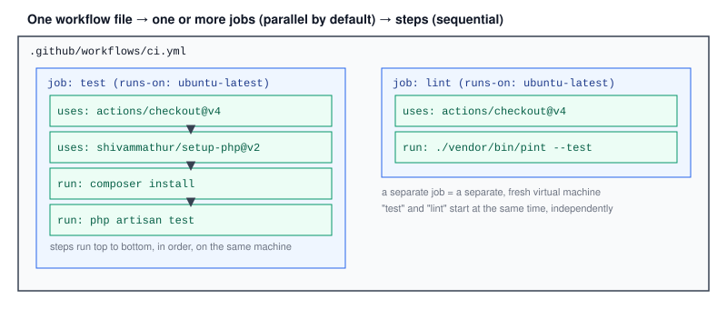

# Chapter 2 — GitHub Actions Basics: Workflows, Jobs, Steps

> **Course:** CI/CD (GitHub Actions) · **Chapter:** 2 of 8
> Read on the website: [learn.bazardev.com/cicd/02-github-actions-basics](https://learn.bazardev.com/cicd/02-github-actions-basics)
>
> 🇧🇩 **Prefer Bangla?** [Read this chapter in Bangla →](https://learn.bazardev.com/cicd/02-github-actions-basics?lang=bn)

Chapter 1 described CI/CD conceptually. **GitHub Actions** is GitHub's own built-in tool for actually running one — no separate service to sign up for, no extra account. This chapter covers the three building blocks every workflow is made of.



## 1. A workflow is just a YAML file

Any file placed at `.github/workflows/*.yml` in your repository is a workflow. GitHub reads it, and runs it when the conditions you specify are met:

```yaml
name: CI

on: push

jobs:
  test:
    runs-on: ubuntu-latest
    steps:
      - uses: actions/checkout@v4
      - uses: shivammathur/setup-php@v2
        with:
          php-version: '8.3'
      - run: composer install
      - run: php artisan test
```

- **`name`** — what shows up in GitHub's "Actions" tab for this workflow.
- **`on`** — what triggers it (here, every push; Chapter 3 covers this in depth).
- **`jobs`** — one or more named jobs this workflow runs.

## 2. A job runs on its own fresh virtual machine

Everything under a job's `runs-on` key picks the **runner** — a virtual machine GitHub spins up just for this job, runs your steps on, then throws away completely once it's done. `ubuntu-latest` is by far the most common choice; `windows-latest` and `macos-latest` exist for platform-specific builds (and you can run your own self-hosted runner instead, for specialized hardware or network access).

Because each runner starts completely empty, the **very first step in almost every job** is `actions/checkout@v4` — without it, your workflow would be running in an empty folder with no access to your repository's code at all.

**Multiple jobs in the same workflow run in parallel by default**, each on its own separate runner, completely independent of each other — exactly like the diagram shows `test` and `lint` starting at the same moment. If one job genuinely needs another to finish first (e.g., build before deploy), you declare that explicitly with `needs:` — covered more in a later chapter.

## 3. A step is either a command or a reusable action

Within a job, steps run **sequentially, top to bottom, on that same runner** — each one can see files and state left behind by the step before it. A step is one of two things:

- **`run:`** — a literal shell command, exactly as you'd type it in a terminal. `run: php artisan test` just runs that command on the runner.
- **`uses:`** — a reusable, pre-built **action** someone else (often GitHub itself, or the broader community) has already written, referenced by `owner/repo@version`. `actions/checkout@v4` is GitHub's own action for fetching your repository's code; `shivammathur/setup-php@v2` is a popular community action that installs a specific PHP version onto the runner.

Actions can take inputs via `with:`, as shown above with `php-version: '8.3'`. You rarely need to write your own action from scratch — GitHub's [Marketplace](https://github.com/marketplace?type=actions) has a pre-built action for almost anything common (setting up a language runtime, deploying to a cloud provider, sending a Slack notification).

## 4. Watching it run

Every push that triggers a workflow shows up under your repository's **Actions** tab, listing each run with a green check or red X. Opening a run shows every job, and opening a job shows every step's live/complete log output — exactly what you'd see if you'd run those commands yourself in a terminal, which makes debugging a failed step straightforward: find the red step, read its log.

## 5. Key takeaways

- A workflow is a YAML file at `.github/workflows/*.yml`, defining what triggers it (`on`) and what it runs (`jobs`).
- Each job runs on its own fresh, disposable virtual machine (the "runner"); `actions/checkout@v4` is almost always the first step, since the runner starts with no code on it.
- Multiple jobs in one workflow run in parallel by default; steps within one job run sequentially on the same runner.
- A step is either `run:` (a raw shell command) or `uses:` (a reusable, versioned action, often from GitHub's Marketplace).
- The Actions tab shows every run, job, and step's log — the first place to look when something fails.

## 6. Test yourself (exam prep)

<details>
<summary><strong>Q1. Why does almost every job start with an `actions/checkout@v4` step?</strong></summary>

A job's runner is a completely fresh virtual machine with nothing on it — not even your repository's own code. The checkout action fetches your repository's files onto the runner so subsequent steps (installing dependencies, running tests) have something to actually work with.
</details>

<details>
<summary><strong>Q2. If a workflow defines two jobs, `test` and `lint`, with no `needs:` relationship between them, in what order do they run?</strong></summary>

They run in parallel, starting at essentially the same time, each on its own separate runner — jobs in a workflow run concurrently by default unless a `needs:` dependency explicitly says one must wait for another.
</details>

<details>
<summary><strong>Q3. What's the difference between a `run:` step and a `uses:` step?</strong></summary>

`run:` executes a literal shell command directly on the runner, exactly as typed. `uses:` instead runs a pre-built, versioned action referenced by `owner/repo@version` — reusable packaged functionality someone else wrote, which can accept configuration through `with:`.
</details>

<details>
<summary><strong>Q4. A workflow run shows a red X on the "test" job. Where would you look first to find out what went wrong?</strong></summary>

Open that run in the repository's Actions tab, open the failing job, and look at its step-by-step log — the specific step with a red mark will show the actual command output and error, the same output you'd see running it in a terminal yourself.
</details>

## 7. Free resources

- Official guide: [Understanding GitHub Actions](https://docs.github.com/en/actions/learn-github-actions/understanding-github-actions)
- Official guide: [Workflow syntax for GitHub Actions](https://docs.github.com/en/actions/writing-workflows/workflow-syntax-for-github-actions)
- Browse: [GitHub Actions Marketplace](https://github.com/marketplace?type=actions)

---

**Next:** Chapter 3 — Triggers: events, branches, paths, schedules *(coming soon)*
