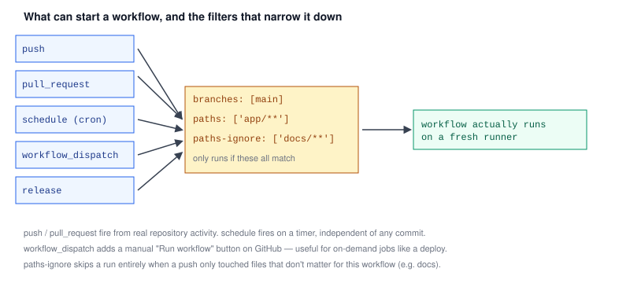

# Chapter 3 — Triggers: Events, Branches, Paths, Schedules

> **Course:** CI/CD (GitHub Actions) · **Chapter:** 3 of 8
> Read on the website: [learn.bazardev.com/cicd/03-triggers-and-events](https://learn.bazardev.com/cicd/03-triggers-and-events)
>
> 🇧🇩 **Prefer Bangla?** [Read this chapter in Bangla →](https://learn.bazardev.com/cicd/03-triggers-and-events?lang=bn)

Chapter 2 used `on: push` without much explanation. The `on:` key is actually where a lot of practical control over your pipeline lives — deciding exactly when a workflow runs is just as important as what it does once it starts, because running it unnecessarily wastes time and, on paid plans, real money.



## 1. The common event types

```yaml
on:
  push:
  pull_request:
  workflow_dispatch:
  schedule:
    - cron: '0 2 * * *'
```

- **`push`** — fires whenever commits are pushed to the repository.
- **`pull_request`** — fires when a PR is opened, or when new commits are pushed to a branch that already has an open PR. This is exactly the status-check mechanism from [Git & GitHub Chapter 6](/git-github/06-pull-requests-and-code-review).
- **`workflow_dispatch`** — adds a manual "Run workflow" button on the Actions tab in GitHub's UI. Useful for things you want triggered on-demand rather than automatically, like a production deploy you want a human to explicitly decide to run.
- **`schedule`** — runs on a timer using cron syntax, completely independent of any commit activity. `cron: '0 2 * * *'` means "every day at 2:00 AM UTC" — handy for nightly test runs or scheduled cleanup jobs. (GitHub notes scheduled runs can be delayed slightly during periods of high load — don't rely on exact timing for anything critical.)

You can list multiple events, and a workflow runs if **any** of them match.

## 2. Narrowing `push` and `pull_request` by branch

Most workflows don't need to run on every single branch. A common pattern:

```yaml
on:
  push:
    branches: [main]
  pull_request:
    branches: [main]
```

This runs the workflow on direct pushes to `main`, and on any PR **targeting** `main` — but not on, say, a developer pushing experimental commits to their own feature branch before it's even ready for review. You can also use patterns: `branches: ['release/**']` matches any branch starting with `release/`.

## 3. Narrowing by which files actually changed

A workflow that only tests PHP code doesn't need to run again just because someone updated a README. `paths` and `paths-ignore` filter based on which files a push or PR actually touched:

```yaml
on:
  push:
    paths-ignore:
      - 'docs/**'
      - '**.md'
```

This skips the workflow entirely when every changed file matches one of those ignore patterns. Flip it around with `paths:` (instead of `paths-ignore:`) to require a match instead of skip one — useful in a monorepo where you only want a service's tests to run when that service's own folder changed.

## 4. A practical combined example

```yaml
name: CI

on:
  push:
    branches: [main]
    paths-ignore: ['docs/**']
  pull_request:
    branches: [main]
  workflow_dispatch:

jobs:
  test:
    runs-on: ubuntu-latest
    steps:
      - uses: actions/checkout@v4
      - run: composer install
      - run: php artisan test
```

This runs automatically on pushes and PRs targeting `main` (skipping docs-only changes), **and** gives anyone with repo access a manual button to trigger the same tests on demand — all three without needing three separate workflow files.

## 5. A security note on forked pull requests

`pull_request` events from a **forked repository** (someone outside your project opening a PR) run with a restricted token that can't access your repository's secrets or push changes back — a safety measure, since you don't control what code a stranger's PR contains. A separate event, `pull_request_target`, runs with full access instead, but runs against your base branch's workflow file, not the fork's — using it carelessly can let a malicious fork's code run with your repository's real permissions. For most projects, the default `pull_request` behavior is exactly what you want and needs no special handling.

## 6. Key takeaways

- `on:` lists one or more events that trigger a workflow; it runs if any of them occur.
- `push` and `pull_request` fire from real repository activity; `schedule` fires on a cron timer independent of any commit; `workflow_dispatch` adds a manual trigger button.
- `branches:` restricts a trigger to specific branch names or patterns (e.g. `release/**`).
- `paths:` / `paths-ignore:` restrict a trigger based on which files actually changed, avoiding wasted runs on irrelevant changes.
- `pull_request` from a fork runs with restricted permissions by default — a deliberate safety measure against untrusted code.

## 7. Test yourself (exam prep)

<details>
<summary><strong>Q1. What's the difference between how `push` and `schedule` triggers are fired?</strong></summary>

`push` fires in direct response to real repository activity — someone pushing commits. `schedule` fires purely based on a cron timer, completely independent of whether any commits have actually happened, running at the configured times regardless of repository activity.
</details>

<details>
<summary><strong>Q2. A workflow has `paths-ignore: ['docs/**']` under its `push` trigger. A commit changes only `docs/setup.md`. Does the workflow run?</strong></summary>

No — since the only changed file matches the ignore pattern, the entire workflow run is skipped for that push, avoiding wasted CI time on a change that doesn't affect any code the workflow cares about.
</details>

<details>
<summary><strong>Q3. Why would a team add `workflow_dispatch` to a workflow that already runs automatically on `push`?</strong></summary>

It adds a manual "Run workflow" button in GitHub's UI, letting someone trigger the same workflow on demand — useful for cases like re-running a deploy without needing to make a new commit, or triggering it for a reason unrelated to any specific push.
</details>

<details>
<summary><strong>Q4. Why does GitHub run `pull_request` events from a forked repository's PR with restricted permissions?</strong></summary>

Because a PR from a fork can contain code from someone outside the project, running it with full access (including secrets) would let untrusted code potentially exfiltrate secrets or push changes. The restricted token for fork-based `pull_request` events is a deliberate safeguard against that risk.
</details>

## 8. Free resources

- Official guide: [Events that trigger workflows](https://docs.github.com/en/actions/writing-workflows/choosing-when-your-workflow-runs/events-that-trigger-workflows)
- Official guide: [Triggering a workflow (filters, paths, branches)](https://docs.github.com/en/actions/writing-workflows/choosing-when-your-workflow-runs/triggering-a-workflow)

---

**Next:** Chapter 4 — Environment variables, secrets, and matrix builds *(coming soon)*
