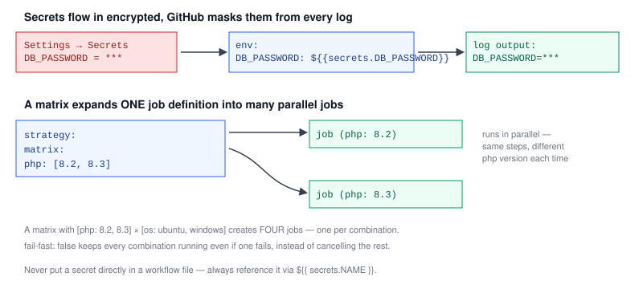

# Chapter 4 — Environment Variables, Secrets, and Matrix Builds

> **Course:** CI/CD (GitHub Actions) · **Chapter:** 4 of 8
> Read on the website: [learn.bazardev.com/cicd/04-env-vars-secrets-matrix](https://learn.bazardev.com/cicd/04-env-vars-secrets-matrix)
>
> 🇧🇩 **Prefer Bangla?** [Read this chapter in Bangla →](https://learn.bazardev.com/cicd/04-env-vars-secrets-matrix?lang=bn)

Three practical tools that make real-world pipelines possible: passing configuration into your steps, handling sensitive values safely, and testing against multiple versions without writing the same job over and over.



## 1. Environment variables with `env:`

The `env:` key sets environment variables your steps can read, and can be set at the workflow, job, or individual step level — a more specific level overrides a broader one:

```yaml
env:
  APP_ENV: testing          # available to every job in this workflow

jobs:
  test:
    runs-on: ubuntu-latest
    env:
      DB_CONNECTION: sqlite  # available to every step in this job
    steps:
      - run: echo $APP_ENV
        env:
          DEBUG: 'true'       # available only to this one step
```

GitHub Actions also provides a set of built-in variables you didn't define yourself — `github.sha` (the commit being built), `github.ref` (the branch/tag), `github.actor` (who triggered the run), and others — accessible via `${{ github.sha }}` expression syntax anywhere in the workflow file.

## 2. Secrets — values that must never appear in your code or logs

Database passwords, API keys, deployment credentials — none of these belong in your repository, ever (this is exactly the `.env`/credentials rule you'd apply to any codebase, just enforced at the pipeline level too). GitHub gives you a dedicated, encrypted place for them: **Settings → Secrets and variables → Actions** on your repository, where you add a name and a value.

Once added, reference a secret in your workflow with `${{ secrets.NAME }}`:

```yaml
steps:
  - run: ./deploy.sh
    env:
      DB_PASSWORD: ${{ secrets.DB_PASSWORD }}
      DEPLOY_KEY: ${{ secrets.DEPLOY_KEY }}
```

GitHub automatically masks any secret's value if it ever shows up in a log — even if a script accidentally echoes it, the log displays `***` instead of the real value. This isn't a reason to be careless (a secret could still leak through a poorly written script that transforms it first), but it's a meaningful safety net.

For configuration that **isn't** sensitive but you still want centrally managed — a default region name, a feature flag — GitHub also offers **variables** (`Settings → Secrets and variables → Actions → Variables` tab, referenced as `${{ vars.NAME }}`). The distinction is purely about sensitivity: use secrets for anything that would be a real problem if exposed, variables for everything else.

## 3. Matrix builds — one job definition, many parallel runs

Say you need your test suite to pass on both PHP 8.2 and PHP 8.3, or on both Ubuntu and Windows. Writing a separate near-identical job for each combination is exactly the kind of repetition `strategy.matrix` exists to eliminate:

```yaml
jobs:
  test:
    runs-on: ubuntu-latest
    strategy:
      matrix:
        php: ['8.2', '8.3']
    steps:
      - uses: actions/checkout@v4
      - uses: shivammathur/setup-php@v2
        with:
          php-version: ${{ matrix.php }}
      - run: composer install
      - run: php artisan test
```

This single job definition automatically expands into **two** actual jobs — one with `matrix.php` equal to `'8.2'`, one equal to `'8.3'` — running in parallel, each a completely independent runner. Add a second matrix dimension (`os: [ubuntu-latest, windows-latest]`) and you get **four** jobs total: every combination of the two lists.

By default, if one matrix combination fails, GitHub cancels the rest to save time. Set `fail-fast: false` if you want every combination to finish regardless, so you can see the full picture of which specific versions actually broke:

```yaml
strategy:
  fail-fast: false
  matrix:
    php: ['8.2', '8.3']
```

## 4. Key takeaways

- `env:` sets environment variables at the workflow, job, or step level; a more specific level overrides a broader one.
- Built-in context variables like `${{ github.sha }}` and `${{ github.actor }}` are available automatically, without you defining them.
- Secrets live in repository settings, are referenced with `${{ secrets.NAME }}`, and GitHub automatically masks their values from logs — never put a sensitive value directly in a workflow file.
- Non-sensitive shared configuration belongs in **variables** (`${{ vars.NAME }}`), not secrets — the distinction is purely about sensitivity.
- `strategy.matrix` expands one job definition into one parallel job per combination of listed values — `fail-fast: false` keeps all combinations running even after one fails.

## 5. Test yourself (exam prep)

<details>
<summary><strong>Q1. If a workflow sets `APP_ENV: testing` at the workflow level, and a specific step also sets `APP_ENV: staging`, what value does that step actually see?</strong></summary>

`staging` — a more specific level (step) overrides a broader one (workflow) for the same variable name. The workflow-level value still applies to every other step that doesn't override it.
</details>

<details>
<summary><strong>Q2. What happens if a script in a workflow step accidentally prints a secret's value with `echo`?</strong></summary>

GitHub automatically detects and masks known secret values in log output, replacing the actual value with `***` even if a step tries to print it directly — though this isn't foolproof against every possible way a value could be transformed before printing.
</details>

<details>
<summary><strong>Q3. Why would you use a GitHub Actions "variable" instead of a "secret" for something like a default AWS region name?</strong></summary>

Variables and secrets differ purely in sensitivity handling — secrets are encrypted and masked from logs, which matters for anything genuinely sensitive. A region name isn't sensitive information, so it belongs in variables, which are simpler and still centrally managed without the extra masking machinery secrets need.
</details>

<details>
<summary><strong>Q4. A matrix defines `php: ['8.2', '8.3']` and `os: [ubuntu-latest, windows-latest]`. How many actual jobs does this produce, and why?</strong></summary>

Four — a matrix expands into one job per combination across all listed dimensions, so two PHP versions times two operating systems produces 2 × 2 = 4 separate, parallel jobs, each with a different combination of `matrix.php` and `matrix.os`.
</details>

## 6. Free resources

- Official guide: [Using secrets in GitHub Actions](https://docs.github.com/en/actions/security-guides/using-secrets-in-github-actions)
- Official guide: [Store information in variables](https://docs.github.com/en/actions/learn-github-actions/variables)
- Official guide: [Using a matrix for your jobs](https://docs.github.com/en/actions/using-jobs/using-a-matrix-for-your-jobs)

---

**Next:** Chapter 5 — Caching and artifacts *(coming soon)*
