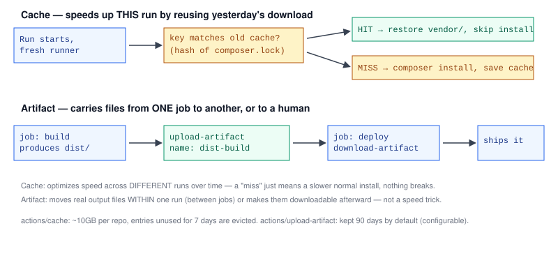

# Chapter 5 — Caching and Artifacts

> **Course:** CI/CD (GitHub Actions) · **Chapter:** 5 of 8
> Read on the website: [learn.bazardev.com/cicd/05-caching-and-artifacts](https://learn.bazardev.com/cicd/05-caching-and-artifacts)
>
> 🇧🇩 **Prefer Bangla?** [Read this chapter in Bangla →](https://learn.bazardev.com/cicd/05-caching-and-artifacts?lang=bn)

[Chapter 2](/cicd/02-github-actions-basics) mentioned that every job runs on a fresh, disposable runner. That's great for consistency, but it has a real cost: `composer install` or `npm install` runs from scratch, downloading every dependency, on every single run — even if nothing in your dependencies changed since yesterday. Caching and artifacts solve two different problems that both come from this "every run starts empty" reality.



## 1. Caching — reuse yesterday's download, if nothing changed

`actions/cache` lets a workflow save a folder (like `vendor/` or `node_modules/`) after a run, and restore it on a later run — if the **key** you give it matches:

```yaml
steps:
  - uses: actions/checkout@v4
  - uses: actions/cache@v4
    with:
      path: vendor
      key: composer-${{ hashFiles('composer.lock') }}
      restore-keys: composer-
  - run: composer install
```

The `key` is usually a hash of your lock file — meaning the cache key only changes when your actual dependencies change. If `composer.lock` is identical to last time, the key matches, GitHub restores the saved `vendor/` folder, and `composer install` finishes almost instantly (it just confirms everything's already there). If `composer.lock` changed, the key doesn't match anything cached — a **cache miss** — and `composer install` does a normal full install, then saves a new cache entry under the new key for next time.

`restore-keys` gives a fallback prefix to match a close-but-not-exact cache if the exact key isn't found — better to restore a slightly outdated cache (most dependencies unchanged) than none at all.

A cache miss is never a failure — it just means that one run is as slow as if caching didn't exist. There's no risk in using a cache key that's "too strict"; the downside is purely speed, never correctness.

Caches are scoped mostly by branch, have a combined size limit (around 10GB per repository), and entries unused for 7 days get automatically evicted — you don't need to manage cleanup yourself.

## 2. Artifacts — carry real files between jobs, or out of the pipeline entirely

A cache is for **speeding up a repeated step** across different runs over time. An artifact solves a completely different problem: getting an actual output file from one job to another **within the same run**, or making it available for a human to download after the workflow finishes.

```yaml
jobs:
  build:
    runs-on: ubuntu-latest
    steps:
      - uses: actions/checkout@v4
      - run: npm run build
      - uses: actions/upload-artifact@v4
        with:
          name: dist-build
          path: dist/

  deploy:
    needs: build
    runs-on: ubuntu-latest
    steps:
      - uses: actions/download-artifact@v4
        with:
          name: dist-build
          path: dist/
      - run: ./deploy.sh
```

Recall [Chapter 2](/cicd/02-github-actions-basics): each job gets its own separate runner, with nothing shared between them automatically. The `build` job's `dist/` folder exists only on `build`'s runner — it's gone the moment that job ends, unless something explicitly carries it forward. `upload-artifact` saves it as a named artifact attached to this workflow run; `download-artifact` in the `deploy` job (which uses `needs: build` to run after it, not in parallel) pulls that exact folder back down onto its own, completely different runner.

Artifacts are also directly useful to humans: test reports, coverage output, build logs, or screenshots from a failed UI test all show up as downloadable files right on the workflow run's summary page — genuinely helpful when debugging a failure you can't reproduce locally. By default, GitHub keeps artifacts for 90 days (configurable per-upload with `retention-days`).

## 3. The distinction that matters

| | Cache | Artifact |
|---|---|---|
| Purpose | Speed — skip redoing work that hasn't changed | Transport — move real output between jobs, or out to a human |
| Scope | Across different runs, over time | Within one run (job to job), or after that run ends |
| If missing | Silent, just slower — never breaks anything | A job expecting it will fail outright if it's missing |
| Typical content | Dependency folders (`vendor/`, `node_modules/`) | Build output, test reports, logs, screenshots |

## 4. Key takeaways

- `actions/cache` restores a previously saved folder when its key (usually a lock-file hash) matches — a miss just means a normal, slower install, never a failure.
- `restore-keys` provides a fallback prefix match when the exact cache key isn't found.
- `actions/upload-artifact` and `actions/download-artifact` move actual files between jobs in the same run (jobs need `needs:` to run in that order), and make files downloadable from the run's summary page afterward.
- Cache is purely a speed optimization; artifacts are a real data dependency — a job that needs an artifact fails if it's missing, unlike a cache miss.
- Caches auto-evict after 7 days of disuse (~10GB per repo limit); artifacts are kept 90 days by default.

## 5. Test yourself (exam prep)

<details>
<summary><strong>Q1. What happens to a workflow run if `actions/cache` can't find a matching key (a "cache miss")?</strong></summary>

Nothing breaks — the step after it (e.g. `composer install`) simply runs a normal, full installation, as if caching weren't configured at all. A cache miss only costs time, it never causes a failure.
</details>

<details>
<summary><strong>Q2. Why does a cache key typically use `hashFiles('composer.lock')` rather than something fixed like `my-cache`?</strong></summary>

Hashing the lock file means the key automatically changes only when your actual dependencies change. A fixed key would either never update (serving a stale cache forever) or need to be manually bumped — hashing the lock file keeps the cache correct without any manual effort.
</details>

<details>
<summary><strong>Q3. The `build` job creates a `dist/` folder. Why can't the `deploy` job just read that folder directly, without using artifacts?</strong></summary>

Each job runs on its own separate, disposable runner with nothing shared automatically between them. The `build` job's `dist/` folder only exists on `build`'s runner and disappears when that job ends — `upload-artifact` and `download-artifact` are what explicitly carry the folder's contents from one job's runner to the other's.
</details>

<details>
<summary><strong>Q4. If a job is expecting to download an artifact that was never uploaded (e.g. the upload step failed silently or was removed), what happens, compared to a cache miss?</strong></summary>

The download step fails outright, and typically the whole job fails with it — unlike a cache miss, which just degrades to a slower normal run, a missing artifact is a real missing dependency the job can't proceed without.
</details>

## 6. Free resources

- Official guide: [Caching dependencies to speed up workflows](https://docs.github.com/en/actions/using-workflows/caching-dependencies-to-speed-up-workflows)
- Official guide: [Storing and sharing data with workflow artifacts](https://docs.github.com/en/actions/using-workflows/storing-workflow-data-as-artifacts)

---

**Next:** Chapter 6 — Automated testing in CI *(coming soon)*
