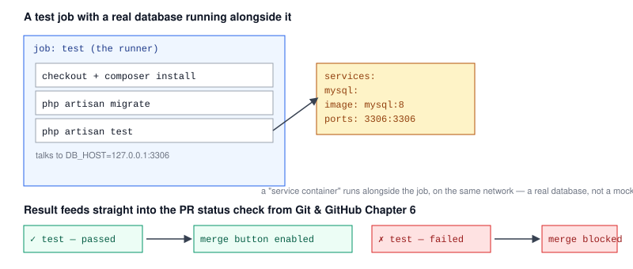

# Chapter 6 — Automated Testing in CI

> **Course:** CI/CD (GitHub Actions) · **Chapter:** 6 of 8
> Read on the website: [learn.bazardev.com/cicd/06-automated-testing-in-ci](https://learn.bazardev.com/cicd/06-automated-testing-in-ci)
>
> 🇧🇩 **Prefer Bangla?** [Read this chapter in Bangla →](https://learn.bazardev.com/cicd/06-automated-testing-in-ci?lang=bn)

Everything so far in this course has been about running *something* on every push. This chapter is specifically about running your actual **test suite** — the single most common, most valuable thing a CI pipeline does, and the direct mechanism behind the "status checks" first mentioned back in [Git & GitHub Chapter 6](/git-github/06-pull-requests-and-code-review).



## 1. Why this specific job matters more than any other

[Chapter 1](/cicd/01-what-is-cicd) made the general case for catching problems early. A test suite is where that principle actually pays off: a test failing on a PR, visible to the author and reviewer before merge, costs minutes. The same bug reaching `main` — or production — costs someone a debugging session later, often without the context of what change caused it. Running tests on every single push, with zero chance of "I forgot" or "I was in a hurry," is the whole point.

## 2. A real example: testing a Laravel app with a database

Most non-trivial test suites need a real database — not just unit tests, but feature/integration tests that actually hit the database layer. Running one in CI needs a **service container**: a second container that starts alongside your job's runner, reachable over the network, for the duration of that job only.

```yaml
jobs:
  test:
    runs-on: ubuntu-latest
    services:
      mysql:
        image: mysql:8
        env:
          MYSQL_ROOT_PASSWORD: secret
          MYSQL_DATABASE: testing
        ports:
          - 3306:3306
        options: >-
          --health-cmd="mysqladmin ping"
          --health-interval=10s
          --health-timeout=5s
          --health-retries=5
    steps:
      - uses: actions/checkout@v4
      - uses: shivammathur/setup-php@v2
        with:
          php-version: '8.3'
      - run: composer install
      - run: cp .env.ci .env
      - run: php artisan migrate
      - run: php artisan test
```

The `services:` key defines a container GitHub starts right alongside your job, on the same network, before any of your steps run. Your test step connects to it exactly like a real database on `127.0.0.1:3306` — this is a genuine MySQL server, not a mock, which matters because mocked tests passing while the real database behaves differently is exactly the kind of gap that defeats the purpose of testing. The `options:` health check makes GitHub wait until MySQL is actually ready to accept connections before your steps start, avoiding a race condition where tests run against a database that hasn't finished starting up yet.

For a lighter-weight alternative, many projects configure a separate, faster `sqlite`-based `.env.ci` purely for CI, when full MySQL-specific behavior isn't actually being tested — a reasonable tradeoff between speed and fidelity, depending on what your tests actually need to verify.

## 3. Getting results out: reports and coverage

Beyond a simple pass/fail, most test runners can generate a structured report — code coverage (what percentage of your code the tests actually exercised), or a JUnit-format XML report some tools can parse into a nicer summary. These are exactly the kind of output [Chapter 5](/cicd/05-caching-and-artifacts) covered: upload them with `actions/upload-artifact` so they're downloadable from the run's summary page, instead of only existing briefly in the raw log output.

```yaml
- run: php artisan test --coverage-clover=coverage.xml
- uses: actions/upload-artifact@v4
  if: always()
  with:
    name: coverage-report
    path: coverage.xml
```

`if: always()` is worth noting here: by default, a step is skipped if an earlier step in the job failed. For uploading a report, you usually want it to upload **even when the tests failed** — the report showing *what* failed is exactly what you need in that case.

## 4. A word on flaky tests

A **flaky test** is one that sometimes passes and sometimes fails, with no code change in between — usually caused by timing assumptions, shared state between tests, or depending on something external and unpredictable. The tempting fix is to just re-run the job until it passes. Resist this: a flaky test is a real bug in the test (or the code it's testing) that masking with retries only hides, and a team that gets used to "just re-run it" stops trusting red CI results at all, which quietly destroys the entire reason to have a test suite. Track down and fix the actual cause — usually a timing issue or test-isolation problem — rather than papering over it.

## 5. Key takeaways

- Automated testing in CI is the direct mechanism behind pull request status checks — catching a broken change on every push, before it ever reaches `main`.
- A `services:` container runs a real dependency (like a database) alongside your job for its duration, reachable over the network — genuinely testing against real behavior, not a mock.
- A health check in `options:` prevents tests from racing against a service container that hasn't finished starting yet.
- Test reports and coverage output belong in artifacts (Chapter 5) so they're inspectable after the run, not just visible briefly in the log.
- `if: always()` lets a step (like uploading a report) run even after an earlier step failed — necessary when you want the report precisely when something went wrong.
- A flaky test should be fixed at its root cause, not masked by blindly re-running — doing the latter erodes trust in CI results over time.

## 6. Test yourself (exam prep)

<details>
<summary><strong>Q1. Why does a failing test on a pull request cost less than the same bug reaching `main` or production?</strong></summary>

A test failing on a PR is caught immediately, visible to the author and reviewer, with full context on exactly what change caused it — fixable in minutes. The same bug reaching `main` or production is usually discovered later, disconnected from the specific change that caused it, requiring a separate debugging investigation under more pressure.
</details>

<details>
<summary><strong>Q2. What problem does a `services:` container solve that running tests against a mocked database wouldn't?</strong></summary>

It lets tests run against a genuinely real database (e.g. actual MySQL), catching behavior differences a mock could paper over — the gap between "passes with a mock" and "works for real" is exactly the risk a service container avoids.
</details>

<details>
<summary><strong>Q3. Why is a health check (like `--health-cmd="mysqladmin ping"`) included when starting a database service container?</strong></summary>

A container starting doesn't mean the database inside it is immediately ready to accept connections. The health check makes GitHub wait until the database actually responds as ready before running your test steps, avoiding a race condition where tests fail simply because they connected too early.
</details>

<details>
<summary><strong>Q4. Why might you want `if: always()` on a step that uploads a test coverage report as an artifact?</strong></summary>

By default, a step is skipped once an earlier step in the job has failed. Since you usually want to inspect the coverage/test report precisely in the case where tests failed, `if: always()` ensures the upload step still runs and the report is still available, regardless of whether the preceding test step passed or failed.
</details>

## 7. Free resources

- Official guide: [Using scripts to test your code](https://docs.github.com/en/actions/automating-builds-and-tests/building-and-testing-java-with-maven) *(see your language's equivalent guide in the Actions docs)*
- Official guide: [About service containers](https://docs.github.com/en/actions/using-containerized-services/about-service-containers)
- Official guide: [Storing and sharing data with workflow artifacts](https://docs.github.com/en/actions/using-workflows/storing-workflow-data-as-artifacts)

---

**Next:** Chapter 7 — Continuous deployment: shipping automatically *(coming soon)*
