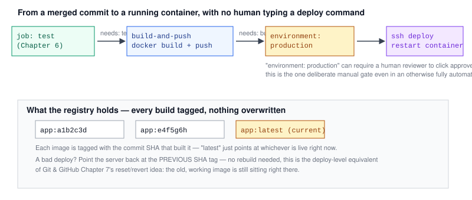

# Chapter 7 — Continuous Deployment: Shipping Automatically

> **Course:** CI/CD (GitHub Actions) · **Chapter:** 7 of 8
> Read on the website: [learn.bazardev.com/cicd/07-continuous-deployment](https://learn.bazardev.com/cicd/07-continuous-deployment)
>
> 🇧🇩 **Prefer Bangla?** [Read this chapter in Bangla →](https://learn.bazardev.com/cicd/07-continuous-deployment?lang=bn)

Chapters 2 through 6 built the CI half of CI/CD — build, test, catch problems early. This chapter is the CD half: once a change is proven good, actually getting it running in production, with no human typing deploy commands.



## 1. The shape of a deploy job

Recall [Chapter 1](/cicd/01-what-is-cicd)'s distinction: Continuous Delivery automates everything up to a human clicking deploy; Continuous Deployment removes even that click. Either way, a typical deploy job for a containerized app (exactly what [Docker Chapter 8](/docker/08-real-project-laravel-dockerize) built) does two things: **build and push** a Docker image, then **deploy** it somewhere real.

```yaml
jobs:
  test:
    # ...Chapter 6's test job...

  build-and-push:
    needs: test
    runs-on: ubuntu-latest
    steps:
      - uses: actions/checkout@v4
      - uses: docker/login-action@v3
        with:
          username: ${{ secrets.DOCKERHUB_USERNAME }}
          password: ${{ secrets.DOCKERHUB_TOKEN }}
      - uses: docker/build-push-action@v5
        with:
          push: true
          tags: |
            myapp:${{ github.sha }}
            myapp:latest

  deploy:
    needs: build-and-push
    runs-on: ubuntu-latest
    environment: production
    steps:
      - uses: appleboy/ssh-action@v1
        with:
          host: ${{ secrets.SERVER_HOST }}
          username: ${{ secrets.SERVER_USER }}
          key: ${{ secrets.SERVER_SSH_KEY }}
          script: |
            docker pull myapp:${{ github.sha }}
            docker stop myapp || true
            docker run -d --rm --name myapp myapp:${{ github.sha }}
```

Three jobs chained with `needs:` (first introduced in [Chapter 2](/cicd/02-github-actions-basics)): `deploy` only starts if `build-and-push` succeeds, which only starts if `test` succeeds. A broken change — caught at any of these three gates — never reaches the last one.

## 2. Tagging images by commit, not just `latest`

Notice the image gets **two** tags: `${{ github.sha }}` (the exact commit that built it) and `latest`. This matters more than it looks: if every build only ever pushes `latest`, you have no way to deploy an older, known-good version without rebuilding it from an old commit. Tagging by commit SHA means every build you've ever shipped still sits in your registry, individually addressable — this is the deploy-level version of the safety [Git & GitHub Chapter 7](/git-github/07-reset-vs-revert) described: nothing is thrown away, so going back to a known-good state is always possible.

## 3. GitHub Environments — the one deliberate manual gate

```yaml
deploy:
  environment: production
```

A GitHub **Environment** (configured under repository Settings → Environments) lets you attach rules to a specific deployment target: require one or more reviewers to manually approve before the job proceeds, restrict which branches are allowed to deploy to it, and store environment-specific secrets (a different `SERVER_HOST` for staging vs. production, for instance). This is exactly where a team doing Continuous Delivery (not full Deployment) puts their one human checkpoint — everything up to this point is fully automatic, and this is the explicit, visible click that says "yes, ship it."

## 4. Connecting to a real server

The example above uses `appleboy/ssh-action`, a popular community action that SSHes into a server and runs a script — directly applicable to a setup like deploying to your own VPS rather than a managed platform. The `script:` block runs exactly as if you'd typed those commands yourself over SSH: pull the newly built image, stop the old running container, start the new one. The server never needs direct access to your repository or your CI secrets beyond the SSH key itself — the image was already built and pushed in the previous job.

## 5. What happens when a deploy goes wrong anyway

Tests passing doesn't guarantee a deploy is perfect — a config difference between environments, an external service being down, anything. Because every image is tagged by commit SHA, rolling back is simple and doesn't require re-running the whole pipeline: redeploy the previous SHA's image directly.

```bash
docker pull myapp:e4f5g6h   # the previous known-good commit
docker stop myapp && docker run -d --rm --name myapp myapp:e4f5g6h
```

Some teams automate this as its own `workflow_dispatch`-triggered workflow (recall [Chapter 3](/cicd/03-triggers-and-events)) that takes a SHA as input and runs just the deploy step — a manual "rollback button" that doesn't need a new commit or a new build.

## 6. Key takeaways

- A typical deploy job builds and pushes a Docker image, then connects to a real server (often via SSH) to run the new version — chained after the test job with `needs:`, so a broken change never reaches it.
- Tagging images by commit SHA, not just `latest`, keeps every previously shipped build individually addressable — the deploy-level equivalent of Chapter 7's reset/revert safety net.
- A GitHub Environment can require manual approval before a job proceeds, restrict which branches may deploy, and hold environment-specific secrets — the deliberate human checkpoint in an otherwise automatic pipeline.
- SSH-based deploy actions run a script on your real server exactly as if typed manually, needing only an SSH key, not direct repository access.
- Rolling back after a bad deploy is just redeploying a previous commit's already-built image tag — no rebuild, no new commit required.

## 7. Test yourself (exam prep)

<details>
<summary><strong>Q1. Why does chaining `test` → `build-and-push` → `deploy` with `needs:` matter for safety?</strong></summary>

Each job only starts if the one it depends on succeeded. A test failure stops the pipeline before an image is even built, and a failed build stops it before anything is deployed — a broken change is blocked at the earliest possible gate rather than reaching production.
</details>

<details>
<summary><strong>Q2. Why tag a Docker image with `${{ github.sha }}` in addition to `latest`?</strong></summary>

Tagging only `latest` means older builds get overwritten and can't be redeployed without rebuilding from an old commit. Tagging by commit SHA keeps every previously shipped version individually addressable in the registry, making it possible to deploy (or roll back to) any specific past build directly.
</details>

<details>
<summary><strong>Q3. What does attaching a GitHub Environment with required reviewers to a deploy job actually change?</strong></summary>

The job pauses before running and waits for one of the designated reviewers to manually approve it in GitHub's UI — turning an otherwise fully automatic pipeline into Continuous Delivery rather than full Continuous Deployment, with one deliberate human checkpoint before production changes.
</details>

<details>
<summary><strong>Q4. After a bad deploy, why doesn't rolling back require re-running the whole CI/CD pipeline from scratch?</strong></summary>

Because every build is tagged by its commit SHA and kept in the registry, the previous known-good image already exists and doesn't need to be rebuilt — rolling back is just pulling that existing image tag and restarting the container with it, skipping the build and test steps entirely.
</details>

## 8. Free resources

- Official guide: [Using environments for deployment](https://docs.github.com/en/actions/deployment/targeting-different-environments/using-environments-for-deployment)
- Reference: [docker/build-push-action](https://github.com/docker/build-push-action)
- Reference: [appleboy/ssh-action](https://github.com/appleboy/ssh-action)

---

**Next:** Chapter 8 — Real project: a full pipeline for a Dockerized Laravel app *(coming soon)*
