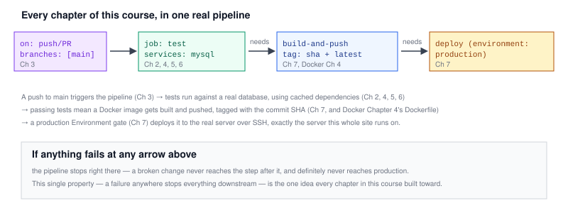

# Chapter 8 — Real Project: A Full Pipeline for a Dockerized Laravel App

> **Course:** CI/CD (GitHub Actions) · **Chapter:** 8 of 8 (final chapter)
> Read on the website: [learn.bazardev.com/cicd/08-real-project-laravel-pipeline](https://learn.bazardev.com/cicd/08-real-project-laravel-pipeline)
>
> 🇧🇩 **Prefer Bangla?** [Read this chapter in Bangla →](https://learn.bazardev.com/cicd/08-real-project-laravel-pipeline?lang=bn)

This final chapter doesn't teach anything new — it assembles every piece from Chapters 1 through 7 into one real, complete workflow file for the exact app [Docker Chapter 8](/docker/08-real-project-laravel-dockerize) dockerized. If you've followed both courses in order, every line below should be recognizable.



## 1. The complete workflow file

```yaml
name: CI/CD

on:
  push:
    branches: [main]
    paths-ignore: ['docs/**']
  pull_request:
    branches: [main]
  workflow_dispatch:

jobs:
  test:
    runs-on: ubuntu-latest
    services:
      mysql:
        image: mysql:8
        env:
          MYSQL_ROOT_PASSWORD: secret
          MYSQL_DATABASE: testing
        ports:
          - 3306:3306
        options: >-
          --health-cmd="mysqladmin ping"
          --health-interval=10s
          --health-timeout=5s
          --health-retries=5
    steps:
      - uses: actions/checkout@v4
      - uses: shivammathur/setup-php@v2
        with:
          php-version: '8.3'
      - uses: actions/cache@v4
        with:
          path: vendor
          key: composer-${{ hashFiles('composer.lock') }}
          restore-keys: composer-
      - run: composer install
      - run: cp .env.ci .env
      - run: php artisan migrate
      - run: php artisan test --coverage-clover=coverage.xml
      - uses: actions/upload-artifact@v4
        if: always()
        with:
          name: coverage-report
          path: coverage.xml

  build-and-push:
    needs: test
    if: github.ref == 'refs/heads/main'
    runs-on: ubuntu-latest
    steps:
      - uses: actions/checkout@v4
      - uses: docker/login-action@v3
        with:
          username: ${{ secrets.DOCKERHUB_USERNAME }}
          password: ${{ secrets.DOCKERHUB_TOKEN }}
      - uses: docker/build-push-action@v5
        with:
          push: true
          tags: |
            myapp:${{ github.sha }}
            myapp:latest

  deploy:
    needs: build-and-push
    runs-on: ubuntu-latest
    environment: production
    steps:
      - uses: appleboy/ssh-action@v1
        with:
          host: ${{ secrets.SERVER_HOST }}
          username: ${{ secrets.SERVER_USER }}
          key: ${{ secrets.SERVER_SSH_KEY }}
          script: |
            docker pull myapp:${{ github.sha }}
            docker stop myapp || true
            docker run -d --rm --name myapp \
              --env-file /srv/myapp/.env \
              myapp:${{ github.sha }}
```

## 2. Reading it chapter by chapter

- **`on:`** — [Chapter 3](/cicd/03-triggers-and-events): runs on pushes and PRs targeting `main` (skipping docs-only changes), plus a manual button via `workflow_dispatch`.
- **`services: mysql`** — [Chapter 6](/cicd/06-automated-testing-in-ci): a real database alongside the test job, with a health check so tests never race against a database that isn't ready yet.
- **`actions/cache`** — [Chapter 5](/cicd/05-caching-and-artifacts): restores `vendor/` when `composer.lock` is unchanged, so most runs skip a full dependency download.
- **`upload-artifact` with `if: always()`** — [Chapter 5](/cicd/05-caching-and-artifacts) and [Chapter 6](/cicd/06-automated-testing-in-ci): the coverage report is saved even if tests failed, since that's exactly when you need it most.
- **`needs: test` / `needs: build-and-push`** — [Chapter 2](/cicd/02-github-actions-basics): each job only runs if the one before it succeeded, so a failure anywhere stops the pipeline right there.
- **`if: github.ref == 'refs/heads/main'`** — ensures the image only gets built and pushed from `main` itself, not from every PR branch, since PRs just need to pass tests, not ship anything.
- **`docker/build-push-action` tagging `${{ github.sha }}` and `latest`** — [Chapter 7](/cicd/07-continuous-deployment) and [Docker Chapter 4](/docker/04-dockerfile): every build stays individually addressable in the registry, never overwritten.
- **`environment: production`** — [Chapter 7](/cicd/07-continuous-deployment): the one place a human can be required to click approve, if the team wants Continuous Delivery rather than full Deployment.
- **`appleboy/ssh-action`** — [Chapter 7](/cicd/07-continuous-deployment): connects to the real server and runs exactly the commands you'd type by hand, pulling the new image and restarting the container — this is the same deploy step that would run on a VPS like the one hosting this very course.
- **Secrets (`DOCKERHUB_TOKEN`, `SERVER_SSH_KEY`, etc.)** — [Chapter 4](/cicd/04-env-vars-secrets-matrix): none of these ever appear in the workflow file itself, only as `${{ secrets.NAME }}` references, masked in every log automatically.

## 3. What this pipeline guarantees, end to end

A developer opens a PR: the `test` job runs automatically, giving the reviewer a status check before they even start reading the diff (connecting straight back to [Git & GitHub Chapter 6](/git-github/06-pull-requests-and-code-review)). The PR gets merged into `main` using whichever merge method the team prefers. That merge triggers the full pipeline again — test, then build-and-push, then deploy — and production is now running the exact code that was reviewed and merged, with a full, visible record in the Actions tab of every step that happened in between.

If anything in this chain breaks — a failing test, a failed image build, a rejected deploy approval — production simply keeps running whatever it was running before. Nothing partial, nothing broken, ever reaches it.

## 4. Key takeaways

- A real pipeline is just the pieces from every earlier chapter in this course, chained together with `needs:` so a failure anywhere stops everything downstream.
- Triggers (Ch 3), caching (Ch 5), a real database service (Ch 6), and masked secrets (Ch 4) make the test stage both fast and trustworthy.
- Tagging images by commit SHA (Ch 7) means the registry holds a complete, individually deployable history of every build, never just the most recent one.
- A GitHub Environment (Ch 7) is where a team inserts its one deliberate human checkpoint, if it wants one, without losing automation everywhere else.
- The entire point of all seven prior chapters converges on one property: a failure at any stage protects every stage after it, all the way to production.

## 5. Test yourself (exam prep)

<details>
<summary><strong>Q1. In the full workflow above, what guarantees that a failing test never results in a new Docker image being pushed?</strong></summary>

The `build-and-push` job declares `needs: test`, so it only starts if the `test` job completes successfully. A failing test stops the pipeline there — `build-and-push` (and everything after it) simply never runs.
</details>

<details>
<summary><strong>Q2. Why does `build-and-push` include `if: github.ref == 'refs/heads/main'` when `test` doesn't have an equivalent restriction?</strong></summary>

Tests should run on every PR to give reviewers a status check, regardless of which branch it's from. But building and pushing a deployable image is only meaningful for code that's actually been merged into `main` — building an image for every experimental PR branch would waste resources on something that's never going to be deployed.
</details>

<details>
<summary><strong>Q3. If `composer.lock` hasn't changed since the last run, which part of this pipeline speeds up, and which doesn't?</strong></summary>

The `actions/cache` step restores the cached `vendor/` folder, making `composer install` nearly instant — that's a speed optimization only. It has no effect on the test execution itself, the Docker build, or the deploy step, since caching only applies to the dependency-install step it's attached to.
</details>

<details>
<summary><strong>Q4. Across this entire course, what's the one property every mechanism — triggers, `needs:`, service containers, environments — ultimately serves?</strong></summary>

That a failure at any single stage stops the pipeline right there, preventing anything broken, untested, or unapproved from ever reaching the next stage, let alone production. Every feature covered — from branch filters to required reviewers — exists to either catch problems earlier or enforce that a failure actually blocks progress.
</details>

## 6. Free resources

- Official guide: [Building and testing with GitHub Actions](https://docs.github.com/en/actions/automating-builds-and-tests)
- Official guide: [Deploying with GitHub Actions](https://docs.github.com/en/actions/deployment/about-deployments/deploying-with-github-actions)

---

## Course complete

That's all 8 chapters of **CI/CD (GitHub Actions)** — from what CI/CD even means, through workflows, triggers, secrets and matrix builds, caching and artifacts, automated testing with a real database, continuous deployment, and finally one complete pipeline tying every piece together with the Docker and Git & GitHub courses.

Head back to the [course homepage](https://learn.bazardev.com) to continue with another course from the roadmap.
