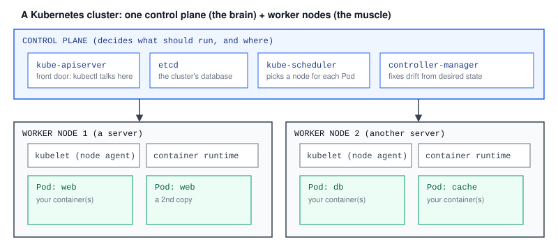

# Chapter 1 — What Is Kubernetes, and Why Does It Matter?

> **Course:** Kubernetes · **Chapter:** 1 of 8
> Read on the website: [learn.bazardev.com/kubernetes/01-what-is-kubernetes](https://learn.bazardev.com/kubernetes/01-what-is-kubernetes)
>
> 🇧🇩 **Prefer Bangla?** [Read this chapter in Bangla →](https://learn.bazardev.com/kubernetes/01-what-is-kubernetes?lang=bn)

In the Docker course you packaged an app into a container and ran it with Docker Compose. That works well on **one server**. This course starts where that stops: what happens when you have *many* containers, on *many* servers, and you cannot afford for the app to go down?

## 1. The problem Kubernetes solves

Imagine your Laravel shop is popular now. You need:

- **3 copies** of the web container, so one crash doesn't take the site down.
- Those copies spread across **several servers**, so one dead server doesn't either.
- A new version released **without downtime**, and an instant way back if it's broken.
- Extra copies added automatically on a busy day, and removed at night.

Doing this by hand with `docker run` over SSH means you become the scheduler: you decide which server runs what, notice crashes, restart things, and update servers one at a time. That does not scale past a handful of containers.

**Kubernetes** (often written **K8s** — "K", 8 letters, "s") is an open-source system that does this job for you. It began at Google, and is now maintained by the Cloud Native Computing Foundation (CNCF). You tell it *what you want*; it works out *how* and keeps it true.

## 2. What it does for you

- **Scheduling** — decides which server (node) each container runs on, based on free CPU and memory.
- **Self-healing** — restarts a crashed container; if a whole server dies, starts the containers again on a healthy one.
- **Scaling** — "I want 5 copies" is one line, and one more line to change it.
- **Rolling updates and rollbacks** — replaces old copies with new ones gradually, and can undo it.
- **Service discovery and load balancing** — gives a group of containers one stable name and spreads traffic across them.
- **Config and secrets** — keeps settings and passwords outside your image.

## 3. The big idea: you declare, Kubernetes reconciles

You don't give Kubernetes a list of commands. You give it a **description of the desired state**, usually in a YAML file:

```yaml
# "I want 3 copies of this app running."
replicas: 3
```

Kubernetes then runs a loop forever: *compare what exists with what you asked for; if they differ, fix it.* Kill one of the 3 copies and a new one appears within seconds, because the actual state (2) no longer matches the desired state (3). This is called **declarative** configuration, and it is the single most important idea in this whole course.

## 4. The architecture, in one picture



A group of servers managed together is a **cluster**. It has two kinds of part:

**The control plane (the brain)** decides what should happen:

- **kube-apiserver** — the front door. `kubectl` and every other component talk to the cluster through it.
- **etcd** — the cluster's database: it stores the desired state and the current state.
- **kube-scheduler** — chooses which node a new Pod should run on.
- **kube-controller-manager** — runs the loops that notice "actual ≠ desired" and fix it.

**Worker nodes (the muscle)** are the servers that run your containers. Each has:

- **kubelet** — an agent that takes orders from the control plane and makes sure the right containers are running on this node.
- **A container runtime** (such as containerd) — the thing that actually runs the containers. You already know the idea from Docker.

Your containers run inside **Pods**, the smallest unit Kubernetes manages (Chapter 3 covers them properly).

## 5. Do you actually need it?

Honestly — often not yet. Kubernetes brings real complexity. If your app runs happily on one VPS with Docker Compose (like most small projects), that is a perfectly good choice. Kubernetes starts paying for itself when you need several servers, zero-downtime releases, automatic recovery, or you work in a team or company that already runs it. Learning it is valuable either way, because it is the industry standard for running containers at scale.

You can use it in two ways: run your own cluster, or rent a **managed** one (Amazon EKS, Google GKE, Azure AKS and others), where the provider runs the control plane for you.

## 6. Key takeaways

- Kubernetes (K8s) runs and manages containers across many servers, so you don't have to be the scheduler.
- It gives you scheduling, self-healing, scaling, rolling updates, service discovery and config/secrets handling.
- You **declare the desired state**; Kubernetes continuously reconciles reality to match.
- A **cluster** = a control plane (apiserver, etcd, scheduler, controller-manager) + worker nodes (kubelet, container runtime, Pods).
- You don't always need it: one server with Docker Compose is fine for many apps.

## 7. Test yourself (exam prep)

<details>
<summary><strong>Q1. What does "declarative" mean in Kubernetes?</strong></summary>

You describe the state you want (for example, 3 copies of the app) rather than a list of commands to run. Kubernetes keeps comparing the real state with that description and fixes any difference.
</details>

<details>
<summary><strong>Q2. You delete one of three running copies of your app. What happens, and why?</strong></summary>

A new copy is started within seconds. The desired state is 3 and the actual state became 2, so a controller sees the difference and creates a replacement.
</details>

<details>
<summary><strong>Q3. Which control-plane component stores the cluster's state, and which one picks the node for a new Pod?</strong></summary>

`etcd` stores the cluster's state (desired and current). The `kube-scheduler` chooses which node a new Pod runs on.
</details>

<details>
<summary><strong>Q4. Your small blog runs fine on one VPS with Docker Compose. Do you need Kubernetes?</strong></summary>

Probably not. Kubernetes adds real complexity; it pays off when you need several servers, zero-downtime releases or automatic recovery. A single server with Docker Compose is a good choice for a small app.
</details>

## 8. Free resources

- Official: [Kubernetes overview](https://kubernetes.io/docs/concepts/overview/)
- Official: [Kubernetes components](https://kubernetes.io/docs/concepts/overview/components/)
- Official, hands-on in your browser: [Learn Kubernetes Basics](https://kubernetes.io/docs/tutorials/kubernetes-basics/)

---

**Next:** Chapter 2 — Local cluster, `kubectl`, and your first Pod *(coming soon)*
