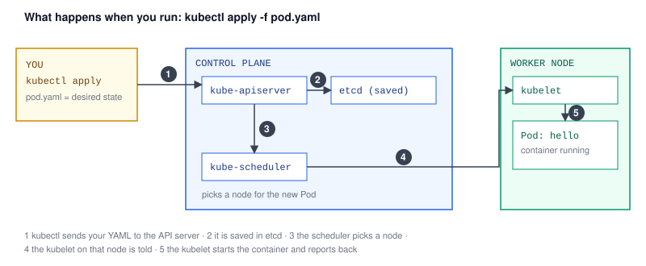

# Chapter 2 — Local Cluster, `kubectl`, and Your First Pod

> **Course:** Kubernetes · **Chapter:** 2 of 8
> Read on the website: [learn.bazardev.com/kubernetes/02-local-cluster-and-kubectl](https://learn.bazardev.com/kubernetes/02-local-cluster-and-kubectl)
>
> 🇧🇩 **Prefer Bangla?** [Read this chapter in Bangla →](https://learn.bazardev.com/kubernetes/02-local-cluster-and-kubectl?lang=bn)

Chapter 1 was theory. Now you get a real cluster on your own computer and run something on it. You don't need to rent servers for this.

## 1. A cluster on your laptop

A full cluster needs several machines, but for learning you can run a tiny one on a single computer. The two popular tools:

- **minikube** — starts a one-node cluster on your machine. The official Kubernetes tutorials use it, so it is the easiest to follow along with.
- **kind** ("Kubernetes in Docker") — runs the cluster inside Docker containers. A good choice if you already live in Docker.

This chapter uses **minikube**, but every command after the start is the same on any cluster.

```bash
minikube start        # downloads what it needs and starts a local cluster
```

Install links are in the resources at the end. You will need Docker (or another driver) already installed — which you have from the Docker course.

## 2. `kubectl`: your remote control

**`kubectl`** (say "kube-control" or "kube-cuddle") is the command-line tool that talks to the cluster's API server. Every Kubernetes command you will ever type starts with it.

```bash
kubectl version --client     # is kubectl installed?
kubectl cluster-info         # where is the cluster, and is it reachable?
kubectl get nodes            # list the servers in the cluster
```

`kubectl get nodes` should show one node with the status `Ready`. If you see that, your cluster works.

The pattern is always `kubectl <verb> <thing>`: `get`, `describe`, `delete`, `logs`, `apply`, applied to things like `pods`, `nodes`, `services`.

## 3. Your first Pod, the quick way

A **Pod** is the smallest thing Kubernetes runs: a wrapper around one (sometimes more) container. Start one:

```bash
kubectl run hello --image=nginx
```

That means: "run a Pod named `hello` from the `nginx` image". Now look at it:

```bash
kubectl get pods              # list Pods and their status
kubectl describe pod hello    # details and an events log at the bottom
kubectl logs hello            # the container's output
```

The status goes `ContainerCreating` → `Running` while the image downloads and starts. To reach it from your browser, forward a local port to the Pod:

```bash
kubectl port-forward pod/hello 8080:80
# now open http://localhost:8080 and you see the nginx welcome page
```

You can also step inside, just like `docker exec`:

```bash
kubectl exec -it hello -- sh
```

## 4. Your first Pod, the proper way: a YAML file

`kubectl run` is handy for experiments, but real work uses files you can keep in Git. Save this as `pod.yaml`:

```yaml
apiVersion: v1
kind: Pod
metadata:
  name: hello
  labels:
    app: hello
spec:
  containers:
    - name: web
      image: nginx:1.27
      ports:
        - containerPort: 80
```

Almost every Kubernetes YAML has the same four top-level fields:

- **`apiVersion`** — which version of the API this object type belongs to (`v1` for Pods).
- **`kind`** — what you are creating (`Pod`).
- **`metadata`** — its name and labels (labels are tags; Chapter 4 uses them).
- **`spec`** — the desired state: here, which container to run.

Create it from the file:

```bash
kubectl apply -f pod.yaml
```



This is the declarative style from Chapter 1: you hand over the desired state, and the cluster makes it real. Run `kubectl apply -f pod.yaml` again and nothing breaks — it just compares and finds nothing to change.

## 5. A catch: a bare Pod does not heal itself

Try this:

```bash
kubectl delete pod hello
kubectl get pods     # it is gone, and nothing brings it back
```

Chapter 1 promised self-healing. But a Pod created on its own has **no controller watching it**, so once it is deleted (or its node dies) it stays gone. The fix is to let a **Deployment** manage your Pods — that is Chapter 3. In practice you almost never create bare Pods.

## 6. Reading the status

| Status | What it usually means |
|---|---|
| `Pending` | Accepted, but not yet running (waiting for a node, or for the image) |
| `ContainerCreating` | Image is being pulled and the container prepared |
| `Running` | At least one container is running |
| `ImagePullBackOff` | The image can't be downloaded — wrong name or tag, or no access |
| `CrashLoopBackOff` | The container starts, crashes, and keeps being restarted |

When something is wrong, the order is: `kubectl get pods` → `kubectl describe pod <name>` (read the **Events** at the bottom) → `kubectl logs <name>`.

## 7. Key takeaways

- **minikube** or **kind** gives you a free cluster on your own computer; `kubectl` talks to it.
- `kubectl <verb> <thing>`: `get`, `describe`, `logs`, `exec`, `apply`, `delete`.
- A **Pod** wraps one or more containers; `kubectl run` is quick, but a YAML file with `apiVersion`, `kind`, `metadata`, `spec` and `kubectl apply -f` is the proper way.
- `kubectl apply` sends the desired state to the API server, which stores it; the scheduler picks a node; the kubelet starts the container.
- A bare Pod isn't recreated when deleted — Deployments (next chapter) fix that.
- Debug in order: `get pods` → `describe pod` (Events) → `logs`.

## 8. Test yourself (exam prep)

<details>
<summary><strong>Q1. What does `kubectl get nodes` show, and what status means the cluster is healthy?</strong></summary>

It lists the servers (nodes) in the cluster. A healthy node shows the status `Ready`.
</details>

<details>
<summary><strong>Q2. Name the four top-level fields found in almost every Kubernetes YAML file.</strong></summary>

`apiVersion`, `kind`, `metadata` and `spec`.
</details>

<details>
<summary><strong>Q3. You create a Pod with `kubectl run` and then delete it. Why isn't it recreated?</strong></summary>

A bare Pod has no controller managing it. Self-healing comes from controllers such as a Deployment, which keep watching the desired state and replace missing Pods.
</details>

<details>
<summary><strong>Q4. A Pod shows `ImagePullBackOff`. What is the most likely cause, and which command do you use to confirm it?</strong></summary>

The cluster can't download the image — usually a wrong image name or tag, or missing access. `kubectl describe pod <name>` shows the exact error in its Events section.
</details>

## 9. Free resources

- Official: [Install tools (kubectl, kind, minikube)](https://kubernetes.io/docs/tasks/tools/)
- minikube: [Get started](https://minikube.sigs.k8s.io/docs/start/)
- Official: [Pods](https://kubernetes.io/docs/concepts/workloads/pods/)
- Official: [kubectl quick reference](https://kubernetes.io/docs/reference/kubectl/quick-reference/)

---

**Next:** Chapter 3 — Pods, ReplicaSets, and Deployments *(coming soon)*
