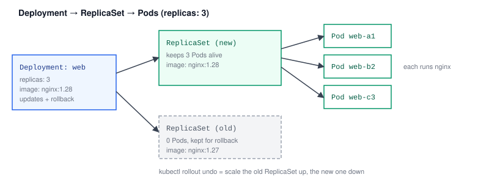

# Chapter 3 — Pods, ReplicaSets, and Deployments

> **Course:** Kubernetes · **Chapter:** 3 of 8
> Read on the website: [learn.bazardev.com/kubernetes/03-pods-replicasets-deployments](https://learn.bazardev.com/kubernetes/03-pods-replicasets-deployments)
>
> 🇧🇩 **Prefer Bangla?** [Read this chapter in Bangla →](https://learn.bazardev.com/kubernetes/03-pods-replicasets-deployments?lang=bn)

At the end of Chapter 2 we saw a gap: a bare Pod that you delete is gone for good. In this chapter we fix that with the object you will use most in real life — the **Deployment**.

## 1. The three layers

Kubernetes stacks three objects, each adding one ability:

| Object | What it adds |
|---|---|
| **Pod** | Runs your container(s). Can die and is not replaced. |
| **ReplicaSet** | Keeps *N identical Pods* running. Delete one and it makes another. |
| **Deployment** | Manages ReplicaSets so you can **update** and **roll back** safely. |

You almost never create a ReplicaSet yourself. You create a **Deployment**, and the Deployment creates the ReplicaSet, which creates the Pods.



## 2. Your first Deployment

Save this as `deployment.yaml`:

```yaml
apiVersion: apps/v1
kind: Deployment
metadata:
  name: web
spec:
  replicas: 3
  selector:
    matchLabels:
      app: web
  template:
    metadata:
      labels:
        app: web
    spec:
      containers:
        - name: nginx
          image: nginx:1.27
          ports:
            - containerPort: 80
```

Apply it and look:

```bash
kubectl apply -f deployment.yaml
kubectl get deployments
kubectl get pods
```

You should see three Pods named like `web-<hash>-<random>`.

Read the file once, slowly:

- `replicas: 3` — the **desired state**: "I want 3 Pods."
- `template` — the blueprint for each Pod (it looks like the Pod YAML from Chapter 2).
- `labels: app: web` on the template, and `selector.matchLabels: app: web` — this is how the Deployment finds *its own* Pods. **They must match.**

## 3. Labels and selectors

A **label** is a small key/value tag on an object, like `app: web` or `env: prod`. A **selector** is a query for labels: "give me everything with `app=web`".

Labels are how Kubernetes connects objects. A Deployment finds its Pods by label. In Chapter 4 a Service will find Pods by label too. If a label is mistyped, they simply won't find each other — and nothing shows an error, so check labels first when something is "not connected".

```bash
kubectl get pods --show-labels
kubectl get pods -l app=web         # filter by label
```

## 4. Self-healing, for real this time

Now repeat the experiment that failed in Chapter 2:

```bash
kubectl get pods                      # copy one Pod name
kubectl delete pod web-xxxxxxxxxx-yyyyy
kubectl get pods                      # a new Pod is already starting
```

The ReplicaSet saw "desired 3, actual 2" and created a replacement. That loop — *compare desired with actual, fix the difference* — is the heart of Kubernetes.

## 5. Scaling

Change the number of Pods with one command:

```bash
kubectl scale deployment web --replicas=5
kubectl get pods
```

Or, better for real projects, edit `replicas:` in the YAML and run `kubectl apply -f deployment.yaml` again. The file stays the source of truth, and you can keep it in Git (just like the Git course taught).

## 6. Rolling updates

You want to upgrade nginx. Change the image in the YAML:

```yaml
          image: nginx:1.28
```

```bash
kubectl apply -f deployment.yaml
kubectl rollout status deployment/web
```

The Deployment does not kill everything at once. It creates a **new ReplicaSet**, starts new Pods one by one, and only then removes old ones. At every moment some Pods are still serving traffic, so users see **no downtime**. This is a **rolling update**, and it is the default strategy.

You can tune it:

```yaml
spec:
  strategy:
    type: RollingUpdate
    rollingUpdate:
      maxSurge: 1          # at most 1 extra Pod above the desired number
      maxUnavailable: 0    # never go below the desired number
```

## 7. Rollback

The new version is broken? Go back:

```bash
kubectl rollout history deployment/web     # list revisions
kubectl rollout undo deployment/web        # back to the previous one
```

This works because the Deployment keeps the **old ReplicaSet** (with 0 Pods) around. Rolling back just scales the old one up and the new one down.

## 8. Handy commands

```bash
kubectl get deploy,rs,pods                 # all three layers together
kubectl describe deployment web            # details and events
kubectl logs deployment/web                # logs from one of its Pods
kubectl delete -f deployment.yaml          # remove everything this file created
```

## 9. Key takeaways

- A **Pod** is not replaced if it dies. A **ReplicaSet** keeps N copies alive. A **Deployment** manages ReplicaSets and adds updates and rollbacks.
- You create Deployments; the ReplicaSet and Pods come automatically.
- `replicas` is the desired state. Change it with `kubectl scale` or by editing the YAML and re-applying.
- **Labels** and **selectors** connect objects. The Deployment's selector must match its template's labels.
- A **rolling update** replaces Pods gradually, with no downtime. `kubectl rollout undo` goes back.

## 10. Test yourself (exam prep)

<details>
<summary><strong>Q1. What is the difference between a ReplicaSet and a Deployment?</strong></summary>

A ReplicaSet keeps a set number of identical Pods running. A Deployment manages ReplicaSets and adds rolling updates and rollbacks. You normally create the Deployment and let it create the ReplicaSet.
</details>

<details>
<summary><strong>Q2. Your Deployment says `replicas: 3` and you delete one Pod. What happens and why?</strong></summary>

A new Pod is created. The ReplicaSet notices the actual count (2) differs from the desired count (3) and fixes it.
</details>

<details>
<summary><strong>Q3. How does a Deployment know which Pods belong to it?</strong></summary>

Through its `selector.matchLabels`, which must match the labels in the Pod template.
</details>

<details>
<summary><strong>Q4. You change the image in the YAML and run `kubectl apply`. How does Kubernetes avoid downtime?</strong></summary>

It does a rolling update: it creates a new ReplicaSet, starts new Pods gradually and removes old ones only as the new ones become ready.
</details>

<details>
<summary><strong>Q5. The new version has a bug. Which command goes back to the previous version?</strong></summary>

`kubectl rollout undo deployment/<name>`
</details>

## 11. Free resources

- Official: [Deployments](https://kubernetes.io/docs/concepts/workloads/controllers/deployment/)
- Official: [ReplicaSet](https://kubernetes.io/docs/concepts/workloads/controllers/replicaset/)
- Official: [Labels and Selectors](https://kubernetes.io/docs/concepts/overview/working-with-objects/labels/)
- Official tutorial: [Performing a Rolling Update](https://kubernetes.io/docs/tutorials/kubernetes-basics/update/update-intro/)

---

**Next:** Chapter 4 — Services and Networking *(coming soon)*
