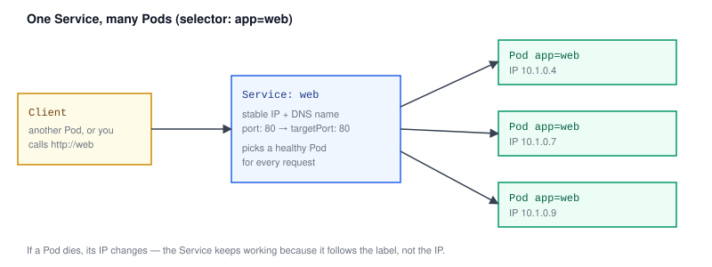

# Chapter 4 — Services and Networking

> **Course:** Kubernetes · **Chapter:** 4 of 8
> Read on the website: [learn.bazardev.com/kubernetes/04-services-and-networking](https://learn.bazardev.com/kubernetes/04-services-and-networking)
>
> 🇧🇩 **Prefer Bangla?** [Read this chapter in Bangla →](https://learn.bazardev.com/kubernetes/04-services-and-networking?lang=bn)

Your Deployment now runs 3 nginx Pods. But how does anyone reach them? Pods die and get replaced, and every new Pod gets a **new IP address**. You can't hard-code those IPs anywhere. A **Service** solves this.

## 1. The problem: Pod IPs keep changing

Each Pod has its own IP, but:

- when a Pod is replaced, its IP changes;
- with 3 replicas you have 3 different IPs, and you want traffic shared between them.

A **Service** gives a group of Pods **one stable IP and one stable DNS name**, and spreads requests across the healthy Pods behind it.



## 2. How a Service finds its Pods

By **label selector** — the same idea from Chapter 3. The Service says "send traffic to every Pod with `app=web`".

```yaml
apiVersion: v1
kind: Service
metadata:
  name: web
spec:
  selector:
    app: web          # must match the Pod labels
  ports:
    - port: 80        # the port the Service listens on
      targetPort: 80  # the port the container listens on
```

```bash
kubectl apply -f service.yaml
kubectl get service web
kubectl get endpoints web      # the real Pod IPs behind the Service
```

`kubectl get endpoints web` is the first thing to check when a Service "doesn't work". If the list is empty, the selector matches no Pods (usually a label typo).

`port` is what clients use. `targetPort` is the port inside the container. They can be different: for example `port: 80` and `targetPort: 3000` for a Node app.

## 3. The Service types

| Type | Reachable from | Use it for |
|---|---|---|
| **ClusterIP** (default) | Inside the cluster only | Internal services: a database, a backend API |
| **NodePort** | Outside, at `<node-ip>:<port>` (ports 30000–32767) | Quick tests, simple setups |
| **LoadBalancer** | Outside, through a cloud load balancer with a public IP | Public apps on a cloud provider |

Each type builds on the previous one: a LoadBalancer also has a NodePort and a ClusterIP.

```yaml
spec:
  type: NodePort
  selector:
    app: web
  ports:
    - port: 80
      targetPort: 80
      nodePort: 30080     # optional; Kubernetes picks one if you omit it
```

`LoadBalancer` needs a cloud (AWS, GCP, a VPS provider with support). On a laptop it stays `<pending>`. For minikube there is a shortcut:

```bash
minikube service web --url      # prints a URL you can open in the browser
```

## 4. DNS inside the cluster

Pods don't need to know IPs at all. Kubernetes runs a DNS service, and every Service gets a name:

```
<service-name>.<namespace>.svc.cluster.local
```

From any Pod in the same namespace you can simply use the short name:

```bash
kubectl run tmp --rm -it --image=busybox:1.36 -- wget -qO- http://web
```

If your Laravel Pod needs MySQL, set `DB_HOST=mysql` (the Service name) instead of an IP. This is how the apps in this course's final project will find each other.

## 5. Namespaces (just enough)

A **namespace** is a folder that groups objects in one cluster (for example `dev`, `staging`, `prod`). Names only need to be unique inside a namespace.

```bash
kubectl get namespaces
kubectl create namespace dev
kubectl get pods -n dev                 # -n = which namespace
kubectl get pods --all-namespaces
```

Without `-n`, `kubectl` uses the namespace called `default`. To reach a Service in another namespace use the longer name: `web.dev`.

## 6. Reaching a Service from your laptop for a quick look

You don't need a NodePort just to test something:

```bash
kubectl port-forward service/web 8080:80
# now open http://localhost:8080
```

This is a debugging tool, not how you serve real users.

## 7. Key takeaways

- Pod IPs change, so you put a **Service** in front: one stable IP and DNS name that load-balances across Pods.
- A Service finds Pods with a **label selector**. Empty `kubectl get endpoints` means the selector matches nothing.
- `port` is the Service's port; `targetPort` is the container's port.
- **ClusterIP** (internal), **NodePort** (outside via node port), **LoadBalancer** (cloud public IP).
- Inside the cluster, use the Service name as a hostname (`http://web`, `DB_HOST=mysql`).
- **Namespaces** group objects; use `-n <name>`.

## 8. Test yourself (exam prep)

<details>
<summary><strong>Q1. Why can't you rely on Pod IP addresses?</strong></summary>

When a Pod is replaced it gets a new IP, and a Deployment has several Pods with different IPs. A Service provides one stable address.
</details>

<details>
<summary><strong>Q2. A Service exists but traffic doesn't reach any Pod. What do you check first?</strong></summary>

`kubectl get endpoints <service>`. If it is empty, the Service's selector doesn't match the Pod labels.
</details>

<details>
<summary><strong>Q3. What is the difference between `port` and `targetPort`?</strong></summary>

`port` is the port the Service listens on. `targetPort` is the port the container listens on.
</details>

<details>
<summary><strong>Q4. Which Service type would you use for a database that only other Pods should reach?</strong></summary>

ClusterIP (the default), because it is reachable only inside the cluster.
</details>

<details>
<summary><strong>Q5. How does one Pod call another Service in the same namespace?</strong></summary>

By the Service name through cluster DNS, for example `http://web` or `DB_HOST=mysql`.
</details>

## 9. Free resources

- Official: [Service](https://kubernetes.io/docs/concepts/services-networking/service/)
- Official: [DNS for Services and Pods](https://kubernetes.io/docs/concepts/services-networking/dns-pod-service/)
- Official: [Namespaces](https://kubernetes.io/docs/concepts/overview/working-with-objects/namespaces/)
- Official tutorial: [Exposing your app](https://kubernetes.io/docs/tutorials/kubernetes-basics/expose/expose-intro/)

---

**Next:** Chapter 5 — ConfigMaps and Secrets *(coming soon)*
