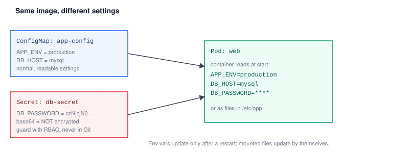

# Chapter 5 — ConfigMaps and Secrets

> **Course:** Kubernetes · **Chapter:** 5 of 8
> Read on the website: [learn.bazardev.com/kubernetes/05-configmaps-and-secrets](https://learn.bazardev.com/kubernetes/05-configmaps-and-secrets)
>
> 🇧🇩 **Prefer Bangla?** [Read this chapter in Bangla →](https://learn.bazardev.com/kubernetes/05-configmaps-and-secrets?lang=bn)

Your app needs settings: the database host, the app name, the debug flag, a password. In the Docker and CI/CD courses you learned not to bake these into the image. Kubernetes has two objects for this: **ConfigMap** for normal settings and **Secret** for sensitive ones.

## 1. Why not put config in the image?

The same image should run in dev, staging and production. Only the configuration changes. If settings are inside the image you must rebuild it for every environment, and passwords end up in the image history. So: **image = code, ConfigMap/Secret = settings.**



## 2. ConfigMap: non-sensitive settings

Create one from the command line:

```bash
kubectl create configmap app-config \
  --from-literal=APP_ENV=production \
  --from-literal=DB_HOST=mysql
kubectl get configmap app-config -o yaml
```

Or as YAML:

```yaml
apiVersion: v1
kind: ConfigMap
metadata:
  name: app-config
data:
  APP_ENV: production
  DB_HOST: mysql
```

## 3. Secret: sensitive settings

```bash
kubectl create secret generic db-secret \
  --from-literal=DB_PASSWORD='s3cr3t-value'
kubectl get secret db-secret -o yaml
```

Look at the output: the value is shown like `czNjcjN0LXZhbHVl`. That is **base64**, an *encoding*, not encryption.

```bash
echo 'czNjcjN0LXZhbHVl' | base64 -d      # anyone can decode it
```

So what does a Secret really give you?

- It is a separate object, so you can control **who may read it** with RBAC (permissions).
- It is not printed in normal `describe` output and can be encrypted at rest if the cluster admin turns that on.
- It is **not** safe to commit a Secret YAML to Git. Never do that with real values; use a tool such as Sealed Secrets or an external secret manager for real projects.

## 4. Use them in a Pod: environment variables

```yaml
spec:
  containers:
    - name: app
      image: nginx:1.27
      envFrom:
        - configMapRef:
            name: app-config        # every key becomes an env var
      env:
        - name: DB_PASSWORD
          valueFrom:
            secretKeyRef:
              name: db-secret
              key: DB_PASSWORD      # one key from the Secret
```

For a Laravel app, `APP_ENV`, `DB_HOST` and `DB_PASSWORD` map directly to the `.env` values you already know.

## 5. Use them as files

You can also mount them as files, which is handy for a whole config file:

```yaml
spec:
  containers:
    - name: app
      image: nginx:1.27
      volumeMounts:
        - name: config
          mountPath: /etc/app
  volumes:
    - name: config
      configMap:
        name: app-config
```

Each key becomes a file in `/etc/app`. Mounted files update automatically when the ConfigMap changes (after a short delay), but **environment variables do not**: the Pod must be restarted to see new values.

```bash
kubectl rollout restart deployment/web     # restart Pods to pick up new env values
```

## 6. Rules of thumb

- Anything you would put in `.env` is either a ConfigMap (non-sensitive) or a Secret (passwords, API keys, tokens).
- Don't print Secrets in logs, don't commit them, and don't paste `kubectl get secret -o yaml` output in chat or tickets.
- Keep ConfigMap YAML in Git. Keep Secret *values* out of it.

## 7. Key takeaways

- Configuration lives outside the image: **ConfigMap** for normal settings, **Secret** for sensitive ones.
- A Secret's value is **base64-encoded, not encrypted**. Protect access with RBAC and never commit real values to Git.
- Inject as **environment variables** (`envFrom`, `valueFrom`) or as **mounted files**.
- Env vars are read at startup: changing a ConfigMap needs `kubectl rollout restart`. Mounted files update on their own.

## 8. Test yourself (exam prep)

<details>
<summary><strong>Q1. Why shouldn't configuration be baked into the container image?</strong></summary>

The same image should run in every environment. Baked-in settings force rebuilds for each environment and can leak passwords through the image.
</details>

<details>
<summary><strong>Q2. Is base64 in a Secret the same as encryption?</strong></summary>

No. Base64 is just an encoding and anyone can decode it. Secrets are protected by access control (RBAC) and optional encryption at rest, not by base64.
</details>

<details>
<summary><strong>Q3. Which object would you use for `APP_ENV=production` and which for `DB_PASSWORD`?</strong></summary>

`APP_ENV` in a ConfigMap; `DB_PASSWORD` in a Secret.
</details>

<details>
<summary><strong>Q4. You edit a ConfigMap that a Pod reads through environment variables. Why doesn't the app see the change?</strong></summary>

Env vars are set when the container starts. Restart the Pods, for example with `kubectl rollout restart deployment/<name>`.
</details>

## 9. Free resources

- Official: [ConfigMaps](https://kubernetes.io/docs/concepts/configuration/configmap/)
- Official: [Secrets](https://kubernetes.io/docs/concepts/configuration/secret/)
- Official: [Good practices for Secrets](https://kubernetes.io/docs/concepts/security/secrets-good-practices/)
- Official task: [Configure a Pod to use a ConfigMap](https://kubernetes.io/docs/tasks/configure-pod-container/configure-pod-configmap/)

---

**Next:** Chapter 6 — Volumes and StatefulSets *(coming soon)*
