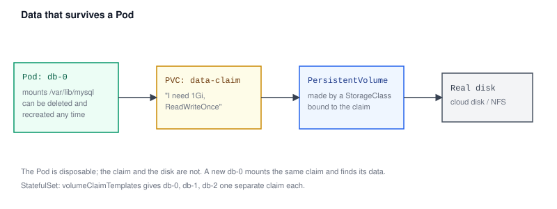

# Chapter 6 — Volumes, PersistentVolumes, and StatefulSets

> **Course:** Kubernetes · **Chapter:** 6 of 8
> Read on the website: [learn.bazardev.com/kubernetes/06-volumes-and-statefulsets](https://learn.bazardev.com/kubernetes/06-volumes-and-statefulsets)
>
> 🇧🇩 **Prefer Bangla?** [Read this chapter in Bangla →](https://learn.bazardev.com/kubernetes/06-volumes-and-statefulsets?lang=bn)

So far everything we ran was **stateless**: if a Pod dies, we lose nothing, because a new identical one replaces it. A database is different. If its Pod restarts and the data is gone, that's a disaster. This chapter is about keeping data.

## 1. The problem: container storage is temporary

A container's own filesystem disappears when the container is replaced. You already know this from the Docker course, where the fix was a volume. Kubernetes has the same idea, with more pieces.

## 2. Volumes

A **volume** is storage attached to a Pod. The simplest kind, `emptyDir`, is a scratch folder that lives as long as the **Pod** (shared between its containers, lost when the Pod is deleted). Good for temporary files and caches, not for a database.

For data that must survive, you need **persistent** storage.

## 3. PersistentVolume and PersistentVolumeClaim

Kubernetes separates *who provides storage* from *who uses it*:

| Object | Role | Think of it as |
|---|---|---|
| **PersistentVolume (PV)** | A real piece of storage (a cloud disk, an NFS share) | A parking space |
| **PersistentVolumeClaim (PVC)** | A Pod's *request* for storage: "I need 5Gi" | A ticket asking for a space |
| **StorageClass** | Recipe for creating PVs automatically | The parking lot's rules |

As a developer you usually write only the **PVC**. On most clusters (minikube, cloud) a StorageClass creates the PV for you automatically.



```yaml
apiVersion: v1
kind: PersistentVolumeClaim
metadata:
  name: data-claim
spec:
  accessModes:
    - ReadWriteOnce        # one node can mount it read-write
  resources:
    requests:
      storage: 1Gi
```

```bash
kubectl apply -f pvc.yaml
kubectl get pvc          # STATUS should become Bound
kubectl get pv
```

Use it in a Pod:

```yaml
spec:
  containers:
    - name: db
      image: mysql:8.4
      env:
        - name: MYSQL_ROOT_PASSWORD
          valueFrom:
            secretKeyRef: { name: db-secret, key: DB_PASSWORD }
      volumeMounts:
        - name: data
          mountPath: /var/lib/mysql
  volumes:
    - name: data
      persistentVolumeClaim:
        claimName: data-claim
```

Delete the Pod and its replacement mounts the same claim — **the data is still there**.

**Access modes:** `ReadWriteOnce` (one node, read-write — most common), `ReadOnlyMany` (many nodes, read-only), `ReadWriteMany` (many nodes, read-write; needs storage that supports it, e.g. NFS).

## 4. Reclaim policy: what happens when the claim is deleted?

A PV has a policy: **Delete** (the disk is removed together with the claim — the common default for dynamic storage) or **Retain** (the disk is kept for manual cleanup). Check it before you delete a claim holding data you care about.

## 5. Why a Deployment is a poor fit for databases

A Deployment treats Pods as interchangeable, with random names (`web-7d9f-x2k`) and no fixed order. A database cluster needs the opposite:

- a **stable name** for each member (so replicas can find the primary),
- its **own disk** that follows it,
- a **predictable start order**.

## 6. StatefulSet

A **StatefulSet** is like a Deployment for stateful apps:

- Pods get fixed names with numbers: `db-0`, `db-1`, `db-2`.
- They start in order (0, then 1, then 2) and stop in reverse.
- Each Pod gets **its own PVC** from `volumeClaimTemplates`. If `db-1` is recreated, it gets *the same* `db-1` disk back.
- A **headless Service** (`clusterIP: None`) gives each Pod its own DNS name, like `db-0.db`.

```yaml
apiVersion: apps/v1
kind: StatefulSet
metadata:
  name: db
spec:
  serviceName: db            # the headless Service
  replicas: 2
  selector:
    matchLabels:
      app: db
  template:
    metadata:
      labels:
        app: db
    spec:
      containers:
        - name: mysql
          image: mysql:8.4
          volumeMounts:
            - name: data
              mountPath: /var/lib/mysql
  volumeClaimTemplates:
    - metadata:
        name: data
      spec:
        accessModes: ["ReadWriteOnce"]
        resources:
          requests:
            storage: 1Gi
```

## 7. A practical warning

Running a production database on Kubernetes is **hard**: backups, failover, upgrades. Many teams run Kubernetes for apps and keep the database on a managed service (like AWS RDS) or a dedicated server. Learn StatefulSets so you understand how it works, then decide what is right for your project. Also remember: **a volume is not a backup.** If you delete the data or corrupt it, the disk just keeps the damage.

## 8. Key takeaways

- A container's own filesystem is temporary; use a **volume** for data.
- `emptyDir` lives as long as the Pod. For data that must survive, use a **PersistentVolumeClaim**, which is bound to a **PersistentVolume** (often created by a StorageClass).
- A **StatefulSet** gives Pods stable names (`db-0`), ordered start, and their own disk each through `volumeClaimTemplates`.
- Use a Deployment for stateless apps and a StatefulSet for apps that need identity and storage.
- Persistent storage is not a backup.

## 9. Test yourself (exam prep)

<details>
<summary><strong>Q1. Your database Pod is deleted and recreated and its data is gone. What is the likely mistake?</strong></summary>

The data was stored in the container's own filesystem or an `emptyDir`. It should use a PersistentVolumeClaim.
</details>

<details>
<summary><strong>Q2. What is the difference between a PV and a PVC?</strong></summary>

A PV is an actual piece of storage in the cluster. A PVC is a request for storage by a Pod; it gets bound to a suitable PV.
</details>

<details>
<summary><strong>Q3. Name two things a StatefulSet gives you that a Deployment does not.</strong></summary>

Stable, numbered Pod names (`db-0`, `db-1`), ordered start and stop, and a separate PVC for each Pod through `volumeClaimTemplates`.
</details>

<details>
<summary><strong>Q4. Does using a PersistentVolume mean your data is backed up?</strong></summary>

No. It only keeps data across Pod restarts. If data is deleted or corrupted, the volume holds the damage. You still need real backups.
</details>

## 10. Free resources

- Official: [Volumes](https://kubernetes.io/docs/concepts/storage/volumes/)
- Official: [Persistent Volumes](https://kubernetes.io/docs/concepts/storage/persistent-volumes/)
- Official: [StatefulSets](https://kubernetes.io/docs/concepts/workloads/controllers/statefulset/)
- Official tutorial: [StatefulSet Basics](https://kubernetes.io/docs/tutorials/stateful-application/basic-stateful-set/)

---

**Next:** Chapter 7 — Ingress, health probes, and resource limits *(coming soon)*
