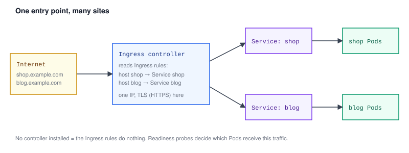

# Chapter 7 — Ingress, Health Probes, and Resource Limits

> **Course:** Kubernetes · **Chapter:** 7 of 8
> Read on the website: [learn.bazardev.com/kubernetes/07-ingress-probes-and-limits](https://learn.bazardev.com/kubernetes/07-ingress-probes-and-limits)
>
> 🇧🇩 **Prefer Bangla?** [Read this chapter in Bangla →](https://learn.bazardev.com/kubernetes/07-ingress-probes-and-limits?lang=bn)

Three things separate a demo from a real deployment: a proper way to let the internet in (**Ingress**), a way for Kubernetes to know your app is healthy (**probes**), and limits so one app can't starve the others (**resource requests and limits**).

## 1. Ingress: one front door for many sites

In Chapter 4 you saw `NodePort` and `LoadBalancer`. A LoadBalancer per app gets expensive: ten apps, ten public IPs. **Ingress** routes HTTP(S) traffic by **host name and path**, so one entry point can serve many Services.



Two pieces are needed:

- An **Ingress controller**: the program that actually receives traffic (for example **ingress-nginx**, or Traefik). Kubernetes does *not* include one by default.
- An **Ingress** object: your routing rules.

On minikube, turn the controller on with:

```bash
minikube addons enable ingress
```

A rule file:

```yaml
apiVersion: networking.k8s.io/v1
kind: Ingress
metadata:
  name: site
spec:
  ingressClassName: nginx
  rules:
    - host: shop.example.com
      http:
        paths:
          - path: /
            pathType: Prefix
            backend:
              service:
                name: shop
                port:
                  number: 80
    - host: blog.example.com
      http:
        paths:
          - path: /
            pathType: Prefix
            backend:
              service:
                name: blog
                port:
                  number: 80
```

An Ingress with no controller installed does nothing. If your rules are ignored, check `kubectl get pods -A` for the controller first.

**HTTPS:** an Ingress can hold a TLS certificate (stored in a Secret), and the add-on **cert-manager** can fetch free Let's Encrypt certificates automatically.

## 2. Health probes

Kubernetes knows if a container *process* is running. It does not know if your app is actually *working*: a web server can be running but stuck. **Probes** let you tell it how to check.

| Probe | Question | If it fails |
|---|---|---|
| **liveness** | "Is the app alive?" | The container is **restarted** |
| **readiness** | "Can it take traffic now?" | The Pod is **removed from the Service** (no restart) |
| **startup** | "Has it finished starting?" | Delays the other probes for slow-starting apps |

```yaml
containers:
  - name: web
    image: nginx:1.27
    readinessProbe:
      httpGet:
        path: /
        port: 80
      initialDelaySeconds: 3
      periodSeconds: 5
    livenessProbe:
      httpGet:
        path: /
        port: 80
      initialDelaySeconds: 10
      periodSeconds: 10
      failureThreshold: 3
```

Why readiness matters most during a rolling update (Chapter 3): the Deployment only sends traffic to a new Pod, and only retires an old one, **when the new Pod is ready**. Without a readiness probe, users may hit a Pod that is still booting.

A common mistake: a liveness probe that checks the database. If the database is slow, Kubernetes restarts all your healthy app Pods and makes things worse. Keep liveness checks simple.

## 3. Resource requests and limits

Each container can declare how much CPU and memory it needs.

```yaml
resources:
  requests:
    cpu: 100m          # 100 millicores = 0.1 of a CPU core
    memory: 128Mi
  limits:
    cpu: 500m
    memory: 256Mi
```

- **Request** = the amount reserved. The scheduler uses it to pick a node with enough room.
- **Limit** = the ceiling. The container may not go above it.

What happens at the limit is different for the two:

- **CPU** over the limit → the container is **throttled** (slowed down), not killed.
- **Memory** over the limit → the container is **killed** with `OOMKilled` and restarted.

```bash
kubectl describe pod <name>     # look for "Reason: OOMKilled" under Last State
kubectl top pods                # live usage (needs the metrics-server add-on)
```

Without requests, the scheduler can't plan well and one noisy Pod can starve its neighbours. Setting memory requests and limits on every production container is a good habit.

## 4. Putting it together

A production-ready Deployment has: a pinned image tag, `replicas` ≥ 2, readiness and liveness probes, resource requests and limits, config from ConfigMap/Secret, and a Service plus an Ingress in front. You now know every part of that. The final chapter assembles them.

## 5. Key takeaways

- **Ingress** routes HTTP(S) by host and path to many Services through one entry point. It needs an **Ingress controller** (e.g. ingress-nginx).
- **Readiness** probe: stop sending traffic if it fails. **Liveness** probe: restart if it fails. **Startup** probe: wait for slow starters.
- Rolling updates rely on readiness to avoid sending users to a Pod that isn't ready.
- **Requests** reserve resources for scheduling; **limits** cap them.
- Over the CPU limit → throttled. Over the memory limit → `OOMKilled`.

## 6. Test yourself (exam prep)

<details>
<summary><strong>Q1. You created an Ingress but nothing happens. What might be missing?</strong></summary>

An Ingress controller (for example ingress-nginx). The Ingress object is only a set of rules; a controller must be installed to act on them.
</details>

<details>
<summary><strong>Q2. What is the difference between a liveness and a readiness probe?</strong></summary>

If liveness fails, the container is restarted. If readiness fails, the Pod is taken out of the Service so it gets no traffic, but it isn't restarted.
</details>

<details>
<summary><strong>Q3. A container exceeds its memory limit. What happens?</strong></summary>

It is killed with `OOMKilled` and restarted. (Exceeding the CPU limit only throttles it.)
</details>

<details>
<summary><strong>Q4. What is the difference between a resource request and a limit?</strong></summary>

A request is the amount reserved and used by the scheduler to place the Pod. A limit is the maximum the container may use.
</details>

## 7. Free resources

- Official: [Ingress](https://kubernetes.io/docs/concepts/services-networking/ingress/)
- Official: [Configure Liveness, Readiness and Startup Probes](https://kubernetes.io/docs/tasks/configure-pod-container/configure-liveness-readiness-startup-probes/)
- Official: [Resource Management for Pods and Containers](https://kubernetes.io/docs/concepts/configuration/manage-resources-containers/)
- Official: [Set up Ingress on minikube](https://kubernetes.io/docs/tasks/access-application-cluster/ingress-minikube/)

---

**Next:** Chapter 8 — Real project: Laravel on Kubernetes *(coming soon)*
