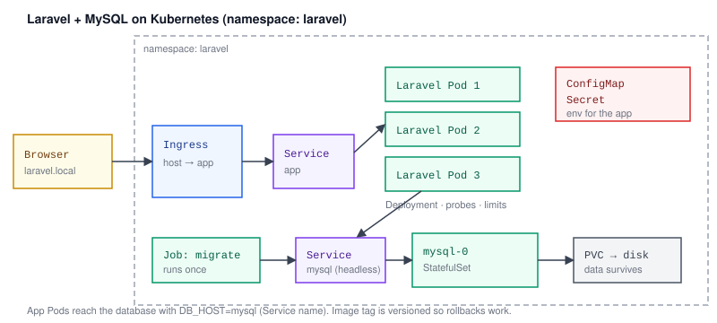

# Chapter 8 — Real Project: Laravel on Kubernetes

> **Course:** Kubernetes · **Chapter:** 8 of 8
> Read on the website: [learn.bazardev.com/kubernetes/08-real-project-laravel-on-kubernetes](https://learn.bazardev.com/kubernetes/08-real-project-laravel-on-kubernetes)
>
> 🇧🇩 **Prefer Bangla?** [Read this chapter in Bangla →](https://learn.bazardev.com/kubernetes/08-real-project-laravel-on-kubernetes?lang=bn)

Time to use everything. We will run a **Laravel app with a MySQL database** on a local cluster: Deployment, Service, ConfigMap, Secret, StatefulSet with storage, a migration Job, probes, limits and an Ingress.

> **Honest note:** these manifests are written to teach the pattern. They are standard, but I have not run them on your cluster, so expect to adjust names, versions and image details. Debugging a manifest that doesn't work on the first try is part of the skill.



## 1. What we are building

| Piece | Kubernetes object | From chapter |
|---|---|---|
| Laravel app (3 replicas) | Deployment | 3 |
| Stable address for the app | Service (ClusterIP) | 4 |
| Public entry by host name | Ingress | 7 |
| Non-secret settings | ConfigMap | 5 |
| DB password, `APP_KEY` | Secret | 5 |
| MySQL with its own disk | StatefulSet + headless Service + PVC | 6 |
| Run `php artisan migrate` once | Job | below |
| Self-check and limits | probes + resources | 7 |

Use a separate namespace so you can delete everything with one command:

```bash
kubectl create namespace laravel
kubectl config set-context --current --namespace=laravel
```

## 2. Step 1 — The image

Build your Laravel image as in the Docker course (a Dockerfile that serves the app on port 80), then make it available to the cluster. On minikube:

```bash
docker build -t laravel-app:1.0.0 .
minikube image load laravel-app:1.0.0
```

On a real cluster you would push to a registry (Docker Hub, GitHub Container Registry) and use that image name. Always use a **version tag**, not `latest`, so a rollback means something.

If you use a local image on minikube, add `imagePullPolicy: IfNotPresent` to the container, otherwise Kubernetes may try to pull it from the internet and fail with `ImagePullBackOff`.

## 3. Step 2 — Settings and secrets

```yaml
# config.yaml
apiVersion: v1
kind: ConfigMap
metadata:
  name: app-config
data:
  APP_ENV: production
  APP_DEBUG: "false"
  DB_CONNECTION: mysql
  DB_HOST: mysql          # the headless Service name from Step 3
  DB_PORT: "3306"
  DB_DATABASE: laravel
  DB_USERNAME: laravel
```

Create the Secret from the command line so the real values never go into a file in Git:

```bash
kubectl create secret generic app-secret \
  --from-literal=DB_PASSWORD='change-me-please' \
  --from-literal=MYSQL_ROOT_PASSWORD='change-me-too' \
  --from-literal=APP_KEY="$(php artisan key:generate --show)"
```

Notice `DB_HOST: mysql`. Pods find the database by the Service name (Chapter 4).

## 4. Step 3 — MySQL with storage

```yaml
# mysql.yaml
apiVersion: v1
kind: Service
metadata:
  name: mysql
spec:
  clusterIP: None          # headless
  selector:
    app: mysql
  ports:
    - port: 3306
---
apiVersion: apps/v1
kind: StatefulSet
metadata:
  name: mysql
spec:
  serviceName: mysql
  replicas: 1
  selector:
    matchLabels:
      app: mysql
  template:
    metadata:
      labels:
        app: mysql
    spec:
      containers:
        - name: mysql
          image: mysql:8.4
          env:
            - name: MYSQL_DATABASE
              value: laravel
            - name: MYSQL_USER
              value: laravel
            - name: MYSQL_PASSWORD
              valueFrom:
                secretKeyRef: { name: app-secret, key: DB_PASSWORD }
            - name: MYSQL_ROOT_PASSWORD
              valueFrom:
                secretKeyRef: { name: app-secret, key: MYSQL_ROOT_PASSWORD }
          ports:
            - containerPort: 3306
          volumeMounts:
            - name: data
              mountPath: /var/lib/mysql
          readinessProbe:
            exec:
              command: ["mysqladmin", "ping", "-h", "127.0.0.1"]
            initialDelaySeconds: 20
            periodSeconds: 10
          resources:
            requests: { cpu: 200m, memory: 512Mi }
            limits:   { memory: 1Gi }
  volumeClaimTemplates:
    - metadata:
        name: data
      spec:
        accessModes: ["ReadWriteOnce"]
        resources:
          requests:
            storage: 2Gi
```

```bash
kubectl apply -f config.yaml
kubectl apply -f mysql.yaml
kubectl get pods -w           # wait until mysql-0 is Ready (Ctrl+C to stop)
```

## 5. Step 4 — The Laravel Deployment and Service

```yaml
# app.yaml
apiVersion: apps/v1
kind: Deployment
metadata:
  name: app
spec:
  replicas: 3
  selector:
    matchLabels:
      app: app
  template:
    metadata:
      labels:
        app: app
    spec:
      containers:
        - name: laravel
          image: laravel-app:1.0.0
          imagePullPolicy: IfNotPresent
          ports:
            - containerPort: 80
          envFrom:
            - configMapRef:
                name: app-config
          env:
            - name: DB_PASSWORD
              valueFrom:
                secretKeyRef: { name: app-secret, key: DB_PASSWORD }
            - name: APP_KEY
              valueFrom:
                secretKeyRef: { name: app-secret, key: APP_KEY }
          readinessProbe:
            httpGet: { path: /up, port: 80 }
            initialDelaySeconds: 5
            periodSeconds: 5
          livenessProbe:
            httpGet: { path: /up, port: 80 }
            initialDelaySeconds: 20
            periodSeconds: 10
          resources:
            requests: { cpu: 100m, memory: 128Mi }
            limits:   { cpu: 500m, memory: 256Mi }
---
apiVersion: v1
kind: Service
metadata:
  name: app
spec:
  selector:
    app: app
  ports:
    - port: 80
      targetPort: 80
```

`/up` is the built-in health route in recent Laravel versions. If your version doesn't have it, point the probes at `/` or add a tiny route. The liveness probe only checks that the app answers; it deliberately does **not** query the database (Chapter 7).

## 6. Step 5 — Run migrations with a Job

A **Job** runs a Pod to completion, once, instead of forever. It is the right tool for `php artisan migrate`, which you don't want every replica to run at startup.

```yaml
# migrate.yaml
apiVersion: batch/v1
kind: Job
metadata:
  name: migrate
spec:
  backoffLimit: 3
  template:
    spec:
      restartPolicy: Never
      containers:
        - name: migrate
          image: laravel-app:1.0.0
          imagePullPolicy: IfNotPresent
          command: ["php", "artisan", "migrate", "--force"]
          envFrom:
            - configMapRef:
                name: app-config
          env:
            - name: DB_PASSWORD
              valueFrom:
                secretKeyRef: { name: app-secret, key: DB_PASSWORD }
            - name: APP_KEY
              valueFrom:
                secretKeyRef: { name: app-secret, key: APP_KEY }
```

```bash
kubectl apply -f migrate.yaml
kubectl logs job/migrate
kubectl apply -f app.yaml
```

Run the Job **before** or together with the first deployment, and again whenever a release has new migrations. (`--force` is needed because `APP_ENV=production` makes Laravel ask for confirmation otherwise.) A Job's name must be unique, so delete the old Job (`kubectl delete job migrate`) before re-running it.

## 7. Step 6 — Ingress

```yaml
# ingress.yaml
apiVersion: networking.k8s.io/v1
kind: Ingress
metadata:
  name: app
spec:
  ingressClassName: nginx
  rules:
    - host: laravel.local
      http:
        paths:
          - path: /
            pathType: Prefix
            backend:
              service:
                name: app
                port:
                  number: 80
```

```bash
minikube addons enable ingress
kubectl apply -f ingress.yaml
minikube ip                      # e.g. 192.168.49.2
```

Add a line to your computer's hosts file so the name resolves: `192.168.49.2  laravel.local`, then open `http://laravel.local`. (On some setups, such as Docker driver on macOS or Windows, `minikube tunnel` is needed; minikube's "Accessing apps" documentation explains this.)

## 8. Day-2 operations

```bash
kubectl get all                                  # everything in the namespace
kubectl logs deployment/app                      # app logs
kubectl scale deployment app --replicas=5        # more capacity
kubectl set image deployment/app laravel=laravel-app:1.0.1   # new version
kubectl rollout status deployment/app
kubectl rollout undo deployment/app              # something broke? go back
```

**Cleanup:** everything lives in one namespace, so `kubectl delete namespace laravel` removes it all. This also deletes the database's PVC and your data. Take care in any real environment.

## 9. What to improve next

- **Queue worker and scheduler:** run `php artisan queue:work` as a second Deployment, and `schedule:run` as a **CronJob**.
- **File uploads:** the `storage` folder is per-Pod. Use object storage (S3-compatible) or a shared volume for user uploads.
- **Sessions and cache:** with several replicas, use Redis or the database, not the local file driver.
- **Real database hosting:** consider a managed MySQL instead of a StatefulSet (Chapter 6).
- **CI/CD:** have your pipeline build the image, push it with a version tag, and run `kubectl set image` (see the CI/CD course).
- **Package manager:** learn **Helm** to template and share sets of manifests.

## 10. Key takeaways

- A real app is several objects working together: Deployment + Service + Ingress for the app, ConfigMap/Secret for settings, StatefulSet + PVC for the database.
- Pods find each other by **Service name** (`DB_HOST=mysql`).
- Use a **Job** for one-off tasks like migrations; use a **CronJob** for scheduled ones.
- Use **versioned image tags**, probes and resource limits, and keep Secret values out of Git.
- `kubectl rollout undo` is your safety net; one namespace makes cleanup easy.

## 11. Test yourself (exam prep)

<details>
<summary><strong>Q1. Why run `php artisan migrate` as a Job instead of at the start of every app Pod?</strong></summary>

A Job runs once to completion. With 3 replicas, running migrations in every Pod would run them several times at once and could conflict.
</details>

<details>
<summary><strong>Q2. How does the Laravel Pod find the MySQL database?</strong></summary>

By the Service name through cluster DNS: `DB_HOST=mysql`.
</details>

<details>
<summary><strong>Q3. Where do `APP_ENV` and `DB_PASSWORD` belong in this project?</strong></summary>

`APP_ENV` in the ConfigMap; `DB_PASSWORD` (and `APP_KEY`) in a Secret.
</details>

<details>
<summary><strong>Q4. You deploy `laravel-app:1.0.1` and users see errors. What is the fastest safe fix?</strong></summary>

`kubectl rollout undo deployment/app`, which returns to the previous ReplicaSet.
</details>

## 12. Free resources

- Official: [Run a Stateless Application Using a Deployment](https://kubernetes.io/docs/tasks/run-application/run-stateless-application-deployment/)
- Official: [Run a Single-Instance Stateful Application (MySQL)](https://kubernetes.io/docs/tasks/run-application/run-single-instance-stateful-application/)
- Official: [Jobs](https://kubernetes.io/docs/concepts/workloads/controllers/job/) and [CronJob](https://kubernetes.io/docs/concepts/workloads/controllers/cron-jobs/)
- Official: [Helm — Quickstart](https://helm.sh/docs/intro/quickstart/)
- Laravel: [Health route and deployment](https://laravel.com/docs/deployment)

---

**Course complete.** Take the course exam on the website to earn your certificate.
