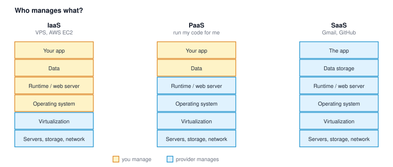

# Chapter 1 — What Is the Cloud? VPS vs AWS vs Shared Hosting

> **Course:** Cloud (AWS / VPS Basics) · **Chapter:** 1 of 8
> Read on the website: [learn.bazardev.com/cloud/01-what-is-the-cloud](https://learn.bazardev.com/cloud/01-what-is-the-cloud)
>
> 🇧🇩 **Prefer Bangla?** [Read this chapter in Bangla →](https://learn.bazardev.com/cloud/01-what-is-the-cloud?lang=bn)

You can build and containerize an app. Now it has to run somewhere other than your laptop, where real people can reach it. This course is about that "somewhere".

## 1. What does "the cloud" mean?

**The cloud is someone else's computers, rented by you over the internet.**

That's really all. A company (AWS, Google, Microsoft, DigitalOcean, Hetzner and many more) owns huge data centers full of servers. You rent a slice of them, usually paying only for what you use, and you can create or delete them in minutes from a web page or a command.

Before the cloud, a company that wanted to run a website had to **buy servers, find a room, power and cool them, and replace broken parts**. Cloud means: you press a button and the server exists.

What you gain:

- **Speed:** a server in minutes, not weeks.
- **Pay as you go:** small bill when small, bigger bill only when you grow.
- **Flexibility:** more power when busy, delete it when done.
- **Reach:** servers in many countries.

What you give up:

- Somebody else's hardware and rules, and **a bill that can surprise you** if you forget to switch things off. We will deal with costs in Chapter 7.

## 2. Who looks after what? (IaaS, PaaS, SaaS)

Cloud services come in layers. The question is always: **how much do I manage, and how much does the provider manage?**

| Model | You get | You manage | Example |
|---|---|---|---|
| **IaaS** (Infrastructure) | A virtual server | The OS, software, security updates, your app | AWS EC2, a VPS |
| **PaaS** (Platform) | A place to run your code | Just your app and data | Heroku-style platforms, AWS Elastic Beanstalk |
| **SaaS** (Software) | A finished product | Only your use of it | Gmail, GitHub, Google Docs |

More control means more work. A VPS gives you freedom, but **you** must patch it, secure it and back it up. This course mostly lives at the IaaS level, because that is where DevOps skills matter most.

## 3. The four common ways to host a website

### Shared hosting
You rent a small space on a server that **many customers share**. Cheap and easy (cPanel, click to install). But you can't install your own software, you share resources with neighbours, and you have little control. Fine for a simple site, limiting for a real app (for example, Docker usually isn't allowed).

### VPS (Virtual Private Server)
One physical machine is split into several virtual servers. You get **your own server with root access**: your own OS, your own software, your own IP. A fixed monthly price. This is what this course's own Laravel site runs on. Providers include DigitalOcean, Hetzner, Vultr, Linode and many local ones.

### Public cloud (AWS, Google Cloud, Azure)
Hundreds of services, not just servers: databases, file storage, queues, load balancers, AI, and more, all billed by usage. Very powerful, very flexible, and also **very large and confusing at first**, with pricing that is harder to predict.

### PaaS / serverless
You push your code and the platform runs it. Less to manage, but less control, and costs can climb as you grow.

| | Shared hosting | VPS | AWS-style cloud | PaaS |
|---|---|---|---|---|
| Control | Low | **High** | **High** | Medium |
| Effort to manage | Lowest | Medium | Highest | Low |
| Price predictability | High | **High** | Lower | Medium |
| Many services (DB, queue, storage) | No | You install them | **Yes, managed** | Some |
| Good first choice for | Simple sites | Learning, small apps | Growing teams, big systems | Fast prototypes |

## 4. How to choose

A practical way to think about it:

- **Learning DevOps / a small project / a tight budget → a VPS.** Simple, cheap, predictable, and you learn the real fundamentals: Linux, SSH, firewalls, web servers.
- **A team, many services, or growth → AWS (or another big cloud).** The managed services save you from running everything yourself.
- **Just need a site online today with no ops → shared hosting or PaaS.**

The skills transfer. SSH, Linux, DNS, firewalls and HTTPS work the same on a $5 VPS and on an AWS server. That is why we start with a VPS in the next chapter and then learn AWS.

**For developers in Bangladesh:** most international providers charge in USD and need a card that works for international payments. Check this before you pick. Also think about **latency**: a server in Singapore is usually closer, and faster for Bangladeshi users, than one in the US or Europe. Pick the region nearest your users.

## 5. Words you will meet everywhere

- **Region / Availability Zone:** a region is a geographic area (for example `ap-southeast-1`, Singapore); an Availability Zone is a separate data center inside it.
- **Instance:** one virtual server.
- **Shared responsibility:** the provider secures the *building and hardware*; **you** secure *your servers, your data and your passwords*.
- **Free tier:** limited free usage for new accounts. Always read the current terms on the provider's site, because they change.

## 6. Key takeaways

- The cloud is **rented computers you control over the internet**, billed by use.
- **IaaS** (you manage the OS and app), **PaaS** (you manage the app), **SaaS** (you just use it): more control means more work.
- Shared hosting is cheap but limited; a **VPS** gives you your own server; **AWS-style clouds** give many managed services; **PaaS** removes server work.
- A VPS is the best place to learn; the skills carry over to AWS.
- You are responsible for securing what you run (**shared responsibility**), and for watching your bill.

## 7. Test yourself (exam prep)

<strong>Q1. In one sentence, what is the cloud?</strong>

Computers owned by a provider that you rent over the internet, usually paying only for what you use.

<strong>Q2. Which model makes you manage the most: IaaS, PaaS or SaaS? Give an example of IaaS.</strong>

IaaS: you manage the operating system, software and security updates. Examples: a VPS or AWS EC2.

<strong>Q3. Name two limits of shared hosting compared with a VPS.</strong>

You usually can't install your own software (such as Docker) or get root access, and you share resources with other customers.

<strong>Q4. What does "shared responsibility" mean?</strong>

The provider secures the data center and hardware. You are responsible for securing your servers, software, data and passwords.

<strong>Q5. Why is a region close to your users important?</strong>

Shorter distance means lower latency, so the site feels faster.

## 8. Free resources

- AWS: [What is cloud computing?](https://aws.amazon.com/what-is-cloud-computing/)
- Cloudflare: [What is the cloud?](https://www.cloudflare.com/learning/cloud/what-is-the-cloud/)
- AWS: [Free Tier](https://aws.amazon.com/free/) (read the current terms)
- DigitalOcean: [Community tutorials](https://www.digitalocean.com/community/tutorials) (free, written for beginners)

---

**Next:** Chapter 2 — Your first VPS: SSH keys, a safe start, and a firewall *(coming soon)*
