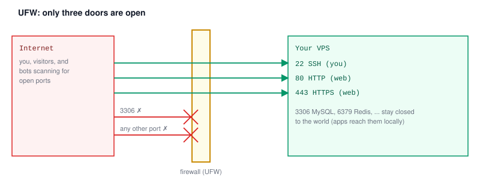

# Chapter 2 — Your First VPS: SSH Keys, a Safe Start, and a Firewall

> **Course:** Cloud (AWS / VPS Basics) · **Chapter:** 2 of 8
> Read on the website: [learn.bazardev.com/cloud/02-your-first-vps](https://learn.bazardev.com/cloud/02-your-first-vps)
>
> 🇧🇩 **Prefer Bangla?** [Read this chapter in Bangla →](https://learn.bazardev.com/cloud/02-your-first-vps?lang=bn)

A new server on the public internet is found by automated bots **within minutes**. They try common usernames and passwords all day long. So the first hour of a server's life is about one thing: **closing the doors before you invite anyone in.**

## 1. Getting a server

Every provider has a different web page, but the steps are the same:

1. Create an account (and add a payment method).
2. Create a server (called a *droplet*, *instance*, *VPS*, *cloud server*, depending on the provider).
3. Choose:
   - **Image / OS:** pick an **LTS Ubuntu** release (for example Ubuntu 24.04 LTS). This course's Linux chapters assume Ubuntu/Debian.
   - **Size:** the smallest plan (1 vCPU, 1 GB RAM) is enough for learning.
   - **Region:** near your users (Chapter 1).
   - **Authentication:** choose **SSH key** if the page offers it (you'll make one below).
4. Create it, and copy the server's **public IP address**.

You can delete the server any time you finish practising. Billing is usually hourly or monthly, so remove what you don't need.

## 2. SSH keys instead of passwords

**SSH** is how you log in to a server's command line over the internet. A password can be guessed. An **SSH key** is a pair of files:

- a **private key**: stays on your computer, and you **never share it**;
- a **public key**: safe to share, you put it on the server.

The server lets you in only if you hold the private key matching the public key. There is nothing short to guess.

Create a key pair on your own computer (Linux, macOS, or Windows PowerShell):

```bash
ssh-keygen -t ed25519 -C "you@example.com"
```

Press Enter to accept the default location, and **set a passphrase** (it protects the key if your laptop is stolen). You now have:

- `~/.ssh/id_ed25519` — **private**. Never upload, email or commit it.
- `~/.ssh/id_ed25519.pub` — **public**. This is what you paste into the provider's page or onto the server.

Show the public key with `cat ~/.ssh/id_ed25519.pub`.

## 3. The first login

If you added your public key when creating the server:

```bash
ssh root@YOUR_SERVER_IP
```

The first time, SSH asks whether to trust the server's fingerprint. Type `yes`. You are now at a command prompt on the server.

If you get `Permission denied (publickey)`, the server doesn't have your public key. Add it from the provider's web console, or use the temporary password they gave you for this first login only.

## 4. Safe start, step by step

You're logged in as `root`, the all-powerful user. Working as root all the time is dangerous: one typo can destroy everything. We make a normal user with `sudo`.

**Step 1 — update the system**

```bash
apt update && apt upgrade -y
```

**Step 2 — create your own user**

```bash
adduser deploy                # choose a strong password when asked
usermod -aG sudo deploy       # allow sudo
```

(Use any name you like instead of `deploy`.)

**Step 3 — give that user your SSH key**

```bash
mkdir -p /home/deploy/.ssh
cp ~/.ssh/authorized_keys /home/deploy/.ssh/authorized_keys
chown -R deploy:deploy /home/deploy/.ssh
chmod 700 /home/deploy/.ssh
chmod 600 /home/deploy/.ssh/authorized_keys
```

**Step 4 — test the new user in a *second* terminal. Keep the first one open.**

```bash
ssh deploy@YOUR_SERVER_IP
sudo whoami                   # should print: root
```

Only continue when this works. The still-open root session is your safety net.

## 5. Lock the doors: SSH settings

Now, as `deploy`, edit the SSH server's config:

```bash
sudo nano /etc/ssh/sshd_config
```

Set (or change) these lines:

```
PermitRootLogin no
PasswordAuthentication no
```

- `PermitRootLogin no` — nobody can log in directly as root.
- `PasswordAuthentication no` — only SSH keys work. Bots guessing passwords now get nowhere.

Check the file for mistakes, then reload:

```bash
sudo sshd -t                           # prints nothing if the syntax is fine
sudo systemctl reload ssh
```

**A common trap:** on many cloud images, a file inside `/etc/ssh/sshd_config.d/` (often named `50-cloud-init.conf`) can still say `PasswordAuthentication yes` and override your edit. Check what is *actually* in effect:

```bash
sudo sshd -T | grep -i -E "passwordauthentication|permitrootlogin"
```

You want to see `passwordauthentication no` and `permitrootlogin no`. If not, find and fix the other file.

**Before you close your safety-net session**, open a *third* terminal and confirm `ssh deploy@YOUR_SERVER_IP` still works. Then you can close the old root session.

## 6. A firewall with UFW

A **firewall** decides which network ports are open to the world. We only want: SSH (22), HTTP (80), HTTPS (443). Everything else stays closed.



Ubuntu ships with **UFW** ("Uncomplicated Firewall"). **Order matters: allow SSH first, then enable.** If you enable it without allowing SSH, you lock yourself out.

```bash
sudo ufw allow OpenSSH
sudo ufw allow 80/tcp
sudo ufw allow 443/tcp
sudo ufw enable
sudo ufw status verbose
```

Your provider may also offer a **cloud firewall** or "security group" in its web panel. It works in front of the server, in addition to UFW. Keep their rules consistent: if one blocks a port, the other can't open it.

## 7. Two more cheap protections

- **Automatic security updates:** `sudo apt install unattended-upgrades` installs important security patches for you.
- **fail2ban** (optional): `sudo apt install fail2ban` temporarily blocks IP addresses that fail to log in repeatedly. With password login off it matters less, but it also reduces log noise.

Also, make a habit of looking at who has tried to log in:

```bash
sudo journalctl -u ssh --since "1 hour ago" | tail
```

You will probably see strangers trying `root`, `admin`, `ubuntu`. That is normal, and exactly why we closed the doors.

## 8. If you lock yourself out

It happens to everyone once. Almost every provider has a **web console** (or "recovery console") in its panel that gives you a login prompt without SSH. Log in there, fix the SSH config or firewall (`sudo ufw disable` is a quick way to get back in), and try again. This is also why you test before closing sessions.

## 9. Key takeaways

- New servers are attacked within minutes, so secure them **first**.
- Use **SSH keys**, not passwords. The private key never leaves your computer.
- Don't work as root: create a user with `sudo`, then set `PermitRootLogin no` and `PasswordAuthentication no`.
- **Test the new login in a second terminal before closing the first.** Check the effective settings with `sshd -T`.
- Use **UFW**: allow `OpenSSH` *before* `ufw enable`, then open 80 and 443 only.
- Keep the system updated, and know where your provider's recovery console is.

## 10. Test yourself (exam prep)

<details>
<summary><strong>Q1. Which SSH key file must you never share?</strong></summary>

The private key (for example `id_ed25519`). The public key (`.pub`) is the one you can share.
</details>

<details>
<summary><strong>Q2. Why create a normal user with `sudo` instead of working as root?</strong></summary>

Root can change or delete anything, so a single typo can be disastrous. A normal user needs `sudo` for powerful actions, which adds a pause and leaves a record.
</details>

<details>
<summary><strong>Q3. What two SSH settings improve security the most, and what do they do?</strong></summary>

`PermitRootLogin no` blocks direct root login. `PasswordAuthentication no` allows only SSH keys, so password guessing is useless.
</details>

<details>
<summary><strong>Q4. Why must you run `ufw allow OpenSSH` before `ufw enable`?</strong></summary>

Enabling the firewall without allowing SSH blocks port 22 and locks you out of your own server.
</details>

<details>
<summary><strong>Q5. You changed `sshd_config` but password login still works. What might be the cause?</strong></summary>

Another file in `/etc/ssh/sshd_config.d/` overrides the setting. Check the effective values with `sudo sshd -T`.
</details>

## 11. Free resources

- Ubuntu: [OpenSSH server](https://documentation.ubuntu.com/server/how-to/security/openssh-server/)
- Ubuntu: [Firewall (UFW)](https://documentation.ubuntu.com/server/how-to/security/firewalls/)
- DigitalOcean: [Initial Server Setup with Ubuntu](https://www.digitalocean.com/community/tutorials/initial-server-setup-with-ubuntu)
- GitHub: [Generating a new SSH key](https://docs.github.com/en/authentication/connecting-to-github-with-ssh/generating-a-new-ssh-key-and-adding-it-to-the-ssh-agent)

---

**Next:** Chapter 3 — Domains and DNS *(coming soon)*
