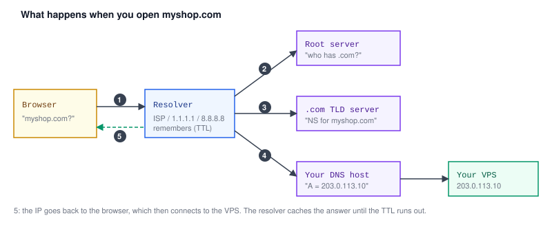

# Chapter 3 — Domains and DNS

> **Course:** Cloud (AWS / VPS Basics) · **Chapter:** 3 of 8
> Read on the website: [learn.bazardev.com/cloud/03-domains-and-dns](https://learn.bazardev.com/cloud/03-domains-and-dns)
>
> 🇧🇩 **Prefer Bangla?** [Read this chapter in Bangla →](https://learn.bazardev.com/cloud/03-domains-and-dns?lang=bn)

Your server has an IP address like `203.0.113.10`. Nobody wants to type that. People type `myshop.com`. The system that connects the two is **DNS**, and it is behind "why isn't my site showing up?" more often than almost anything else.

## 1. DNS in one sentence

**DNS (Domain Name System) is the internet's phone book: it turns a name like `myshop.com` into an IP address like `203.0.113.10`.**

Computers talk to each other by IP address. DNS exists so humans can use names.

## 2. Parts of a domain name

Read a name from right to left:

```
        blog.myshop.com
          │     │    └── TLD (top-level domain): .com, .org, .bd, .dev
          │     └─────── domain (the part you register): myshop.com
          └───────────── subdomain (you create these freely): blog
```

- You **register** a domain (for example `myshop.com`) for a yearly fee.
- You can then create as many **subdomains** as you like for free: `www.myshop.com`, `api.myshop.com`, `blog.myshop.com`, each pointing wherever you want.
- The bare `myshop.com` (no subdomain) is called the **apex** or **root** domain.

Country domains such as `.bd` have their own registration rules and registrars, so check the requirements before you plan around one.

## 3. Registrar and DNS host: two different jobs

People mix these up:

- **Registrar:** the company where you *buy* and renew the domain name (Namecheap, GoDaddy, Cloudflare Registrar, Porkbun and many more).
- **DNS host:** the service that holds your *DNS records*, the answers to "where is this name?". It is often the registrar by default, but it doesn't have to be. You can buy at one place and use another's DNS (such as Cloudflare or AWS Route 53).

The link between them is the domain's **NS (name server) records**. They say "ask *these* servers about my domain". Changing NS records at the registrar moves your DNS to another host.

## 4. DNS records

A **record** is one line in your domain's DNS zone. The ones you will use:

| Type | Maps | Example | Meaning |
|---|---|---|---|
| **A** | name → IPv4 address | `myshop.com → 203.0.113.10` | "This name lives at this IP" |
| **AAAA** | name → IPv6 address | `myshop.com → 2001:db8::10` | Same, for IPv6 |
| **CNAME** | name → another *name* | `www → myshop.com` | "Same as that other name" |
| **MX** | domain → mail server | `10 mail.example.net` | Where email for the domain goes |
| **TXT** | name → text | `v=spf1 ...` | Verification and email security (SPF, DKIM) |
| **NS** | domain → name servers | `ns1.provider.com` | Who answers for this domain |

A typical setup for a website:

```
Type   Name   Value            TTL
A      @      203.0.113.10     300
CNAME  www    myshop.com.      300
A      api    203.0.113.10     300
```

`@` means "the domain itself" (the apex). Rules to remember:

- A **CNAME can't sit on the apex**, only on subdomains. Use an A record there.
- A CNAME points to a *name*; an A record points to an *IP*.
- Pointing `api` to the same IP as the apex is fine: one server can serve many names. The web server decides what to show based on the requested hostname (Chapter 4).
- A **wildcard** record `*` matches any subdomain you haven't defined (for example `*.myshop.com`).

## 5. How a lookup works

When someone opens `myshop.com`, a chain of servers helps. You don't need to memorize it, but the picture matters:



1. The browser asks the **resolver** (usually your ISP's, or one like 1.1.1.1 or 8.8.8.8).
2. If the resolver doesn't know, it asks a **root server**: "who handles `.com`?"
3. Then the **`.com` TLD servers**: "who handles `myshop.com`?" They answer with your **NS records**.
4. Then **your DNS host**, which returns the **A record**: `203.0.113.10`.
5. The resolver gives the IP to the browser and **remembers it** for a while.

## 6. TTL and "propagation"

Each record has a **TTL (time to live)** in seconds: how long resolvers may remember the answer before asking again. `300` = 5 minutes, `3600` = 1 hour.

"DNS propagation" is not a mysterious spreading. It is just **old answers living in caches until their TTL runs out**. If you change an A record whose TTL is 86400 (24 hours), some people may still see the old IP for up to a day.

**Practical tip:** before a planned server move, lower the TTL to `300` a day ahead. After the move you can raise it again.

New NS records (changing DNS host) can take longer to settle, because the registrar and TLD caches are involved.

## 7. Check DNS yourself

Two tools, built in to Linux and macOS (`nslookup` works on Windows too):

```bash
dig +short myshop.com A            # the IPv4 address
dig +short www.myshop.com CNAME    # what the CNAME points to
dig +short myshop.com NS           # which name servers answer
dig myshop.com A                   # full answer, including the TTL column
dig @1.1.1.1 myshop.com A          # ask a specific resolver
```

The full `dig` output has an answer line like this:

```
myshop.com.   299   IN   A   203.0.113.10
```

The `299` is the **remaining TTL** in the resolver's cache. Asking twice shows it counting down. If your change isn't visible, ask a different resolver (`@8.8.8.8`) or ask your DNS host's own server (`dig @ns1.provider.com ...`) to see whether the problem is the record or just caching.

## 8. Putting a domain on your VPS

1. Buy the domain at a registrar.
2. In the DNS panel (registrar's or Cloudflare/Route 53), add an **A record**: name `@` → your VPS IP, and `www` → `CNAME` to `@` (or another A record).
3. Wait a few minutes. Check with `dig +short myshop.com`.
4. Visit `http://myshop.com`. You will see something only after Chapter 4 sets up a web server, but DNS is now working.

**Cloudflare note:** if you use Cloudflare's DNS you may see an orange cloud ("proxied") next to a record. That routes traffic through Cloudflare (hiding your server IP, adding caching and protection). For learning, you can start with "DNS only" (grey cloud) so you see exactly what happens.

## 9. Key takeaways

- **DNS** turns names into IP addresses.
- A **registrar** sells the name; a **DNS host** holds the records. **NS records** link them.
- **A** = name → IPv4, **AAAA** = IPv6, **CNAME** = name → name (not on the apex), **MX** = mail, **TXT** = verification/email security.
- **Subdomains** are free and unlimited; one server can serve many names.
- **TTL** is how long caches keep an answer; "propagation" is caches expiring. Lower the TTL before a move.
- Debug with `dig +short name TYPE`, and try another resolver to rule out caching.

## 10. Test yourself (exam prep)

<details>
<summary><strong>Q1. What does DNS do?</strong></summary>

It translates human-friendly names such as `myshop.com` into IP addresses.
</details>

<details>
<summary><strong>Q2. What is the difference between a registrar and a DNS host?</strong></summary>

The registrar is where you buy and renew the domain. The DNS host stores the records that say where the name points. They can be different companies, linked by NS records.
</details>

<details>
<summary><strong>Q3. When would you use an A record and when a CNAME?</strong></summary>

An A record maps a name to an IPv4 address (and must be used on the apex). A CNAME maps a name to another name, such as `www` → `myshop.com`.
</details>

<details>
<summary><strong>Q4. You changed an A record but still see the old IP. Why, and what can you do?</strong></summary>

Resolvers cache the old answer until its TTL expires. Wait, or check another resolver or the authoritative server with `dig @...`. Next time, lower the TTL before changing.
</details>

<details>
<summary><strong>Q5. Can `api.myshop.com` and `myshop.com` point to the same server?</strong></summary>

Yes. Two names can share one IP; the web server uses the requested hostname to choose what to serve.
</details>

## 11. Free resources

- Cloudflare: [What is DNS?](https://www.cloudflare.com/learning/dns/what-is-dns/)
- Cloudflare: [Common DNS record types](https://www.cloudflare.com/learning/dns/dns-records/)
- Julia Evans: [How DNS works (comic zine)](https://wizardzines.com/zines/dns/)
- Tool: [DNS Checker](https://dnschecker.org/) to see an answer from many places

---

**Next:** Chapter 4 — A web server with HTTPS *(coming soon)*
