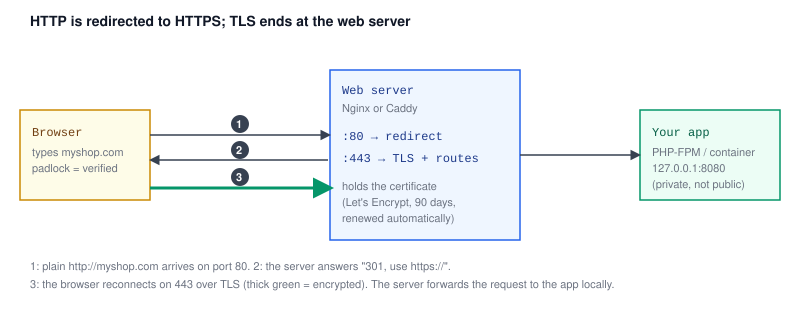

# Chapter 4 — A Web Server with HTTPS

> **Course:** Cloud (AWS / VPS Basics) · **Chapter:** 4 of 8
> Read on the website: [learn.bazardev.com/cloud/04-web-server-and-https](https://learn.bazardev.com/cloud/04-web-server-and-https)
>
> 🇧🇩 **Prefer Bangla?** [Read this chapter in Bangla →](https://learn.bazardev.com/cloud/04-web-server-and-https?lang=bn)

You now have a secured server (Chapter 2) and a domain pointing at it (Chapter 3). One piece is missing: a program that **listens on ports 80 and 443 and answers web requests**. That program is a **web server**, and in this chapter you also make it speak **HTTPS**.

## 1. What a web server does

A web server:

1. **Listens** on a port (80 for HTTP, 443 for HTTPS).
2. **Reads the request**, including which hostname was asked for (`myshop.com` or `api.myshop.com`).
3. **Responds**: by sending a file, by passing the request to your app (PHP-FPM, Node, a Docker container), or by redirecting.

Two popular choices:

| | **Nginx** | **Caddy** |
|---|---|---|
| Popularity | Extremely common, huge community | Newer, growing fast |
| HTTPS certificates | You set them up (with certbot) | **Automatic**, built in |
| Config style | `server { ... }` blocks | Short `site { ... }` blocks |

We show both. Choose one, not both, on the same server (they would fight over ports 80 and 443).

## 2. Option A: Nginx

Install and check:

```bash
sudo apt update
sudo apt install nginx
systemctl status nginx
```

Open `http://YOUR_SERVER_IP` in a browser: you should see the "Welcome to nginx" page. (If not, check that port 80 is allowed in UFW and in any provider firewall: Chapter 2.)

**Your own site.** On Ubuntu, each site gets a file in `/etc/nginx/sites-available/`, and a link to it in `sites-enabled/` turns it on. Example for a Laravel app:

```nginx
# /etc/nginx/sites-available/myshop
server {
    listen 80;
    server_name myshop.com www.myshop.com;

    root /var/www/myshop/public;
    index index.php;

    location / {
        try_files $uri $uri/ /index.php?$query_string;
    }

    location ~ \.php$ {
        include snippets/fastcgi-php.conf;
        fastcgi_pass unix:/run/php/php8.3-fpm.sock;   # match your PHP version
    }

    location ~ /\.(?!well-known) {
        deny all;                                      # never serve .env and friends
    }
}
```

Turn it on, **test the config**, then reload:

```bash
sudo ln -s /etc/nginx/sites-available/myshop /etc/nginx/sites-enabled/
sudo nginx -t                     # always run this first
sudo systemctl reload nginx
```

`nginx -t` checks the syntax *before* you apply it. A reload with a broken config would take your sites down, so make `-t` a habit.

**Reverse proxy.** If your app runs on a local port (for example a Docker container published on `127.0.0.1:8080`), Nginx forwards requests to it instead of serving files:

```nginx
server {
    listen 80;
    server_name app.myshop.com;

    location / {
        proxy_pass http://127.0.0.1:8080;
        proxy_set_header Host $host;
        proxy_set_header X-Real-IP $remote_addr;
        proxy_set_header X-Forwarded-For $proxy_add_x_forwarded_for;
        proxy_set_header X-Forwarded-Proto $scheme;
    }
}
```

This is how many apps share one server: the web server is the single front door, and each app listens privately on its own local port. (Remember from Chapter 2: keep those app ports closed in the firewall; only Nginx is public.)

## 3. Option B: Caddy

Caddy needs very little config, and gets HTTPS certificates **by itself**.

```bash
sudo apt install caddy      # may need the Caddy apt repository; see the install docs
```

A `Caddyfile` (usually `/etc/caddy/Caddyfile`) for the same Laravel site:

```
myshop.com, www.myshop.com {
    root * /var/www/myshop/public
    encode zstd gzip
    php_fastcgi unix//run/php/php8.3-fpm.sock
    file_server
}
```

And for a reverse proxy:

```
app.myshop.com {
    reverse_proxy 127.0.0.1:8080
}
```

Apply changes with:

```bash
sudo caddy validate --config /etc/caddy/Caddyfile
sudo systemctl reload caddy
```

If your DNS already points to the server and ports 80/443 are open, Caddy fetches a certificate on the first request. You get HTTPS with no extra step. (Skip the next two sections.)

## 4. What HTTPS is

**HTTP** sends everything as plain text. Anyone on the path (café Wi-Fi, an ISP) can read or change it. **HTTPS** is HTTP inside **TLS**, which gives you:

- **Encryption:** nobody in the middle can read the data.
- **Integrity:** nobody can change it unnoticed.
- **Identity:** the padlock means the server really owns that domain.



Identity comes from a **certificate**, a file signed by a **Certificate Authority (CA)** that browsers already trust. **Let's Encrypt** is a free, automated CA, and it is why HTTPS no longer costs money.

Today HTTPS is expected: browsers warn on plain HTTP forms, and many features (service workers, geolocation, payments) require it.

## 5. Free HTTPS with Nginx and certbot

Requirements: the domain's A record already points to this server (Chapter 3), and ports 80 and 443 are open. Let's Encrypt proves you control the domain by making a request to it, so DNS must be right first.

```bash
sudo apt install certbot python3-certbot-nginx
sudo certbot --nginx -d myshop.com -d www.myshop.com
```

Certbot asks for an email (for expiry notices), gets the certificate, **edits your Nginx config** to listen on 443, and offers to **redirect HTTP to HTTPS**. Say yes.

Certificates last **90 days**. Certbot installs a timer that renews them automatically. Don't just trust it, test it:

```bash
sudo certbot renew --dry-run
systemctl list-timers | grep certbot
```

If the dry run succeeds, renewal will work.

## 6. Trouble-shooting

| Symptom | Likely cause | Check |
|---|---|---|
| Page never loads | Firewall or DNS | `sudo ufw status`, provider firewall, `dig +short myshop.com` |
| **502 Bad Gateway** | The app behind the proxy isn't running or the port is wrong | Is the container/PHP-FPM running? `curl http://127.0.0.1:8080` on the server |
| **404 Not Found** | Wrong `root`, or the wrong site answered | `root` path; `server_name` matches the hostname |
| **403 Forbidden** | File permissions | Is the web user (`www-data`) able to read the folder? |
| Certbot fails | DNS not pointing here yet, or port 80 blocked | `dig +short`, `ufw status` |
| Browser shows "not secure" after HTTPS | Mixed content: the page loads an `http://` image or script | Use `https://` or relative URLs |

The first places to look are always the logs:

```bash
sudo tail -n 50 /var/log/nginx/error.log
sudo journalctl -u caddy --since "10 minutes ago"
```

## 7. Key takeaways

- A **web server** listens on 80/443, reads the hostname, and serves files or passes the request to your app.
- **Nginx** is the common choice (config blocks, certbot for HTTPS). **Caddy** is simpler and does HTTPS **automatically**. Use one on a server, not both.
- Always **test the config** (`nginx -t`, `caddy validate`) before reloading.
- A **reverse proxy** lets many apps share one server, each on a private local port.
- **HTTPS** = HTTP + TLS: encryption, integrity and identity, via a certificate from a CA such as **Let's Encrypt** (free, 90 days, auto-renewed).
- DNS must already point to the server, and ports 80 and 443 must be open, before getting a certificate.
- When something breaks, check the **error log** first.

## 8. Test yourself (exam prep)

<details>
<summary><strong>Q1. What are the three jobs of a web server?</strong></summary>

Listen on a port, read the request (including which hostname was asked for), and respond: serve a file, pass the request to an app, or redirect.
</details>

<details>
<summary><strong>Q2. Why run `nginx -t` before `systemctl reload nginx`?</strong></summary>

It checks the configuration for mistakes. Reloading a broken config could take your sites down.
</details>

<details>
<summary><strong>Q3. What does a reverse proxy do?</strong></summary>

It receives requests on the public ports and forwards them to an app listening privately on a local port, so many apps can share one server and one front door.
</details>

<details>
<summary><strong>Q4. What three things does HTTPS (TLS) give you?</strong></summary>

Encryption, integrity (no unnoticed changes) and identity (the server really owns the domain).
</details>

<details>
<summary><strong>Q5. Certbot fails to get a certificate. What are the two most likely causes?</strong></summary>

The domain's DNS doesn't point to this server yet, or port 80/443 is blocked by a firewall.
</details>

<details>
<summary><strong>Q6. You see 502 Bad Gateway. What does it usually mean?</strong></summary>

The web server is fine, but the app it forwards to isn't running or isn't on the port it expects.
</details>

## 9. Free resources

- Nginx: [Beginner's guide](https://nginx.org/en/docs/beginners_guide.html)
- Caddy: [Documentation](https://caddyserver.com/docs/) and [Automatic HTTPS](https://caddyserver.com/docs/automatic-https)
- Let's Encrypt: [How it works](https://letsencrypt.org/how-it-works/)
- Certbot: [Instructions](https://certbot.eff.org/instructions) (pick your software and OS)
- Mozilla: [SSL Configuration Generator](https://ssl-config.mozilla.org/)

---

**Next:** Chapter 5 — AWS core concepts: accounts, regions, and IAM *(coming soon)*
