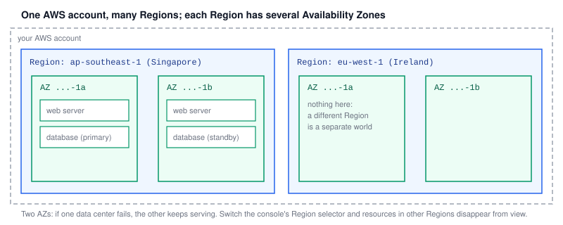
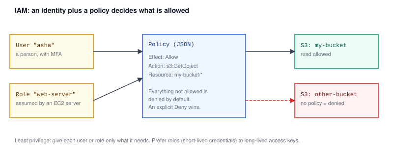

# Chapter 5 — AWS Core Concepts: Accounts, Regions, and IAM

> **Course:** Cloud (AWS / VPS Basics) · **Chapter:** 5 of 8
> Read on the website: [learn.bazardev.com/cloud/05-aws-core-concepts](https://learn.bazardev.com/cloud/05-aws-core-concepts)
>
> 🇧🇩 **Prefer Bangla?** [Read this chapter in Bangla →](https://learn.bazardev.com/cloud/05-aws-core-concepts?lang=bn)

A VPS is one server. **AWS (Amazon Web Services)** is hundreds of services, and the first screen can feel overwhelming. The good news: a small set of ideas explains almost everything. This chapter teaches that set, plus the **three things to do first** so a mistake doesn't cost you money or your account.

> **A note on accuracy:** AWS changes its console, prices and free-tier rules often. This chapter teaches the lasting ideas. For anything with a number or a price, check AWS's own page; links are at the end.

## 1. What an AWS account is

An AWS account is a **container for everything you create and everything you are billed for**. When you sign up you give an email address, a payment card, and verify your phone. The email you sign up with becomes the account's **root user**.

The root user can do *anything*, including closing the account and changing billing. That makes it the most dangerous login you have. The rule:

> **Secure the root user, then stop using it.**

## 2. First thing to do: protect the root user

1. Use a **strong, unique password**, kept in a password manager.
2. Turn on **MFA (multi-factor authentication)** for the root user: an authenticator app or a security key, so a stolen password alone is useless.
3. **Don't create access keys for root.** Never.
4. After setting up your own admin user (section 6), log in as root only for the rare tasks that truly need it.

## 3. Three ways to use AWS

| Way | What it is | When |
|---|---|---|
| **Console** | The web site | Learning, looking around |
| **CLI** | `aws` command in your terminal | Scripts, speed, repeatable work |
| **SDK / API** | Libraries for PHP, Python, JavaScript... | Your app talks to AWS (upload to S3, send email) |

All three do the same underlying thing: call AWS's API. Later in this course you will see that clicking in the console is fine for learning, but real projects write the steps down as code (the Infrastructure as Code course).

## 4. Regions and Availability Zones

AWS runs in many places around the world.

- A **Region** is a geographic area, with a code like `ap-southeast-1` (Singapore) or `eu-west-1` (Ireland).
- Each Region has several **Availability Zones (AZs)**: separate data centers, with their own power and network, a short distance apart, written like `ap-southeast-1a`, `ap-southeast-1b`.



Why it matters:

- **Latency:** pick the Region nearest your users (Chapter 1).
- **Resilience:** spreading across two AZs means one data center failing doesn't take you down.
- **Regions are separate worlds.** A server created in Singapore does **not** appear when the console is set to Ireland. This confuses everyone once: "where did my server go?" Check the **Region selector** at the top right of the console first.
- Some services are **global** (for example IAM and Route 53); most are **regional**.
- Prices and available services can differ by Region.

## 5. IAM: who can do what

**IAM (Identity and Access Management)** controls access to your AWS account. Everything in it answers two questions: **who** is asking, and **what** are they allowed to do?

| Concept | What it is |
|---|---|
| **User** | A person (or program) with their own login or keys |
| **Group** | A set of users sharing the same permissions (for example "developers") |
| **Role** | An identity that **someone or something temporarily assumes**, with no password of its own (for example an EC2 server that needs to read from S3) |
| **Policy** | A JSON document that lists permissions, attached to a user, group or role |



**Everything is denied by default.** A new user can do nothing until a policy allows it. This is a safe starting point.

### A policy, line by line

```json
{
  "Version": "2012-10-17",
  "Statement": [
    {
      "Effect": "Allow",
      "Action": ["s3:GetObject", "s3:ListBucket"],
      "Resource": [
        "arn:aws:s3:::my-bucket",
        "arn:aws:s3:::my-bucket/*"
      ]
    }
  ]
}
```

- **Effect:** `Allow` or `Deny`. (An explicit `Deny` always wins.)
- **Action:** *what* can be done: `service:Operation`, such as `s3:GetObject` (read a file).
- **Resource:** *which things*, written as an **ARN** (Amazon Resource Name).
- `Version` is just the policy language version; keep it as shown.

An ARN looks like `arn:aws:service:region:account-id:resource`. The one above means "the bucket `my-bucket` and everything inside it". This policy lets someone **read** that one bucket and do nothing else.

### Least privilege

Give each user or program **only the permissions it needs**, nothing more. If a script only reads from one bucket, it gets read access to that bucket, not "admin". If its keys leak, the damage is limited.

### Roles beat access keys

An **access key** (an ID plus a secret) is a long-lived password for a program. They leak: pasted into code, committed to GitHub, left in a chat. Automated bots scan public repositories for AWS keys and can use them within minutes to run expensive servers on your bill.

So:

- **Never put access keys in code or Git.**
- For something running *on AWS* (a server), attach a **role**. It receives short-lived credentials automatically, and there is no key to leak.
- For people, use a user with MFA (AWS also offers *IAM Identity Center* for teams).
- If a key ever leaks, **deactivate it immediately** in IAM and create a new one.

## 6. Second thing to do: your own admin user

Instead of root, create an everyday user:

1. In the console, open **IAM**, create a **user** and give it administrator permissions (for a personal learning account, the AWS-managed `AdministratorAccess` policy is the simple choice. In a team you would be stricter).
2. Turn on **MFA** for that user too.
3. Log in as this user from now on. Keep root locked away.

## 7. Third thing to do: a budget alert

The classic beginner disaster: you start something, forget it, and a bill arrives. Set a safety net **before** you create anything:

1. Open **Billing** → **Budgets**.
2. Create a **monthly cost budget** with a small amount that you would be comfortable with (and a second, lower threshold if offered).
3. Add your email so AWS **warns you as spending approaches the limit**.

A budget **warns**; it does not stop spending by itself. You still have to look, and switch off what you don't need. We cover cost control properly in Chapter 7.

Also read the **current free tier rules** on AWS's page. They change, and some free allowances last only for a limited time after you sign up.

## 8. The AWS CLI

To use AWS from your terminal, install the **AWS CLI** (see the official install page) and connect it to your own user:

```bash
aws configure                    # asks for access key, secret, default region, output format
aws sts get-caller-identity      # "who am I?": shows the account and user the CLI is using
aws s3 ls                        # example: list your S3 buckets
```

`aws configure` stores keys in `~/.aws/credentials` on **your own computer**. That file is a secret: never commit it, never share it. `aws sts get-caller-identity` is a handy first command whenever something seems off: it tells you which identity and account you are actually using.

## 9. Key takeaways

- An AWS account contains everything you create and pay for. The **root user** is all-powerful: protect it with a strong password and **MFA**, then stop using it.
- Use the **Console** to learn, the **CLI** for repeatable work, and the **SDK** inside apps. All call the same API.
- A **Region** is a geographic area; an **Availability Zone** is a separate data center inside it. Regions are separate worlds: if something vanished, check the Region selector.
- **IAM** answers who and what: **users**, **groups**, **roles** and JSON **policies** (`Effect`, `Action`, `Resource`). Everything is **denied by default**.
- Follow **least privilege**. Prefer **roles** over long-lived **access keys**; never put keys in code or Git.
- First day: secure root with MFA, create your own admin user, set a **budget alert**.

## 10. Test yourself (exam prep)

<details>
<summary><strong>Q1. Why shouldn't you use the root user for everyday work?</strong></summary>

Root can do anything, including closing the account and changing billing, so a stolen or mistaken login is catastrophic. Secure it with MFA and use a separate IAM user instead.
</details>

<details>
<summary><strong>Q2. What is the difference between a Region and an Availability Zone?</strong></summary>

A Region is a geographic area. An Availability Zone is one of several separate data centers inside that Region.
</details>

<details>
<summary><strong>Q3. You created a server but it isn't visible in the console. What do you check first?</strong></summary>

The Region selector. Resources live in one Region and don't show up when the console is set to another.
</details>

<details>
<summary><strong>Q4. What are the three main parts of an IAM policy statement?</strong></summary>

`Effect` (Allow or Deny), `Action` (what may be done) and `Resource` (which things it applies to).
</details>

<details>
<summary><strong>Q5. Why is a role usually safer than an access key for a server running on AWS?</strong></summary>

A role gives short-lived credentials automatically, so there is no long-lived secret to leak into code or Git.
</details>

<details>
<summary><strong>Q6. Does an AWS budget stop you from spending money?</strong></summary>

No. It warns you as spending approaches the limit; you still have to act.
</details>

## 11. Free resources

- AWS: [Getting started with AWS](https://aws.amazon.com/getting-started/)
- AWS: [Security best practices in IAM](https://docs.aws.amazon.com/IAM/latest/UserGuide/best-practices.html)
- AWS: [Global infrastructure: Regions and Availability Zones](https://aws.amazon.com/about-aws/global-infrastructure/regions_az/)
- AWS: [Installing the AWS CLI](https://docs.aws.amazon.com/cli/latest/userguide/getting-started-install.html)
- AWS: [Free Tier](https://aws.amazon.com/free/) and [Budgets](https://aws.amazon.com/aws-cost-management/aws-budgets/) (read the current terms)

---

**Next:** Chapter 6 — AWS EC2, S3, and RDS *(coming soon)*
