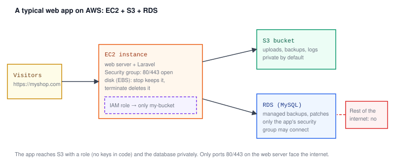

# Chapter 6 — AWS EC2, S3, and RDS

> **Course:** Cloud (AWS / VPS Basics) · **Chapter:** 6 of 8
> Read on the website: [learn.bazardev.com/cloud/06-ec2-s3-and-rds](https://learn.bazardev.com/cloud/06-ec2-s3-and-rds)
>
> 🇧🇩 **Prefer Bangla?** [Read this chapter in Bangla →](https://learn.bazardev.com/cloud/06-ec2-s3-and-rds?lang=bn)

AWS has hundreds of services, but a typical web app starts with just **three**: a server to run the code (**EC2**), a place for files (**S3**), and a database (**RDS**). Learn these three and you can build most things.

> As in the last chapter: AWS changes its console, prices and free-tier rules often. This chapter teaches the lasting ideas and gives no prices. Check AWS's own pages for numbers.

## 1. EC2: a virtual server

**EC2 (Elastic Compute Cloud)** is AWS's version of a VPS. You rent a virtual server, called an **instance**, and you manage the operating system on it. If Chapter 2 made sense, EC2 will feel familiar: SSH key, a normal user, a firewall, a web server.

Pieces you choose when you launch an instance:

| Piece | What it is |
|---|---|
| **AMI** (Amazon Machine Image) | The starting disk image: which OS (Ubuntu, Amazon Linux...) |
| **Instance type** | The size: CPU and memory. Names look like `t3.micro` (family `t3`, size `micro`). Bigger size = more power = higher cost |
| **Key pair** | The SSH key used to log in (you download the private key **once**) |
| **Security group** | The firewall for the instance: which ports are open to whom (next chapter) |
| **EBS volume** | The instance's disk |
| **Region / AZ** | Where it runs (Chapter 5) |

**Connecting**, once the instance is running and the security group allows SSH (port 22):

```bash
chmod 400 my-key.pem                    # SSH refuses keys that others could read
ssh -i my-key.pem ubuntu@PUBLIC_IP      # "ubuntu" for Ubuntu AMIs; "ec2-user" for Amazon Linux
```

The default login user depends on the AMI. From here, everything from Chapters 2 and 4 applies: create your own user, set up the web server, enable HTTPS.

### Stop, start, terminate

This is the most important thing to understand about cost:

| Action | What happens | Still paying for? |
|---|---|---|
| **Stop** | The instance shuts down; its disk is kept | The **disk (EBS)**, but no longer the compute |
| **Start** | It boots again from the same disk | Compute again |
| **Terminate** | The instance is **deleted** (and its disk, by default) | Nothing, but the data is **gone** |

Stopped is not free: attached disks and some addresses keep costing. When you finish practising, **terminate** what you don't need.

### IP addresses

By default an instance gets a **public IP that changes when you stop and start it**. If your DNS record points at it, it will break (Chapter 3). An **Elastic IP** is a fixed public address you attach to an instance, so it survives restarts. Public IPv4 addresses can cost money, so check the current pricing and release addresses you don't use.

## 2. S3: files in buckets

**S3 (Simple Storage Service)** stores **files, called objects, in containers, called buckets**. It is not a disk attached to a server. You put and get objects over the internet (HTTPS) by name.

- **Bucket:** a container with a **globally unique name**, living in one Region.
- **Object:** a file plus its **key**, which is its name/path, like `uploads/2026/photo.jpg`. (S3 has no real folders; the `/` is just part of the key.)
- Practically unlimited space; you pay for what you store and transfer.
- AWS **designs S3 for extremely high durability**, so objects are very unlikely to be lost. (Durability is not a backup: if *you* delete or overwrite a file, it's gone. Turn on **versioning** to keep older versions.)

Good uses: user uploads, images, **backups**, logs, static websites, files for other services.

**Why not keep uploads on the server's disk?** If your app runs on several servers (or you replace a server), each has its own disk, and files uploaded to one are missing from the others. S3 is shared storage, and your servers become disposable. (This is the file-upload problem from the Kubernetes final project.)

### Using S3 from the CLI

```bash
aws s3 mb s3://my-unique-bucket-name           # make a bucket
aws s3 cp photo.jpg s3://my-unique-bucket-name/uploads/photo.jpg
aws s3 ls s3://my-unique-bucket-name/uploads/
aws s3 sync ./backups s3://my-unique-bucket-name/backups   # copy a whole folder
```

### Keep buckets private

New buckets **block public access** by default. **Leave that on** unless you are deliberately hosting a public website. Many data leaks come from a public bucket that nobody meant to expose. To let someone download a private file for a short time, generate a **pre-signed URL**: a link that works for minutes or hours, then expires.

### Storage classes

S3 offers cheaper classes for data you rarely read (for example "Infrequent Access" and archive classes such as Glacier), and **lifecycle rules** can move or delete old objects automatically. Handy for old backups and logs.

### From Laravel

Laravel can use S3 as a filesystem disk (via the `league/flysystem-aws-s3-v3` package and `FILESYSTEM_DISK=s3` with the bucket and region in `.env`). On EC2, give the instance an **IAM role** with access to only that bucket (Chapter 5) instead of putting access keys in `.env`.

## 3. RDS: a managed database

**RDS (Relational Database Service)** runs a database for you: MySQL, PostgreSQL, MariaDB and others. You *could* install MySQL on an EC2 server yourself, but then **you** handle backups, updates, failover and disk space. With RDS, AWS handles:

- installing and **patching** the database software,
- **automated backups** and point-in-time recovery (you choose how many days to keep),
- **Multi-AZ** option: a standby copy in another Availability Zone that takes over if the main one fails,
- monitoring, and easy resizing.

You still own the **schema, queries, indexes and application security**. RDS manages the engine, not your design.



Connect your app using the database's **endpoint**, a hostname AWS gives you:

```
DB_HOST=mydb.abcdefghij12.ap-southeast-1.rds.amazonaws.com
DB_PORT=3306
DB_DATABASE=laravel
DB_USERNAME=laravel
```

(Keep the password in a secret store or `.env` that is **not** in Git.)

**Security rule:** the database should **not** be reachable from the whole internet. Keep it private and let only your app's security group connect to it (Chapter 7). A database open to the world is attacked within hours.

### Multi-AZ vs read replicas

These are different things:

- **Multi-AZ** is for **availability**: a standby copy for automatic failover. It doesn't make reads faster.
- **Read replicas** are for **performance**: extra copies that serve read queries to take load off the main database.

### EC2 + MySQL vs RDS

| | MySQL on your own EC2 | RDS |
|---|---|---|
| Backups, patches, failover | You build and maintain | Managed |
| Cost | Cheaper on paper | More per month; saves your time and risk |
| Control | Full | Some settings restricted |
| Good for | Learning, tiny projects | Anything where losing data hurts |

## 4. Which service for what?

| You need... | Use |
|---|---|
| To run your app's code | **EC2** |
| To store uploads, images, backups, logs | **S3** |
| A relational database with backups handled | **RDS** |
| Names pointing at your servers | **Route 53** (AWS's DNS) |
| Permissions between all of these | **IAM roles** |

## 5. Key takeaways

- **EC2** = virtual server (instance): choose an AMI, an instance type, a key pair and a security group; connect with `ssh -i key.pem`.
- **Stop** keeps the disk (and its cost); **terminate** deletes the instance. Use an **Elastic IP** if you need a fixed address.
- **S3** = object storage in **buckets** (unique names), keys instead of folders; ideal for uploads and backups. **Keep buckets private**, use pre-signed URLs, and turn on versioning for important data.
- **RDS** = a **managed** database: AWS handles patching, backups and failover; you own schema and queries. Keep it private.
- **Multi-AZ** = availability; **read replicas** = read performance.
- Give servers **IAM roles** to reach S3, not access keys.

## 6. Test yourself (exam prep)

<details>
<summary><strong>Q1. What do you choose when you launch an EC2 instance?</strong></summary>

An AMI (the OS image), an instance type (CPU/memory size), a key pair for SSH, a security group (firewall), storage (EBS) and the Region/AZ.
</details>

<details>
<summary><strong>Q2. What is the difference between stopping and terminating an instance?</strong></summary>

Stopping shuts it down but keeps the disk (which still costs money) and lets you start it again. Terminating deletes the instance and, by default, its disk, so the data is gone.
</details>

<details>
<summary><strong>Q3. Why is S3 a better place for user uploads than the web server's own disk?</strong></summary>

S3 is shared and independent of any one server, so every server sees the same files and you can replace servers without losing them.
</details>

<details>
<summary><strong>Q4. Name two things RDS does for you that a self-installed MySQL on EC2 does not.</strong></summary>

Examples: automated backups, patching, Multi-AZ failover, monitoring.
</details>

<details>
<summary><strong>Q5. What is the difference between Multi-AZ and a read replica?</strong></summary>

Multi-AZ is a standby for failover (availability). A read replica serves extra read queries (performance).
</details>

<details>
<summary><strong>Q6. How should an EC2 app get permission to read an S3 bucket safely?</strong></summary>

Attach an IAM role to the instance, allowing only that bucket, instead of storing access keys.
</details>

## 7. Free resources

- AWS: [What is Amazon EC2?](https://docs.aws.amazon.com/AWSEC2/latest/UserGuide/concepts.html)
- AWS: [Amazon S3 User Guide](https://docs.aws.amazon.com/AmazonS3/latest/userguide/Welcome.html)
- AWS: [What is Amazon RDS?](https://docs.aws.amazon.com/AmazonRDS/latest/UserGuide/Welcome.html)
- AWS: [Launch a virtual machine (tutorial)](https://aws.amazon.com/getting-started/launch-a-virtual-machine-B-0/)
- Laravel: [File Storage](https://laravel.com/docs/filesystem) (S3 driver)

---

**Next:** Chapter 7 — Networking, security, backups, and costs *(coming soon)*
