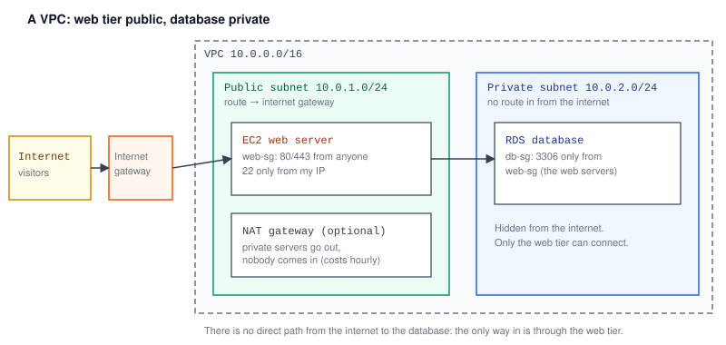

# Chapter 7 — Networking, Security, Backups, and Costs

> **Course:** Cloud (AWS / VPS Basics) · **Chapter:** 7 of 8
> Read on the website: [learn.bazardev.com/cloud/07-networking-security-and-costs](https://learn.bazardev.com/cloud/07-networking-security-and-costs)
>
> 🇧🇩 **Prefer Bangla?** [Read this chapter in Bangla →](https://learn.bazardev.com/cloud/07-networking-security-and-costs?lang=bn)

You can run a server, store files and host a database. Before the final project, four things turn a demo into something you can trust: **who can reach what** (networking), **keeping it safe** (security), **surviving mistakes** (backups) and **not getting a surprise bill** (costs).

> As before, AWS prices and console screens change. This chapter teaches the ideas and gives no prices.

## 1. VPC: your private network in the cloud

A **VPC (Virtual Private Cloud)** is **your own isolated network inside AWS**, in one Region. Everything you launch (EC2, RDS) sits inside a VPC. Each new account has a **default VPC** ready to use, so you can launch a server without designing anything. For real projects you create your own.

A VPC is made of:

| Piece | What it does |
|---|---|
| **CIDR block** | The VPC's range of private IP addresses, like `10.0.0.0/16` |
| **Subnet** | A slice of the VPC, living in **one Availability Zone** |
| **Route table** | Rules saying where network traffic goes next |
| **Internet gateway** | The door between the VPC and the public internet |
| **NAT gateway** | Lets private servers make outgoing connections (for updates) without being reachable from outside |

**CIDR in one minute.** `10.0.0.0/16` means "the first 16 bits are fixed, the rest are free", giving about 65,000 addresses. `10.0.1.0/24` gives 256. The bigger the number after `/`, the *smaller* the range. (AWS reserves 5 addresses in every subnet.) You don't need to calculate by hand: use a CIDR calculator.

### Public and private subnets

The key design idea:

- A **public subnet** has a route to the internet gateway. Things here can be reached from the internet: your web server or load balancer.
- A **private subnet** has **no** route in from the internet. Things here are hidden: your database, internal services.

Visitors reach the web server. The web server reaches the database. **Nobody on the internet can reach the database at all**, not even by guessing its address. This is the safest, most common layout. (A NAT gateway helps private servers download updates, but it also has its own hourly cost, so check pricing before you leave one running.)

## 2. Security groups: the firewall for each resource

A **security group** is a firewall attached to an instance, a database or a load balancer. Compared with UFW from Chapter 2 it lives **outside** the server, and you manage it in AWS.

How it works:

- **Allow rules only.** There are no "deny" rules. Anything not allowed is blocked.
- **Inbound** is denied by default; **outbound** is allowed by default.
- It is **stateful**: if a request is allowed in, the reply is allowed back out automatically.
- A rule says: *protocol + port + source*. A source can be an IP range **or another security group**.

An example:

| Security group | Inbound rule | Meaning |
|---|---|---|
| `web-sg` | TCP 80, 443 from `0.0.0.0/0` | Anyone may load the website |
| `web-sg` | TCP 22 from `203.0.113.7/32` | **Only your own IP** may SSH |
| `db-sg` | TCP 3306 from `web-sg` | **Only servers in `web-sg`** may talk to MySQL |

That last row is the powerful trick: the database accepts connections **from the web servers' security group**, so you never write IP addresses, and new web servers get access automatically.

**Never open SSH (22) or a database port to `0.0.0.0/0`** (the whole internet). Bots will find it within minutes. Allow only your own IP, or use AWS's session tools instead of SSH.

There is also a second, coarser firewall at the subnet level, the **network ACL (NACL)**. It is *stateless* and supports allow *and* deny rules. Most projects leave NACLs at their defaults and rely on security groups.

## 3. A security checklist

You have seen most of these already. Treat them as a list to check on every project:

- [ ] **MFA** on the root user and on every human IAM user; no root access keys (Chapter 5).
- [ ] **Least privilege** IAM policies; **roles** instead of access keys on servers.
- [ ] **No secrets in Git** or in images (Docker course).
- [ ] **SSH** only from your IP, with keys, no password login (Chapter 2).
- [ ] **Databases private**, reachable only from the app's security group.
- [ ] **S3 buckets private** unless a public site is intended.
- [ ] **HTTPS everywhere** (Chapter 4).
- [ ] **Updates:** patch the OS and your packages regularly.
- [ ] **Encryption at rest:** you can turn it on for EBS disks, RDS and S3, usually with one setting.
- [ ] **Audit logs:** **CloudTrail** records who did what in your account via the API, which is how you answer "who deleted that?" or "was this key abused?".

## 4. Backups: the thing you only need once

Some day a table gets dropped, a disk fails, or someone deletes the wrong bucket. A backup is how you recover.

Two numbers describe your needs:

- **RPO (Recovery Point Objective):** how much data can you afford to lose? "Up to 1 hour of orders" means backups at least hourly.
- **RTO (Recovery Time Objective):** how long can you be down? "Back within 2 hours" shapes how you restore.

**The 3-2-1 rule** is a good guide: **3** copies of your data, on **2** different kinds of storage, with **1** copy somewhere else (another Region or account).

What AWS gives you:

| Data | Backup tool |
|---|---|
| **RDS database** | **Automated backups** (daily, with point-in-time recovery, kept for the days you choose) and manual **snapshots** |
| **EC2 disk (EBS)** | **EBS snapshots** (copies of the disk, stored incrementally) |
| **S3 files** | **Versioning** keeps older versions; **cross-Region replication** copies to another Region |
| **Your VPS or self-managed DB** | A scheduled dump (for example `mysqldump`) **copied to S3** |

A very common pattern: a cron job that dumps the database, compresses it and uploads it to S3, with a lifecycle rule that deletes copies older than N days.

Two warnings:

1. **Multi-AZ and RAID are not backups.** They protect against hardware failure, not against *you* deleting data, because the deletion is copied too.
2. **A backup you have never restored is only a hope.** Practise restoring into a test environment, and time it. That is how you learn your real RTO.

## 5. Costs: how to avoid a surprise bill

Cloud billing is pay-as-you-go, which is wonderful until you forget something. A bill is built from a few sources:

| Source | Remember |
|---|---|
| **Compute** | Instances bill for the time they run. Bigger type = more cost |
| **Storage** | Disks (EBS), S3 and snapshots bill for GB stored, **even if the server is stopped** |
| **Data transfer** | Traffic going **out** to the internet costs money; coming in is generally free |
| **Managed extras** | Load balancers, NAT gateways, RDS Multi-AZ and public IPv4 addresses bill by the hour |
| **Idle leftovers** | Unattached disks, old snapshots, unused Elastic IPs, forgotten test servers |

**Habits that prevent surprises:**

1. **Set a budget with email alerts first** (Chapter 5). It warns you; it does not stop spending.
2. **Look at the bill regularly.** Use **Cost Explorer** to see which service costs what.
3. **Tag resources** (for example `project=shop`, `env=test`) so you can find, group and delete things by project.
4. **Clean up after practice:** terminate test instances, delete unattached volumes, old snapshots and unused Elastic IPs, and empty test buckets.
5. **Right-size:** a small instance is usually enough for learning and small apps. Don't pick large "just in case".
6. **Stop or schedule non-production servers** that don't need to run overnight.
7. **Read free-tier terms carefully:** they are limited in amount and in time, and anything beyond them is billed.
8. **Know your Region:** resources forgotten in a Region you rarely open still cost money. Check the Region selector (Chapter 5).

A final **after-practice checklist:** open EC2 (instances, volumes, Elastic IPs), RDS (databases, snapshots), S3 (buckets), and the **Billing** page. If anything is still there that you don't need, delete it.

## 6. Key takeaways

- A **VPC** is your private network in a Region. **Subnets** live in one AZ; **public** subnets route to the internet gateway, **private** ones don't.
- Put the **web tier in a public subnet** and the **database in a private subnet**.
- **Security groups** are stateful, allow-only firewalls. Reference **another security group** as the source (`db-sg` allows `web-sg`). Never open SSH or databases to `0.0.0.0/0`.
- Follow the security checklist: MFA, least privilege, no secrets in Git, private DB and buckets, HTTPS, updates, encryption, **CloudTrail**.
- **Backups:** know your **RPO** and **RTO**, follow **3-2-1**, use RDS automated backups, EBS snapshots and S3 versioning, and **test restores**. Multi-AZ is not a backup.
- **Costs:** compute, storage (even stopped), data transfer out and idle leftovers. Set a **budget**, **tag** resources, **clean up** after practice.

## 7. Test yourself (exam prep)

<strong>Q1. What is the difference between a public and a private subnet?</strong>

A public subnet has a route to the internet gateway, so its resources can be reached from the internet. A private subnet has no such route, so its resources (like a database) are hidden from it.

<strong>Q2. How do you let only your web servers connect to the database?</strong>

Put the database in a private subnet and, in the database's security group, allow the database port with the web servers' security group as the source.

<strong>Q3. What does it mean that a security group is "stateful"?</strong>

If an incoming request is allowed, the reply is automatically allowed back out, without a separate rule.

<strong>Q4. Why is opening SSH (port 22) to 0.0.0.0/0 a bad idea?</strong>

Anyone on the internet can try to connect, and bots scan for open SSH within minutes. Allow only your own IP.

<strong>Q5. What do RPO and RTO mean?</strong>

RPO is how much data you can afford to lose (it sets how often to back up). RTO is how long you can afford to be down (it shapes how fast you must restore).

<strong>Q6. Why is Multi-AZ not a replacement for backups?</strong>

It protects against hardware or data-center failure, but a mistaken delete or corrupted data is copied to the standby too.

<strong>Q7. Name three things that keep costing money after you "stop" practising.</strong>

Examples: EBS volumes and snapshots, S3 data, unused Elastic IPs or public IPv4 addresses, load balancers, NAT gateways, RDS instances.

## 8. Free resources

- AWS: [How Amazon VPC works](https://docs.aws.amazon.com/vpc/latest/userguide/how-it-works.html)
- AWS: [Security groups](https://docs.aws.amazon.com/vpc/latest/userguide/vpc-security-groups.html)
- AWS: [AWS CloudTrail](https://docs.aws.amazon.com/awscloudtrail/latest/userguide/cloudtrail-user-guide.html)
- AWS: [Cost Explorer](https://aws.amazon.com/aws-cost-management/aws-cost-explorer/) and [Billing and Cost Management docs](https://docs.aws.amazon.com/awsaccountbilling/latest/aboutv2/billing-what-is.html)
- Tool: [CIDR calculator](https://cidr.xyz/) (visualizes address ranges)

---

**Next:** Chapter 8 — Real project: a Laravel app in production *(coming soon)*
