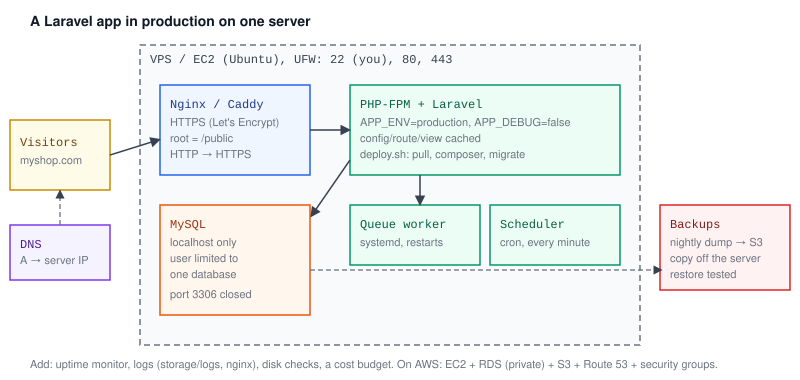

# Chapter 8 — Real Project: A Laravel App in Production

> **Course:** Cloud (AWS / VPS Basics) · **Chapter:** 8 of 8
> Read on the website: [learn.bazardev.com/cloud/08-real-project-laravel-in-production](https://learn.bazardev.com/cloud/08-real-project-laravel-in-production)
>
> 🇧🇩 **Prefer Bangla?** [Read this chapter in Bangla →](https://learn.bazardev.com/cloud/08-real-project-laravel-in-production?lang=bn)

Time to put it all together. We take a Laravel app from "works on my laptop" to **live on the internet**, with a domain, HTTPS, a database, a queue worker, a scheduler, a deploy script and backups.

The steps use a **VPS running Ubuntu**. On AWS the same steps work on an **EC2** instance, and we show at the end how each piece maps to AWS services.

> **Honest note:** these commands are the standard Ubuntu way of doing this, but I have not run them on a fresh server for you. Package names and versions change (for example the PHP version), so adjust for what your server offers, and read each command before you run it. Doing a real deploy once, slowly, is the best way to learn this.



## Step 0 — The plan

| Piece | Where it comes from |
|---|---|
| A safe server | Chapter 2 |
| Domain pointing at the server | Chapter 3 |
| Web server + HTTPS | Chapter 4 |
| PHP, Composer, MySQL | this chapter |
| The app code, `.env`, migrations | this chapter |
| Queue worker + scheduler | this chapter |
| Deploys | this chapter (and the CI/CD course) |
| Backups | Chapter 7, applied here |

## Step 1 — A safe server and a domain

Follow Chapter 2: create the server, make your own `deploy` user, SSH keys only, `PermitRootLogin no`, UFW allowing OpenSSH, 80 and 443. Then Chapter 3: point `myshop.com` and `www` at the server's IP with A records. Check with `dig +short myshop.com`.

## Step 2 — Install the stack

As your `deploy` user (with `sudo`):

```bash
sudo apt update && sudo apt upgrade -y
sudo apt install -y nginx git unzip mysql-server \
  php-fpm php-cli php-mysql php-mbstring php-xml php-curl php-zip php-bcmath php-intl
php -v                      # note the version, e.g. 8.3
```

Install **Composer** with the official instructions at getcomposer.org (the installer verifies a checksum), then confirm with `composer --version`.

Check that your PHP version meets your Laravel version's requirement, and that `systemctl status php8.3-fpm` (use your version) shows it running.

## Step 3 — The database

MySQL listens only on `localhost` by default, which is what we want: **never open port 3306 in the firewall.** Create a database and a dedicated user:

```bash
sudo mysql
```

```sql
CREATE DATABASE myshop CHARACTER SET utf8mb4 COLLATE utf8mb4_unicode_ci;
CREATE USER 'myshop'@'localhost' IDENTIFIED BY 'use-a-long-random-password';
GRANT ALL PRIVILEGES ON myshop.* TO 'myshop'@'localhost';
FLUSH PRIVILEGES;
EXIT;
```

The app's user can touch **only its own database**, not the whole server. (On AWS you would use an RDS endpoint instead, in a private subnet. Chapters 6 and 7.)

## Step 4 — Get the code on the server

```bash
sudo mkdir -p /var/www/myshop
sudo chown deploy:www-data /var/www/myshop
cd /var/www/myshop
git clone https://github.com/YOUR_NAME/YOUR_REPO.git .
composer install --no-dev --optimize-autoloader
```

For a **private repository**, add a **deploy key** (a read-only SSH key for this one repo) to GitHub rather than your personal key.

`--no-dev` skips development packages. If your app has a frontend build (Vite), run `npm ci && npm run build` here, or build in CI and copy the output. Node is only needed at build time.

## Step 5 — Configure `.env`

```bash
cp .env.example .env
nano .env
```

The settings that matter in production:

```
APP_ENV=production
APP_DEBUG=false
APP_URL=https://myshop.com

DB_CONNECTION=mysql
DB_HOST=127.0.0.1
DB_PORT=3306
DB_DATABASE=myshop
DB_USERNAME=myshop
DB_PASSWORD=the-password-from-step-3
```

**`APP_DEBUG=false` is critical.** With debug on, an error page can show your environment variables, including passwords, to any visitor.

Then:

```bash
php artisan key:generate
php artisan migrate --force
php artisan storage:link
```

`--force` is required in production, because Laravel otherwise asks "are you sure?".

**Permissions.** The web server's user (`www-data`) must be able to write to `storage` and `bootstrap/cache`:

```bash
sudo chown -R deploy:www-data storage bootstrap/cache
sudo chmod -R ug+rwX storage bootstrap/cache
```

**Never commit `.env`**, and never make it web-readable (the web root is `public/`, not the project folder, so it isn't).

## Step 6 — Nginx and HTTPS

Create `/etc/nginx/sites-available/myshop` exactly as in Chapter 4, with `root /var/www/myshop/public;` and your PHP-FPM socket. Then:

```bash
sudo ln -s /etc/nginx/sites-available/myshop /etc/nginx/sites-enabled/
sudo nginx -t && sudo systemctl reload nginx
sudo apt install -y certbot python3-certbot-nginx
sudo certbot --nginx -d myshop.com -d www.myshop.com
sudo certbot renew --dry-run
```

Open `https://myshop.com`. If you use Caddy instead, the Caddyfile from Chapter 4 does the same, with automatic HTTPS.

## Step 7 — Speed up Laravel for production

```bash
php artisan config:cache
php artisan route:cache
php artisan view:cache
```

(`php artisan optimize` runs the main ones together.) A classic gotcha: **after `config:cache`, `env()` only works inside config files.** Code that calls `env('SOMETHING')` elsewhere gets `null`. Use `config('...')` in your code. And after you edit `.env` on a server, run `php artisan config:clear` (or re-cache), or your change is ignored.

## Step 8 — Queue worker and scheduler

Many apps send emails or process images in the background (**queues**), and run timed jobs (**scheduler**).

**Scheduler:** one cron entry runs Laravel's scheduler every minute. Edit the web user's crontab:

```bash
sudo crontab -u www-data -e
```

```
* * * * * cd /var/www/myshop && php artisan schedule:run >> /dev/null 2>&1
```

**Queue worker:** it must run all the time and restart if it crashes. Use a **systemd** service:

```ini
# /etc/systemd/system/myshop-worker.service
[Unit]
Description=MyShop queue worker
After=network.target mysql.service

[Service]
User=www-data
Group=www-data
Restart=always
ExecStart=/usr/bin/php /var/www/myshop/artisan queue:work --sleep=3 --tries=3 --max-time=3600

[Install]
WantedBy=multi-user.target
```

```bash
sudo systemctl daemon-reload
sudo systemctl enable --now myshop-worker
systemctl status myshop-worker
```

(Your `.env` must set `QUEUE_CONNECTION=database` or `redis`, not `sync`.) A worker keeps the old code in memory, so **restart it after every deploy**: `php artisan queue:restart`.

## Step 9 — A deploy script

Never deploy by editing files on the server. Write the steps once:

```bash
#!/usr/bin/env bash
# /var/www/myshop/deploy.sh
set -euo pipefail
cd /var/www/myshop

php artisan down --retry=60          # show a maintenance page
git pull --ff-only origin main
composer install --no-dev --optimize-autoloader
php artisan migrate --force
php artisan config:cache
php artisan route:cache
php artisan view:cache
php artisan queue:restart
sudo systemctl reload php8.3-fpm     # use your PHP version
php artisan up
echo "Deployed."
```

`set -euo pipefail` makes the script **stop at the first error**, instead of carrying on with half a deploy. You run it with `bash deploy.sh`.

Later, let **GitHub Actions** run this script over SSH whenever you merge to `main`. That is the pipeline from the CI/CD course, with a dedicated deploy key stored in GitHub Secrets. A deploy that touches the database should be preceded by a backup (next step), and for a bigger app you would aim for zero-downtime deploys with release folders.

## Step 10 — Backups

A nightly database dump, compressed, copied off the server. First store the database password in a private file so it never appears on the command line or in `ps`:

```bash
nano ~/.my.cnf
```

```
[client]
user=myshop
password=the-password-from-step-3
```

```bash
chmod 600 ~/.my.cnf
```

The backup script:

```bash
#!/usr/bin/env bash
# /home/deploy/backup-db.sh
set -euo pipefail
STAMP=$(date +%F-%H%M)
DIR=/var/backups/myshop
mkdir -p "$DIR"

mysqldump --single-transaction --no-tablespaces myshop | gzip > "$DIR/myshop-$STAMP.sql.gz"

# copy off the server (needs the AWS CLI and an IAM user or role limited to this bucket)
aws s3 cp "$DIR/myshop-$STAMP.sql.gz" s3://my-backup-bucket/myshop/

# keep only the last 7 days locally
find "$DIR" -name 'myshop-*.sql.gz' -mtime +7 -delete
```

Run it every night with `crontab -e`:

```
15 2 * * * /home/deploy/backup-db.sh >> /home/deploy/backup.log 2>&1
```

Add an S3 **lifecycle rule** to expire old copies, and keep the bucket private (Chapter 6). If you have no AWS yet, copy the file to another machine with `scp` or `rsync`. The point is a copy **off this server** (3-2-1, Chapter 7).

**Now practise the restore** into a scratch database, and time it:

```bash
gunzip < myshop-2026-01-01-0215.sql.gz | mysql myshop_restore_test
```

A backup you haven't restored is only a hope.

## Step 11 — Watch it

- **Is it up?** Use a free uptime monitor (UptimeRobot, Better Stack and similar) that pings `https://myshop.com/up` and emails you when it fails. Laravel 11+ includes the `/up` health route.
- **Errors:** read `storage/logs/laravel.log` and `sudo tail -n 50 /var/log/nginx/error.log`.
- **Disk and memory:** `df -h` (full disks break databases and logs), `free -h`.
- **Worker:** `systemctl status myshop-worker`.

You will go much deeper in the **Monitoring & Logging** course.

## Step 12 — The go-live checklist

- [ ] `APP_ENV=production`, `APP_DEBUG=false`, `.env` not in Git
- [ ] HTTPS works; HTTP redirects to HTTPS; `certbot renew --dry-run` passes
- [ ] Firewall allows only 22 (ideally from your IP), 80, 443; port 3306 closed
- [ ] SSH: keys only, no root login
- [ ] Database user limited to one database
- [ ] `storage` and `bootstrap/cache` writable by the web user
- [ ] Queue worker running; scheduler cron installed
- [ ] Deploy script works end to end
- [ ] Nightly backup runs, a copy is off-server, **and a restore has been tested**
- [ ] Uptime monitor and a budget/cost alert set
- [ ] OS updates (`unattended-upgrades`) enabled

## Step 13 — The same project on AWS

| This chapter's VPS | On AWS |
|---|---|
| The VPS | **EC2** instance (in a public subnet, security group 80/443 open; 22 only from your IP) |
| MySQL on the same server | **RDS** in a private subnet, reachable only from the app's security group |
| `/var/www/myshop/storage` uploads | **S3** bucket, accessed through an **IAM role** on the instance |
| Backups to S3 | RDS automated backups and snapshots, plus S3 versioning |
| Domain at your registrar | **Route 53** (or keep your DNS host) pointing at an Elastic IP |
| `ufw` | **Security groups** (and keep UFW if you like) |
| Cost control | A **budget**, tags, and a clean-up after practice |

Notice that nothing conceptual changed: the same web server, the same app, the same deploy script. You swapped some pieces for managed services.

## Key takeaways

- A production Laravel deploy needs: a **safe server**, a **domain**, **Nginx or Caddy with HTTPS**, **PHP-FPM**, a **database**, and the app with a correct `.env`.
- Set `APP_ENV=production` and **`APP_DEBUG=false`**. Use `migrate --force`. Make `storage` and `bootstrap/cache` writable by the web user. The web root is `public/`.
- Cache config/routes/views for speed; remember `env()` only works in config files after caching, and clear the config cache after editing `.env`.
- Run the **scheduler** from cron and the **queue worker** under **systemd**, and restart the worker on every deploy.
- Put the deploy steps in a **script** (`set -euo pipefail`) and automate it with CI/CD.
- Back up the database off-server, and **test the restore**.
- Watch the app with an uptime monitor, logs, and disk checks.
- The same design maps to **EC2 + RDS + S3 + Route 53 + security groups** on AWS.

## Test yourself (exam prep)

<details>
<summary><strong>Q1. Why must `APP_DEBUG` be `false` in production?</strong></summary>

With debug on, error pages can reveal environment details such as passwords and file paths to any visitor.
</details>

<details>
<summary><strong>Q2. Why is the web server's root set to the `public/` folder and not the project folder?</strong></summary>

So that `.env`, source code, `vendor` and other private files are not reachable from the web.
</details>

<details>
<summary><strong>Q3. After a deploy, why do you run `php artisan queue:restart`?</strong></summary>

A queue worker keeps the old code in memory. Restarting makes it load the new code.
</details>

<details>
<summary><strong>Q4. What does `set -euo pipefail` do in a deploy script?</strong></summary>

It makes the script stop at the first error (and on unset variables or failed pipes), instead of carrying on with a half-finished deploy.
</details>

<details>
<summary><strong>Q5. After `php artisan config:cache`, a call to `env('MY_KEY')` in your code returns null. Why, and what is the fix?</strong></summary>

Once config is cached, `.env` isn't read at runtime, so `env()` outside config files returns null. Read the value through `config()` (set it in a config file that uses `env()`).
</details>

<details>
<summary><strong>Q6. What makes a backup trustworthy?</strong></summary>

A copy stored off the server, and a restore that you have actually tested.
</details>

## Free resources

- Laravel: [Deployment](https://laravel.com/docs/deployment)
- Laravel: [Queues](https://laravel.com/docs/queues) and [Task scheduling](https://laravel.com/docs/scheduling)
- Laravel: [Configuration caching](https://laravel.com/docs/configuration#configuration-caching)
- Composer: [Download / installation](https://getcomposer.org/download/)

---

**Course complete.** Take the course exam on the website to earn your certificate.
