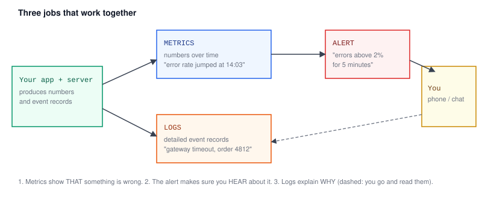
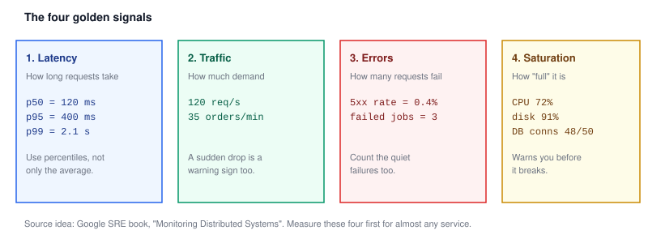

# Chapter 1 — Why Monitor? Metrics, Logs, Alerts, and the Four Golden Signals

> **Course:** Monitoring & Logging · **Chapter:** 1 of 8
> Read on the website: [learn.bazardev.com/monitoring/01-why-monitor-and-what-to-watch](https://learn.bazardev.com/monitoring/01-why-monitor-and-what-to-watch)
>
> 🇧🇩 **Prefer Bangla?** [Read this chapter in Bangla →](https://learn.bazardev.com/monitoring/01-why-monitor-and-what-to-watch?lang=bn)

Your app is live (Cloud course). Now a question every team eventually faces:

> **"How do we find out something is broken before our users tell us?"**

If the honest answer is "a customer messages us", you have no monitoring yet. This course fixes that, step by step, with free tools.

## 1. A story you will recognise

At 2 a.m. the database disk fills up. Orders start failing. Nobody is awake. At 9 a.m. a customer emails: "your site is broken". You open the server, find the full disk in two minutes, and fix it in ten. But the site was down for **seven hours**, and the fix took ten minutes.

The expensive part was not the repair. It was **not knowing**. Monitoring turns "seven hours" into "five minutes".

## 2. Monitoring, logging, alerting: three different jobs

| Job | Question it answers | Example |
|---|---|---|
| **Monitoring** (metrics) | "How is the system doing right now, and over time?" | CPU 85%, 120 requests/second, 2% errors |
| **Logging** | "What exactly happened?" | `ERROR Payment failed for order 4812: gateway timeout` |
| **Alerting** | "Who needs to be told, and when?" | A message to your phone: "disk 95% full" |

They work together:

1. **Metrics** show *that* something is wrong (error rate jumped at 14:03).
2. **Alerts** make sure a human *hears* about it.
3. **Logs** explain *why* (the gateway timed out).



Together with **traces** (following one request across several services), these are often called the **three pillars of observability**: metrics, logs and traces. For a single Laravel server you will mostly use the first two. Traces matter when you have many services.

**Monitoring vs observability:** monitoring watches for problems you *predicted* ("disk full"). Observability means your system gives you enough data to investigate problems you *didn't* predict. You build toward it by collecting good metrics and logs.

## 3. What is a metric?

A **metric** is a **number measured over time**. For example, "CPU usage" sampled every 15 seconds is a metric. Stored as a series of points, it can be drawn as a graph and checked against a rule.

```
time      cpu_percent
14:00:00      22
14:00:15      24
14:00:30      91   <- spike
14:00:45      90
```

Metrics are small, cheap to store, fast to graph, and great for **trends and alerts**. They do not carry details like *which* request failed. That is the job of logs.

## 4. What should you watch? The four golden signals

Google's Site Reliability Engineering (SRE) book suggests four signals that describe the health of almost any user-facing service. Learn these four and you know what to measure first:

| Signal | Meaning | Example for a web app |
|---|---|---|
| **Latency** | How long requests take | "95% of pages load in under 400 ms" |
| **Traffic** | How much demand there is | Requests per second |
| **Errors** | How many requests fail | Share of responses that are 5xx |
| **Saturation** | How "full" the system is | CPU, memory, disk, database connections |



Two notes:

- Measure latency for **successful and failed** requests separately. A fast error looks "good" if you average it in.
- Prefer **percentiles** (like p95, p99) to averages. If 99 requests take 100 ms and one takes 10 seconds, the average looks fine (about 200 ms) but one user waited 10 seconds. The p99 shows the pain; the average hides it.

## 5. Symptoms and causes

Watch **what users feel** first, then dig into causes:

- **Symptom:** "the checkout page returns errors" (users feel it).
- **Cause:** "the database has run out of connections" (users do not feel it directly).

Alert mainly on **symptoms** (errors, latency, the site being down), because they tell you users are hurting. Use cause metrics (CPU, disk, connections) to **diagnose** and to catch problems *before* they become symptoms. Chapter 6 builds on this idea.

## 6. Black-box and white-box monitoring

- **Black-box:** check from the **outside**, like a user. "Does `https://myshop.com/` answer with 200 in under 2 seconds?" An uptime checker does this.
- **White-box:** look from the **inside**. "The app reports 3% of requests failing; the queue has 5,000 waiting jobs." Metrics and logs do this.

You need both. A black-box check catches *"the whole server is unreachable"*, which internal metrics can't report because they are down too.

## 7. SLIs, SLOs and "how many nines?"

Teams make reliability measurable with three terms:

- **SLI (Service Level Indicator):** a measurement, such as "the share of requests that succeed".
- **SLO (Service Level Objective):** your **target** for it: "99.9% of requests succeed over 30 days".
- **SLA (Service Level Agreement):** a **contract** with customers, often with penalties. (You don't need one to have SLOs.)

An uptime target sounds small but means a lot of downtime. For a 30-day month:

| Availability | Downtime allowed per month | per year |
|---|---|---|
| 99% ("two nines") | about 7 hours 12 minutes | about 3.65 days |
| 99.9% ("three nines") | about 43 minutes | about 8.8 hours |
| 99.99% ("four nines") | about 4.3 minutes | about 53 minutes |
| 99.999% ("five nines") | about 26 seconds | about 5 minutes |

Each extra nine costs far more effort and money. Choose a target that fits your business: a small shop may be happy with 99.9%; a payment system may need more. The allowed downtime is your **error budget**: the amount of failure you can "spend" while still meeting the target.

## 8. The tools you will meet in this course

You don't need to buy anything. A common free stack:

| Job | Tool |
|---|---|
| Collect and store metrics | **Prometheus** |
| Draw dashboards | **Grafana** |
| Send alerts | **Alertmanager**, or email/Slack |
| Collect and search logs | **Loki** (or the ELK stack) |
| Check from outside | An **uptime monitor** (UptimeRobot, Better Stack and similar) |
| Catch application errors | An **error tracker** (Sentry and similar) |

Paid, all-in-one services exist too (Datadog, New Relic and others). They cost more, but save setup time. Learn the concepts first, and you can use either.

## 9. Key takeaways

- Monitoring exists so **you** find problems before your users do. The costly part of an outage is often *not knowing*.
- **Metrics** (numbers over time) show *that* something is wrong; **logs** explain *why*; **alerts** make sure someone *hears* about it. **Traces** follow a request across services.
- The **four golden signals**: **latency**, **traffic**, **errors**, **saturation**.
- Prefer **percentiles** to averages, and measure errors and successes separately.
- Alert on **symptoms** users feel; use **causes** to diagnose.
- Use **black-box** (outside) and **white-box** (inside) monitoring together.
- An **SLO** is your reliability target; each extra "nine" of uptime costs much more.

## 10. Test yourself (exam prep)

<details>
<summary><strong>Q1. What is the difference between a metric and a log?</strong></summary>

A metric is a number measured over time (for example CPU or requests per second), good for trends and alerts. A log is a detailed record of an event (for example an error message), good for finding out exactly what happened.
</details>

<details>
<summary><strong>Q2. Name the four golden signals.</strong></summary>

Latency, traffic, errors and saturation.
</details>

<details>
<summary><strong>Q3. Why are percentiles (like p99) often better than averages for latency?</strong></summary>

An average can look fine while a few users wait a very long time. A high percentile shows those slow requests.
</details>

<details>
<summary><strong>Q4. What is the difference between black-box and white-box monitoring? Why do you need both?</strong></summary>

Black-box checks from outside like a user (for example an uptime check). White-box looks at internals such as metrics and logs. If the whole server is down, internal metrics stop too, so only an outside check notices.
</details>

<details>
<summary><strong>Q5. An SLO says 99.9% availability over 30 days. Roughly how much downtime does that allow?</strong></summary>

About 43 minutes.
</details>

<details>
<summary><strong>Q6. Should you alert mainly on symptoms or causes? Why?</strong></summary>

Mainly on symptoms (errors, latency, downtime), because they mean users are affected. Cause metrics help diagnose and give early warning.
</details>

## 11. Free resources

- Google SRE book: [Monitoring Distributed Systems](https://sre.google/sre-book/monitoring-distributed-systems/) (where the four golden signals come from)
- Google SRE book: [Service Level Objectives](https://sre.google/sre-book/service-level-objectives/)
- OpenTelemetry: [Observability primer](https://opentelemetry.io/docs/concepts/observability-primer/)
- Prometheus: [Overview](https://prometheus.io/docs/introduction/overview/)
- Grafana: [Documentation](https://grafana.com/docs/grafana/latest/)

---

**Next:** [Chapter 2 — Linux server health: CPU, memory, disk, and the logs](02-linux-server-health.md)
