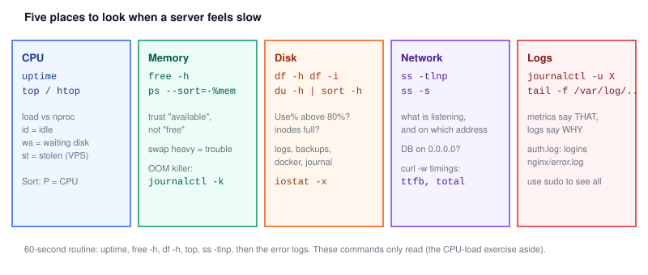

# Chapter 2 — Linux Server Health: CPU, Memory, Disk, and the Logs

> **Course:** Monitoring & Logging · **Chapter:** 2 of 8
> Read on the website: [learn.bazardev.com/monitoring/02-linux-server-health](https://learn.bazardev.com/monitoring/02-linux-server-health)
>
> 🇧🇩 **Prefer Bangla?** [Read this chapter in Bangla →](https://learn.bazardev.com/monitoring/02-linux-server-health?lang=bn)

Before any fancy tool, you should be able to **look at a Linux server and say whether it is healthy**. Every dashboard in this course is just these same numbers, drawn over time. So we start by learning to read them by hand, with commands that are already installed.

In Chapter 1 you met the *saturation* signal: how "full" the system is. Four resources can fill up: **CPU, memory, disk and network**. This chapter shows how to check each one, then how to read the logs that explain what you see.

> The example outputs below are typical illustrations. Your numbers will differ. Try every command on your own server. They only *read*, with one harmless exception: the small CPU-load exercise in section 2, which you stop yourself.



## 1. First look: `uptime` and load average

```bash
uptime
```

```
 09:39:28 up 16 days, 16:21,  6 users,  load average: 0.06, 0.35, 0.56
```

- **up 16 days:** how long since the last reboot. A surprise reboot is itself a clue.
- **load average** has three numbers: the average over the last **1, 5 and 15 minutes**.

**Load average** counts processes that are running **or waiting to run** (and, on Linux, waiting for disk). To read it, compare it with the number of **CPU cores**:

```bash
nproc          # number of CPU cores, for example 6
```

| Load (1 min) on a 6-core machine | Meaning |
|---|---|
| about 0 to 3 | Comfortable |
| about 6 | All cores busy: "full" |
| well above 6 (for example 15) | Work is **queueing**: things will feel slow |

Also read the **trend**: `0.06, 0.35, 0.56` is falling (calming down). `5.2, 2.1, 0.8` is rising (something just started).

## 2. CPU: who is using it?

```bash
top            # live view; press q to quit
htop           # friendlier, if installed (sudo apt install htop)
```

The summary line in `top` is the most useful part:

```
%Cpu(s):  3.1 us,  6.1 sy,  0.0 ni, 90.8 id,  0.0 wa,  0.0 hi,  0.0 si,  0.0 st
```

| Field | Meaning | A problem when... |
|---|---|---|
| **us** | Time in your programs (user space) | Very high: an app is working hard or looping |
| **sy** | Time in the kernel (system calls, network) | Very high: heavy I/O or network handling |
| **id** | Idle: unused | Near 0 means the CPU is saturated |
| **wa** | **Waiting for disk (I/O wait)** | High: the disk is the bottleneck, not the CPU |
| **st** | **Stolen** by the hypervisor | High on a VPS: noisy neighbours, or you are over the plan's CPU share |

Below the summary, the process list shows **who** uses CPU. In `top`, press **`P`** to sort by CPU and **`M`** to sort by memory.

**Try it.** Create some harmless load, watch it appear, and stop it:

```bash
yes > /dev/null &        # burns one CPU core; runs in the background
top                      # find "yes" at the top of the list; press q
kill %1                  # stop it
```

## 3. Memory: read `free -h` correctly

```bash
free -h
```

```
               total        used        free      shared  buff/cache   available
Mem:            11Gi       8.6Gi       1.8Gi       461Mi       2.0Gi       3.1Gi
Swap:             0B          0B          0B
```

The most common beginner mistake: **"free is only 1.8 GB, we're out of memory!"** Not necessarily. Linux uses spare RAM as a **cache** for files (`buff/cache`) and gives it back instantly when programs need it. The number that matters is **`available`**: how much memory programs can still get **without swapping**.

- **Healthy:** `available` is a comfortable share of `total` and stays steady.
- **Danger:** `available` trends towards near zero, and `swap` is being used heavily. Heavy swapping makes a server crawl.

Some programs legitimately use a lot of memory. A database is the classic example: MySQL keeps a large **buffer pool** in RAM on purpose, so a database using half of the memory can be normal. What is *not* normal is memory that **keeps growing without limit** (a **memory leak**).

**The OOM killer.** When memory truly runs out, the kernel kills a process to survive, often your biggest one (the database or the app). Search for it:

```bash
sudo journalctl -k | grep -i "out of memory"
sudo dmesg -T | grep -i "killed process"
```

If a service "randomly disappears", this is the first place to look.

Find the biggest memory users:

```bash
ps aux --sort=-%mem | head -5
```

## 4. Disk: the quiet killer

A full disk is one of the most common causes of outages, and one of the easiest to prevent. A full disk can stop a database from writing, break logs, and crash your app.

```bash
df -h                    # space used per filesystem
```

```
Filesystem      Size  Used Avail Use% Mounted on
/dev/sda1       193G   27G  166G  14% /
```

Watch **Use%** on every mounted filesystem. Also check **inodes**, the "number of files" limit. You can run out of inodes with plenty of space left (millions of tiny files):

```bash
df -i
```

**Finding what is eating the disk:**

```bash
sudo du -h --max-depth=1 /var | sort -h | tail      # biggest folders under /var
sudo du -h --max-depth=1 /var/log | sort -h | tail
```

(`ncdu` is a friendlier interactive version: `sudo apt install ncdu`.)

Usual suspects:

| Culprit | Where | Check |
|---|---|---|
| **Log files** that were never rotated | `/var/log`, `storage/logs/` | `du -sh /var/log` |
| **Database dumps and backups** | wherever you keep them | `ls -lh` the backup folder |
| **Docker images and volumes** | `/var/lib/docker` | `docker system df` |
| **Old releases, uploads, caches** | your app folder | `du` it |
| **systemd journal** | `/var/log/journal` | `journalctl --disk-usage` |

Never delete things you do not understand just to free space. Find out what they are first, and think before you run `rm -rf` anywhere.

**Disk speed (I/O).** If `top` shows high `wa`, find out which disk is busy:

```bash
vmstat 1 5               # one line per second, five times; watch "wa" and "b"
iostat -x 1 3            # per-disk utilisation (needs: sudo apt install sysstat)
```

In `iostat -x`, a disk with `%util` near 100 and growing wait times is saturated.

## 5. Processes and network

**Processes:**

```bash
ps aux --sort=-%cpu | head -5        # top CPU users
ps aux --sort=-%mem | head -5        # top memory users
systemctl --failed                   # services that have crashed
```

**What is listening on the network** (compare with the firewall rules from the Cloud course):

```bash
sudo ss -tlnp
```

```
State   Recv-Q  Send-Q  Local Address:Port   Process
LISTEN  0       511     0.0.0.0:80           nginx
LISTEN  0       128     0.0.0.0:22           sshd
LISTEN  0       70      127.0.0.1:3306       mysqld
```

Read the **Local Address** column: `127.0.0.1:3306` means MySQL is reachable only from this machine (good). `0.0.0.0:3306` means it listens on every interface (check that the firewall blocks it). **A database port bound to `0.0.0.0` is a finding worth investigating.**

Connection counts and a response-time breakdown:

```bash
ss -s                                # summary: how many TCP connections
curl -o /dev/null -s -w "dns=%{time_namelookup} connect=%{time_connect} ttfb=%{time_starttransfer} total=%{time_total}\n" https://myshop.com/
```

`ttfb` is **time to first byte**: the moment the server begins to respond. A high ttfb with a low `connect` usually means the *application* is slow, not the network.

## 6. Reading the logs

Metrics say *that* something is wrong. **Logs say why.** On Linux there are two main places:

**A. `journalctl`** reads the **systemd journal**, where services started by systemd (nginx, mysql, your queue worker, ssh) write their output:

```bash
journalctl -u nginx --since "1 hour ago"     # one service, recent
journalctl -u myshop-worker -f               # follow live (Ctrl+C to stop)
journalctl -p err -b                         # errors and worse, this boot
journalctl -k                                # kernel messages (OOM kills, disk errors)
journalctl --disk-usage                      # how big is the journal?
```

**A common surprise:** if you run `journalctl` as a normal user you may see only *your own* messages and a hint like "You are currently not seeing messages from other users and the system". Use `sudo journalctl ...`, or add your user to the `systemd-journal` (or `adm`) group.

**B. Plain files in `/var/log`:**

| File | What is in it |
|---|---|
| `/var/log/syslog` | General system messages |
| `/var/log/auth.log` | **Logins and `sudo`**: failed SSH attempts live here |
| `/var/log/nginx/access.log`, `error.log` | Every web request, and web server errors |
| `/var/log/mysql/error.log` | Database errors |
| your app's `storage/logs/laravel.log` | Laravel application errors (Chapter 3) |

Handy ways to read them:

```bash
sudo tail -n 50 /var/log/nginx/error.log          # the last 50 lines
sudo tail -f /var/log/nginx/error.log             # follow live
sudo grep -i "error" /var/log/syslog | tail       # search
sudo grep "Failed password" /var/log/auth.log | wc -l     # count failed logins
```

Example: how many requests produced a 5xx error? (In Nginx's default log format the status code is the 9th field):

```bash
sudo awk '$9 ~ /^5/' /var/log/nginx/access.log | wc -l
```

Logs grow without limit unless they are **rotated** (old ones compressed and deleted). Ubuntu does this with **logrotate**. You will set it up for your own app in the next chapter.

## 7. The 60-second checklist

When someone says "the server is slow", run these in order. It takes about a minute and finds most problems:

```bash
uptime                          # 1. load: is anything queueing?
free -h                         # 2. memory: is "available" low? swapping?
df -h                           # 3. disk: anything near 100%?
top                             # 4. who is using CPU / memory? is "wa" high?
sudo ss -tlnp                   # 5. is the service even listening?
sudo journalctl -p err -n 50    # 6. recent errors
sudo tail -n 50 /var/log/nginx/error.log   # 7. web server errors
```

Performance engineer Brendan Gregg popularised this idea in a famous short list for Netflix (see resources).

## 8. Rough warning levels

These are **rules of thumb**, not laws. Adjust them for your server and workload.

| What | Look into it when... |
|---|---|
| Load average per core | above about 1 for a long time |
| CPU idle (`id`) | below about 10 to 20% for several minutes |
| I/O wait (`wa`) | above about 20% for a while |
| Memory `available` | below about 10 to 15% of total, or swap in heavy use |
| Disk `Use%` | above about 80% (alert), 90% (urgent) |
| Inodes `IUse%` | above about 80% |
| Failed services | any (`systemctl --failed`) |

## 9. Why this is not enough

Everything here works, but you are **checking by hand, only when you remember to**. It tells you how the server is *now*, not what happened at 3 a.m. and not how it changed over the last week. The next chapters fix that: logs that are structured and rotated (Chapter 3), then **Prometheus** to record these same numbers every few seconds (Chapter 4), **Grafana** to draw them (Chapter 5) and **alerts** to wake you up (Chapter 6).

## 10. Key takeaways

- Four resources can saturate: **CPU, memory, disk, network**. Check each by hand first.
- `uptime` shows **load average**; compare it with `nproc`, and read the trend (1, 5, 15 minutes).
- In `top`: **`id`** idle, **`wa`** waiting for disk, **`st`** stolen by the hypervisor. `P` sorts by CPU, `M` by memory.
- In `free -h`, trust **`available`**, not `free`; Linux uses spare RAM for cache. A kill from the **OOM killer** shows up in `journalctl -k`.
- A full disk causes real outages: watch `df -h` and `df -i`; find hogs with `du`; logs, backups, Docker and the journal are the usual suspects.
- `ss -tlnp` shows what listens where. A database on `0.0.0.0` deserves a look.
- Use `journalctl -u <service>` and files in `/var/log`. As a normal user you may need `sudo` to see everything.
- The **60-second checklist**: `uptime`, `free -h`, `df -h`, `top`, `ss -tlnp`, then the error logs.

## 11. Test yourself (exam prep)

<details>
<summary><strong>Q1. A 6-core server shows a 1-minute load average of 15. What does that suggest?</strong></summary>

Far more work is waiting than the 6 cores can run, so tasks are queueing and the server will feel slow.
</details>

<details>
<summary><strong>Q2. What does a high `wa` in `top` mean?</strong></summary>

The CPU is waiting for disk I/O, so the disk, not the CPU, is the bottleneck.
</details>

<details>
<summary><strong>Q3. `free -h` shows only 1.8 GB "free" of 11 GB. Is the server out of memory? What do you check?</strong></summary>

Not necessarily. Linux uses spare RAM as cache. Check the `available` column and whether swap is heavily used.
</details>

<details>
<summary><strong>Q4. Your service keeps vanishing with no error in its own log. Where might you find the reason?</strong></summary>

The kernel's OOM killer may have killed it. Check `journalctl -k` or `dmesg` for "out of memory" or "killed process".
</details>

<details>
<summary><strong>Q5. `df -h` shows 40% used, yet you can't create new files. What else should you check?</strong></summary>

Inode usage with `df -i`. The filesystem can run out of inodes (file entries) while space remains.
</details>

<details>
<summary><strong>Q6. Why can `journalctl` show almost nothing when run as a normal user?</strong></summary>

Normal users see only their own messages unless they are in the `systemd-journal` or `adm` group. Use `sudo` or join the group.
</details>

<details>
<summary><strong>Q7. In `ss -tlnp`, MySQL shows `0.0.0.0:3306`. Why is that worth investigating?</strong></summary>

It listens on every network interface. Unless the firewall blocks port 3306, the database could be reachable from the internet. It should normally listen on `127.0.0.1` or a private address only.
</details>

## 12. Free resources

- Brendan Gregg: [Linux Performance](https://www.brendangregg.com/linuxperf.html) (tools and diagrams from a world expert)
- Netflix's checklist: [Linux Performance Analysis in 60,000 Milliseconds (PDF)](https://www.brendangregg.com/Articles/Netflix_Linux_Perf_Analysis_60s.pdf)
- Manual: [`free`](https://man7.org/linux/man-pages/man1/free.1.html) and [`top`](https://man7.org/linux/man-pages/man1/top.1.html)
- systemd: [`journalctl` manual](https://www.freedesktop.org/software/systemd/man/latest/journalctl.html)

---

**Next:** Chapter 3 — Application logs: levels, structure, and rotation *(coming soon)*
