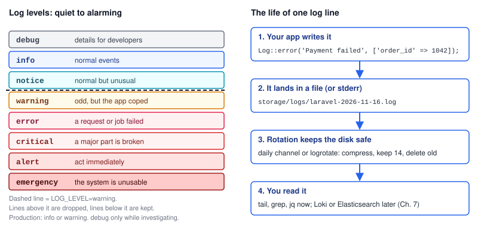

# Chapter 3 — Application Logs: Levels, Structure, and Rotation

> **Course:** Monitoring & Logging · **Chapter:** 3 of 8
> Read on the website: [learn.bazardev.com/monitoring/03-application-logs](https://learn.bazardev.com/monitoring/03-application-logs)
>
> 🇧🇩 **Prefer Bangla?** [Read this chapter in Bangla →](https://learn.bazardev.com/monitoring/03-application-logs?lang=bn)

In Chapter 2 you read the **server's** logs. But the most useful log of all is the one **your own application writes**: *"Order 1042 failed: the payment gateway timed out."* No tool can invent that sentence. Only your code knows what it was doing, so only your code can write it down.

This chapter teaches how to write logs that help at 2 a.m., how to keep them from filling the disk, and how to read them fast. The examples use **Laravel** (PHP), but every idea applies to any language.

> **How the examples were checked:** the Laravel snippets and their output were run on a real Laravel 13 project (Monolog's standard formatters). The `logrotate` configuration was checked with its dry-run mode (`logrotate -d`), which changes nothing. Older Laravel versions (10 to 12) behave the same for everything shown here, except `Log::shareContext()`, which needs Laravel 11 or newer. Your exact timestamps and paths will differ.



## 1. Why application logs?

Metrics (Chapter 1) tell you **that** something is wrong: *errors went up at 14:05.* Logs tell you **why**: *which* requests failed, for *which* user, with *what* message. A good log line answers three questions:

- **What happened?** (a clear message)
- **To whom / which thing?** (order id, user id)
- **Where and when?** (timestamp, channel, request id)

## 2. Log levels

Every log line has a **level** that says how serious it is. They come from an old standard (RFC 5424) and are used by almost every logging library. From quiet to loud:

| Level | Laravel method | Use it for | Example |
|---|---|---|---|
| `debug` | `Log::debug()` | Detail for developers; off in production | "Cart contents: ..." |
| `info` | `Log::info()` | Normal, notable events | "Order 1042 placed" |
| `notice` | `Log::notice()` | Normal but unusual | "User changed their email" |
| `warning` | `Log::warning()` | Something odd, but the app coped | "Slow query: 1830 ms" |
| `error` | `Log::error()` | A request or job **failed** | "Payment failed" |
| `critical` | `Log::critical()` | A major part is broken | "Database unreachable" |
| `alert` | `Log::alert()` | Act **immediately** | "Disk full, cannot write" |
| `emergency` | `Log::emergency()` | The system is unusable | "App cannot boot" |

The level is also a **filter**. If you set the minimum level to `warning`, `debug` and `info` lines are dropped before they are written. That is why one setting changes how noisy your logs are:

```bash
# .env
LOG_LEVEL=warning      # production: keep it quiet
# LOG_LEVEL=debug      # local development: see everything
```

A common starting point: **`info` or `warning` in production, `debug` only while investigating a problem** (and switch it back, because debug logs are big and can contain sensitive detail).

## 3. Writing a log line people can use

Compare two lines:

```php
// Hard to use: no context, can't be searched
Log::error('Something went wrong');

// Easy to use: a stable message, and the details as data
Log::error('Payment failed', ['order_id' => 1042, 'gateway' => 'bkash']);
```

Rules of thumb:

1. **Keep the message constant** and put the changing parts in the **context array**. Then you can search for the exact message `Payment failed` and still see each order id.
2. **Log at the boundary of something important**: a payment, a login, a job starting and finishing, a call to another service.
3. **Log failures with the exception**, not just a text. Laravel prints the exception class, message and file:

```php
try {
    $gateway->charge($order);
} catch (Throwable $e) {
    Log::error('Payment failed', ['order_id' => $order->id, 'exception' => $e]);
    throw $e;   // do not swallow it: let the app handle the failure properly
}
```

4. **Never leave an empty `catch {}`.** An error that nobody logs is an error nobody can fix.
5. Don't log inside tight loops (a million lines of `Processing row`). Log a summary: "Imported 50,000 rows in 12 s".

### What you must never log

Logs are copied, shipped to other tools, kept for weeks, and read by many people. **Treat them as semi-public.** Never write:

- **Passwords**, password-reset tokens, API keys, `.env` values
- **Full card numbers**, CVV, bank details
- **One-time codes (OTP)** and session tokens
- Large amounts of **personal data** (full addresses, national ID numbers). Log an id (`user_id: 7`), not the person's details.

If you must record something sensitive-looking, **mask it** (`01*******89`). The OWASP logging cheat sheet in the resources lists more.

## 4. Plain text vs structured (JSON) logs

By default Laravel writes one human-readable line per event:

```
[2026-11-16 08:33:26] production.INFO: Order placed {"order_id":1042,"user_id":7,"total":2500}
[2026-11-16 08:33:26] production.ERROR: Payment failed {"order_id":1042,"gateway":"bkash"}
```

That is fine for you reading with `tail`. But machines struggle to *search* inside it. A **structured log** writes each event as one **JSON object** per line:

```json
{"message":"Order placed","context":{"order_id":1042,"user_id":7,"total":2500},"level":200,"level_name":"INFO","channel":"production","datetime":"2026-11-16T08:33:26.886295+00:00","extra":{}}
{"message":"Slow query","context":{"ms":1830,"table":"orders"},"level":300,"level_name":"WARNING","channel":"production","datetime":"2026-11-16T08:33:26.886751+00:00","extra":{}}
```

Every field has a name, so tools (and later, central log systems like Loki or Elasticsearch in Chapter 7) can filter by `level_name`, `context.order_id` and so on. You can even do it today with **`jq`**, a free command-line JSON tool:

```bash
# only the warnings, and only two fields
jq -c 'select(.level_name=="WARNING") | {message, context}' storage/logs/app-json.log
# {"message":"Slow query","context":{"ms":1830,"table":"orders"}}

# how many errors per message?
jq -r 'select(.level_name=="ERROR") | .message' storage/logs/app-json.log | sort | uniq -c | sort -rn
```

Use **plain text for small projects you read by hand**; switch to **JSON once logs are shipped to a central system**.

## 5. Laravel's logging setup

Everything lives in `config/logging.php`. A **channel** is a named place logs go. The default channel is chosen by `LOG_CHANNEL`:

| Channel | Where it writes | Notes |
|---|---|---|
| `single` | one file, `storage/logs/laravel.log` | Simple, but the file **grows forever** |
| `daily` | a new file each day, `laravel-2026-11-16.log` | Keeps the last `days` files (default 14) and deletes older ones |
| `stderr` | standard error | For containers: the platform collects it (Docker, Kubernetes) |
| `syslog`, `errorlog` | system log / PHP error log | Integrates with `journalctl` |
| `stack` | **several channels at once** | The usual default; `LOG_STACK=single,slack` for example |

A good production start:

```bash
# .env
LOG_CHANNEL=daily
LOG_LEVEL=warning
LOG_DAILY_DAYS=14
```

To write **JSON** to its own file, add a channel to `config/logging.php`:

```php
'channels' => [
    // ...
    'json' => [
        'driver'    => 'single',
        'path'      => storage_path('logs/app-json.log'),
        'level'     => env('LOG_LEVEL', 'debug'),
        'formatter' => Monolog\Formatter\JsonFormatter::class,
    ],
],
```

```php
Log::channel('json')->info('Order placed', ['order_id' => 1042]);
```

### A request id on every line

When ten requests run at once, their log lines mix together. Give each request an id and attach it to **every** line, so you can follow one request from start to finish. In a middleware (`Log::shareContext` needs Laravel 11+; on older versions use `Log::withContext`):

```php
use Illuminate\Support\Facades\Log;
use Illuminate\Support\Str;

public function handle($request, Closure $next)
{
    $id = $request->header('X-Request-Id') ?: (string) Str::uuid();
    Log::shareContext(['request_id' => $id]);

    $response = $next($request);
    $response->headers->set('X-Request-Id', $id);   // the user can quote it to support
    return $response;
}
```

Now every line carries the id, even the error:

```
[...] production.INFO: Checkout started {"request_id":"req-7f3a","cart":3}
[...] production.ERROR: Payment failed {"request_id":"req-7f3a","order_id":1042,"exception":"[object] (RuntimeException(code: 0): Gateway timeout at ...
```

`grep req-7f3a storage/logs/laravel.log` now shows that one request's whole story.

## 6. Unhandled errors are logged for you

If your code throws an exception that nobody catches, Laravel logs it at `error` level with the full stack trace, and shows the user a generic error page. So even with no `Log::` calls at all, `storage/logs/laravel.log` is the **first place to look when a user reports a 500 error**. Remember `APP_DEBUG=false` in production, so the *user* never sees the trace; the *log* does.

## 7. Reading logs quickly

```bash
tail -n 50 storage/logs/laravel.log              # the last 50 lines
tail -f storage/logs/laravel.log                 # follow live (Ctrl+C to stop)
grep "production.ERROR" storage/logs/laravel.log | tail      # recent errors
grep -c "production.ERROR" storage/logs/laravel-2026-11-16.log   # how many today?
grep "order_id\":1042" storage/logs/*.log        # everything about order 1042
```

Stack traces make `laravel.log` long. To see only the one-line summary of each error, show just the lines that start with a timestamp:

```bash
grep -E "^\[20[0-9-]+ [0-9:]+\] " storage/logs/laravel.log | cut -c1-200 | tail
```

### A very common problem: "Permission denied" on `laravel.log`

Two different users often write to the same log: the **web server's PHP** (`www-data`) and **you** running `php artisan ...` from the terminal. Whoever creates `laravel.log` first becomes its owner, and the other one then fails with an error like *"The stream or file laravel.log could not be opened in append mode: Permission denied"*. The real error is then hidden behind this one.

The fix is to let both users write, by sharing a **group**, never by `chmod 777`:

```bash
sudo chgrp -R www-data storage bootstrap/cache
sudo chmod -R g+rwX storage bootstrap/cache
```

(If your deploy user and `www-data` are different people, it is also worth adding the deploy user to the `www-data` group.)

## 8. Log rotation: don't let logs fill the disk

A log file that is never cleaned will, one day, fill the disk, and a full disk is an outage (you saw `df -h` in Chapter 2). **Rotation** means: when a log gets old or big, rename it, compress it, and delete the very old ones.

- Laravel's **`daily`** channel already does this for the files it writes (it keeps `LOG_DAILY_DAYS` days).
- For the **`single`** file, and for **other programs' logs**, Ubuntu's **`logrotate`** does it. It reads small config files from `/etc/logrotate.d/` and runs once a day.

A config for a Laravel app that uses the `single` channel (save as `/etc/logrotate.d/myshop`):

```
/var/www/myshop/storage/logs/*.log {
    daily
    rotate 14
    compress
    delaycompress
    missingok
    notifempty
    copytruncate
}
```

What each line means:

| Line | Meaning |
|---|---|
| `daily` | Rotate once a day |
| `rotate 14` | Keep 14 old files, delete older |
| `compress` | Compress old files with gzip |
| `delaycompress` | Compress one cycle later, so the newest old file is still plain text |
| `missingok` | Don't complain if the file isn't there |
| `notifempty` | Skip empty files |
| `copytruncate` | Copy the log, then empty the original. The app keeps writing to the **same open file**, so you don't have to restart PHP |

> **`copytruncate` vs `create`:** the default way is to *rename* the file and `create` a new empty one, but a running program keeps writing to the old, renamed file until it is told to reopen it. `copytruncate` avoids that for programs that cannot reopen their logs. Its small downside: a few lines written during the copy can be lost. For a typical web app that is an acceptable trade.

**Test it safely first.** The `-d` (debug) flag prints what *would* happen and changes **nothing**:

```bash
sudo logrotate -d /etc/logrotate.d/myshop        # parse the config, show the plan
sudo logrotate -d -f /etc/logrotate.d/myshop     # pretend it is due now ("-f" = force)
```

The forced dry-run prints lines like `log needs rotating` and `renaming ...log.13.gz to ...log.14.gz`. Only when it looks right do you let the daily timer do the real work (or run `sudo logrotate -f` once yourself).

The **systemd journal** has its own size control. Check it, and trim it **only if you decide to** (this deletes old log entries):

```bash
journalctl --disk-usage
sudo journalctl --vacuum-time=14d      # delete journal entries older than 14 days
```

## 9. Key takeaways

- Your app's own log tells you **why** something failed; the server can't.
- Use **levels**: `info` for normal events, `warning` for odd, `error` for failures. The minimum level is a noise filter (`LOG_LEVEL`).
- Keep the **message constant** and put details in **context**. Log the **exception**. Never an empty `catch`.
- **Never log** passwords, tokens, card numbers or OTPs. Logs are semi-public.
- **JSON logs** are searchable by machines (and by `jq`). Add a **request id** to follow one request.
- Laravel: `LOG_CHANNEL=daily`, `LOG_LEVEL=warning`; unhandled exceptions are logged automatically.
- Fix "Permission denied" on `laravel.log` with a shared **group**, not `chmod 777`.
- **Rotate** logs (`daily` channel or `logrotate`) so they never fill the disk, and test with `logrotate -d` first.

## 10. Test yourself (exam prep)

<details>
<summary><strong>Q1. Which log level should a failed payment normally use?</strong></summary>

`error`. A request or job failed. `warning` is for odd things the app coped with, `critical` and above are for major breakdowns.
</details>

<details>
<summary><strong>Q2. Why keep the message constant and put the order id in the context array?</strong></summary>

You can search for the exact message and still see every order id, and a log system can filter by the `order_id` field. A message that changes every time is hard to group or count.
</details>

<details>
<summary><strong>Q3. Which of these must never be written to a log?</strong></summary>

Passwords, API keys/tokens, full card numbers and one-time codes. Log an id (for example `user_id`) instead of personal details.
</details>

<details>
<summary><strong>Q4. What is the advantage of JSON (structured) logs over plain text?</strong></summary>

Every field has a name, so tools such as `jq`, Loki or Elasticsearch can filter and count by field (for example `level_name` or `context.order_id`) instead of guessing from text.
</details>

<details>
<summary><strong>Q5. What does `LOG_LEVEL=warning` do?</strong></summary>

It sets the minimum level written. `debug`, `info` and `notice` lines are dropped; `warning` and above are kept.
</details>

<details>
<summary><strong>Q6. Why add a request id to every log line?</strong></summary>

Many requests run at once and their lines mix. With a shared request id you can `grep` it and see one request's complete story from start to finish.
</details>

<details>
<summary><strong>Q7. `laravel.log` fails with "Permission denied" after you ran `php artisan` as yourself. What is the right fix?</strong></summary>

Two users (you and `www-data`) write to the same file. Share a group and make the folder group-writable (`chgrp -R www-data storage`, `chmod -R g+rwX storage`). Do not use `chmod 777`.
</details>

<details>
<summary><strong>Q8. What does `copytruncate` do in a logrotate config, and what is its trade-off?</strong></summary>

It copies the log, then empties the original, so a running app keeps writing to the same file and needs no restart. The trade-off is that a few lines written during the copy can be lost.
</details>

<details>
<summary><strong>Q9. How can you check a new logrotate config without changing any files?</strong></summary>

Run `logrotate -d <config>` (debug/dry-run). Add `-f` to see what would happen if rotation were due now.
</details>

## 11. Free resources

- Laravel docs: [Logging](https://laravel.com/docs/logging) (channels, levels, context, exceptions)
- Monolog (the library behind Laravel's logs): [documentation](https://seldaek.github.io/monolog/)
- The levels standard: [RFC 5424, section 6.2.1 (Severity)](https://www.rfc-editor.org/rfc/rfc5424#section-6.2.1)
- [OWASP Logging Cheat Sheet](https://cheatsheetseries.owasp.org/cheatsheets/Logging_Cheat_Sheet.html) (what to log and what never to)
- Manual: [`logrotate`](https://man7.org/linux/man-pages/man8/logrotate.8.html)
- [`jq` manual](https://jqlang.github.io/jq/manual/) (query JSON from the command line)
- The Twelve-Factor App: [Logs](https://12factor.net/logs) (treat logs as event streams)

---

**Next:** Chapter 4 — Metrics and Prometheus *(coming soon)*
