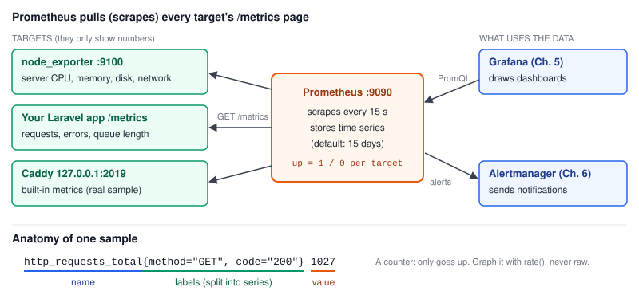

# Chapter 4 — Metrics and Prometheus

> **Course:** Monitoring & Logging · **Chapter:** 4 of 8
> Read on the website: [learn.bazardev.com/monitoring/04-metrics-and-prometheus](https://learn.bazardev.com/monitoring/04-metrics-and-prometheus)
>
> 🇧🇩 **Prefer Bangla?** [Read this chapter in Bangla →](https://learn.bazardev.com/monitoring/04-metrics-and-prometheus?lang=bn)

In Chapter 2 you ran `uptime` and `free -h` by hand. That tells you the state **right now**, but you cannot ask it "what was the load at 3 a.m.?" or "is memory slowly growing?". For that, a program must collect the same numbers **every few seconds, forever**, and store them. That program is **Prometheus**, the most widely used free monitoring system.

> **Honesty note: what was and was not run.** Prometheus and `node_exporter` are **not installed on the server used to write this course**, and nothing was installed for it. So the Prometheus config and queries below are written from the official documentation and are **not executed**. The YAML was checked to be valid, and every external link was checked. What *was* run is real: **Caddy**, the web server on that machine, already publishes metrics in Prometheus's own format on a local-only address, so the "real output" samples and the `rate()` demonstration in this chapter come from it (read-only `curl`, nothing changed). Package versions and exact output will differ on your server.



## 1. What is a metric?

A **metric** is a number that changes over time. Every sample Prometheus stores has four parts:

```
http_requests_total{method="GET", code="200"}   1027      (at 14:05:15)
└─────── name ───────┘└──── labels ────────────┘ └value┘  └ timestamp ┘
```

- **Name:** what is measured (`http_requests_total`).
- **Labels:** key/value tags that split one metric into many **series**. `method="GET"` and `method="POST"` are two different series of the same metric.
- **Value:** a number.
- **Timestamp:** when it was collected (added by Prometheus).

A series is just *a list of (time, number) pairs*. A graph is a series drawn on a chart. That is all a dashboard is.

## 2. The pull model: Prometheus comes to you

Many older systems make each server **push** its numbers to a central place. Prometheus does the opposite. It **pulls** (**scrapes**): every `scrape_interval` (often **15 seconds**) it makes an ordinary HTTP request to each **target** and reads a text page, usually at `/metrics`.

Why this design is useful:

- **You notice dead targets.** If a target does not answer, Prometheus records `up = 0` for it. A pushing server that crashes just goes quiet, and silence is easy to miss.
- **Targets stay simple.** An app only has to *show* its numbers on a web page. It does not need to know where Prometheus is.
- **You can look yourself:** `curl` the page and read it, like any web page.

The special metric **`up`** is created for every target: `1` means the last scrape worked, `0` means it failed. `up == 0` is the simplest, most important alert you will ever write (Chapter 6).

## 3. What a `/metrics` page looks like

Here is **real output** from the Caddy web server on the machine used for this course. Caddy's admin interface listens on `127.0.0.1:2019` (local only) and serves metrics at `/metrics`:

```bash
curl -s http://localhost:2019/metrics | grep caddy_
```

(An excerpt: a few metrics are left out to keep it short.)

```
# HELP caddy_admin_http_requests_total Counter of requests made to the Admin API's HTTP endpoints.
# TYPE caddy_admin_http_requests_total counter
caddy_admin_http_requests_total{code="200",handler="admin",method="GET",path="/metrics"} 1
caddy_admin_http_requests_total{code="200",handler="admin",method="POST",path="/load"} 24
# HELP caddy_config_last_reload_successful Whether the last configuration reload attempt was successful.
# TYPE caddy_config_last_reload_successful gauge
caddy_config_last_reload_successful 1
# HELP caddy_reverse_proxy_upstreams_healthy Health status of reverse proxy upstreams.
# TYPE caddy_reverse_proxy_upstreams_healthy gauge
caddy_reverse_proxy_upstreams_healthy{upstream="127.0.0.1:8080"} 1
caddy_reverse_proxy_upstreams_healthy{upstream="unix//run/php/php8.3-fpm.sock"} 1
```

This plain-text layout is called the **exposition format**. Each metric has:

- `# HELP`: a one-line description,
- `# TYPE`: its type (next section),
- then one line per series: `name{labels} value`.

Anything that can print this text on a web page can be monitored by Prometheus. A program that does this *for* another program is called an **exporter**.

## 4. The four metric types

| Type | What it is | Goes | Example |
|---|---|---|---|
| **Counter** | A number that only **goes up** (resets to 0 on restart) | ↗ | requests served, errors, bytes sent |
| **Gauge** | A number that goes **up and down** | ↕ | memory in use, queue length, temperature |
| **Histogram** | Counts of observations in **buckets**, for percentiles | | request duration |
| **Summary** | Percentiles calculated **inside** the app | | GC pause time |

Real examples from the same Caddy page:

```
# TYPE caddy_admin_http_requests_total counter
caddy_admin_http_requests_total{code="200",handler="admin",method="POST",path="/load"} 24

# TYPE go_goroutines gauge
go_goroutines 51

# TYPE process_resident_memory_bytes gauge
process_resident_memory_bytes 6.5118208e+07        # about 62 MiB (scientific notation)
```

A **histogram** (this one is an **illustration**, not from that server) records how many requests were *at most* a given duration. The `le` label means "less than or equal":

```
http_request_duration_seconds_bucket{le="0.1"}  8421     # 8421 requests took <= 0.1 s
http_request_duration_seconds_bucket{le="0.5"}  9790     # 9790 took <= 0.5 s
http_request_duration_seconds_bucket{le="+Inf"} 9800     # all 9800
http_request_duration_seconds_sum   1432.7                # total seconds
http_request_duration_seconds_count 9800                  # total requests
```

From these buckets Prometheus can estimate the **p99** you met in Chapter 1 (`histogram_quantile`). This is how "99% of requests finished within X seconds" is measured.

## 5. Counters and `rate()`: the most important idea

A counter such as `process_cpu_seconds_total` (CPU time used since the process started) only grows. A graph of it is a line that climbs forever, which tells you almost nothing. What you want is **how fast it grows**: that is **`rate()`**.

Let us do by hand what `rate()` does. Scrape the same counter twice, 15 seconds apart, on the real Caddy page:

```bash
curl -s http://localhost:2019/metrics | grep '^process_cpu_seconds_total '
# process_cpu_seconds_total 3277.79        (scrape 1)
# ... wait 15 seconds ...
# process_cpu_seconds_total 3277.8         (scrape 2)
```

```
increase = 3277.80 - 3277.79        = 0.010 CPU-seconds
rate     = 0.010 / 15 seconds        = 0.0007 CPU-seconds per second
```

`0.0007` CPU-seconds per second means Caddy used **0.07% of one CPU core** in that window. It was nearly idle, so the number is tiny, but the method is the point: **a rate is the difference between two scrapes, divided by the time between them.** In PromQL:

```
rate(process_cpu_seconds_total[5m])      # average per-second rate over the last 5 minutes
increase(http_requests_total[1h])        # how many requests in the last hour
```

**Rule:** never graph a raw counter. Wrap it in `rate()` or `increase()`. (A counter that resets when a program restarts is handled for you: `rate()` understands resets.)

## 6. Labels, and the cardinality trap

Labels are powerful: `sum by (method) (rate(http_requests_total[5m]))` gives requests per second for each method. But **every different label value creates a new series**, and each series costs memory and disk.

- **Good labels** have a small, fixed set of values: `method`, `status code`, `route name`, `server`.
- **Bad labels** are unbounded: `user_id`, `email`, `order_id`, a full URL with ids in it. A million users would create a million series and can crash Prometheus. This problem is called **high cardinality**.

User-specific details belong in **logs** (Chapter 3), not in metric labels.

## 7. `node_exporter`: the server's own numbers

For the CPU, memory, disk and network numbers from Chapter 2, you do not write anything. **`node_exporter`** is a small program, run on each server, that reads `/proc` and `/sys` and publishes the results on port **9100** (its default):

| Metric | Meaning |
|---|---|
| `node_cpu_seconds_total{mode="idle"}` | CPU time spent idle, per core (a counter: use `rate`) |
| `node_load1`, `node_load5`, `node_load15` | The load averages from Chapter 2 |
| `node_memory_MemAvailable_bytes` | The **available** memory (the number to trust) |
| `node_memory_MemTotal_bytes` | Total memory |
| `node_filesystem_avail_bytes`, `node_filesystem_size_bytes` | Free and total disk space |
| `node_network_receive_bytes_total` | Bytes received (a counter) |

On Ubuntu, `node_exporter` and Prometheus are available as packages (`prometheus-node-exporter` and `prometheus`; on the machine used for this course, `apt-cache policy` listed versions 1.10.2 and 2.53.5, but your Ubuntu release may differ). You would install them with `sudo apt install prometheus prometheus-node-exporter`. **(This was not run for this chapter.)**

> **Security: do not expose port 9100 to the internet.** A metrics page reveals a lot about your server (versions, mounts, load). Let it listen on `127.0.0.1` (if Prometheus runs on the same machine) or on a **private network address**, and keep the firewall closed to the public. The flag is `--web.listen-address` (see `node_exporter --help`; on a packaged install, `systemctl cat prometheus-node-exporter` shows where its arguments are set). Check what is listening with `ss -tlnp` from Chapter 2.

## 8. Configuring Prometheus

Prometheus is configured by one YAML file, `prometheus.yml`. A small, valid starting point that scrapes Prometheus itself, one server, and a Laravel app:

```yaml
global:
  scrape_interval: 15s        # how often to scrape
  evaluation_interval: 15s    # how often to evaluate alert rules (Chapter 6)

scrape_configs:
  - job_name: prometheus
    static_configs:
      - targets: ["localhost:9090"]

  - job_name: node
    static_configs:
      - targets: ["localhost:9100"]
        labels:
          server: web-1

  - job_name: myshop
    metrics_path: /metrics
    static_configs:
      - targets: ["127.0.0.1:8080"]
```

Each `job_name` groups targets; Prometheus adds `job` and `instance` labels to every series automatically. Prometheus keeps data in its own on-disk database and, by default, **deletes data older than 15 days** (`--storage.tsdb.retention.time`). Set a larger value, or a size limit, if you want a longer history. Always check the file before reloading: `promtool check config prometheus.yml` (the checking tool that comes with Prometheus).

You can open Prometheus's web page (port **9090**) and type queries into its **Expression browser**. Keep that port private too.

## 9. Your first PromQL

**PromQL** is Prometheus's query language. Two things to know first:

- An **instant vector** is "the latest value of each series": `node_load1`.
- A **range vector** is "the values over a time window", written with `[5m]`: `node_cpu_seconds_total[5m]`. You cannot graph it directly; you feed it to a function like `rate()`.

Useful, standard queries (adapted from the official `node_exporter` guide and docs; **not executed here**):

```promql
up                                                   # 1 = target alive, 0 = dead
up == 0                                              # only the dead ones

# CPU used, percent (100 minus the idle share), averaged over each server's cores
100 - (avg by (instance) (rate(node_cpu_seconds_total{mode="idle"}[5m])) * 100)

# Memory used, percent (uses "available", as in Chapter 2)
(1 - node_memory_MemAvailable_bytes / node_memory_MemTotal_bytes) * 100

# Disk used, percent, ignoring RAM-backed filesystems
(1 - node_filesystem_avail_bytes{fstype!~"tmpfs|overlay"}
   / node_filesystem_size_bytes{fstype!~"tmpfs|overlay"}) * 100

# Requests per second, per HTTP method
sum by (method) (rate(http_requests_total[5m]))

# 99th percentile latency from a histogram
histogram_quantile(0.99, sum by (le) (rate(http_request_duration_seconds_bucket[5m])))
```

Reading these:

- `{mode="idle"}` is a **label matcher**: only series whose `mode` is exactly `idle`. `=~` and `!~` match a pattern.
- `avg by (instance)` is an **aggregation**: combine many series into one per `instance`.
- Everything inside `[5m]` is a window, so a longer window is smoother but reacts later.

The CPU query says: *the fraction of time the CPU was idle, subtracted from 100*. It is the "id" number in `top` (Chapter 2), now measured continuously.

## 10. Metrics from your own application and other services

- **Your Laravel app:** add a Prometheus client library that exposes a `/metrics` route, for example [`spatie/laravel-prometheus`](https://github.com/spatie/laravel-prometheus) or the lower-level PHP client [`promphp/prometheus_client_php`](https://github.com/PromPHP/prometheus_client_php). Protect the route (allow only Prometheus's IP, or a private network): it is not for the public.
- **Other services** have ready-made exporters, so you do not write one: [`mysqld_exporter`](https://github.com/prometheus/mysqld_exporter) (MySQL), [`redis_exporter`](https://github.com/oliver006/redis_exporter) (Redis), [`php-fpm_exporter`](https://github.com/hipages/php-fpm_exporter) (PHP-FPM), and [`blackbox_exporter`](https://github.com/prometheus/blackbox_exporter), which checks a site from the **outside** (HTTP, ping, TLS expiry), the black-box check from Chapter 1.
- **Some software already has it built in**, like the Caddy example above.

Good first things to measure in your app: request rate, error rate (5xx), request duration, queue length, failed jobs. These are the four golden signals from Chapter 1.

## 11. What Prometheus is not

- It stores **numbers over time**, not log text. For logs you will use Loki or similar (Chapter 7).
- A single Prometheus is one machine with local disk: great for a small team's servers, but it is not a long-term, highly available archive by itself.
- It does not draw nice dashboards. That is **Grafana** (Chapter 5). It does not send notifications by itself. That is **Alertmanager** (Chapter 6).

## 12. Key takeaways

- A **metric** is a name, labels, a number and a time. A **series** is those numbers over time.
- Prometheus **pulls** (scrapes) `/metrics` from each target every ~15 s. The built-in **`up`** metric says whether a target answered.
- Four types: **counter** (only up), **gauge** (up and down), **histogram** and **summary** (percentiles).
- **Never graph a raw counter.** Use **`rate()`** or **`increase()`**: the change between scrapes divided by the time.
- Keep **labels low-cardinality**. User ids and emails belong in logs, not labels.
- **`node_exporter`** (port 9100) gives CPU, memory, disk and network. Keep exporter ports **private**.
- PromQL basics: instant vs range vectors, label matchers, `rate`, `sum by`, `histogram_quantile`.
- Prometheus stores numbers (default 15 days); Grafana draws; Alertmanager notifies.

## 13. Test yourself (exam prep)

<details>
<summary><strong>Q1. Does Prometheus push metrics or pull them? Why does it matter?</strong></summary>

It **pulls** (scrapes) each target's `/metrics` page. Because of that, a target that dies is noticed (`up = 0`) instead of just going quiet, and targets stay simple.
</details>

<details>
<summary><strong>Q2. What does `up == 0` tell you?</strong></summary>

The last scrape of that target failed: it is down, unreachable, or not serving `/metrics`.
</details>

<details>
<summary><strong>Q3. Which metric type fits "memory in use", and which fits "total requests served"?</strong></summary>

Memory in use is a **gauge** (goes up and down). Total requests served is a **counter** (only goes up).
</details>

<details>
<summary><strong>Q4. Why should you not graph a raw counter?</strong></summary>

It only climbs, so the line shows almost nothing useful. Use `rate()` (per second) or `increase()` (over a period) to see how fast it changes.
</details>

<details>
<summary><strong>Q5. A counter read 3277.79 and, 15 seconds later, 3277.80. What is its rate?</strong></summary>

(3277.80 − 3277.79) / 15 ≈ 0.0007 per second. A rate is the difference between two scrapes divided by the time between them.
</details>

<details>
<summary><strong>Q6. Why is a `user_id` label a bad idea?</strong></summary>

Every distinct value creates a new series. With many users that is a huge number of series (high cardinality), which uses a lot of memory and can crash Prometheus. Put per-user detail in logs.
</details>

<details>
<summary><strong>Q7. What does `node_exporter` do, and on which port?</strong></summary>

It reads the server's CPU, memory, disk and network figures and publishes them as metrics on port 9100 by default, for Prometheus to scrape.
</details>

<details>
<summary><strong>Q8. Why should port 9100 not be open to the whole internet?</strong></summary>

The metrics page exposes details about your server. Bind it to `127.0.0.1` or a private address and keep the firewall closed to the public.
</details>

<details>
<summary><strong>Q9. What is the difference between an instant vector and a range vector?</strong></summary>

An instant vector is the latest value of each series (`node_load1`). A range vector is the values over a time window (`node_cpu_seconds_total[5m]`) and must be passed to a function such as `rate()`.
</details>

## 14. Free resources

- Prometheus docs: [Overview](https://prometheus.io/docs/introduction/overview/) and [Data model](https://prometheus.io/docs/concepts/data_model/)
- [Metric types](https://prometheus.io/docs/concepts/metric_types/) (counter, gauge, histogram, summary)
- [Querying basics (PromQL)](https://prometheus.io/docs/prometheus/latest/querying/basics/)
- [Configuration reference](https://prometheus.io/docs/prometheus/latest/configuration/configuration/)
- Hands-on guide: [Monitoring Linux host metrics with the Node Exporter](https://prometheus.io/docs/guides/node-exporter/)
- [Metric and label naming](https://prometheus.io/docs/practices/naming/) and [Instrumentation practices](https://prometheus.io/docs/practices/instrumentation/)
- Caddy: [Metrics](https://caddyserver.com/docs/metrics) (the source of this chapter's real samples)
- [`node_exporter` on GitHub](https://github.com/prometheus/node_exporter)

---

**Next:** Chapter 5 — Grafana dashboards *(coming soon)*
