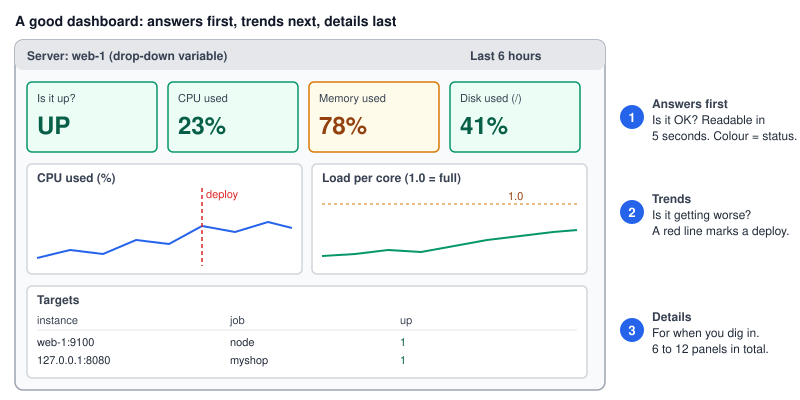

# Chapter 5 — Grafana Dashboards

> **Course:** Monitoring & Logging · **Chapter:** 5 of 8
> Read on the website: [learn.bazardev.com/monitoring/05-grafana-dashboards](https://learn.bazardev.com/monitoring/05-grafana-dashboards)
>
> 🇧🇩 **Prefer Bangla?** [Read this chapter in Bangla →](https://learn.bazardev.com/monitoring/05-grafana-dashboards?lang=bn)

Prometheus (Chapter 4) is excellent at **collecting and answering** questions, but its own web page is a query box, not something you would put on a TV for your team. **Grafana** is the tool that turns those numbers into **dashboards**: charts, big status numbers and colour-coded warnings, all on one screen. Prometheus *stores*; Grafana *draws*.

> **Honesty note: what was and was not run.** Grafana is **not installed on the server used to write this course**, and nothing was installed for it. So the steps in this chapter are written from Grafana's official documentation and are **not executed**; menu names change between Grafana versions, so use the linked docs for your version. What *was* checked: Grafana's own default settings (read from its source repository), the provisioning formats, and that every YAML, `.ini` and Caddyfile snippet below is valid (parsed by a tool; the Caddyfile was checked with `caddy adapt`). Every external link was opened. The PromQL queries are the standard ones from Chapter 4 and were not executed.



## 1. What Grafana does (and does not do)

- Grafana **does not collect or store your metrics.** It connects to a **data source** (Prometheus, and later Loki for logs, or even a MySQL database) and asks it questions when you open a dashboard.
- A **dashboard** is a page made of **panels**. Each panel is one query plus a way to draw the result.
- Because it only *reads*, you can delete and rebuild a dashboard without losing any data. The numbers still live safely in Prometheus.

## 2. Getting Grafana (a plan, not run here)

On the machine used for this course, `apt-cache policy grafana` finds nothing: Grafana is not in Ubuntu's own package lists. Grafana Labs publishes its own **apt repository** (`apt.grafana.com`), and the official [Debian/Ubuntu install page](https://grafana.com/docs/grafana/latest/setup-grafana/installation/debian/) gives the exact, current commands (adding the signing key and the repository). Follow that page rather than copying commands from an article, because the details change. It can also run in Docker.

From Grafana's own default configuration (`conf/defaults.ini` in its repository):

| Setting | Default | Why it matters |
|---|---|---|
| `http_port` | `3000` | The web page is on port 3000 |
| `admin_user` / `admin_password` | `admin` / `admin` | **Change this on first login**, before anything else |
| `http_addr` | *empty* | Empty means **all network interfaces**. Port 3000 would be open to the internet unless the firewall blocks it |
| `[auth.anonymous] enabled` | `false` | Good: nobody can view dashboards without logging in |

## 3. Keep Grafana safe

A dashboard shows how your system works, so treat it as sensitive.

1. **Change the `admin`/`admin` password immediately** on the first login (Grafana normally offers a screen for it; if you skip it, change it under your profile).
2. **Do not leave port 3000 open.** Make Grafana listen only on the local machine and put **Caddy** (or Nginx) in front, which also gives you **HTTPS**:

```ini
# /etc/grafana/grafana.ini  (the main settings file on a package install)
[server]
http_addr = 127.0.0.1
http_port = 3000
domain = grafana.example.com
root_url = https://grafana.example.com/

[auth.anonymous]
enabled = false
```

```
# Caddyfile
grafana.example.com {
	reverse_proxy 127.0.0.1:3000
}
```

Caddy gets and renews the HTTPS certificate for that name automatically (the DNS record must point to your server, as in the Cloud course). Keep Prometheus (port 9090) and exporters (9100) **private** too; only Grafana, behind HTTPS and a login, is reachable.

3. **Never put secrets in a file you commit.** Grafana's admin password and API tokens go in environment variables or a secrets store, not in Git.

## 4. Connect Grafana to Prometheus

In the web interface you add a **data source**: in recent versions this is under **Connections → Data sources → Add data source → Prometheus** (the wording differs between versions). Set the **URL** to where Prometheus listens, for example `http://localhost:9090` when both run on the same machine, and press **Save & test**. A green message means Grafana can reach it.

The same thing as a **file** (Grafana's "provisioning" feature reads it at startup, so the setup is repeatable and can live in Git). This format is from the official Prometheus data source documentation:

```yaml
# /etc/grafana/provisioning/datasources/prometheus.yml
apiVersion: 1
datasources:
  - name: Prometheus
    type: prometheus
    access: proxy
    url: http://localhost:9090
    isDefault: true
```

`access: proxy` means Grafana's server makes the request to Prometheus (your browser never talks to Prometheus directly), which is what keeps Prometheus private.

## 5. Explore first, then build

Before making a panel, try the query in **Explore** (the compass icon). It is a scratch area: type PromQL, see the graph, adjust. When a query shows what you want, you save it as a panel. This is the fastest way to learn PromQL, and it stops you from filling a dashboard with queries you have never looked at.

## 6. Panel types: pick the one that answers the question

| Panel | Best for | Example |
|---|---|---|
| **Time series** | How something **changed over time** | CPU % over the last 6 hours |
| **Stat** | One big number, optionally coloured | Is the site up? (1 or 0), current memory % |
| **Gauge / Bar gauge** | A value against its limit | Disk used per mount point |
| **Table** | Exact values to compare | Top processes, list of targets and their `up` |
| **Heatmap** | Distribution over time (histograms) | Request duration buckets |
| **State timeline** | When something was in each state | Service up/down over a day |
| **Logs** | Log lines (needs a logs data source, Chapter 7) | Recent errors |

Rule of thumb: **time series for "is it getting worse?", stat or gauge for "is it OK right now?"**.

## 7. Your first dashboard: one server

Start with **six panels**. These use the standard `node_exporter` queries from Chapter 4. (Set each panel's **unit**: `Percent (0-100)`, `bytes`, and so on, so the axis reads correctly.)

| # | Title | Panel | PromQL | Unit |
|---|---|---|---|---|
| 1 | Is it up? | Stat | `up{job="node"}` | none (map 1 = UP, 0 = DOWN) |
| 2 | CPU used | Time series | `100 - (avg by (instance) (rate(node_cpu_seconds_total{mode="idle"}[$__rate_interval])) * 100)` | Percent (0-100) |
| 3 | Memory used | Gauge | `(1 - node_memory_MemAvailable_bytes / node_memory_MemTotal_bytes) * 100` | Percent (0-100) |
| 4 | Disk used (/) | Gauge | `(1 - node_filesystem_avail_bytes{mountpoint="/"} / node_filesystem_size_bytes{mountpoint="/"}) * 100` | Percent (0-100) |
| 5 | Load per core | Time series | `node_load1 / on (instance) count by (instance) (node_cpu_seconds_total{mode="idle"})` | none |
| 6 | Network received | Time series | `rate(node_network_receive_bytes_total{device!="lo"}[$__rate_interval])` | bytes/sec |

Notes on the queries:

- **`$__rate_interval`** is a Grafana variable. Instead of hard-coding `[5m]`, Grafana chooses a window that fits the scrape interval and the zoom level, so graphs stay correct when you zoom in or out. Use it inside `rate()`.
- **Load per core** (panel 5) is the load average from Chapter 2 divided by the number of cores, so **1.0 means "full"** on any server size. A raw load of 6 means nothing until you know the core count. The `on (instance)` part tells Prometheus to match the two sides by their `instance` label only: without it, the left side has extra labels (like `job`) and the division would return nothing.
- **Disk** (panel 4) looks at the root filesystem `/`. To see every disk, drop the `mountpoint="/"` filter (and then filter out RAM-backed ones with `fstype`, as in Chapter 4).
- Memory uses **available**, the number to trust (Chapter 2).

### Thresholds: let colour do the reading

In each panel you can set **thresholds**: the colour changes at the values you choose. Use the warning levels from Chapter 2, for example for memory and disk: **green** below 70, **yellow** from 70, **red** from 90. A tired person at 2 a.m. should be able to see a red box before reading a single number. (See the [thresholds documentation](https://grafana.com/docs/grafana/latest/panels-visualizations/configure-thresholds/).)

## 8. Variables: one dashboard for many servers

If you have three servers, do not copy the dashboard three times. Add a **variable** (**Dashboard settings → Variables**): a drop-down at the top of the page. A **Query** variable with the query type **Label values** (label `instance`, metric `up`, with a label filter `job="node"`) fills it with every server. Older tutorials write the same thing in the legacy form `label_values(up{job="node"}, instance)`.

Then use the variable in your panels:

```
node_load1{instance="$instance"}
```

Now one dashboard shows whichever server you pick. Variables are documented in Grafana's [variables guide](https://grafana.com/docs/grafana/latest/dashboards/variables/).

## 9. What makes a dashboard good

A dashboard that shows everything shows nothing. Rules that work:

1. **Answers first.** The top row should say "is it OK?" in five seconds: up/down, error rate, the few big gauges. Detail goes lower.
2. **Fewer panels.** Roughly 6 to 12. If you need more, make a second dashboard for a different question ("database", "queue") and link them.
3. **Measure what the user feels.** For a service use the **RED** method (**R**ate, **E**rrors, **D**uration, the golden signals from Chapter 1). For a machine use the **USE** method (**U**tilization, **S**aturation, **E**rrors) for each resource. See the two links in the resources.
4. **One unit and one colour meaning.** Always percent, always bytes. Red always means bad; never use red for "a big number".
5. **Same time range, same axis.** Panels that sit together should be comparable at a glance.
6. **Name panels like questions.** "Disk used (%)" tells the story; "Panel 4" does not. Add a short description under a panel when the number needs context.
7. **Mark events.** Annotations (a vertical line on every chart) for deploys and restarts make "it broke right after the deploy" obvious.

And remember the limit: **a dashboard only helps if someone looks at it.** At 3 a.m. nobody does. That is the job of **alerts** (Chapter 6).

## 10. Don't start from zero: import a ready-made dashboard

The community shares dashboards at [grafana.com/grafana/dashboards](https://grafana.com/grafana/dashboards/). A very popular one for `node_exporter` is **"Node Exporter Full"** (ID **1860**): hundreds of ready-made panels for CPU, memory, disk and network. In Grafana: **Dashboards → New → Import**, type the ID, choose your Prometheus data source. ([Import guide](https://grafana.com/docs/grafana/latest/dashboards/build-dashboards/import-dashboards/).)

Two cautions:

- It is **more than you need**. Use it to explore, then build your own small "answers first" dashboard from the panels that matter to you.
- An imported dashboard is JSON written by someone else. Take it from a source you trust, and check it before you rely on it.

## 11. Dashboards as code

A dashboard you built by clicking exists only inside Grafana. If the server dies, it is gone. Better: **export it as JSON** (the share/export button), keep the file in **Git** (as you learned in the Git course), and let Grafana load it from disk with **provisioning**. The format below is from Grafana's provisioning documentation:

```yaml
# /etc/grafana/provisioning/dashboards/myshop.yml
apiVersion: 1
providers:
  - name: "myshop"
    orgId: 1
    folder: "MyShop"
    type: file
    disableDeletion: false
    updateIntervalSeconds: 30
    allowUiUpdates: false
    options:
      path: /var/lib/grafana/dashboards
```

Grafana scans that folder every `updateIntervalSeconds` and loads any dashboard JSON it finds. With `allowUiUpdates: false`, people cannot edit and save the provisioned dashboard in the browser: to change it you edit the file and commit it. Now your dashboards are reviewed, versioned and repeatable, like any other code.

## 12. Key takeaways

- **Prometheus stores, Grafana draws.** Grafana connects to a **data source** and runs your queries when you open a page.
- Defaults to change: **port 3000 is open on all interfaces** and the login is **`admin`/`admin`**. Change the password, bind to `127.0.0.1`, and put HTTPS (Caddy) in front.
- Try queries in **Explore** first. Pick the **panel type** that answers the question: time series for trends, stat/gauge for "is it OK now".
- Use **`$__rate_interval`** inside `rate()`, set **units**, and use **thresholds** so colour does the reading.
- **Variables** let one dashboard serve many servers.
- A good dashboard: **answers first, 6 to 12 panels, one unit, red means bad**, panels named like questions.
- Import a community dashboard (such as ID 1860) to learn, then build your own small one.
- Keep dashboards **as code in Git** (provisioning). And remember: dashboards are for looking; **alerts** are for waking you up.

## 13. Test yourself (exam prep)

<details>
<summary><strong>Q1. Does Grafana store your metrics?</strong></summary>

No. Grafana connects to a data source such as Prometheus and runs queries when you open a dashboard. Prometheus stores the numbers; Grafana draws them.
</details>

<details>
<summary><strong>Q2. Name two Grafana defaults you should change or restrict, and how.</strong></summary>

The default login `admin`/`admin` (change the password at first login), and port 3000 listening on all interfaces (set `http_addr = 127.0.0.1` and put Caddy with HTTPS in front, with the firewall closed to 3000).
</details>

<details>
<summary><strong>Q3. What is the benefit of `access: proxy` in the data source file?</strong></summary>

Grafana's server makes the request to Prometheus, so a user's browser never talks to Prometheus directly and Prometheus can stay private.
</details>

<details>
<summary><strong>Q4. Which panel type suits "how did CPU change over the last 6 hours", and which suits "is the site up right now"?</strong></summary>

A time series panel for the CPU trend, and a stat panel for the up/down status.
</details>

<details>
<summary><strong>Q5. Why write `rate(...[$__rate_interval])` instead of `[5m]`?</strong></summary>

Grafana picks a window that fits the scrape interval and the zoom level, so graphs stay correct when you zoom in or out, instead of using one fixed window for everything.
</details>

<details>
<summary><strong>Q6. Why divide the load average by the number of cores in a panel?</strong></summary>

So that 1.0 means "full" on any server size. A raw load of 6 is fine on a 12-core machine and overloaded on a 2-core one.
</details>

<details>
<summary><strong>Q7. What is a dashboard variable useful for?</strong></summary>

It adds a drop-down (for example the server name) so one dashboard can show any server, instead of copying the dashboard for each one.
</details>

<details>
<summary><strong>Q8. Give three rules of a good dashboard.</strong></summary>

For example: answers first at the top; roughly 6 to 12 panels; one unit and one meaning for red; panels named like questions; use RED for services and USE for machines.
</details>

<details>
<summary><strong>Q9. Why keep dashboards as JSON files in Git using provisioning?</strong></summary>

A dashboard built only by clicking lives inside Grafana and is lost if the server dies. Files in Git are versioned, reviewable and repeatable.
</details>

## 14. Free resources

- Grafana docs: [Prometheus data source](https://grafana.com/docs/grafana/latest/datasources/prometheus/) and [Install on Debian/Ubuntu](https://grafana.com/docs/grafana/latest/setup-grafana/installation/debian/)
- [Configure Grafana](https://grafana.com/docs/grafana/latest/setup-grafana/configure-grafana/) (every setting, including `http_addr`)
- [Visualizations](https://grafana.com/docs/grafana/latest/panels-visualizations/visualizations/) and [Explore](https://grafana.com/docs/grafana/latest/explore/)
- [Dashboard best practices](https://grafana.com/docs/grafana/latest/dashboards/build-dashboards/best-practices/)
- [Variables](https://grafana.com/docs/grafana/latest/dashboards/variables/) and [Provisioning](https://grafana.com/docs/grafana/latest/administration/provisioning/)
- Community dashboards: [Node Exporter Full (ID 1860)](https://grafana.com/grafana/dashboards/1860-node-exporter-full/)
- The two methods: [The RED Method](https://grafana.com/blog/2018/08/02/the-red-method-how-to-instrument-your-services/) and Brendan Gregg's [USE Method](https://www.brendangregg.com/usemethod.html)
- Caddy: [`reverse_proxy`](https://caddyserver.com/docs/caddyfile/directives/reverse_proxy)

---

**Next:** [Chapter 6 — Alerting That Helps Instead of Annoys](06-alerting.md)
